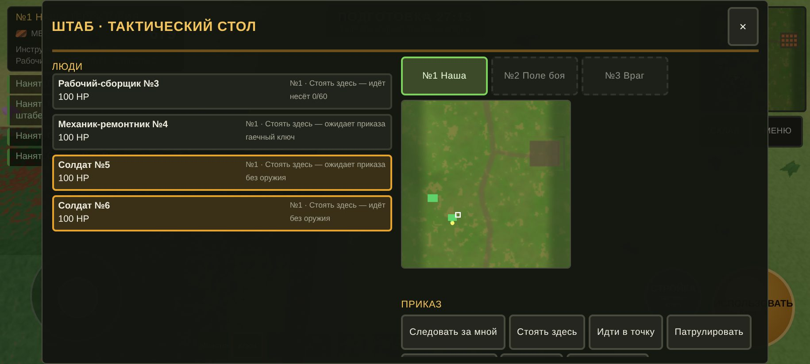
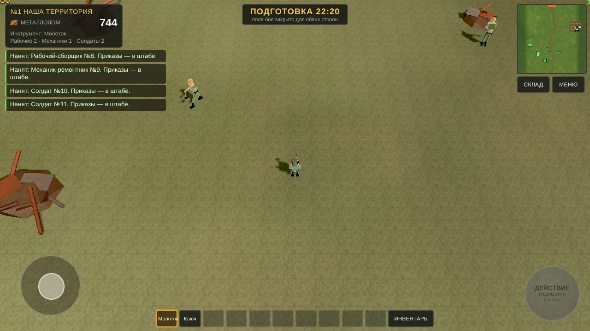
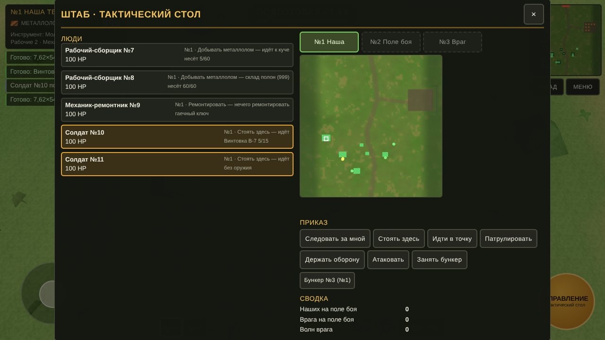
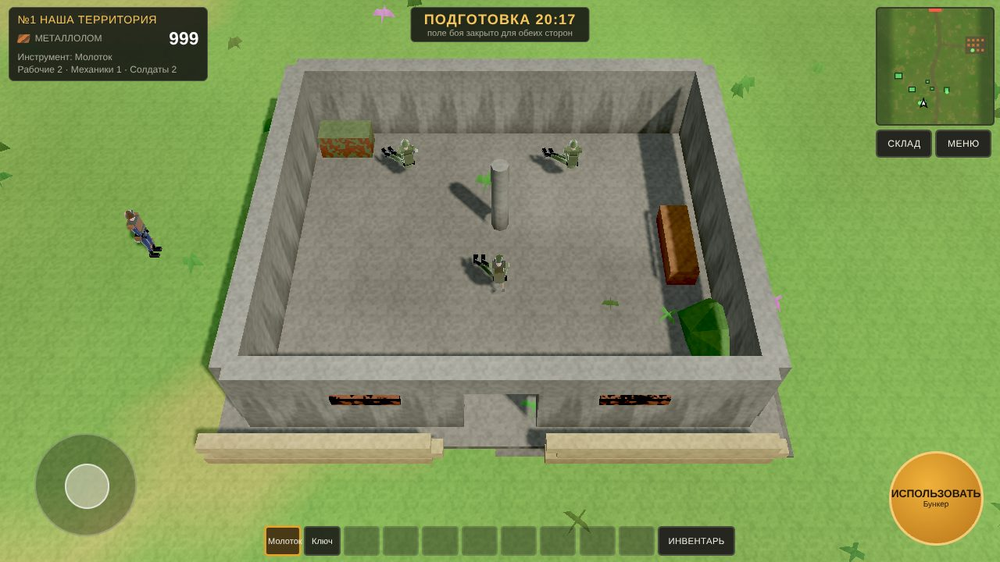
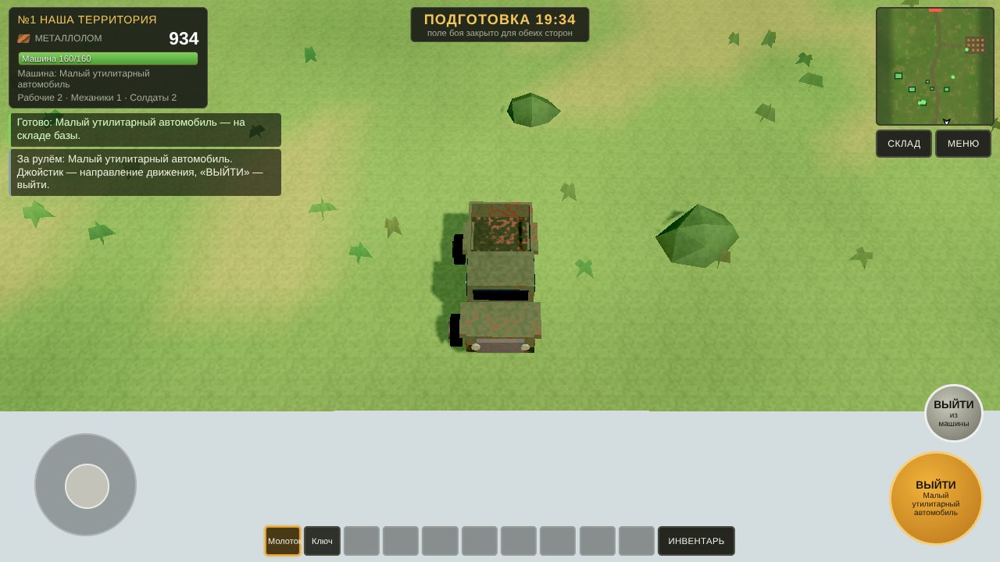
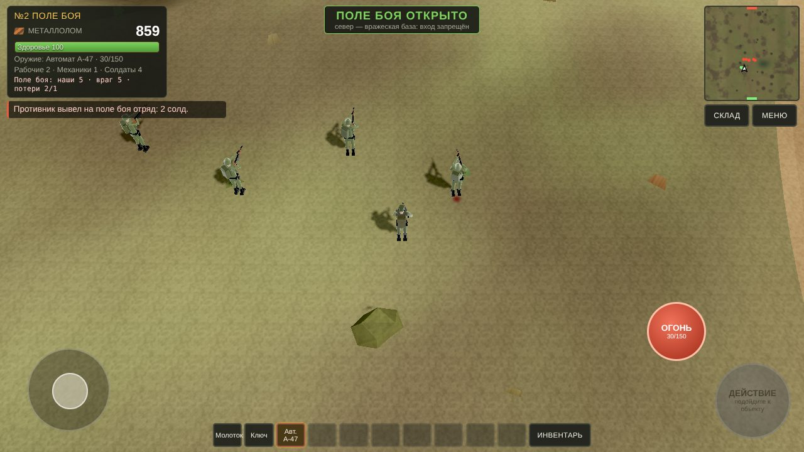
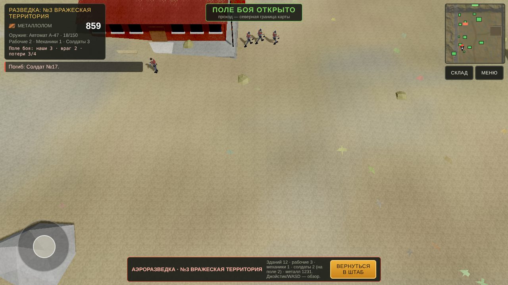
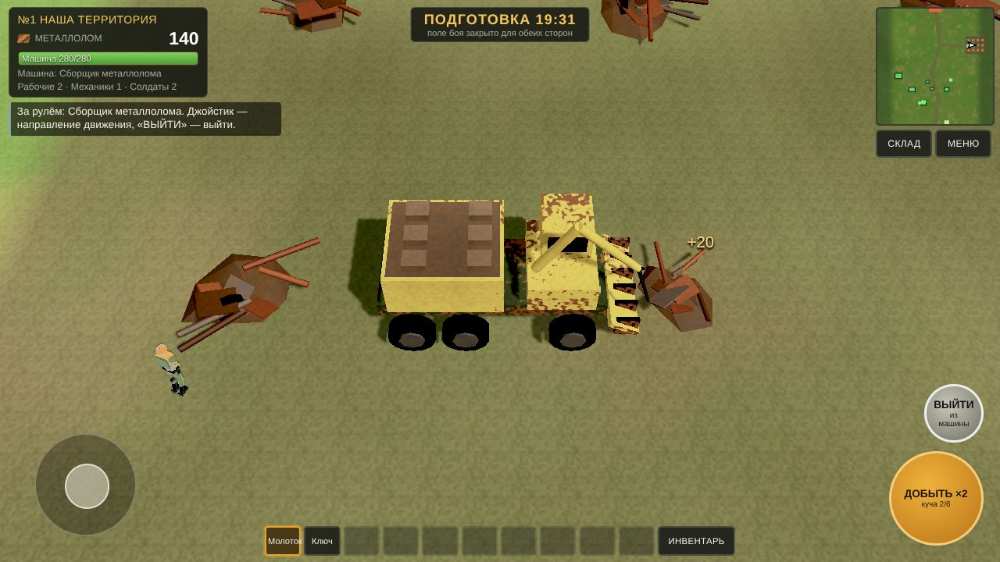
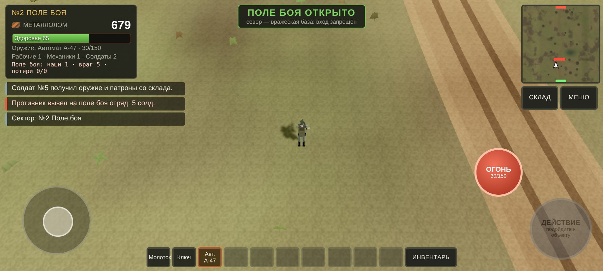
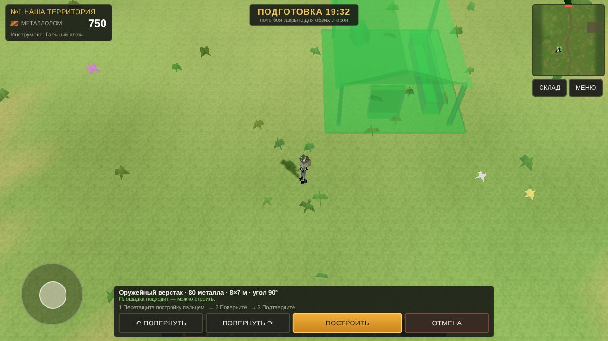

# Линия снабжения

Одиночная мобильная военно-экономическая игра. Три сектора 300 × 300 м:

| № | Сектор | Доступ игрока |
|---|---|---|
| 1 | Наша база — поле металлолома (12 куч), стройка, производство, найм | всегда |
| 2 | Поле боя — здесь воюют обе стороны | только после 30:00 подготовки, через северную границу №1 (пешком или на машине) |
| 3 | Вражеская база — у врага своя экономика | никогда (с №2 на север не пускает); видна только с аэроразведки из штаба |

Первые **1800 секунд активной игры** — фаза подготовки: поле боя закрыто для обеих сторон. Игрок добывает металлолом молотком, строит здания гаечным ключом, производит оружие, патроны и технику, нанимает людей. Враг всё это время развивается сам по правилам `data/enemy_ai.json`, а после 30:00 выводит на поле боя волны из реально нанятых и вооружённых солдат.

Игра работает на **собственном веб-движке** этого репозитория (JavaScript + WebGL2, без Godot и сторонних библиотек). Логика врага перенесена из `Godot_Starter` пакета постановки один в один: расчёты совпадают с эталоном. Постановка задачи из архива — в `spec/`.



## Как запустить

```bash
cd rubin
python3 -m http.server 8080
# ПК:      http://localhost:8080/
# Телефон: http://<IP-компьютера>:8080/  — повернуть горизонтально
```

Сборка не нужна. Нужен браузер с WebGL2 (Chrome/Edge/Firefox, Safari 15+, Chrome на Android 8+). Прогресс сохраняется в браузере сам (раз в 10 с, при смене сектора и при сворачивании); новая кампания — в главном меню или в меню паузы.

Автотесты (нужны Node и Playwright с Chromium):

```bash
python3 -m http.server 8765 --bind 127.0.0.1 &
node tools/test_stages_1_5.js out/   # этапы 1–5: 40 проверок + скриншоты
node tools/test_stages_6_7.js out/   # этапы 6–7а и техника: 28 проверок + скриншоты
python3 tools/make_test_glb.py out/glb && node tools/test_glb.js out/glb out/   # загрузчик GLB: 5 проверок
node tools/phone_shots.js out/       # снимки в альбомной ориентации телефона
```

## Управление

**Телефон (альбомная ориентация):** джойстик слева; справа большая кнопка действия — подпись показывает, что произойдёт: «ДОБЫТЬ» у кучи, «ИСПОЛЬЗОВАТЬ» у здания (до 3 м), «УПРАВЛЕНИЕ» у стола в штабе, «СЕСТЬ» у машины, «ДОБЫТЬ ×2» в сборщике металлолома. С гаечным ключом — кнопка «СТРОЙКА». Когда в руках оружие или вы в вооружённой машине — красная кнопка «ОГОНЬ» (прицел — автоматически по ближайшему врагу); в машине — «ВЫЙТИ». Внизу — 10 ячеек инвентаря.

**ПК:** WASD — движение (за рулём — куда ехать), Shift — бег/газ, E — действие, пробел или ЛКМ — огонь, R — перезарядка, 1–0 — ячейки, B — стройка, I/Tab — инвентарь, Esc — пауза/отмена/выход из разведки. При размещении: мышь двигает призрак, Q/R или колесо — поворот на 90°, Enter — построить. F3 — счётчик FPS.

## Отчёт по этапам

### Сделано

**Этапы 1–5** (карты, таймер 30:00, добыча, стройка 4×3, производство, казарма, штаб, бункер) — см. прошлый отчёт ниже, всё по-прежнему работает: 40 из 40 проверок.

**Этап 6. Работа нанятых людей** (`sim/army.js`).
- Новый человек появляется у двери казармы с личным номером, ролью, здоровьем 100 и статусом «ожидает приказа».
- **Рабочий** по приказу «Добывать» сам идёт к свободной куче (две бригады не берут одну кучу), 4 с на действие: −1 прочность, +5 металла в руки, носит не больше 60, относит на ближайшее здание базы. Работает с теми же конечными кучами, что и игрок: из пустой кучи металла нет.
- **Механик** чинит повреждённые здания и машины: +10 HP за 5 с, 2 металла со склада за действие; без металла или при полном HP не чинит.
- **Солдат** берёт со склада только изготовленное оружие и совместимые патроны (до 4 магазинов, гранаты — до 2). Без них ходит безоружным. На базе пополняет патроны.
- Пути — по навигационной сетке сектора (0,5 м, здания, деревья, камни, крутые склоны). Застревание обрабатывается, недоступная цель — «не может пройти». Пока сектор не загружен, люди честно идут по прямой, а ресурсы считаются одинаково.

**Этап 7. Штаб и приказы.**
- В штаб входят пешком через дверь; у командного стола кнопка «УПРАВЛЕНИЕ» открывает тактический экран: список людей (сектор, приказ, состояние, здоровье, груз или оружие), выбор одного человека или группы (до 6 солдат), карта сектора для выбора точки, сводка боя.
- Приказы: следовать, стоять, идти в точку, добывать, отнести металл, ремонтировать (с выбором объекта), патрулировать, держать оборону, атаковать, занять бункер. Каждой роли — только свои приказы.
- Гарнизон бункера: солдаты заходят внутрь через проход и занимают места у стен. По ним попадают втрое реже, взрывы ранят слабее, они стреляют через бойницы. Крыша скрывается только по положению игрока.
- После 30:00 наши люди ходят только №1 ↔ №2. Приказ на вражескую базу — «НЕТ ДОСТУПА: ЧУЖАЯ БАЗА», до 30:00 — «Поле боя закрыто».

**Этап 7а. Враг на картах и бой на №2.**
- **Аэроразведка** (кнопка на столе штаба): показывает №3 по сохранённому состоянию ИИ врага — все его здания стоят 3D-моделями в цветах фракции (ржаво-красный и тёмно-серый), видны инженер, рабочие у кучи, механик и солдаты, а также его машины у гаража. Игрок при этом остаётся на своём секторе, экономика врага повторно не считается.
- **Волны:** после 30:00 враг выводит на №2 с севера отряд из реально нанятых солдат. Каждому выдаётся оружие и патроны с его склада (списываются, удвоения нет). Неполный отряд не отправляется, в волне не больше 6 человек.
- **Бой:** стрельба с расходом патронов, очереди, перезарядка, точность зависит от дальности, движения и укрытия, гранаты и гранатомёт ранят взрывом, бункеры и машины получают повреждения. Раненый враг (меньше 30 HP) или оставшийся без патронов отступает домой и возвращает оружие и патроны. Погибших убирают из найма, и враг нанимает замену за металл. Если на поле тихо, линия фронта врага понемногу сдвигается к югу, но в №1 он не заходит.
- **Игрок воюет сам:** «ВЗЯТЬ СЕБЕ» на складе — изготовленное оружие с патронами в инвентарь. Есть бронежилет (урон ×0,5); при тяжёлом ранении — эвакуация на базу.

**Техника.**
- В автоцехе «ВЫКАТИТЬ» ставит машину со склада у ворот. «СЕСТЬ» — и джойстик задаёт направление: машина разворачивается дугой, разгоняется и упирается в препятствия. На поле боя можно проехать после 30:00.
- **Сборщик металлолома** снимает 2 прочности кучи за действие и даёт 20 металла (×2 к молотку, данные из `world.json`).
- **Бронеавтомобиль, лёгкий танк и БТР:** стрелок сам ведёт огонь по врагу в зоне досягаемости. Боезапас (лента 7,62, снаряды 37 мм) берётся со склада базы, на базе пополняется. Броня снижает урон, уничтоженная машина пропадает.
- 9 процедурных моделей машин по фото-референсам.

**Модели Tripo AI.**
- **Загрузчик GLB в движке** (`engine/gltf.js`): меши, текстуры, скелет с любым числом костей (матрицы в float-текстуре), клипы с плавными переходами.
- `world/assets.js` подменяет процедурные модели, если есть файл:
  - здания подгоняются под пятно застройки; внутри бункера и штаба видны процедурные стены и интерьер без крыши;
  - машины подгоняются по длине;
  - кучи металлолома, молоток и ключ;
  - оружие в руках;
  - люди и игрок — на скелете Tripo с клипами idle/walk/run/shoot/fall.
- **Конвейер** `tools/tripo_pipeline.py`: картинка → 3D → скелет и 5 анимаций для людей → GLB → запись в `assets/manifest.json`. Жёсткий лимит **3000 кредитов** по фактическому расходу, продолжает с места остановки.
- 54 картинки-референса лежат в `spec/references/tripo/models/`.

### Проверено

- `tools/test_stages_1_5.js` — **40 из 40** (этапы 1–5, без изменений после доработок).
- `tools/test_stages_6_7.js` — **28 из 28**, ошибок в консоли 0. Среди проверок:
  - рабочие: добыто = сдано на склад + в руках, носят не больше 60, металл склада вырос ровно на сданное; 5202 пробы позиций — ни одной внутри стен;
  - механик за 25 с: 5 ремонтов, +50 HP, −10 металла;
  - солдат без изготовленного оружия безоружен; одна винтовка на двоих достаётся одному;
  - штаб: снаружи «ИСПОЛЬЗОВАТЬ», у стола внутри «УПРАВЛЕНИЕ», крыша скрыта;
  - отказы приказов: до 30:00, на чужую базу, рабочему «Атаковать»;
  - гарнизон: оба солдата внутри бункера, приказ сохраняется;
  - машина: «ВЫКАТИТЬ» → «СЕСТЬ» → проехала 76 м → «ВЫЙТИ»; сборщик: 20 металла за 2 прочности;
  - волна врага: 5 из 5 нанятых солдат у северного края, оружие и патроны списаны с его склада точно;
  - бой: обе стороны стреляют, есть попадания и потери; погибший враг убран из найма и поставлен на замену; раненый вернул оружие и патроны;
  - игрок: один патрон на выстрел;
  - разведка: 12 из 12 зданий врага на месте, игрок остался на №1;
  - после перезагрузки люди, приказы, машины и враги на поле восстановлены.
- `tools/test_glb.js` — **5 из 5** на тестовых GLB (собирает `tools/make_test_glb.py`): текстура, скелет, клипы idle → walk → shoot → fall, кости двигаются, оружие в руке, здание подогнано под пятно.

| | |
|---|---|
|  Рабочие у поля металлолома |  Тактический стол штаба |
|  Гарнизон в бункере (крыша скрыта) |  За рулём утилитарной машины |
|  Бой на поле боя |  Аэроразведка вражеской базы |
|  Сборщик металлолома ×2 |  Телефон: оружие и «ОГОНЬ» |
|  №1 — наша база |  Стройка: призрак |

### Что ещё не реализовано

- **Модели Tripo не сгенерированы.** Из этой среды Tripo недоступен (сетевые правила), и ключа API нет. Загрузчик и конвейер готовы и проверены на тестовых GLB, но настоящих моделей ещё нет — сейчас все объекты процедурные. Как запустить генерацию — ниже.
- Враг не выводит на поле боя свою технику (машины производит и держит у гаража); у врага нет механиков на поле боя.
- Перевозка людей и грузов на машинах, артиллерия, огневые точки — этап 9 постановки.
- APK: в этой среде нет Android SDK. Веб-сборку можно завернуть в Capacitor или Trusted Web Activity.
- Частота кадров на реальном телефоне не измерена — в контейнере нет GPU (программный рендер: ~1,4 мс JS на кадр, 45–60 вызовов отрисовки).

## Модели из Tripo AI: как сгенерировать

1. **Сеть.** В настройках облачной среды (Network access → Allowed domains) разрешить `openapi.tripo3d.ai` и домен, с которого Tripo отдаёт файлы. Если домен скачивания закрыт, конвейер сам назовёт его и остановится, не теряя оплаченных задач. Проще всего на время генерации включить полный доступ к сети.
2. **Ключ.** Создать ключ API на platform.tripo3d.ai и сохранить в настройках среды как переменную `TRIPO_API_KEY` (не вставлять в чат). Баланс API может быть отдельным от баланса сайта.
3. Запуск (в новой сессии, чтобы подхватился ключ):
   ```bash
   python3 tools/tripo_pipeline.py --dry-run     # план: 45 моделей, оценка ≈2250 кредитов
   python3 tools/tripo_pipeline.py               # генерация по приоритету, лимит 3000
   ```
   Порядок: 15 зданий (12 + 3 вражеских варианта) → 7 персонажей (скелет + idle/walk/run/shoot/fall) → 9 машин → 9 видов оружия → куча металлолома, молоток, ключ → 2 дополнительных облика. Боеприпасы — только с `--with-ammo`.
4. Готовые `assets/models/<id>.glb` и записи в `assets/manifest.json` игра подхватит сама. Если модель повёрнута не той стороной, поправить `"yaw"` (в радианах) у её записи в манифесте.

## Устройство

```
index.html, style.css, main.js   — запуск, игрок, камера, стройка, вождение, стрельба, разведка, события боя
ui.js                            — HUD, окна стройки, производства, склада, казармы, тактического стола
sim/campaign.js                  — состояние кампании, команды, техника, сохранение (версия 4)
sim/army.js                      — люди обеих сторон: работа, приказы, переходы, бой, волны врага
sim/enemy_director.js            — экономика врага (перенос enemy_director.gd + замена погибших)
sim/vehicle_data.js              — ходовые и боевые параметры машин
world/terrain.js, sector.js      — рельеф, дороги, сектор, проверки площадки, здания врага на №3
world/nav.js                     — навигационная сетка по рельефу
world/models.js, vehicles.js     — процедурные модели зданий и 9 машин
world/actors_view.js             — отображение людей (скелет, оружие, инструменты) и машин
world/assets.js                  — модели GLB по манифесту, персонаж на скелете GLB
assets/manifest.json             — список GLB (заполняет конвейер Tripo)
data/*.json                      — данные из пакета постановки
spec/                            — постановка задачи и 54 картинки для Tripo
docs/                            — скриншоты и журналы тестов
engine/                          — собственный движок: WebGL2-рендер и шейдеры, тени, геометрия, физика, навигация,
                                   камера, звук, ввод, эффекты, скелет человека, модели оружия, загрузчик glTF/GLB
tools/                           — автотесты, сборка страницы, тестовые GLB, конвейер Tripo
```

---

### Прошлый отчёт: этапы 1–5

- **Каркас и кампания:** `sim/campaign.js` — единственный источник правды; атомарные команды; таймер только в активной игре; правила переходов; сохранение JSON.
- **Три карты:** рельеф 151 × 151 с биомами и скальными склонами, дороги, лес, трава; №1 и №3 — поля металлолома по 12 куч, №2 — воронки и гряды.
- **Металлолом:** удар молотком в радиусе 2,2 м: +5, 6 прочностей, 0,45 с между ударами, возрождение через 120 с.
- **Стройка:** 4 раздела × 3 здания с 3D-миниатюрами; зелёный/красный призрак с причиной; поворот 90°; «ПОСТРОИТЬ» списывает один раз, «ОТМЕНА» бесплатна; на поле боя — только бункер.
- **Производство, склад, найм, вход в здания:** рецепты из `buildings.json`, очередь до 5, склад с пометкой «готово к бою», найм по `npcs.json`, бункер с исчезающей крышей.
