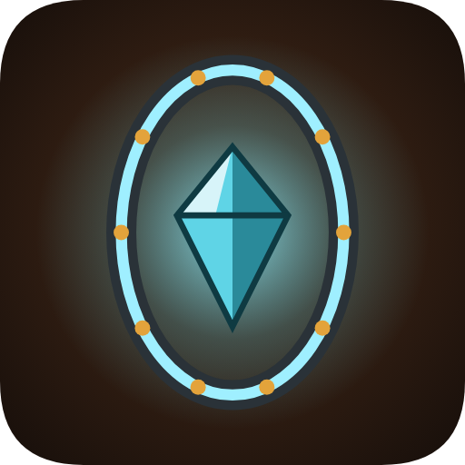

# Мёртвый мир: Плацдарм



Пошаговая тактика в стиле XCOM для Android (горизонтальная ориентация) по мотивам книги «Мёртвый мир».
Фанатский проект для личного использования.

Мёртвый мир, переживший войну, — тюрьма без решёток. Заключённых выбрасывают туда через Портал в один конец. Институт выдаёт старые ППШ и припасы на пару дней.
Задача — закрепиться: искать место для базы, выживать, добывать драгоценные кристаллы и отправлять их
через Портал, получая взамен оружие, патроны, снаряжение и новых людей.

## Что есть в игре

**Глобальная карта** (процедурная, ~23 локации):
- Типы локаций: точка высадки (Портал), руины, кристальные жилы, лагеря банд, логова мутантов,
  «укрытия» (места под базу), древний бункер и Гнездо.
- Каждый переход — 1 день, отряд ест провизию. Голод снижает здоровье и меткость.
- Туман войны: соседние локации открываются по мере продвижения.
- Зачищенные руины можно обыскивать, на жилах — добывать кристаллы или ставить бур (+3 в день).
- Случайные события: беглецы, тайники, торговцы, бури, перебежчики.

**Портал и Институт**:
- Каталог: патроны, провизия, аптечки, гранаты, стройматериалы, оружие, броня, новые бойцы.
- Доставка — на следующий день в выбранную точку: к Порталу или на любой поставленный **маяк**
  (на базе или в другой зачищенной локации). Брошенный без охраны груз могут растащить.
- Чем больше драгоценностей сдано, тем выше доверие Института и лучше товары (4 уровня).

**База**:
- Основывается в зачищенном «Укрытии». Постройки: укрепления (частокол → каменная стена),
  сторожевая вышка, лазарет, мастерская, теплица, маяк портала, автотурели.
- На базу нападают мутанты и банды. Если отряд на базе — бой за оборону (3 волны), иначе базу защищают укрепления.

**Графика** (всё рисуется процедурно, без внешних файлов):
- Изометрическое поле боя-«диорама»: объёмные стены с кирпичом и камнем, мешки с песком, частоколы,
  ржавые машины, ящики, палатки, валуны; стены автоматически стыкуются, у бойцов — силуэты сквозь стены.
- Детальные фигуры бойцов (разное оружие, броня, причёски, бороды) и мутантов; бойцы прижимаются к укрытиям.
- Портреты-аватарки каждого бойца и врага, иллюстрации построек и иконки оружия.
- Глобальная карта с рельефом, хребтами, пересохшими реками, дорогами, облаками и локациями-диорамами.
- Живые бойцы: прицеливание, отдача, перезарядка, броски гранат, реакция на попадания, падение.
- Зрелищный бой: кинокамера и замедление на решающих выстрелах, гильзы, искры, вспышки, взрывы,
  разрушаемые укрытия, следы боя (кровь, гарь, обломки) остаются на земле.
- Живые локации: время суток и погода (ночь, рассвет, закат, дождь, пыльная буря, пеплопад),
  динамический свет от костров, кристаллов и фонарей, вороны, светлячки, кислотные лужи.
- Многоуровневые карты: террасы и уступы (бонус к меткости сверху, укрытие за обрывом),
  13 видов карт — завод, мёртвый лес, кристальные пещеры, кислотное болото, руины с заготовками
  (АЗС, блокпост, склад, ДОТ, колонна, застава) и др.
- Живой мир: смена дня и ночи на карте, жители и дым над базой, патрули банд и мутантов,
  банда набега идёт по дорогам к базе, груз Института падает из Портала в небе, тревога при набеге.
- Прогресс внешности: со званием растёт снаряжение (подсумки, патронташ, рюкзак с рацией, повязка
  ветерана, шевроны на портрете), после тяжёлых ранений остаются шрамы.
- Сюжетные ролики: прибытие через Портал в начале игры и три финала (выключаются кнопкой «Кинокамера»).
- Объёмное поле боя: рельефные фактуры грунтов со светом и природными переходами, тени от стен,
  деревьев, бойцов и уступов по направлению солнца, затенение у основания укрытий, каменистые срезы.
- Фигуры-миниатюры: контур, подсветка со стороны света, падающие тени, подставки-кольца.
- Укрытия с фасками и бликами, обломки и грязь на стенах, мусор (покрышки, кирпич, арматура, лужи).
- Атмосфера: цветокоррекция по времени суток, дымка вдали, лучи света, мягкий туман войны;
  зона хода — светящийся контур с сеткой внутри, световой маркер точки назначения.
- Арсенал: отряд начинает с ППШ (как в книге), АК и остальное оружие — через Портал. У каждого
  ствола свой вид, очередь, вспышка, трассеры, гильзы и звук; у бандитов разное оружие.
- Анимации: перезарядка под каждое оружие (смена диска, магазина, короба, затвор, цевьё), отдача,
  бег, плавные развороты, позы в укрытии, три вида гибели, движения в покое.
- Поле боя: попадания по материалам (искры, щепа, крошка, песок), обломки, висящий дым,
  полупрозрачные стены перед бойцами, щиты укрытий, «выстреливающие» цифры урона.
- База-диорама: отдельный экран с постройками, стройкой, жителями, днём и ночью.
- Экран отряда с фигурой бойца в полный рост, иконка оружия в бою, плавные переходы между экранами.
- Вокруг поля боя — небо по времени суток, горы и руины города на горизонте с параллаксом;
  в начале боя камера пролетает над картой.
- Мягкий объёмный дым, живой огонь с искрами, брызги дождя; на стенах окна, граффити, плакаты,
  следы пуль; трава колышется, фонари мигают ночью.
- Карта мира: объёмный рельеф с тёплым светом и холодными тенями, кислотные озёра, рваный туман
  с дрейфующей дымкой.

**3D-модели (Tripo)**:
- Версия 4.3: бойцы, враги, мутанты, оружие и укрытия — настоящие 3D-модели, сгенерированные в Tripo и запечённые
  в изометрические спрайты под камеру поля боя (8 направлений, 12 движений у людей: стойка, ходьба, бег,
  прицел, выстрел, перезарядка, попадание, гибель, удар прикладом, присед за укрытием, пригнулся).
- Крут, Мальборо, заключённые, бойцы в бронежилете / тяжёлой броне / экзоскелете — броня видна на фигуре.
- Враги: бандиты (две модели), стрелок банды в маскхалате, главарь в кожаном плаще, Костолом, Плевун,
  Падальщик (четвероногий), Страж бункера (робот), Матка (шестиногая); у мутантов свои движения Tripo
  (ходьба, бег, удар, рёв, попадание, падение). Турель — по 8 направлениям, Портал — каменное кольцо.
- 3D-фигура бойца в экране отряда, 3D-жители на базе (ходят, сидят у костра, работают в мастерской).
- На слабых телефонах (графика «низкая») загружаются атласы в половинном разрешении.
- Оружие — отдельный слой поверх тела: ППШ, АК, дробовик, СВД, ПКМ, штурмовая винтовка, КСВК, Корд;
  вспышка и трассер выходят из дула модели.
- Машины-остовы, бочки, ящики, контейнеры, кристаллы, палатки, валуны, генераторы и мелкий мусор — тоже модели.
- Пока атлас не загружен (или его нет), игра рисует прежние процедурные фигуры.
- Фото-текстуры Poly Haven (CC0): грунты (пыль, пепел, потрескавшаяся земля, бетон, рифлёный металл,
  каменистое дно пещер, щебень, доски, асфальт дорог), кирпичная, каменная и бетонная кладка стен,
  ржавые переборки, порода уступов и гор на горизонте (`game/textures/`, список — `SOURCES.txt`).
- Дома, в которые можно заходить: двери, окна, дощатые полы и обстановка — столы, кровати, нары,
  диваны, комоды (низкое укрытие), шкафы, буфеты, печи, холодильники (полное укрытие); жилые дома и
  казармы на точке высадки, в руинах, лагере, на заводе и в «Укрытии».
- Версия 4.4: новые движения из текста (присед с прицелом, выглядывание из-за угла, перелезание, подъём,
  бросок гранаты, перевязка, осмотр), портреты бойцов — снимки головы 3D-модели, новые модели бандитов,
  вожака мутантов и второй породы падальщиков, разные внешности новобранцев, постройки базы
  (штаб, вышка, лазарет, мастерская, теплица, маяк, ворота, костёр, бак, склад) и рамы окон и дверей в домах.
- Конвейер: `tools/tripo/` (генерация в Tripo через GitHub Actions за кредиты Studio), `tools/art3d/`
  (three.js в Chromium: перенос анимаций на скелет, IK рук на оружие, присед IK ног, упаковка в атласы WebP),
  исходники моделей — `art3d/src/`, готовые атласы — `game/assets3d/`.

**Тактический бой (как в XCOM)**:
- 2 очка действия на бойца: синяя зона — шаг за 1 ОД, жёлтая — рывок за 2 ОД. Выстрел завершает ход.
- Половинные и полные укрытия (−20/−40 к попаданию), обход с фланга, криты, броня.
- Линия видимости, туман войны, группы врагов, которые «просыпаются» и разбегаются по укрытиям.
- Дозор (реакционный огонь), «залечь», перезарядка, гранаты и РПГ разрушают укрытия.
- Классы со способностями: Лидер (Приказ: +1 ОД союзнику), Пулемётчик (Подавление), Штурмовик (Рывок),
  Снайпер (Прицельный выстрел), Медик (Полевая медицина), Стрелок (Двойной выстрел).
- Опыт и звания, ранения переходят между боями, погибшие уходят в мемориал.
- Зона эвакуации, отступление, сбор кристаллов и тайников на карте.
- Враги: падальщики, костоломы, плевуны, бандиты, головорезы, стрелки, главари, стражи бункера, Матка.
- Тяжелораненый боец не гибнет сразу, а падает и истекает кровью: есть несколько ходов, чтобы
  подбежать и «Перевязать» его — после победы он вернётся в строй со шрамом.
- Удар прикладом в упор, красная зона дозора врага на поле, бандиты бросают гранаты,
  раненые враги отходят в укрытия, у каждого оружия своя длительность перезарядки.
- Скрытное начало (версия 4.4): в обычных боях отряд высаживается незамеченным. Оранжевые клетки —
  зона, где враг заметит бойца; первый выстрел — из засады (+15 к меткости, +10 к криту). Выстрел,
  граната, удар или вход в зону раскрывают отряд, и в бой вступают все группы, которых он видит.
- Подкрепления: на высокой сложности после 4-го хода враг пускает сигнальную ракету — через ход
  в отмеченном месте появляется подмога.
- Боевые товарищи: после трёх совместных боёв двое бойцов получают +5 к меткости, стоя рядом
  (видно в экране отряда и в итогах боя).
- Паника: гибель или тяжёлое ранение бойца может выбить из колеи соседей — на следующий ход
  у них 1 ОД и они жмутся к укрытию (опытные и хладнокровные паникуют реже).

- Задания в боях (версия 4.5): освободить пленника у бандитов (он вступает в отряд), убить вожака стаи
  (стая теряет ход, с вожака — кристаллы, рядом с ним мутанты метче), забрать груз Института
  (контейнер с припасами). По ходу боя Институт может сбросить груз — успейте его забрать.

**Оружие и звук (версия 4.5)**:
- Хват от корпуса: при стрельбе приклад в плече и ствол вперёд, в переноске — ствол вперёд-вниз, обе руки
  на оружии (правая на рукояти, левая на цевье); Корд — от бедра, РПГ — на плече, при броске гранаты ствол
  в левой руке, при перевязке — за спиной.
- «Мастерская оружия» (кнопка в настройках): предпросмотр бойца со стволом, правка положения в руках
  отдельно для переноски и стрельбы (сдвиг, наклон ствола, размер), стрельба (очередь, темп, вспышка,
  трассер, гильзы, отдача, тряска экрана, разброс), голос выстрела (тон, щелчок, корпус, бас, хвост, эхо,
  хрип, затвор) и общая физика (отскок и скольжение гильз, отброс при попадании, эхо на улице и в помещении).
  Кнопки «Огонь!» и «Перезарядка» для проверки; правки сразу действуют в бою, их можно выгрузить текстом.
- Выстрелы синтезируются по слоям, у каждого ствола свой голос, каждый выстрел очереди звучит вместе со
  вспышкой; в помещениях и пещерах — гулкое эхо; затвор СВД и КСВК, помпа дробовика; перезарядка по
  устройству ствола (диск, магазин, короб, затвор, помпа); гильзы звенят о землю и отскакивают.
- Начальная заставка по книге со своей музыкальной темой (отключается в настройках).

**Версия 4.6**:
- Оружие под любой рост: рукоять каждого ствола ставится туда, где рука держит автомат, а слой оружия
  в игре подгоняется под руку конкретного тела в каждом кадре (главарь, экзоскелет, бандиты — без «плавания»).
- Новые движения (Tripo): крадущийся шаг при скрытности, скольжение в укрытие, спиной к стене за полным
  укрытием, бросок гранаты с колена, второе попадание; редкие — две гибели, паника, ликование после победы,
  осмотр оружия, удар бандита (отдельный атлас, грузится по надобности, чтобы не тратить память).
- Дома с плоской крышей: кирпичный блок с окнами, наверх — по лестнице, на крыше мешки с песком (+15 за высоту).
- Взрывы проламывают кирпичные и каменные стены. Ночью и в пещерах — фонари: обзор +2, но враг замечает
  отряд издалека; можно выключить и красться. Страж бункера прикрывает союзников щитом (−15 к попаданию),
  бандиты охотнее заходят во фланг, стая мутантов бежит быстрее.
- Ветки навыков по классам (4 уровня по два навыка, 10 новых: Твёрдая рука, В упор, Дальнобой, Охотник,
  Толстокожий, Железные нервы, Полевой госпиталь, Подрывник, Командир, Бронебой).
- Модули оружия (до двух у бойца): прицел, расширенный магазин, глушитель (выстрел наповал не раскрывает
  отряд, если никто не видел), приклад. Через Портал и в грузе Института.
- Новые постройки: радиовышка (засады реже, груз в бою чаще, разведка шире), гараж (каждый второй переход
  без ночёвки), склад боеприпасов (+20 патронов в день, граната раз в три дня).
- «Хроника» в журнале: сюжетные главы по известным фактам книги; события книги добавляются главами в D.STORY.
- Звук: шаги по разной земле, попадания по материалам (камень, металл с рикошетом, дерево, мешки, стекло),
  «голос по рации» к репликам бойцов.
- Динамическое разрешение мельче шагом и с возвратом к чёткости, когда телефон справляется.

**Версия 4.7 — здания как настоящие**:
- Стены выше человека: кирпичные и переборки ≈2,6 м, каменные ≈2,2 м (раньше были ниже бойцов).
- Над дверями и окнами — перемычки, дверные рамы в рост (≈2 м), окна — от подоконника до 1,65 м;
  широкие въезды (2–3 клетки) — ворота с перемычкой.
- Срез стен как в XCOM: стены перед бойцами (на 1–4 клетки) и передняя часть дома, в котором кто-то стоит,
  рисуются низкими — бойцы внутри видны; за высокими стенами свои — полупрозрачным силуэтом.
- Двери всегда проходимы: снаружи и внутри у проёма свободно, окна не ставятся вплотную к дверям,
  у дома минимум две двери; проломы — только в руинах. Дома с плоской крышей стали выше (одноэтажный дом).

**Версия 5.0 — бой в настоящем 3D** («Настройки → Бой: 3D/2D», без WebGL — 2D):
- Поле боя строится в 3D из той же карты: земля одной поверхностью с плавным смешением видов грунта (PBR-материалы
  Poly Haven, CC0: цвет, рельеф, шероховатость), уступы и скалы, полы и крыши, стены домов с дверями, окнами,
  воротами и перемычками; стены перед бойцами срезаются (как в XCOM); предметы и техника — 3D-модели; мелочь
  (трава, камни, кирпичи, кости, шины, грибы и кристаллы со свечением, костры, фонари), дорога, лужи, трещины.
- Камера: поворот на 90° (кнопки ⟲ ⟳), приближение, сдвиг пальцем, плавный перелёт к бойцу, следует за идущим.
- Свет по времени суток и погоде: солнце с тенями, небо, дымка; ночью — фонари отряда и огни на карте.
- Персонажи — скелетные модели (Tripo, высокое качество), движения — общая библиотека (перенос на любое тело,
  плавная смена движений без рывков), оружие в обеих руках (как в спрайтах), при гибели падает на землю;
  мутанты — свои клипы и наклоны тела.
- Эффекты: вспышка дула освещает округу, трассеры, гильзы с отскоком, дымки, искры и крошка по материалу,
  взрывы, кровь и копоть на земле, граната и ракета по дуге.
- Высоты: уступ рельефа — 1,5 м (по плечо человеку), крыши домов — 3 м; наверх — только по лестнице: маршевая
  лестница на клетку перед уступом (8 ступеней, заход спереди и сверху, боец идёт по ступеням шагом), на крыши —
  приставная (лезет вверх и вниз); генератор ставит лестницы так, что любая площадка достижима.
- Настоящие размеры: легковые машины — 3 клетки, автобус ПАЗ, «Урал», БТР-80 — 5×2 клетки; мешки и ящики — в два
  ряда по пояс; мебель в реальный рост; техника за краем поля — тоже в настоящую величину.
- Хват оружия по анатомии: кулак смыкается на пистолетной рукоятке (указательный — у спуска), левая кисть — под
  цевьём или на магазине; плечо, локоть, предплечье, запястье и ключица — в естественных пределах, без
  пересечений с телом; приклад — в плечевую впадину; оружие всегда стоит ровно, магазином вниз
  (game/js/r3d/grip.js, стенд настройки — tools/three3d/griplab).
- ППШ-41 — настоящий: модель Tripo по фото (диск поперёк, как у оригинала; tools/three3d/fixppsh.mjs).
- 5.0.2: портреты врагов и мутантов (разведка перед боем, цель в бою) — снимки голов 3D-моделей вместо рисованных
  (tools/efaces: render.js снимает, build.py собирает; свои картинки — в tools/efaces/src с теми же именами).
- 5.0.2: обычный ход — шагом, рывок — бегом; кнопка «Присесть» / «Встать» (без ОД): присевшего замечают на 2 клетки
  ближе и в него труднее попасть (−10), стреляет с колена; отправленный в путь — встаёт и идёт (крадучись не ходят).
- 5.0.1: картинки 2D-режима (бойцы, враги, оружие, мутанты) перезапечены с новых моделей — тот же ППШ-41 и новые тела.
- Портреты бойцов — фото (20 лиц: стартовый отряд и 14 новобранцев со своими именами, tools/faces);
  в окне отряда — живая 3D-фигура бойца (поворот пальцем), иконки оружия и брони — снимки 3D-моделей (tools/wicons).
- Устройство: game/js/r3d/*.js (ядро, мир, свет, персонажи, эффекты, детали, интерфейс, связка с логикой боя),
  three.js — game/js/lib/three.min.js (сборка tools/three3d/build.sh), модели — game/models (tools/three3d/models.mjs),
  движения людей — game/models/anim_human.js (tools/three3d/animlib.js), материалы — game/tex3d (tools/three3d/pbr.py).

**Версия 4.9 — проверка всех анимаций**: четыре проверяющих прошли каждое движение каждого персонажа
(бойцы, бандиты, мутанты, турель, все стволы) по листам кадров, замерам и снимкам из боя; найденное исправлено.
- Гибель: ствол выпадает из руки и ложится на землю (раньше торчал из трупа стволом вверх).
- Оружие «на ремне» (перевязка, паника, удар бандита) — за спиной, а не перед лицом.
- Прицел из-за угла, с колена, в дозоре — ствол по горизонту (раньше в землю); пригнувшись, крадучись и в скольжении
  дуло не уходит в землю; длинные стволы (КСВК, Корд) — затыльником у плеча, а не за спиной.
- Вспышка, трассер и гильзы — из дула той позы, в которой боец стреляет (из-за стены вспышка висела в воздухе);
  ракета вылетает из трубы РПГ, вспышка турели — у ствола.
- Снайпер в укрытии не встаёт во весь рост, чтобы передёрнуть затвор; в укрытии и в дозоре боец не встаёт
  «осмотреться»; при броске гранаты ствол остаётся в руке; удар бандита — настоящий удар; у стены — без рывков.
- На слабых телефонах редкие движения оружия догружаются сами (раньше в ликовании и панике оружие пропадало).
- Смена позы стоя ↔ присев — короткий переход без «двоения» фигуры.
- Мутанты: Костолом и Плевун не раскачиваются взад-вперёд при ходьбе и беге, падают на месте; у Падальщиков,
  Вожака и Матки появились атака-бросок, вздрагивание при попадании, рык, дыхание в покое и гибель на бок
  (раньше труп вставал торчком); Матка ходит головой вперёд; разбитая турель — 3D, а не старый рисунок;
  Плевун перед плевком замахивается, а не бежит на месте.

**Версия 4.8 — нормальные движения**:
- Ноги на земле: при запекании нижняя точка тела в каждом кадре — на уровне земли, а тело — над своей клеткой
  (середина между стопами у людей, середина тела у мутантов). Раньше движения «из-за укрытия», «с колена»,
  «дозор», «крадётся» висели над землёй до 0,6 м и уезжали от клетки, отсюда «взлёты» и «телепорты».
- Ход одним движением: путь сглажен, боец разгоняется на первой клетке и тормозит на последней, без остановок
  и «стоп-кадров» между клетками; скорость человеческая (шаг ≈2,3 клетки/с, рывок ≈3,6), по диагонали дольше,
  по лестнице медленно.
- Кадр ходьбы зависит от пройденного пути (ноги не скользят), ходьба 12 кадров, бег 10.
- Плавные развороты (через промежуточные направления), плавный отход от укрытия, мягкая смена поз
  (старая поза растворяется), в стойке и дозоре — плавные переходы между кадрами.
- Стрельба: вскинул оружие → очередь → задержался в прицеле; толчок отдачи вдвое мягче; скольжение в укрытие —
  только с разбега; без «прыжков» в позу прицела в покое.
- Автотест хода: записывает положение бойца каждый кадр и ищет скачки и остановки.

**Бойцы**:
- У каждого черта характера: Авторитет у Крута, Курильщик у Мальборо, у остальных — Меткий, Живучий,
  Шустрый, Хладнокровный или Везучий.
- При повышении звания — выбор одного из двух навыков (Фельдшер, Закалка, Глаз-алмаз…).
- Реплики в бою («Перезаряжаюсь!», «Контакт!», «Диск пуст!»), раны видны на портретах (бинты, кровь).
- Бойца можно переименовать в экране отряда.

**Звук и музыка** (всё синтезируется на лету, без файлов):
- Музыка со своим лейтмотивом в ре миноре: тихая тема в меню, дорога по пустоши на карте,
  гитарные переборы на базе, тревожный пульс в бою, который разгоняется при контакте с врагом,
  отдельные акценты на контакт, победу и поражение, мелодия для роликов и финала.
- Звуки окружения по месту и погоде: ветер, дождь с громом, пыльная буря, капель и гул в пещерах,
  скрип и вентиляция в бункере, стук инструментов на базе, далёкий вой мутантов ночью.
- Звук глушится, когда игра свёрнута. Кнопки «Звук» и «Музыка» в настройках независимы.

**Настройки и производительность**:
- Качество графики: авто / низкое / среднее / высокое. В режиме «авто» игра сама понижает
  качество при просадках FPS и повышает, если запас есть. Счётчик FPS включается в настройках.

**Победа**: сдать Институту 1000 драгоценностей («вольная») или уничтожить Матку в Гнезде
(путь открывается после разгрома двух логов).

По мотивам книги Кирилла Шарапова «Мёртвый мир. Форт Крут». Стартовый отряд: **Крут**, **Мальборо**, Сыч, Док, Бугай, Тихий. Крут и Мальборо — из книги, остальные
клички придуманы и легко меняются в `game/js/data.js` (`D.START_SQUAD`).

## Установка на телефон

1. Скачайте `DeadWorld.apk` (артефакт сборки GitHub Actions «Сборка APK» или собранный локально).
2. На телефоне разрешите установку из неизвестных источников и откройте APK.
3. Игра работает полностью офлайн, сохраняется автоматически (после каждого дня и каждого хода в бою).

Требуется Android 8.0+.

## Управление

- Нажатие — выбор; перетаскивание — сдвиг карты; два пальца — масштаб.
- В бою: нажмите клетку, затем ещё раз — перемещение. Нажмите на врага — прицеливание.
- Кнопка «Назад» закрывает окна / открывает меню.

## Структура проекта

```
game/                   игра на HTML5 Canvas + JS (без внешних библиотек и файлов)
  index.html
  css/style.css
  js/util.js            утилиты, шум, хранилище (SharedPreferences через мост / localStorage)
  js/audio.js           синтезированные звуки (WebAudio)
  js/music.js           процедурная музыка и звуки окружения
  js/sprites3d.js       3D-спрайты: атласы, выбор кадра по состоянию, склейка тела и оружия
  assets3d/             атласы WebP и meta.js (кадры), запекает tools/art3d/bake.js
  js/data.js            все игровые данные: оружие, враги, постройки, каталог портала
  js/art.js             фигуры людей и мутантов, оружие, внешность
  js/art_ui.js          портреты, иконки, изометрические блоки, диорамы локаций
  js/state.js           кампания: ресурсы, дни, портал, база, события, итоги боёв
  js/world.js           генерация и отрисовка глобальной карты
  js/wscene.js          стратегический режим
  js/basescene.js       экран базы-диорамы
  js/mapgen.js          генерация тактических карт (13 типов, высоты, заготовки)
  js/battle.js          правила боя: обзор, укрытия, попадания, действия
  js/ai.js              ИИ противника
  js/render_battle.js   изометрическая отрисовка боя и эффектов
  js/bscene.js          интерфейс боя
  js/ui.js              окна: отряд, база, портал, журнал, брифинг
  js/cine.js            сюжетные ролики (вступление и финалы)
  js/main.js            запуск, ввод, главное меню
android/                Android-обёртка (WebView, ландшафт, полноэкранный режим)
```

Игру можно запустить и в браузере: откройте `game/index.html` (окно в горизонтальной ориентации).

## Сборка APK

Нужны JDK 17+ и Android SDK (platform 35, build-tools 35).

```bash
cd android
echo "sdk.dir=/путь/к/android-sdk" > local.properties
./gradlew assembleRelease
# APK: android/app/build/outputs/apk/release/app-release.apk
```

APK подписывается ключом `android/app/deadworld.jks` (пароль `deadworld`), чтобы локальные и CI-сборки
ставились поверх друг друга без потери сохранений. Для публикации в магазине замените ключ на свой.
