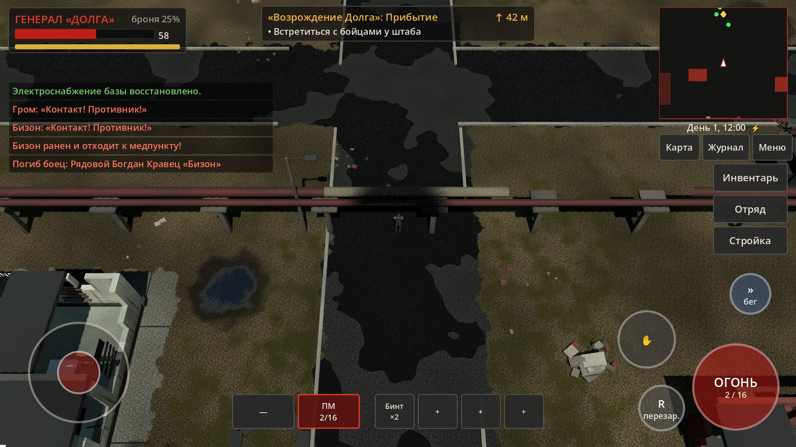

# Долг: Возрождение

3D survival-action в Зоне отчуждения: строительство базы, управление бойцами группировки «Долг», бои в реальном времени.
**Первый играбельный этап** — локация «База Долга» (300 × 300 м) и задание «Возрождение Долга».

Движок: **Godot 4.6** (проверено на 4.6.3-stable), рендерер **Compatibility** (OpenGL ES 3.0 / GL 3.3) — максимальная совместимость с Android-устройствами среднего класса.
Платформы: Android (горизонтальная ориентация, основная), Windows/Linux (тестирование).



## Как запустить

1. Установите Godot **4.6.x** (стандартная версия, не .NET): https://godotengine.org/download
2. Откройте Godot → «Импорт» → выберите файл `project.godot` в корне репозитория.
3. Нажмите **F5** (запуск). Первый импорт занимает несколько секунд.

Из командной строки:

```bash
godot --path .                      # запуск игры
godot --path . --editor             # открыть в редакторе
```

### Сборка для Android
1. В Godot: *Редактор → Управление шаблонами экспорта* → скачать шаблоны 4.6.x.
2. *Редактор → Настройки редактора → Экспорт → Android*: указать путь к Android SDK и Java (JDK 17), отладочный keystore.
3. *Проект → Экспорт → Android* (пресет уже настроен: arm64-v8a, горизонтальная ориентация, immersive mode) → «Экспорт проекта» → `build/dolg_vozrozhdenie.apk`.

### Сборка для Windows
*Проект → Экспорт → Windows Desktop* → `build/windows/DolgVozrozhdenie.exe` (pck встроен в exe).

## Управление

| Действие | Телефон | ПК |
|---|---|---|
| Движение | виртуальный джойстик (левая половина экрана, плавающий) | WASD / стрелки |
| Бег (выносливость) | кнопка «»» (переключатель) | Shift |
| Огонь | кнопка «ОГОНЬ» — автоприцел по ближайшему видимому врагу | ЛКМ (стрельба в точку курсора с подсказкой цели) |
| Прицеливание | при удержании «ОГОНЬ» | ПКМ |
| Перезарядка | кнопка «R» (и автоматически при пустом магазине) | R |
| Действие (подобрать, открыть, поговорить; **удерживать** — разобрать завал, ремонтировать) | кнопка «✋» | E |
| Смена оружия | слоты внизу экрана | 1 / 2 |
| Быстрые слоты (бинт, аптечка…) | слоты внизу экрана | 3–6 |
| Осмотр оружия | — | V |
| Инвентарь / Карта / Отряд / Стройка / Журнал | кнопки справа и под мини-картой | I / M / O / B / J |
| Пауза, сохранение, настройки | «Меню» | Esc |
| Быстрое сохранение / загрузка | — | F5 / F9 |
| Масштаб камеры | — | колесо мыши |
| Счётчик производительности | в настройках | F3 |

## Задание «Возрождение Долга»

1. Прибыть на базу и встретиться с бойцами у штаба.
2. Осмотреть штаб (крыша скрывается, когда генерал внутри).
3. Осмотреть повреждения: генераторная, радиоцентр, оружейная.
4. Поговорить с капитаном Рябовым.
5. Найти инструменты, электронику (3) и металлолом (8) — ящики, разбитая техника, кучи лома; часть — **за периметром** (там псы, зомбированные и мародёры).
6. Сдать материалы на основной склад.
7. Восстановить генераторную (панель здания → ремонт; работает техник и/или генерал) и заправить генератор топливом → свет на базе.
8. Разобрать завал у оружейной и обследовать её (оружейный тайник).
9. Вооружить охрану КПП: в панели оружейной выдать патроны двум бойцам и назначить их на КПП.
10. Восстановить радиоцентр (нужно электропитание).
11. Поймать сигнал выживших (мини-игра настройки частоты) → сигнал отряда сержанта Ковалёва со Свалки.
12. Подготовить экспедицию в штабе. Следующая локация («Свалка») **не создавалась** — ждёт подтверждения.

## Что реализовано

**Мир (300 × 300 м, 1 ед. = 1 м)** — настоящая физическая территория с коллизиями и навигацией:
- укреплённый периметр 200 × 187 м из бетонных плит ПО-2 с колючей проволокой, три пролома, главный КПП (будка, шлагбаум, мешки с песком, блоки «змейкой», ежи);
- 11 зданий базы + 6 сторожевых вышек: штаб (2 этажа), казармы, оружейная, основной склад, ремонтная мастерская, медпункт, радиоцентр с антенной мачтой, генераторная с цистернами, тренировочная площадка, гараж, КПП;
- 10 разрушенных вспомогательных построек (котельная с трубой, столовая, казарма №2, дома заброшенной деревни, сторожка бандитов и др.);
- база разрушена примерно на 70%: обрушенные кровли, проломы, завалы, воронки, сгоревшая техника (БТР, ЗИЛ, УАЗ), мусор, лужи, колея; теплотрасса на опорах, контейнеры;
- окраины: лес (≈520 деревьев: сосны, берёзы, сухостой), кусты, трава, железная дорога с вагонами, лагерь мародёров, логово слепых псов, деревня зомбированных, аномалии «Электра» и «Жарка», радиационные пятна;
- выходы на соседние локации на краях карты (юг — «Свалка», восток — «Агропром», север — ж/д ветка);
- смена времени суток, ночное освещение базы работает только при восстановленном генераторе.

**Здания**: визуальные состояния *разрушено → ремонт (строительные леса) → работает → улучшено* (мешки у входа, щиты, антенны, прожекторы, полотнище «Долга»). Реальные входы и двери, интерьеры с мебелью; крыша и верхние этажи скрываются при входе генерала; «вырез» геометрии между камерой и генералом. У каждого здания своя панель с функциями (склад — сдача/выдача ресурсов, генераторная — топливо и рубильник, радиоцентр — поиск сигнала, оружейная — снабжение и назначение охраны, медпункт — лечение и бинты, мастерская — детали и патроны, тренировочная — подготовка бойцов, штаб — сводка и экспедиция, вышки — пост снайпера и т.д.).

**Генерал**: повреждённый красно-чёрный костюм «Долга», разгрузка, рюкзак, ПМ, 2 бинта, минимум патронов. Ходьба/бег/спринт с выносливостью, поворот корпуса по направлению движения и к цели, прицеливание, стрельба, перезарядка, бинты/аптечки/антирад/еда, подбор предметов, двери и контейнеры, разговор и приказы бойцам, радиация, фонарь ночью. Ближнего боя нет (по требованию).

**Оружие — 20 видов, каждое отдельная 3D-модель** из подвижных частей (магазин, затвор/кожух/цевьё помпы/крышка, откидные стволы/барабан): ПМ, АПС, ТТ, АКС-74У, ПП-19 «Бизон», ПП-91 «Кедр», АК-74, АКМ, АН-94, АС «Вал», СКС, СВД, ВСС, винтовка Мосина, ТОЗ-34, «Сайга-12К», КС-23, ПКМ, РПК-74, РГ-6. Семь классов хвата со своими позами и анимациями держания: пистолет, ПП, автомат, снайперская, дробовик, пулемёт, гранатомёт. Перезарядки по типу: магазин (магазин уходит в левую руку), пистолет, короб ПКМ (крышка откидывается), обойма, переломка, патроны по одному + помпа, барабан. Листы 20 поз для каждого класса: `docs/screenshots/poses_*.jpg`.

**Анимация персонажей** (процедурная, без внешних файлов): скелет из 17 костей со сглаженным скиннингом суставов; **стопы зафиксированы в мире** во время опоры (нет скольжения), длина и частота шага зависят от скорости, IK ног и рук, таз опускается при широком шаге, наклон при беге/ускорении, противовращение плеч, шаги на месте при поворотах, боковой шаг без перекрещивания ног, руки точно на рукояти/цевье через IK (оружие не «висит»), отдача, осмотр оружия, перевязка, ремонт, лечение товарища, приветствие, смерть. Слепые псы — четвероногий скелет с рысью/галопом и фиксацией лап.

**Бойцы «Долга»** (6 человек с именами, ролями, здоровьем, оружием, обязанностями): офицер, автоматчик, пулемётчик (ранен), снайпер, медик, техник. Приказы: следовать, охранять позицию, патрулировать, ремонтировать, лечить, занять оборону, вернуться в казарму. Передвижение по навмешу с обходом препятствий и взаимоуклонением, без телепортации; обнаружение врагов зрением и по шуму, огонь очередями, не стреляют через своих, раненые отходят к медпункту, медик лечит.

**Противники**: слепые псы (слух, нюх, стая, укус, бегство), зомбированные (медленные, плохо стреляют), мародёры (огнестрел, держат дистанцию). Живут в своих зонах с «поводком», **не заходят внутрь охраняемого периметра**, «спят», когда генерал далеко (упрощённая симуляция), возрождаются через двое игровых суток. С мародёров и зомби можно снять снаряжение.

**Интерфейс** (горизонтальный экран, базовое разрешение 1920×1080, растягивается под любые пропорции): плавающий джойстик (мультитач), кнопки огня/действия/перезарядки/бега, полосы здоровья/выносливости/радиации, слоты оружия и быстрых предметов, мини-карта, полноэкранная карта базы с легендой, панель бойцов, меню восстановления, журнал заданий, диалоги, пауза, сохранение/загрузка (3 слота + автосохранение), настройки.

**Сохранения**: JSON в `user://save_N.json` — генерал, инвентарь, экипировка, склад, здания и работы, бойцы (позиции, здоровье, приказы, боезапас), открытые контейнеры, разобранные завалы и кучи, убитые враги, двери, время, топливо, задание.

**Оптимизация**: статическая геометрия объединена в чанки 50×50 м (≈40 draw call на весь мир), единый материал на вершинных цветах (без текстур, кроме двух шумов 256×256), трава — MultiMesh по чанкам с регулируемой плотностью, дальность прорисовки (visibility range) как LOD, тени только от солнца с ограниченной дистанцией, анимация персонажей вне экрана не считается, дальние — с пропуском кадров, сон удалённых групп врагов, ИИ думает 4 раза в секунду (далеко — раз в секунду), физика 30 Гц с интерполяцией, коллизии — простые боксы, навмеш запекается при загрузке (≈0,5 с) и асинхронно перестраивается при разборе завалов. Пресеты качества «Низкое/Среднее/Высокое» и ручные настройки (дальность, трава, разрешение 3D, тени, FPS 30/60). Замеры — `docs/performance.md`.

## Проверка

| Что | Как запустить | Результат |
|---|---|---|
| Компиляция всех скриптов | `tools/check_scripts.sh` | `docs/` — без ошибок |
| Автопрохождение задания с реальной ходьбой по навмешу, боем, ремонтом, сохранением/загрузкой | `godot --headless --path . -- autotest` | `docs/test_report.md` |
| Скриншоты основных экранов | `xvfb-run -a godot --rendering-driver opengl3 --resolution 1920x1080 --path . -- shots` | `docs/screenshots/` |
| Замеры производительности | `xvfb-run -a godot --rendering-driver opengl3 --resolution 1280x720 --path . -- bench` | `docs/performance.md` |
| Листы поз оружия (20 поз × 7 классов) | `xvfb-run -a godot --rendering-driver opengl3 --path . -s tools/pose_sheet.gd` + `python3 tools/pose_grid.py docs` | `docs/screenshots/poses_*.jpg` |

## Структура проекта

```
project.godot, export_presets.cfg, icon.svg
scenes/main.tscn               — точка входа (меню → загрузка → игра)
scenes/game_world.tscn         — сцена локации (генерируется при загрузке)
scripts/autoload/              — Events (шина), ItemDB (предметы и 20 видов оружия), Settings, Sfx (процедурные звуки), Game (состояние, склад, здания, сохранения)
scripts/quest/quest.gd         — задание «Возрождение Долга», диалоги
scripts/core/                  — MeshBuilder (процедурная геометрия, скиннинг), Mats (материалы), Inventory
scripts/world/                 — layout.gd (планировка 300×300), world_builder.gd, building_gen.gd, building.gd, props.gd, day_night.gd, fx.gd, objects/ (двери, завалы, ящики, подбор, точки осмотра, выходы)
scripts/weapons/               — weapon_models.gd (20 моделей из частей), weapon_view.gd (подвижные части), hold_profiles.gd (позы хвата)
scripts/actors/                — human_rig.gd / dog_rig.gd (скелеты и процедурная анимация), actor.gd, player.gd, soldier.gd, enemy.gd, enemy_group.gd, combat.gd, game_camera.gd
scripts/ui/                    — HUD, джойстик, сенсорные кнопки, карта, окна
shaders/                       — мир, земля (карта смешивания), растительность, персонажи, эффекты, аномалии
tools/                         — автотест, скриншоты, замеры, листы поз, проверка скриптов
docs/                          — скриншоты, отчёт автотеста, замеры производительности
```

## Честно об ограничениях

- Все модели, анимации, звуки и интерфейс созданы процедурно в коде, в едином низкополигональном стиле. Это рабочие «временные» ассеты: пропорции и стиль согласованы, но детализация ниже, чем у художественно смоделированных моделей. Архитектура позволяет заменить их на импортированные модели (оружие и персонажи разделены, точки хвата заданы данными).
- Анимация процедурная (IK + фиксация стоп), а не захват движения.
- Замеры FPS сделаны на виртуальной машине без GPU (программный рендер llvmpipe) — абсолютные значения FPS там на порядок ниже, чем на телефоне; аппаратно-независимые показатели (draw calls, треугольники, время скриптов) приведены в `docs/performance.md`. **На реальном Android-устройстве проект не запускался** — в этой среде нет телефона; цель 30/60 FPS нужно подтвердить замером на устройстве (счётчик F3/в настройках).
- Сборка APK не выполнялась (нет Android SDK в среде); пресет экспорта подготовлен.
- Вышки не имеют подъёма на площадку (бойцы стоят на постах у основания).
- Следующая локация, режимы стратегического/тактического управления и формирование отрядов — на следующих этапах (камера и система приказов к этому подготовлены).
