# Долг: Возрождение

3D-выживание с видом сверху в Зоне отчуждения: генерал группировки «Долг» возвращается на разрушенную базу, восстанавливает постройки, отдаёт приказы бойцам и ведёт бой в реальном времени.

**Этап 1** — локация «База Долга» (ровно 300 × 300 м, 1 единица = 1 метр) и задание «Возрождение Долга». Вторая локация («Свалка») не создаётся до подтверждения.

Игра работает в браузере на **собственном веб-движке** (JavaScript + WebGL2, без Godot, Unity, three.js и любых сторонних библиотек). Целевые платформы: телефон Android в горизонтальной ориентации и ПК.

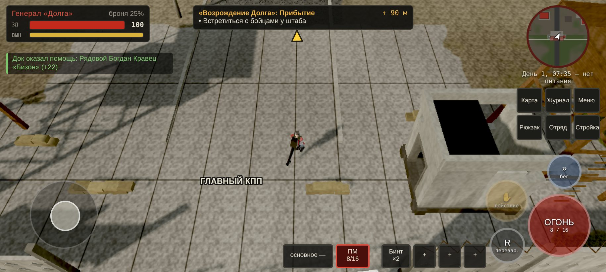

## Как запустить

Нужен любой статический веб-сервер (ES-модули не загружаются по `file://`):

```bash
cd rubin
python3 -m http.server 8080        # или: npx serve .
# ПК:      http://localhost:8080/
# Телефон: http://<IP-компьютера>:8080/  (в одной сети Wi-Fi), повернуть горизонтально
```

Сборка не нужна: файлы `index.html`, `style.css`, `main.js`, `engine/`, `game/` — это и есть игра. Её можно выложить на любой хостинг статических файлов (GitHub Pages, Netlify и т. п.).

Требования: браузер с WebGL2 — Chrome/Edge/Firefox, Safari 15+, Chrome на Android 8+.

**APK.** Готового APK нет: в этой среде недоступны Android SDK и подпись. Веб-сборку можно упаковать в APK обёрткой Capacitor или Trusted Web Activity (Bubblewrap) — игра уже рассчитана на сенсорное управление и альбомную ориентацию.

## Управление

| | ПК | Телефон |
|---|---|---|
| Движение | WASD / стрелки, Shift — бег | джойстик слева (появляется под пальцем), «»» — бег |
| Огонь | ЛКМ (точка на земле, доводка на врага), ПКМ — прицел | «ОГОНЬ»: автонаведение на ближайшего видимого противника |
| Перезарядка | R | «R» |
| Действие | E (удерживать — разбор завала, ремонт) | «✋» (удерживать) |
| Оружие / быстрые слоты | 1, 2 / 3–6 | кнопки внизу экрана |
| Окна | I — рюкзак, M — карта, O — отряд, B — стройка, J — журнал, Esc — пауза | кнопки под мини-картой |
| Прочее | V — осмотр оружия, колесо — масштаб, T — тактический обзор (заготовка), F3 — счётчик FPS, F5/F9 — быстрое сохранение/загрузка | масштаб камеры — в настройках |

## Что есть в игре

- **Локация 300 × 300 м**: штаб командования, казармы, оружейная, основной склад, ремонтная мастерская, медпункт, радиоцентр, генераторная, тренировочная площадка, главный КПП, вышки, гараж, разрушенные вспомогательные здания, повреждённый периметр с проломами, заросшие окраины, лес, деревня, железнодорожная ветка, аномалии («Электра», «Жарка») и радиационные пятна. Выходы с локации — на краях карты.
- **Здания с интерьерами**: внутри крыша скрывается, геометрия между камерой и генералом растворяется. Двери открываются (бойцы открывают их сами).
- **Восстановление**: разрушено → идут работы (леса) → работает → улучшено. Ремонт тратит материалы со склада и из рюкзака; работают назначенные бойцы и сам генерал (удержание «Действия» у входа). У каждого здания своя панель: склад, генератор (топливо, питание базы), радиостанция (поиск сигнала), оружейная (выдача патронов и оружия, охрана КПП), медпункт, мастерская (детали и патроны), казармы, тренировки, вышки.
- **6 бойцов** (офицер, автоматчик, пулемётчик, снайпер, медик, техник) с приказами: следовать, охранять, патрулировать, ремонтировать, лечить, оборонять, в казарму, вольно. Поиск пути A* по навигационной сетке 0,5 м — без телепортов и скольжения ног.
- **Бой в реальном времени**: только огнестрельное оружие, ближнего боя нет. Обнаружение зрением и на слух (выстрелы и шаги шумят), укрытия, отступление раненых к медпункту, медик лечит, очереди с паузами, проверка «свой на линии огня».
- **Противники**: слепые псы (слух, стая, укус), зомбированные сталкеры (медленные, стреляют плохо), мародёры (держат дистанцию, перезаряжаются за укрытием). Обитают за периметром, не появляются и не преследуют внутри охраняемой базы; вдали «засыпают», через двое игровых суток возрождаются. С тел можно забрать добычу.
- **20 видов оружия** — отдельные 3D-модели из частей (корпус, магазин, затвор, стволы/барабан): ПМ, АПС, ТТ, АКС-74У, ПП-19 «Бизон», ПП-91 «Кедр», АК-74, АКМ, АН-94, АС «Вал», ВСС, СКС, СВД, винтовка Мосина, РПК-74, ПКМ, ТОЗ-34, «Сайга-12К», КС-23, РГ-6.
- **Персонажи и оружие — раздельно**: скелет из 17 костей со скиннингом на GPU; оружие только позиционируется скелетом, руки ставятся на рукоять и цевьё через IK. Процедурные анимации: шаг со стопами, закреплёнными в мире, 7 профилей хвата (пистолет, ПП, автомат, снайперская винтовка, ружьё, пулемёт, гранатомёт) в состояниях стойка/низкая готовность/опущено/прицел/осмотр, перезарядки по типу (магазин, пистолет, короб ПКМ, обойма, переломка, патроны по одному, барабан — с движением магазина, затвора, крышки, стволов), отдача, передёргивание. Только стоячие позы: **без приседаний и колена**.
- **Задание «Возрождение Долга»** (12 этапов): прибытие → встреча с бойцами → штаб → осмотр повреждений → доклад офицера → инструменты и детали → склад → генератор и топливо → оружейная (завал, тайник) → охрана КПП → радиоцентр → сигнал выживших → подготовка экспедиции. Диалоги, маркер цели на экране и карте, журнал.
- **Интерфейс** под горизонтальный телефон и ПК: здоровье, выносливость, радиация, броня, слоты оружия и быстрые слоты, рюкзак, мини-карта и полная карта, отряд, стройка, журнал, пауза, сохранения (автосохранение + 3 слота в браузере), настройки качества.
- **Сутки**: солнце, рассвет и закат, ночь с фонарями (работают при включённом питании), фонарь генерала, цветокоррекция.
- **Звук**: все звуки генерируются процедурно в WebAudio (выстрелы, перезарядка, шаги, собаки, радиоэфир, ветер, гул генератора).

## Собственный движок

| Модуль | Назначение |
|---|---|
| `engine/math.js` | векторы, базисы, кватернионы, матрицы 4×4, фрустум, детерминированный ГСЧ |
| `engine/mesh.js` | процедурная low-poly геометрия: боксы, цилиндры, «конечности» со скиннингом, цвет вершин + код материала |
| `engine/shaders.js` | GLSL ES 3.00: земля со смешиванием по карте, мир, растительность с колыханием, персонажи (скиннинг, контурный свет, вспышка попадания), тени PCF, туман, ACES, цветокоррекция, эффекты |
| `engine/renderer.js` | WebGL2-рендерер: кэш программ, отсечение по фрустуму и дальности, сортировка, карта теней с привязкой к текселям, до 8 точечных источников, инстансинг травы, пакет эффектов |
| `engine/physics.js` | ориентированные боксы в пространственной сетке, движение окружностей со скольжением вдоль стен, лучи в 3D (статика и персонажи) |
| `engine/nav.js` | навигационная сетка 600 × 600 клеток по 0,5 м, A* с двоичной кучей, сглаживание пути, локальная перестройка |
| `engine/camera.js`, `engine/audio.js`, `engine/events.js`, `engine/noise.js` | камера и проекции, процедурный звук, шина событий, текстуры шума |

Игровой код: `game/` — планировка и генерация мира (`layout.js`, `world_builder.js`, `building_gen.js`, `props.js`), объекты и здания (`objects.js`), персонажи (`rig_human.js`, `rig_dog.js`, `weapons.js`, `actors.js`), задание (`quest.js`), состояние и сохранения (`state.js`), интерфейс (`ui/`).

## Проверка и замеры

Автотесты запускаются в Chromium через Playwright (сервер на порту 8765):

```bash
python3 -m http.server 8765 --bind 127.0.0.1 &
node tools/test_game.js out/        # прохождение задания от меню до финала + 21 скриншот
node tools/bench.js 915 412         # замер по пресетам качества
node tools/shot_page.js "tools/test_rig.html?w=ak74" poses.jpg   # лист 20 поз для оружия
node tools/shot_phone.js phone.jpg  # телефон, альбомная ориентация
```

Результат `test_game.js`: задание проходится полностью (все 12 этапов, `finished`), бойцы и генерал доходят до целей по навигационной сетке, бой с псами — стая уничтожена, сохранение и загрузка работают, ошибок в консоли нет.

**Замеры (честно о среде).** В этой облачной среде нет видеокарты: WebGL2 работает через программный растеризатор SwiftShader на CPU, поэтому FPS ниже — нижняя граница, а не результат телефона.

| Сцена, 915 × 412 | Низкое | Среднее | Высокое |
|---|---|---|---|
| Плац (6 бойцов) | 26.8 FPS · 46 вызовов · 26 тыс. треуг. | 16.1 · 115 · 118 тыс. | 11.3 · 144 · 166 тыс. |
| КПП | 21.4 · 33 · 34 тыс. | 17.1 · 76 · 103 тыс. | 9.3 · 93 · 130 тыс. |
| Окраина у леса | 19.5 · 26 · 39 тыс. | 16.4 · 54 · 97 тыс. | 9.4 · 70 · 124 тыс. |

- Логика игры (ИИ, физика, анимация) — 0,2–0,5 мс на кадр; вся работа JS на кадр — 1,6–2,1 мс. Узкое место — растеризация, которую на телефоне выполняет GPU.
- Загрузка локации: 0,55–0,62 с на ПК (генерация мира, навигационная сетка 31 мс).
- Нагрузка на кадр (до 170 тыс. треугольников, до 150 вызовов отрисовки с тенями) рассчитана на 30 FPS на среднем Android и 60 FPS на мощных устройствах, но **на реальном телефоне не измерена**. Для замера включите «Счётчик FPS» в настройках (или F3): он показывает FPS, время кадра, вызовы отрисовки и треугольники.
- Пресеты: низкое — без теней, 0,6 разрешения, трава 25 %, дальность 70 м, 30 FPS; среднее — тени 1024, 0,75 разрешения, 30 FPS; высокое — тени 2048, полное разрешение, 60 FPS.

## Скриншоты

| | |
|---|---|
| 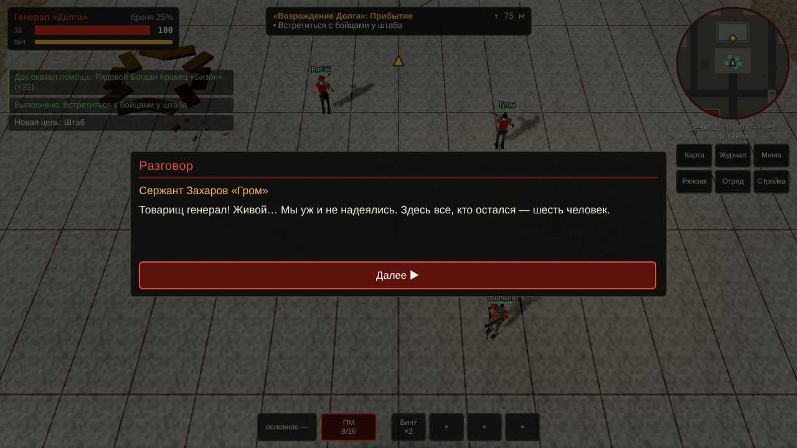 Встреча с бойцами | 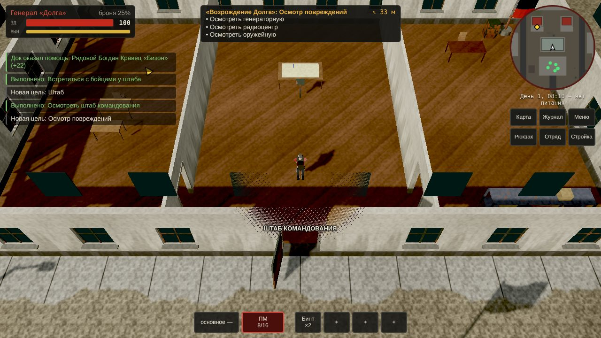 Внутри штаба: крыша скрыта |
| 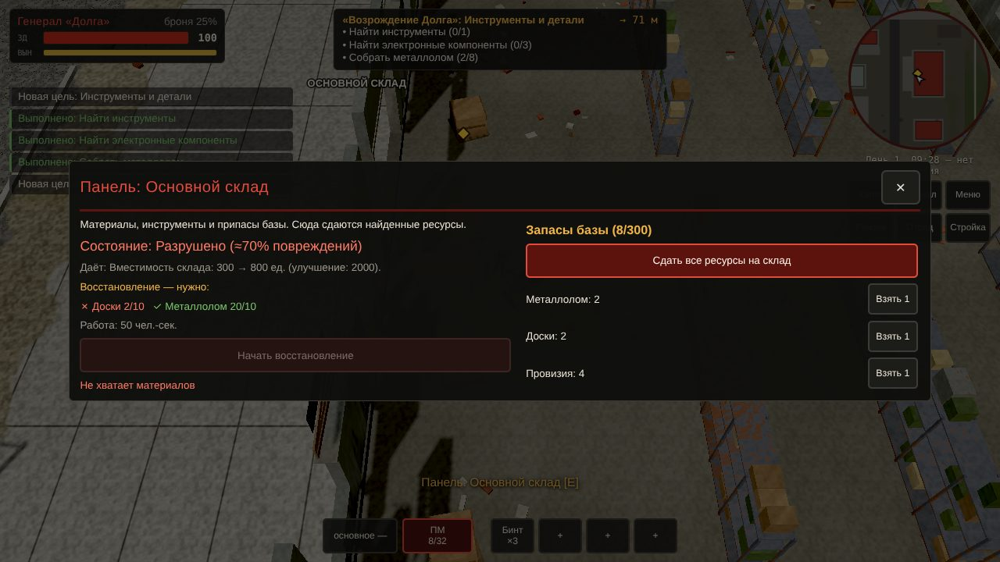 Панель здания | 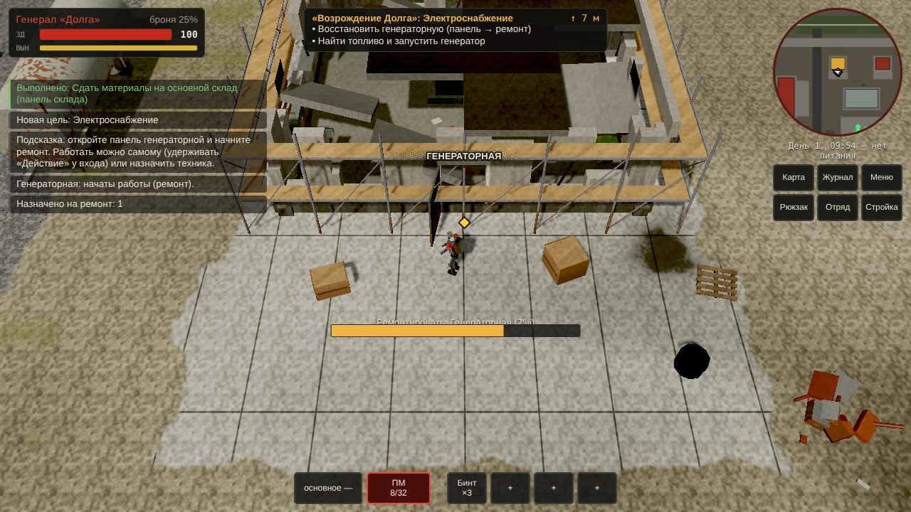 Ремонт генераторной |
| 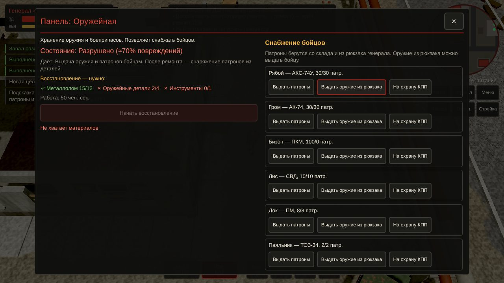 Снабжение бойцов | 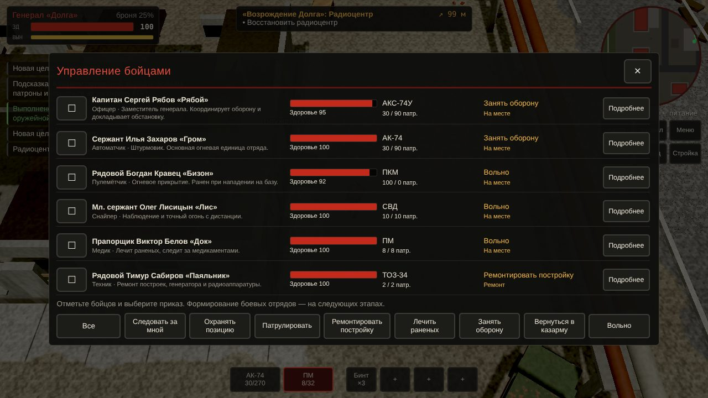 Приказы отряду |
| 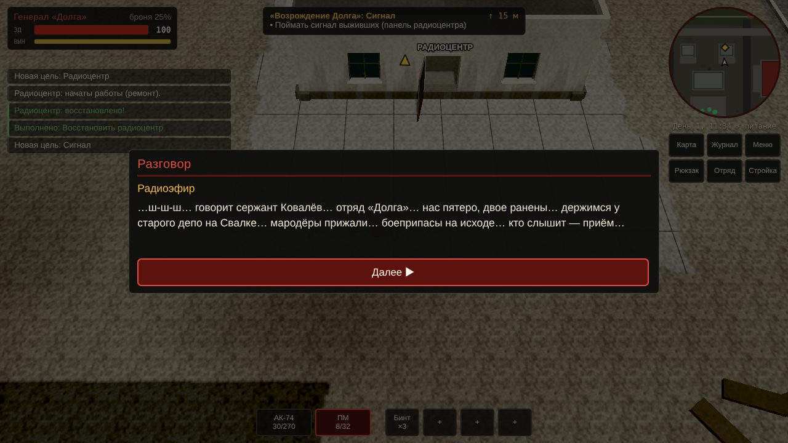 Поиск сигнала | 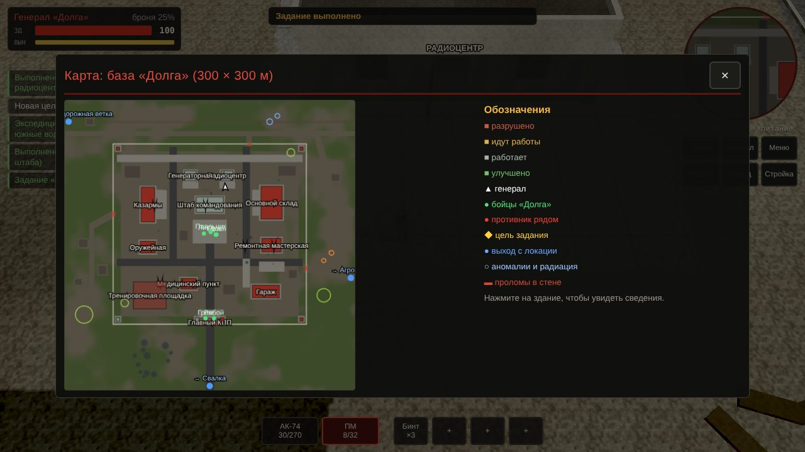 Карта 300 × 300 м |
| 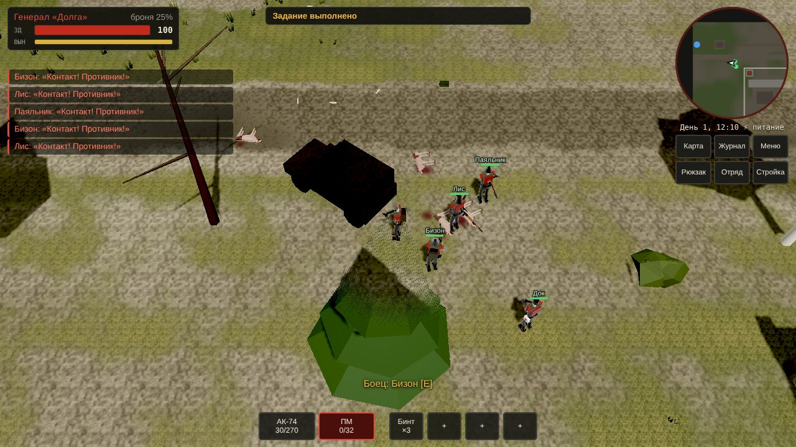 Бой со стаей псов | 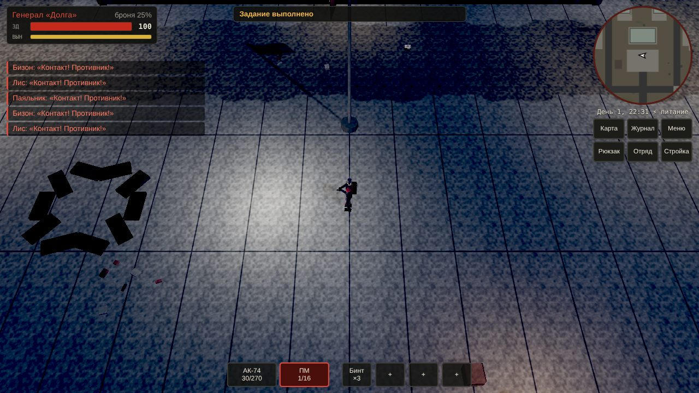 Ночь, питание включено |
| 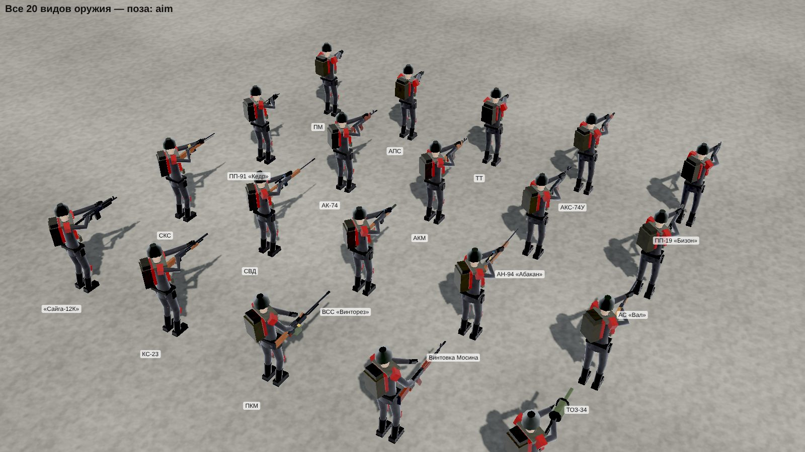 20 видов оружия, прицел | 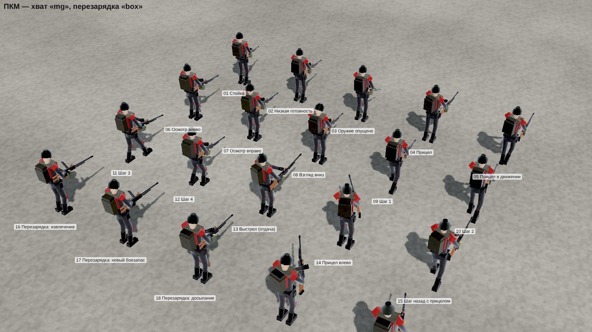 20 поз: ПКМ |

Листы поз для всех 7 классов хвата: `docs/screenshots/poses_*.jpg`.

## Ограничения этапа 1

- Графика — процедурная low-poly без текстур персонажей и звукозаписей: всё строится кодом.
- Стратегический и тактический режимы пока не реализованы (есть заготовка тактической камеры, клавиша T).
- Набор новых бойцов, техника, вторая локация — на следующих этапах.

## Архив: прототип на Godot

Первая версия на Godot 4.6 сохранена в `godot_prototype/` для истории; текущая игра от неё не зависит.
