# Линия снабжения

Одиночная мобильная военно-экономическая игра. Три сектора 300 × 300 м:

| № | Сектор | Доступ игрока |
|---|---|---|
| 1 | Наша база — поле металлолома (12 куч), стройка, производство | всегда |
| 2 | Поле боя | только после 30:00 подготовки, пешком через северную границу №1 |
| 3 | Вражеская база — у врага своя экономика | никогда (с №2 на север не пускает) |

Первые **1800 секунд активной игры** — фаза подготовки: поле боя закрыто для обеих сторон. Игрок добывает металлолом молотком, строит здания гаечным ключом, производит оружие и патроны, нанимает людей. Враг всё это время развивается сам по правилам `data/enemy_ai.json`.

Игра работает на **собственном веб-движке** этого репозитория (JavaScript + WebGL2, без Godot и сторонних библиотек). Логика перенесена из `Godot_Starter` пакета постановки один в один: расчёты врага совпадают с эталоном.

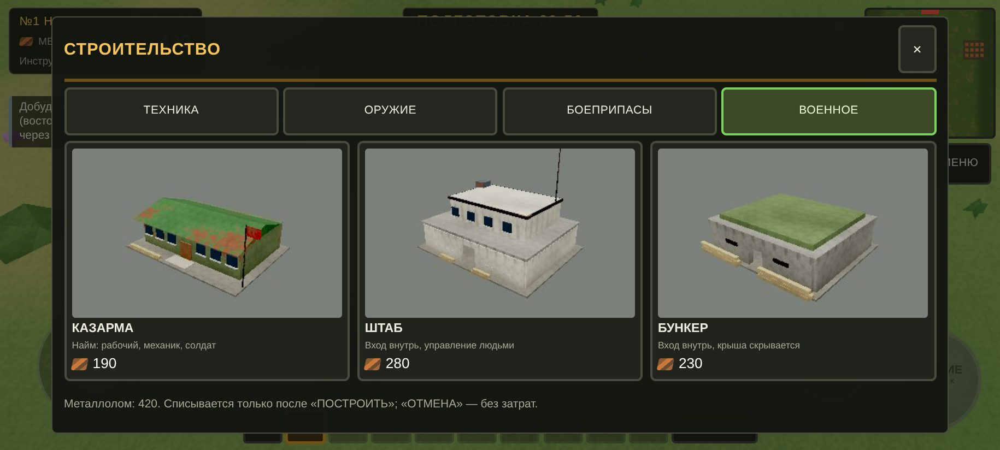

## Как запустить

```bash
cd rubin
python3 -m http.server 8080
# ПК:      http://localhost:8080/frontline/
# Телефон: http://<IP-компьютера>:8080/frontline/  — повернуть горизонтально
```

Сборка не нужна. Нужен браузер с WebGL2 (Chrome/Edge/Firefox, Safari 15+, Chrome на Android 8+). Прогресс сохраняется в браузере сам (раз в 10 с, при смене сектора и при сворачивании); новая кампания — в главном меню или в меню паузы.

Автотесты (нужны Node и Playwright с Chromium):

```bash
python3 -m http.server 8765 --bind 127.0.0.1 &
node tools/fl_test.js out/      # 40 проверок + скриншоты в out/
node tools/fl_phone.js out/     # скриншоты в альбомной ориентации телефона
```

## Управление

**Телефон (альбомная ориентация):** джойстик слева; справа большая кнопка действия — её подпись показывает, что произойдёт: «ДОБЫТЬ» у кучи металлолома, «ИСПОЛЬЗОВАТЬ» у здания (до 3 м), «СТРОЙКА» с гаечным ключом. Внизу — панель инструментов (молоток, гаечный ключ). В режиме размещения: перетащить призрак пальцем, кнопки «↶ ПОВЕРНУТЬ», «ПОВЕРНУТЬ ↷», «ПОСТРОИТЬ», «ОТМЕНА».

**ПК:** WASD — движение, Shift — бег, E — действие, 1 — молоток, 2 — гаечный ключ, B — стройка, I/Tab — инвентарь, Esc — пауза/отмена. При размещении: мышь двигает призрак, Q/R — поворот на 90°, Enter или кнопка «ПОСТРОИТЬ», Esc — отмена. F3 — счётчик FPS.

## Отчёт по этапам

### Сделано

**Этап 1. Каркас и состояние кампании.**
- `sim/campaign.js` — единственный источник правды: сектор, время активной игры, металлолом, кучи, здания, склад, очереди производства и найма, люди, приказы, состояние врага. Все изменения — атомарные команды (`mine`, `build`, `produce`, `hire`, `setOrder`), каждая либо выполняется целиком, либо возвращает причину отказа.
- Таймер подготовки идёт только в активной игре (пауза и окна его не двигают).
- Правила переходов: №1→№2 только после 30:00, №2→№1 всегда, в №3 нельзя ни с какого сектора.
- Сохранение JSON (версия 3) в `localStorage`: здания с координатами и углом, металл, кучи с таймерами, склад, очереди, люди с приказами, таймер, весь ИИ врага.

**Этап 2. Три карты.**
- Рельеф-высотное поле 151 × 151 (шаг 2 м) с окраской по биомам и скальными склонами, дороги по сплайнам, лес (сосна, берёза, сухие деревья, кусты, камни), трава.
- №1 — равнина с дорогой и полем металлолома (12 куч); №2 — воронки, гряды и разбитая дорога, без металлолома; №3 — плато врага с полем металлолома (12 куч).
- Границы секторов: у краёв предупреждение и переход только туда, куда разрешено.

**Этап 3. Металлолом.**
- Удар молотком в радиусе 2,2 м: +5 металла, у кучи 6 «прочностей», задержка между ударами 0,45 с. Разобранная куча исчезает и через 120 с появляется снова. Гаечным ключом добыть нельзя (подсказка).

**Этап 4. Стройка (12 зданий).**
- Гаечный ключ → «СТРОЙКА»: 4 раздела × 3 здания (техника, оружие, патроны, военные) с 3D-миниатюрами, ценой и описанием.
- Режим размещения: полупрозрачный призрак, зелёный — можно, красный — нельзя, с причиной (дорога, поле металлолома, граница, уклон, пересечение со зданием, деревья под площадкой). Поворот по 90°.
- «ПОСТРОИТЬ» списывает металл ровно один раз (защита от двойного нажатия), «ОТМЕНА» бесплатна. На поле боя можно ставить только бункер.

**Этап 5. Производство, склад, найм, вход в здания.**
- «ИСПОЛЬЗОВАТЬ» в 3 м от здания открывает его окно. Производство по рецептам `buildings.json`: цена, время, очередь до 5 заказов; готовые изделия попадают на склад (оружие + патроны к нему, техника — на склад техники).
- Склад: оружие, боеприпасы, техника; оружие с подходящими патронами помечено «готово к бою».
- Казарма: найм рабочего, механика, солдата по `npcs.json` (цена и время найма, лимит отряда).
- Штаб: вход внутрь, тактический стол — приказы каждому нанятому человеку (сохраняются).
- Бункер: вход через проход, внутри крыша скрывается, снаружи снова видна.

**Враг (весь период подготовки).** `sim/enemy_director.js` — точный перенос `enemy_director.gd`: шаг 3 с, добыча по своему полю, стройка по приоритетам, производство и найм. Работает в фоне, пока игрок на любом секторе. В меню паузы — отладочный отчёт ИИ врага (металл, здания, люди, изделия).

### Проверено

`node tools/fl_test.js` — **40 проверок, не прошло 0, ошибок в консоли 0** (полный журнал — `docs/test_report.txt`). Среди них:
- за 30 минут враг построил 12 зданий, нанял 2 рабочих, 1 механика и 5 солдат — как в эталоне Godot; металл врага сходится: добыто 5055 = 634 осталось + 4421 потрачено;
- при 1799 с поле боя закрыто, при 1800 с открыто; №2→№3 и №1→№3 запрещены, №2→№1 разрешён;
- 6 ударов молотком дают 6 × 5 = 30, куча исчезает, быстрые нажатия не дают лишнего, через 120 с куча возвращается;
- призрак красный на дороге, на поле металлолома и у границы, зелёный на свободной площадке; «ПОСТРОИТЬ» списал цену один раз, «ОТМЕНА» — ноль;
- заказ винтовки: −25 металла, через 7 с винтовка и 20 патронов на складе; очередь ограничена 5;
- найм рабочего за 55 металла и 25 с; в бункере крыша скрыта;
- после перезагрузки страницы здания, металл, склад, таймер и ИИ врага восстановлены.

Замеры в контейнере без GPU (программный рендер SwiftShader): JS ≈ 1,1 мс на кадр, 55 вызовов отрисовки, ~43 тыс. треугольников, загрузка сектора ≈ 0,7 с.

| | |
|---|---|
| 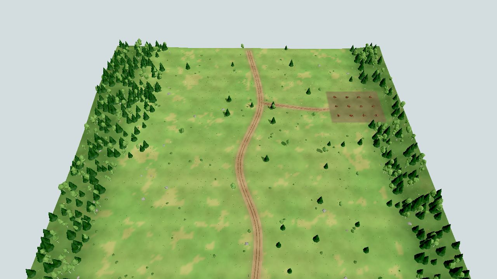 №1 — наша база | 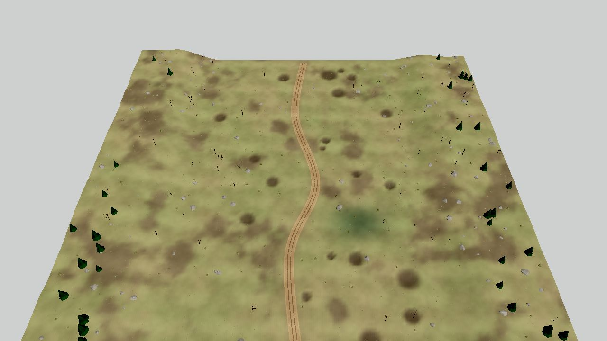 №2 — поле боя |
| 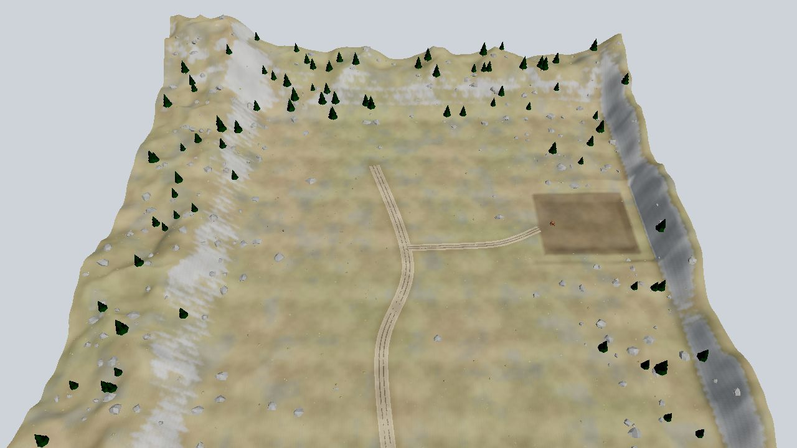 №3 — вражеская база | 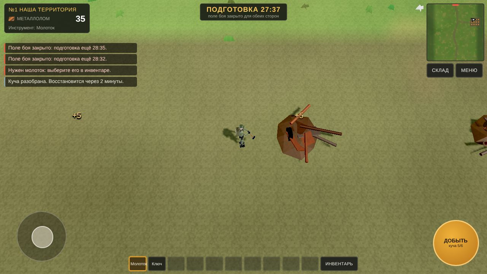 Добыча молотком |
| 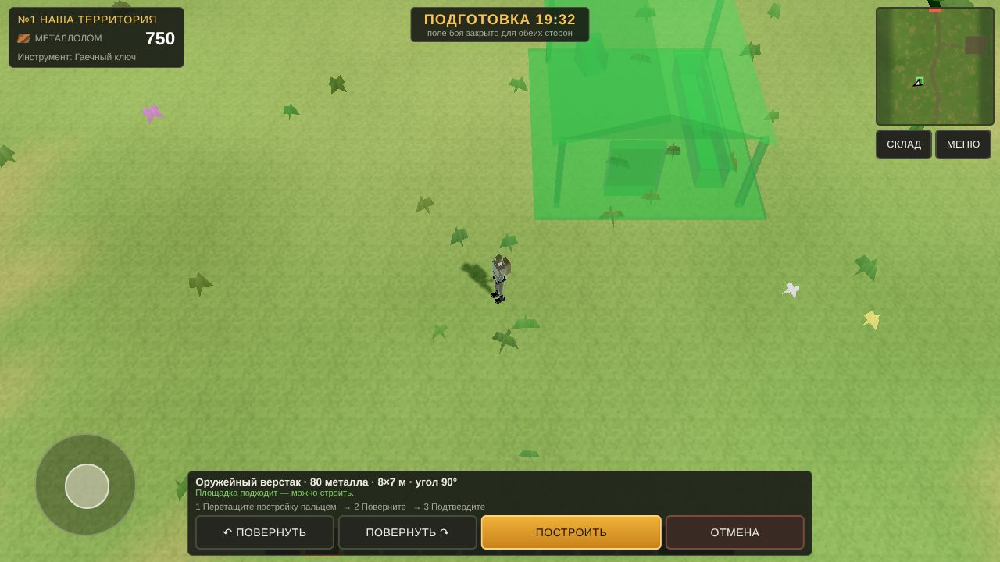 Призрак: можно строить | 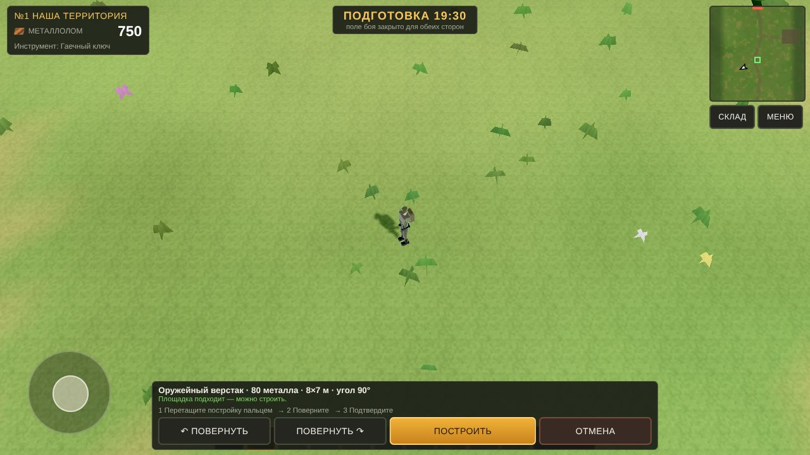 Призрак: нельзя (дорога) |
| 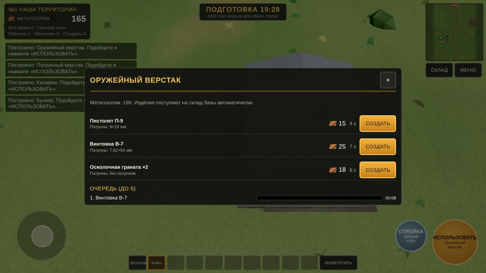 Производство | 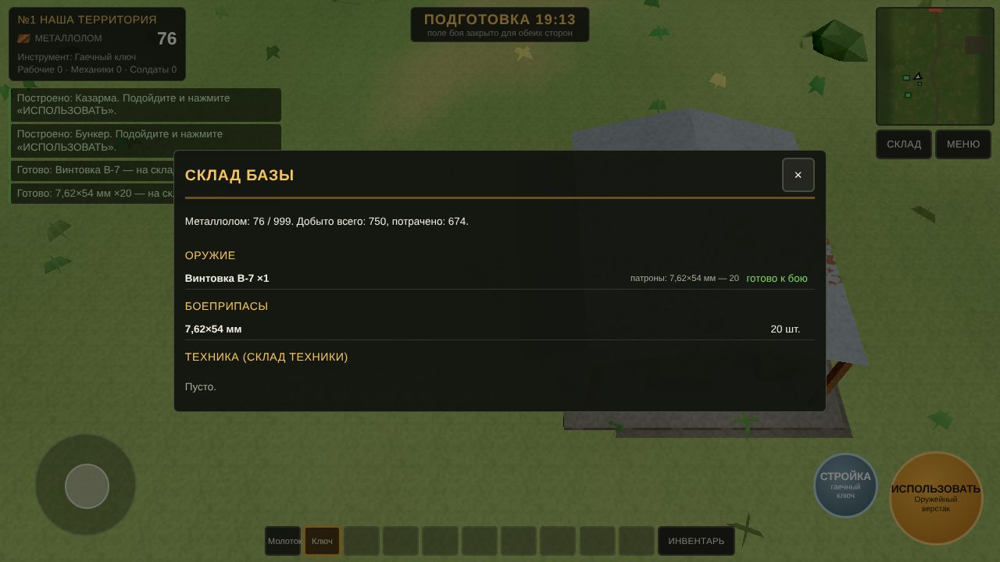 Склад |
| 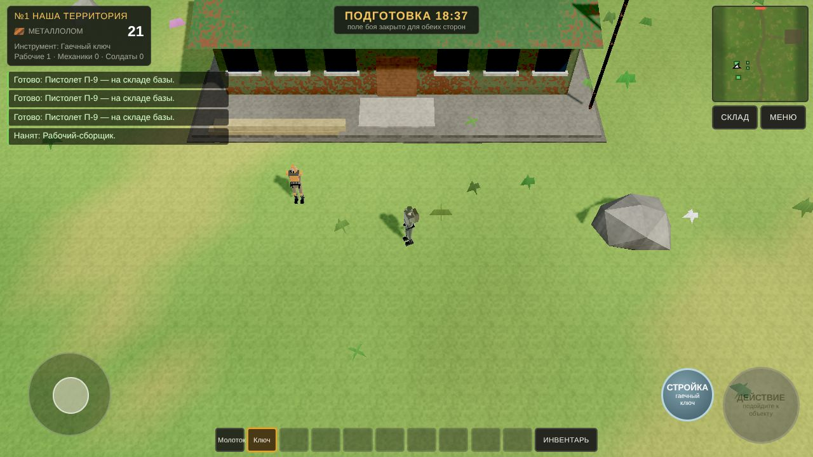 Найм в казарме | 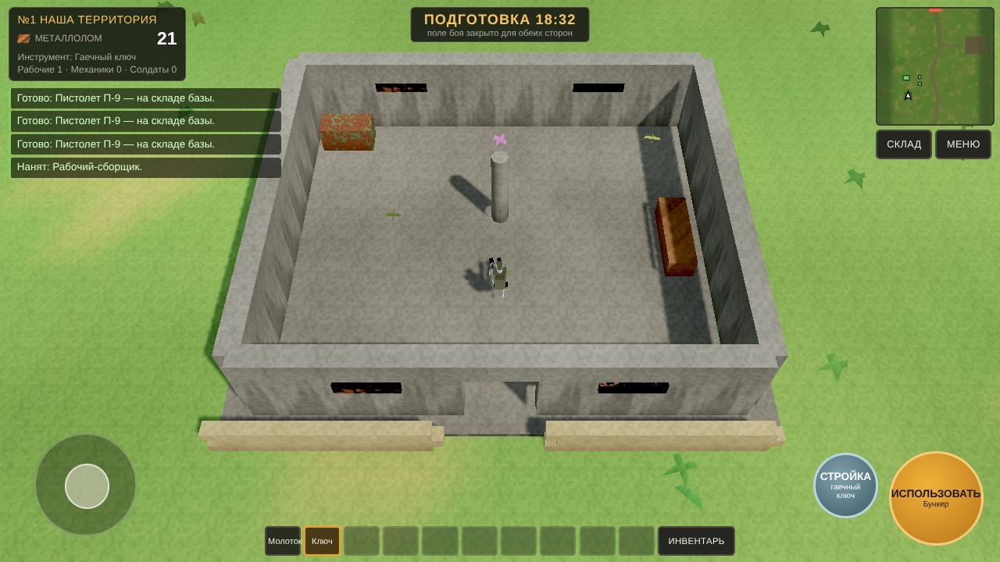 Внутри бункера |
| 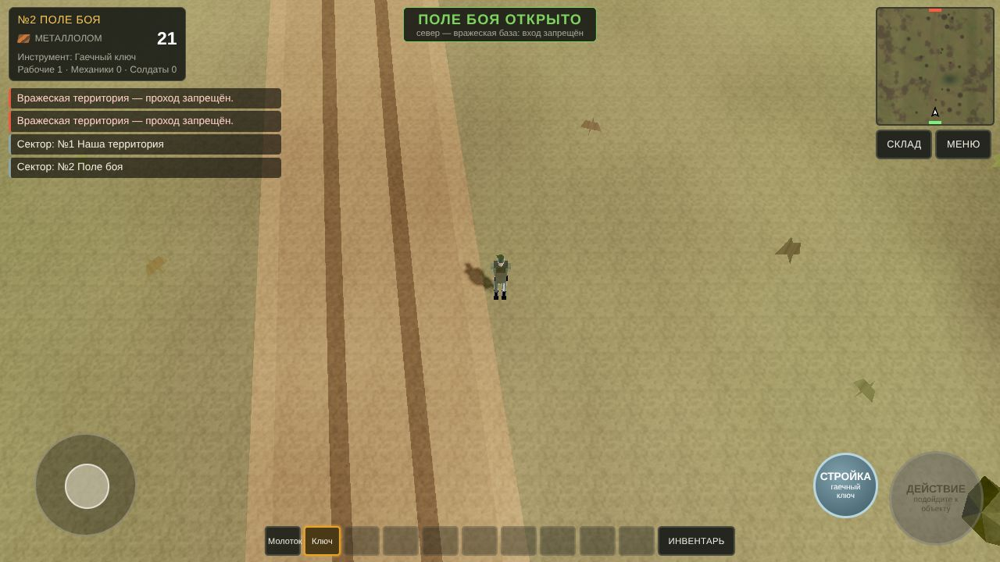 После 30:00 — на поле боя | 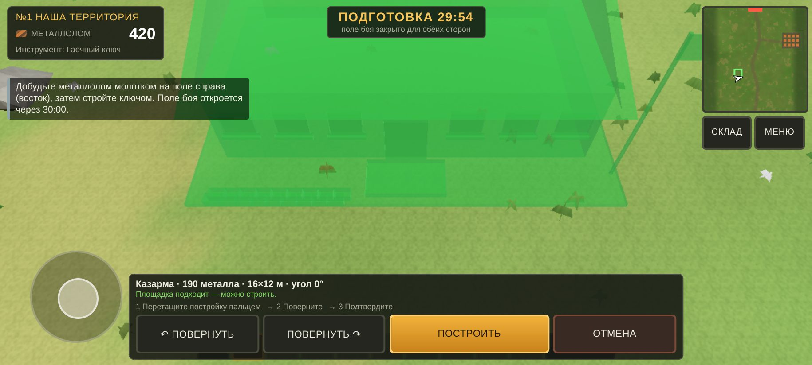 Размещение на телефоне |

### Что ещё не реализовано

- **Этап 6** — самостоятельная работа нанятых людей: рабочие не ходят добывать сами, механики не ремонтируют, солдаты не берут оружие со склада. Сейчас люди стоят у казармы.
- **Этап 7** — выполнение приказов из штаба на карте и гарнизон бункера: приказы выбираются и сохраняются, но люди их пока не исполняют.
- **Этап 7а** — видимые войска врага и бой на поле боя. Враг развивается «на бумаге» (здания и люди считаются честно), но на №2 его солдат пока нет.
- Управление техникой (машины производятся и учитываются на складе, водить нельзя).
- Модели из каталога Tripo: все здания, деревья и инструменты пока процедурные low-poly.
- APK: в этой среде нет Android SDK. Веб-сборку можно завернуть в Capacitor или Trusted Web Activity.
- Частота кадров на реальном телефоне не измерена — в контейнере нет GPU.

## Устройство

```
frontline/
  index.html, style.css, main.js   — запуск, игрок, камера, режим размещения
  ui.js                            — HUD, окна стройки, производства, склада, казармы, штаба
  sim/campaign.js                  — состояние кампании, команды, сохранение
  sim/enemy_director.js            — экономика врага (перенос enemy_director.gd)
  world/terrain.js                 — рельеф, дороги, окраска, лучи к земле
  world/sector.js                  — сборка сектора, проверки размещения, крыши
  world/models.js                  — модели 12 зданий, куч, деревьев, инструментов
  data/*.json                      — данные из пакета постановки без изменений
  spec/                            — постановка задачи (START_HERE, роадмап, приёмка)
  docs/                            — скриншоты и журнал тестов
```

Движок общий с «Долгом»: `engine/` (рендер, тени, физика, камера, звук); добавлены шейдеры рельефа и полупрозрачного призрака.
