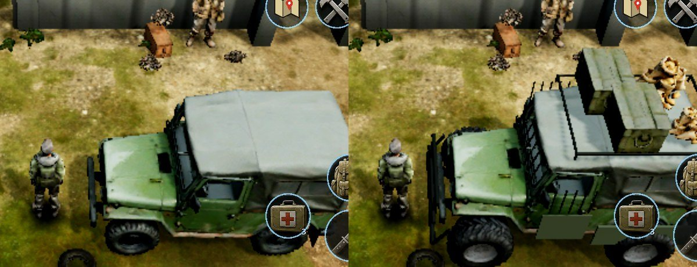
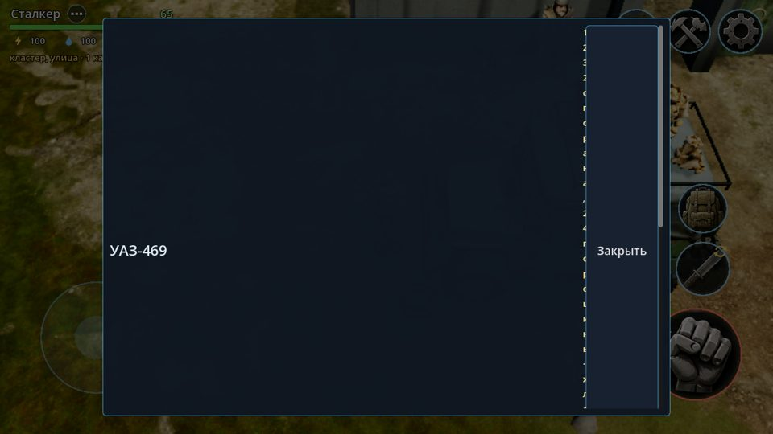

# Замыслы, которые ещё не делаются (только описание)

Здесь — полные описания механик, которые решено сначала продумать, а делать позже. Все числа — предложение для
обсуждения, а не утверждённый баланс; при реализации они уйдут в `data/*.json`, как остальные.

---

## 5. Своя машина на локации

### Уточнение пользователя (22.11) — главное
- Машина — **УАЗ** (дальше его можно модернизировать и улучшать), в **натуральную величину**.
- Подошёл к машине — персонаж **садится в неё**, и можно **ездить по карте, на которую приехал**.
- **Багажник вместительный**, со своим **окном инвентаря**: класть в него разные вещи и брать из него.
- У машины есть **прочность (ХП), и её много**; получила урон — **ремонт на базе в гараже**.
- Сейчас — машина и механика; когда сделаем **гараж** — машина целиком: ремонт, модернизация, улучшения.

### Этап 1 — сделано (22.11, `core/world/car.gd`, `data/car.json`, проверка `--as-test=car --as-place=cowshed`)
- УАЗ стоит у точки входа каждой временной локации, сбоку от тропы, мордой внутрь, на свободном месте.
  Размер — как у УАЗ-469: 4,0 × 2,07 × 2,16 м. Пока модель — прежний УАЗ из конвоя; УАЗ-469 в высоком качестве
  заказан в Tripo и заменит её (одна строка в `data/car.json`).
- У водительской двери (слева) — кнопка «Сесть» (рукопожатие). За рулём: джойстик — куда наклонён, туда машина
  поворачивает и едет (сильнее — быстрее, до ~54 км/ч), назад — тормоз и задний ход; поворачивает только на ходу;
  кнопки «Выйти», рюкзак и лечение остаются, оружия нет. Камера выше и дальше. Сверху — прочность и скорость.
- Прочность 600: удары врагов, пока герой в машине, достаются машине (герой цел); удар о стену или дерево на
  скорости — по силе удара; сбитый пустыш на скорости гибнет (машина чуть мнётся), лоторейщика отбрасывает, о
  Рубера машина встаёт как о стену. Ниже 30 % — дым из-под капота; при нуле не едет, удары снова достаются герою.
- Багажник (сзади, кнопка «Багажник»): хранилище на 30 ячеек — окно как у сейфа («Взять всё», «Положить всё»,
  «Сортировать»). Прочность и багажник хранятся в сохранении базы и переходят из посещения в посещение.
- Звук мотора — свой синтез (`tools/make_car_assets.py`), тон растёт со скоростью.
- Числа — предложение, не утверждённый баланс (`data/car.json`).

### Этап 2 — сделано (22.11, просьба: «можно и по базе ездить; у неё есть топливо, его надо отдельно покупать;
### создай машину с возможностью модернизировать — колёса, вместимость багажника — и чтобы это меняло её вид»)

- УАЗ стоит и на базе рядом с героем — по базе тоже можно ездить.
- **Бензин**: бак 30 л, на старте 15 л, расход 2,5 л на км (на ходу), кончился — мотор не тянет, машина докатывается
  и встаёт; на экране за рулём — сколько литров. Покупается отдельно на базе: +10 л за 8 споранов или полный бак.
- **Окно «УАЗ»** (на базе — кнопка «Улучшить» у капота): прочность, бензин, багажник; «Бензин +10 л», «Полный
  бак», «Починить» (6 споранов и 1 хлам за каждые 100 прочности); четыре улучшения по 2 уровня:
  - **Колёса**: внедорожные (+10 % скорости и поворота) → грязевые 35″ (+20 %); колёса крупнее, кузов выше, колёса
    крутятся на ходу, передние поворачивают;
  - **Багажник**: решётка на крыше с ящиком и мешками (45 ячеек) → экспедиционный: ещё ящик и мешки, ящик на заднем
    бампере (60 ячеек);
  - **Броня**: кенгурятник (прочность 800, сбитые меньше мнут машину) → бронелисты на дверях и бортах, решётки на
    окнах и лобовом (1100);
  - **Бак**: пара канистр на задней двери (45 л) → вторая пара (60 л).
  Платится споранами, горошинами и хламом (всё до конца — 760 споранов, 6 горошин, 56 хлама). Числа и цены —
  предложение (`data/car.json`). Проверка `--as-test=carmod` (база).

### Дальше (когда будет гараж)
- Гараж базы: машина стоит там, ремонт за ресурсы, модернизация УАЗа (броня, решётки на окна, усиленный бампер,
  бак, вместительнее багажник, багажник на крыше, фары, лебёдка), внешний вид по уровням.
- Анимации посадки и выхода (движения уже заказаны в Tripo: сесть, выйти, руль, починка у колеса и под капотом),
  крутящиеся колёса (колесо отдельной моделью заказано), открытие дверей, бензин, шум мотора для заражённых.

### Зачем
Машина даёт три вещи: быстро доехать до дальнего края локации, увезти больше добычи (багажник) и уйти от толпы.
Плата — шум (мотор слышно издалека), бензин и ремонт. Машина не делает героя неуязвимым: на малой скорости
заражённые цепляются за двери, лотерейщик прыгает на капот, Рубер бросает камень в лобовое.

### Как получить
1. **Найти и починить.** На временных кластерах стоят брошенные машины (гараж Хутора, легковушки у санатория).
   Одна из них в каждом посещении (выбор по случайности посещения) — «живая»: у неё горит значок ключа. Подходишь
   — кнопка «Осмотреть»: окно с тем, чего не хватает: **аккумулятор, канистра бензина, колесо, свечи** (1–3 из
   списка). Детали — новая добыча в ящиках гаражей, багажниках, у механиков и у барахольщика.
2. **Починка** — кнопка «Чинить» (у машины, детали в инвентаре): 6–10 секунд, герой присаживается у колеса или
   наклоняется под капот (кнопка удержания; получил удар — починка прерывается, сделанное сохраняется).
3. Починенную машину можно сразу вести. Если выехать на ней с локации — она становится **своей** и стоит в
   **гараже базы** (новое улучшение базы «Гараж», покупается в компьютере базы). Дальше в каждый маршрут её можно
   взять с собой: она стоит у точки входа.

### Управление (телефон)
- **«Сесть»** — кнопка-рукопожатие у водительской двери (как «взять»). Внутри интерфейс меняется: джойстик слева
  — руль и газ (наклон вперёд — газ, куда наклонён — туда поворачивает, сильнее наклон — быстрее; оттянуть назад
  — тормоз, затем задний ход), справа кнопки **«Сигнал»**, **«Тормоз»** и **«Выйти»**.
- Камера поднимается выше и отъезжает (обзор ×1,3), смотрит вперёд по ходу — чтобы на скорости видеть, куда едешь.
- Модель езды — «аркадная», без настоящей физики подвески: машина сама держится на земле (4 луча под колёсами),
  поворачивает по радиусу, на грунте чуть заносит. Это дёшево для телефона и не даёт перевернуться на ровном
  месте. Скорость: до ~55 км/ч на дороге, ~35 по траве, по лесу — медленно (деревья — препятствия).

### Бензин, прочность, багажник
- Бак 30 л, расход ~1 л на 400 м; канистра — +10 л. Полоска бензина на экране. Кончился — машина глохнет.
- Прочность машины 100: удар о стену, дерево или технику — минус по скорости удара, сбитый заражённый — 3–8,
  камень Рубера — 25. Ниже 30 — из-под капота дым, ниже 10 — плохо заводится, 0 — горит: 3 секунды выйти, потом
  взрыв (урон рядом). Чинится на базе запчастями (хлам + детали) у механика или самим героем.
- **Багажник** — 12 ячеек (как ящик), открывается кнопкой у задней двери. Главная польза — увезти больше.
- Машина, оставленная на локации к перезагрузке кластера, **пропадает вместе с багажником** (как вещи погибшего).

### Заражённые и машина
- Сбить: пустыша на скорости больше ~25 км/ч — насмерть, меньше — отлетает и встаёт; лотерейщик — падает, теряет
  здоровье; Рубер — машина останавливается как об стену. Кровь на капоте и лобовом стекле.
- На малой скорости и стоя заражённые подбегают и бьют по корпусу (урон машине), цепляются за дверь; если герой
  выходит, когда рядом враги, — его хватают сразу.
- **Шум:** заведённый мотор слышно за 35 м, газ — за 60, сигнал — за 90 м: собирает заражённых (можно увести
  толпу от места). Голод заражённых усиливает это: в 3-й стадии на шум бегут дальше.
- Выезд с локации на машине — сразу при пересечении края, без 5-секундного отсчёта.

### Анимации
Герой: подойти к двери, открыть (дверь на петле поворачивается), сесть (переход 0,8 с, тело садится на сиденье,
руки на руль — та же постановка кистей, что у оружия), сидеть (покачивание на кочках), крутить руль (кисти
по ободу, руль поворачивается), обернуться назад при заднем ходе, выйти, выпасть из горящей машины, починка у
колеса и под капотом. Машина: вращение и поворот колёс, наклон кузова в поворотах и при торможении, подскок на
кочках, дым выхлопа, пыль из-под колёс на грунте, фары (в подвалах и тени), стоп-сигналы, вмятины и трещины на
стекле по прочности (смена частей модели), дым и огонь. Звуки: мотор (тон по оборотам), заводится / глохнет,
сигнал, визг тормозов, удар, хлопок двери.

### Что понадобится
- Модель машины с отдельными колёсами и дверями (Tripo даёт цельную модель — колёса и двери отделим или сделаем
  отдельными моделями; ~2–3 модели, ~100–150 кредитов из оставшихся 840), 3–4 модели деталей.
- Файл `data/vehicles.json`: скорость, разгон, поворот, бак, расход, прочность, багажник, шум.
- Этапы: 1) езда во дворе базы (управление, камера, столкновения); 2) находка и починка на локации, гараж базы;
  3) заражённые, урон, шум, багажник, выезд; 4) анимации и звуки; 5) замер кадров на телефоне.

---

## 6. Спасённые выжившие на базе и набеги на базу

### Откуда люди
- На временных кластерах вместе с перезагрузкой появляются **новички** — люди, которые только что попали в Улей.
  В посещении — 0–2 новичка (по случайности посещения): заперлись в комнате, на чердаке, в погребе, сидят на
  крыше техники. Слышен **зов о помощи**: на экране — значок направления, на карте локации — примерная точка.
- Добраться, перебить заражённых рядом, поговорить (рукопожатие) — новичок идёт за героем.
- **Сопровождение:** держится в 2–3 м за героем, обходит препятствия по карте проходимости, приседает и
  прячется, когда герой стреляет; если заражённые близко — паникует и бежит к герою. У него своё здоровье; его
  могут убить. Довести до края локации до конца таймера — он на базе. Погиб или не успел — потерян.
- Новичок может принести дар (по книге — у многих есть дар): у некоторых — полезная особенность (см. ниже).

### Жизнь на базе
- **Жильё:** новое улучшение базы «Койки» (уровни: 2 → 4 → 6 мест). Без места спасённого не принять (он уйдёт
  к другим — с наградой спорами за спасение).
- У каждого — имя, внешность (одна из моделей героев в другой одежде), **роль** и уровень умения 1–3:
  - **Механик** — чинит оружие дешевле и быстрее, позже — машину; со временем делает патроны из хлама;
  - **Медик** — раз в маршрут делает бинты и аптечки из трав и ткани, лечит героя на базе бесплатно;
  - **Хозяйственник** — огород и колодец: вода и еда раз в маршрут;
  - **Добытчик** — уходит в короткую вылазку сам (пока герой на маршруте) и приносит хлам, спораны, иногда
    горох; есть риск ранения и гибели (шанс по уровню и снаряжению);
  - **Охранник** — стоит у входа, в набег защищает базу оружием, которое ему выдали из хранилища.
- **Компьютер базы → вкладка «Люди»:** список, роль, умение, здоровье, что сейчас делает; назначить работу,
  выдать оружие и патроны, отпустить.
- **Что им нужно:** раз в маршрут каждый съедает 1 еду и выпивает 1 воду из хранилища. Не хватает — настроение
  падает, после двух голодных маршрутов человек уходит.
- **Видно в игре:** люди ходят по базе и работают — механик у верстака, медик у стола, хозяйственник у огорода и
  колодца, охранник ходит у входа; с ними можно поговорить (короткие реплики по роли и настроению).

### Набеги
- Раз в 3–6 маршрутов (или по событию на карте мира) на базу идёт **набег**: муры (за людьми и добычей) или
  толпа заражённых из соседнего кластера.
- **Предупреждение** за 2 минуты: «С севера движение — муры!» — направление удара на экране и на карте базы.
  Если герой в это время на маршруте — набег решается без него по силе обороны.
- **Оборона:** улучшения базы — стены и ворота (уровни прочности), баррикады, ловушки, пулемёт на крыше бункера
  (ПКП, стреляет охранник или герой), фонари. Охранники стреляют сами.
- **Ход набега:** 2–3 волны с одного-двух направлений; муры подрывают ворота и стреляют из укрытий (их ИИ уже
  есть в логове), заражённые бьют стены и лезут через пролом. Набег окончен, когда все нападавшие убиты.
- **Итог:** победа — добыча с тел, шанс жемчужины, рост настроения людей. Поражение — часть содержимого
  общих ящиков унесена (сейфы хранилища не трогаются), люди ранены или похищены (похищенного можно отбить в
  логове муров — новое задание).
- Без героя: исход считается по сумме — охранники × уровень и оружие + стены + ловушки против силы набега; итог
  — в сообщении при возвращении.

### Этапы
1) новичок на локации: зов, разговор, сопровождение, вывод; 2) жильё и люди на базе (вкладка «Люди», роли,
прогулки и работа); 3) хозяйство: еда/вода, работа ролей, вылазки добытчика; 4) набеги: предупреждение, волны,
оборона, итог с героем и без; 5) баланс и проверки. В кооперативе люди и набеги — общие для мира.

---

## 9. Кооператив в кластере (вдвоём на одной локации)

### Что уже есть
Выделенный сервер (этап 1, `docs/COOP.md`): миры на двоих, код приглашения, общие маршруты, хранилище, кошельки
на сервере, миссия на мир, правила добычи «кто первый взял». Нет самого главного — **играть вдвоём на одной
локации**.

### Как будет устроено
- **Одна и та же локация у обоих.** Локация строится по зерну посещения (`cs_seed`); сервер выдаёт зерно обоим,
  и телефоны строят одинаковые постройки, ящики и останки. Сначала нужна проверка, что все генераторы зависят
  только от зерна (сравнение «отпечатка» локации на двух запусках).
- **Сервер ведёт врагов.** На сервере та же игра без экрана держит локацию с картой проходимости и ИИ
  заражённых и муров для обоих игроков; телефоны врагов не «думают», а только показывают.
- **Что идёт по сети** (ENet, UDP 7777):
  - телефон → сервер 20 раз в секунду: положение, поворот, скорость, стойка, оружие в руках; сервер проверяет
    правдоподобие (не быстрее бега, не сквозь стены);
  - сервер → телефоны 10–15 раз в секунду: враги в 60 м от любого из игроков (положение, поворот, состояние,
    клип, здоровье) и напарник; телефон показывает их на 0,1 с «в прошлом» и плавно ведёт между снимками —
    рывков нет;
  - события: выстрел (откуда, куда, чем) — попадание считает сервер; удар врага по игроку, гибель, тело,
    добыча (уже есть), таймер и голод заражённых — общие.
  - Трафик: ~40 врагов × ~16 байт × 12 раз в секунду ≈ 8 КБ/с — для мобильного интернета нормально.
- **Напарник на экране:** его модель (Сталкер / Лис / Рысь), имя над головой, красный шарф/бандана видны сверху;
  если ушёл за край экрана — стрелка у края. Кнопка **«Метка»**: тап по карте или по месту — точка видна обоим.
  Быстрые фразы: «Сюда!», «Помоги!», «Уходим!», «Тут добыча».
- **Ранен, а не убит:** в кооперативе при нуле здоровья герой падает и 20 секунд может ползти; напарник
  удерживает «Поднять» 4 секунды — встаёт с 30 % здоровья. Не подняли — гибель (сервер помнит её до конца
  миссии, как сейчас).
- **Общие правила:** таймер, стадии голода, предупреждения — одни на двоих; выходят каждый сам через край
  локации; миссия закрывается, когда живых на локации не осталось. Добыча — уже работающее правило «кто первый
  взял»; деньги и вещи — на сервере.
- **Сложность для двоих:** врагов больше в 1,4 раза, лотерейщики и муры заметнее (числа — в данных локаций).

### Этапы
1. Одинаковая локация по зерну у двух клиентов (проверка отпечатка).
2. Видеть друг друга: движение и анимации напарника через сервер, без врагов.
3. Враги на сервере: снимки и плавное ведение на телефонах; голод и таймер с сервера.
4. Стрельба, удары, урон, падение и подъём напарника, гибель.
5. Связать добычу, ящики, сейфы и кошелёк сервера с инвентарём в самой игре.
6. Проверка на двух настоящих телефонах через интернет. Для этого нужен сервер в интернете (арендованный VPS) —
   его сейчас нет; без него — проверка только в одной Wi-Fi сети. Без настоящих телефонов этап не будет
   объявлен проверенным.

### Риски
Задержка сети (до 150 мс терпимо при показе «в прошлом» и попаданиях на сервере), нагрузка сервера при
2 игроках и 60 врагах (сервер без экрана — проверим замером), стоимость сервера в интернете.
