# «Карьер» — нестабильный промышленный кластер

Код — `core/world/quarry.gd` (класс `ULQuarry`, наследник общего слоя временных кластеров), баланс —
`data/quarry.json`, маршрут — `data/base_shop.json` → `routes.quarry`, карта мира — `map.gd` (`PLACES.quarry`),
предметы — `core/world/items.gd`.

## Поле и рельеф
- Поле 180 × 140 м (x — 180, z — 140; выход за край по своей стороне — `size_z` в `world.gd`). Запад — посёлок,
  восток — выработка, по краям — смешанный лес (ели, сосны, берёзы).
- Выработка — эллипс 88 × 96 м с неровным краем (две гармоники, одна формула в коде и в проверках):
  бровка на 0 м, три уступа −4,5 / −9 / −13,5 м, стенки ~65° с шероховатой скалой (вершины сдвинуты шумом).
- Спуск — спиральный съезд для техники: с западной бровки по северной стороне на первый, второй уступ и дно
  (три пандуса, уклон 5–10°). Края съездов и полок — обрыв (можно упасть на нижний уступ); только у самого
  подножия съезда, где он невысоко над полкой (до 0,6 м), край — пологий откос: на съезд можно зайти и сбоку
  (раньше там оставалась ступенька 0,3–0,7 м, на которой герой застревал).
- Затопленная яма на юге: чаша 20 × 15 м, вода на −1,4 м.
- Земля посёлка — своя сетка (триангуляция Делоне) с вырезами по бровке и краю ямы; выработка — кольцевая сетка
  (43 кольца × 256 углов). Столкновения — по тем же сеткам (`ConcavePolygonShape3D`): сквозь скалу не пройти,
  под землю не провалиться. Карта проходимости для заражённых запекается вместе с уступами (`--as-test=qrbake`).
- Материалы (Poly Haven, CC0): скала — `quarry_wall` (слои породы по высоте, карта нормалей), полки —
  `rocks_ground_02` (серо-бурый щебень, три масштаба против повтора), пятна пыли; ниже — темнее. Осыпь у подножия
  стенок — валуны одной сеткой (`MultiMesh`), крупные — со столкновением. У стенки, закрывающей героя от камеры,
  — окно вокруг героя (как у построек).

## Посёлок (во все постройки можно зайти; крыша скрывается, стены срезаются — генератор `ULBlock`)
| Постройка | Где | Внутри |
|---|---|---|
| Общежитие рабочих (2 этажа, штукатурка) | северо-запад | коридор, комнаты с кроватями, тумбочками, шкафами, санузлы, бельевая, лестница |
| Общежитие №2 (деревянный барак) | запад | жилые комнаты, санузел, коридор |
| Столовая | запад | обеденный зал, кухня, холодильная, кладовая |
| Медпункт | север | палата с кушетками, процедурная, кабинет фельдшера |
| Мастерская | центр | цех с воротами: УАЗ на ремонте, разобранный двигатель, компрессор, генератор, барабан кабеля, бочки (машина, двигатель и барабан — тайники), верстаки; кладовая, техкомната, бытовка |
| Склад | центр-юг | зал: три ряда штабелей (поддоны, ящики, бочки, еврокубы, мешки) с проходами, три кладовые, широкие ворота |
| Контора карьера | юго-запад | кабинет начальника, диспетчерская (радиостанция, журнал), архив |
| Сараи ×2, гараж | юг, запад | — |

КПП со шлагбаумом и будкой на выезде (юго-запад), бетонный забор вдоль южного края посёлка, сетчатый — по западной
бровке; бытовки, туалеты, душевая, навес, спутниковая антенна, радиовышка, прожекторные мачты; вывески «Карьер
„Гранитный“», указатели, «Опасная зона», «Обрыв». Лес по краям — 220 деревьев (ели одной сеткой, сосны, берёзы,
дубы, сухостой).

Модели Tripo (18.11, 64 шт., 1900 кредитов; перечень и итог — `tools/tripo/budget.md`): техника и цех — detailed + PBR,
остальное — стандартные; текстуры ужаты (крупное — 2048/1024, мелочь — 1024/512, предметы — 512/256).

## Вид по видео-образцу (в работе)
Локация приводится к виду присланного пролёта над карьером (второй вариант видео: посёлок, серые
кровли, грунтовые дороги, тёмная слоистая порода). Сделано:
- кровля посёлка — листы профнастила (`q_rust`, `q_tin`; в шейдере построек — режим `sheet`): волна идёт вдоль
  ската, у каждого листа 1,05 × 2,4 м свой тон, по нахлёстам тёмные линии, ржавчина бурая; у общежития, медпункта
  и конторы — двускатные крыши со свесом. Прежняя текстура сплошной ржавчины вблизи выглядела размытыми полосами;
- земля: грунтовые дороги и дворы у построек вместо сплошной утоптанной площадки, между ними трава;
- борта выработки: тёмная холодная порода с вертикальными трещинами и швами пластов, охристая кромка уступов;
- за краем поля — только туман границы кластера: рамка тумана идёт далеко за край и в 10–40 м от него
  становится сплошной, за ней ничего не видно (`_edge_fog`, параметр `solid` — только у карьера). Леса и холмов
  на заднем плане нет (были добавлены и убраны по решению автора игры);
- у наружных дверей — тёплое пятно света на земле и лампа над входом, у минеральных жил — голубой отсвет
  (`_q_glows`: один MultiMesh с прибавляющим смешением, настоящих источников света нет);
- солнце теплее, дымка светлее.

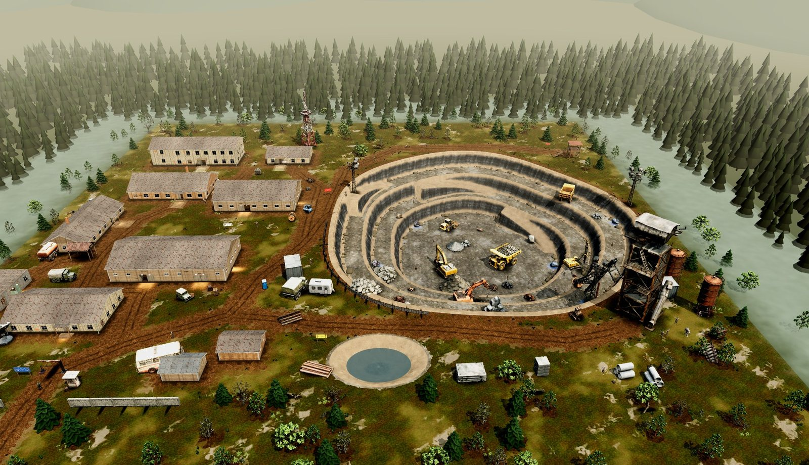
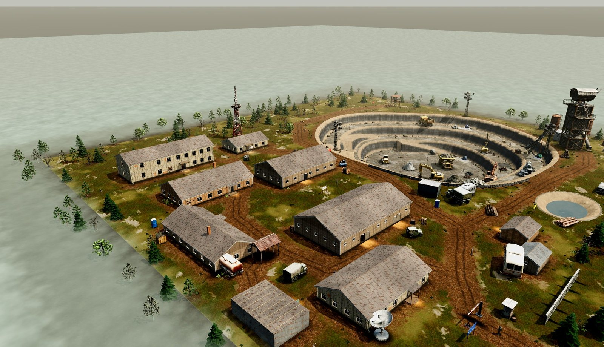

Чего до образца не хватает: образец — нарисованный ролик (без ограничений по числу деталей и свету), игра — живая
сцена для телефона. Осталось: более рваный рельеф породы и осыпи, плотнее мелкие детали посёлка (столбы, заборы,
бочки, ящики), свет в окнах, крупные кристаллы, деревья внутри поля выше и гуще (сейчас они низкие, чтобы не
закрывать героя). На телефоне вид не проверялся.

## Техника и промышленные объекты (модели Tripo, неподвижные; кабины — тайники)
Экскаватор ×2, карьерный самосвал ×2, фронтальный погрузчик, буровая установка — на дне и уступах;
топливозаправщик, вахтовый автобус, УАЗ, «Урал», ГАЗ-66 — в посёлке. Дробильный цех на юго-восточной бровке,
к нему — конвейер с первого уступа (секции модели по наклонному отрезку, опоры до земли), два силоса,
сторожевая вышка на северо-востоке (подъём по маршу, навес скрывается, ящик наблюдателя — тайник).

## Добыча
- Тайники в постройках (тумбочки, шкафы, столы, кухонные и медицинские шкафы, стеллажи склада) и вне их: кабины
  техники, кузова, металлолом, кабельные барабаны, ящики, **минеральные жилы** и **кучи руды**. Таблицы — `loot`
  в `data/quarry.json`.
- На земле у жил и куч руды — минералы (10–16 бросков, остаются те, что легли на ровное место своей полки — обычно
  7–11), у техники — запчасти, кабель, металлолом; в постройках — кучки хлама. Каждое посещение — заново. Находка
  лежит на высоте своего уступа (раньше все находки временных кластеров ставились на нулевую высоту — над уступами
  они висели в воздухе); та, к которой не подойти (вне карты проходимости), сдвигается к проходу или убирается.
- **Ресурсы на полу построек** (`ULQuarry.floor_loot`) — в каждой из 10 построек, включая сараи и гараж, и каждое
  посещение по-новому: часть свободных мест комнат (доля `floor_share` 30–55 %, не больше `floor_max` 8 и не меньше
  одной находки на постройку) занята находками по назначению комнаты — в жилых еда, вода, бинты, патроны; на
  кухне и в столовой консервы; в цехе, гараже и сараях запчасти, кабель, металл; в медпункте медицина; в конторе
  электроника (`floor_loot` в `data/quarry.json`: вид комнаты → [предмет, от, до, вес]). В проверочное посещение —
  35 находок девяти видов; в соседнем посещении из них на прежних местах осталась одна.
  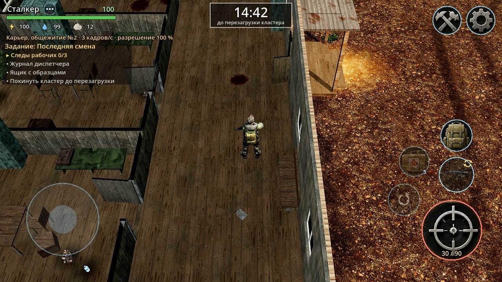
- Каталог для барахольщика (`ULItems.catalog()`): у каждого предмета — название, иконка/модель, масса (kg),
  стопка, категория (`mineral` минералы, `tech` технический хлам, `tool` инструменты, `parts` запчасти), редкость,
  базовая цена в ресурсах Улья (спораны, горох). Сам барахольщик эти предметы пока не покупает — торговля
  подключится позже; цены правятся в `items.gd`.

## Заражённые
Пустыши 40–60, лоторейщики 5–12, Рубер 0–1 (шанс 40 %) — заново при каждом входе, по зонам с весами
(`zones_*`): посёлок, дороги, дно и уступы, у техники, у дробилки, у ямы, лес, внутри построек. Лоторейщики —
в основном внизу и у дробилки; Рубер — только на просторе (дно, первый уступ, у дробилки), не в комнатах.
Заражённые бывают в любой постройке, и в сараях с гаражом тоже: за 12 посещений подряд в каждой из 10 построек
кто-то был, раскладка по постройкам ни разу не повторилась (проверка `qr`).
Убитые не возрождаются в это посещение. Общий ИИ кластеров: дальние — упрощённые, ближние — полные.

## Задание «Последняя смена»
1. Следы рабочих 0/3 — жетон с останков, личные вещи (каска, письмо), пропуск; места — по 4 кандидата на вид,
   в каждое посещение находка — в одном из них.
2. Журнал диспетчера — в диспетчерской конторы.
3. Ящик с образцами особой партии — в одном из трёх ящиков с образцами (дробилка, второй уступ, у склада).
4. Покинуть кластер до перезагрузки — награда (`quest.reward`: 30 споранов и горошина) при выходе за край.
Находка засчитывается, когда предмет попал в инвентарь. Панель этапов — слева вверху.
Кооператив: совместного прохождения одной локации ещё нет (см. `COOP.md`), поэтому общий прогресс задания для
двух игроков пока не сделан.

## Таймер и маршрут
15 минут, предупреждения за 5 и 2 минуты, тревога за 30 с; таймер не останавливается (обыск, постройки,
инвентарь). На нуле — перезагрузка: герой погибает, всё при себе теряется, маршрут закрывается, база цела.
Маршрут — 38 споранов (карта локации — ещё 13), карточка «Карьер» (кирка) в компьютере; новая локация сразу попадает в набор вместо
случайной некупленной. На карте мира — справа от дома, рядом с «Опасным коровником».

## Проверки
`--as-test=qr` (посещение по списку ТЗ), `--as-test=qr --as-reset` (перезагрузка кластера),
`--as-test=qrview` (снимки; `--as-only=…` — выбранные, в том числе `m0_minerals` и `c0_combat`),
`--as-test=qrbake` (кэш построек, карта земли, карта проходимости), `--as-test=qrperf` (нагрузка при наибольшем
числе врагов), «Лаборатория → Тест уровней → Карьер → Замер FPS».

Итог 19.11: `qr` — без ошибок, в том числе новые проверки: вход во все 10 построек, ресурсы на полу в каждой,
другая раскладка в другое посещение, заражённые в любой постройке.
Итог 18.11 (в контейнере разработки, программная отрисовка): `qr` — 26 из 26, `qr --as-reset` — 26 из 26.
Нагрузка (`qrperf`, 73 врага — наибольшее по настройкам, 10 мест, средняя графика): вызовов отрисовки до 192 при
бюджете 350, треугольников до 427 тыс. при бюджете 450 тыс. (у дробильного цеха; было 646 тыс. — лес стал реже,
дальние заражённые упрощаются, настоящая тень — у шести ближайших), текстуры 186 МБ при бюджете 450. Частота кадров
здесь не показательна (нет видеокарты: 7–18 к/с); на телефоне не измерялась — «Замер FPS» в игре пишет файл отчёта.

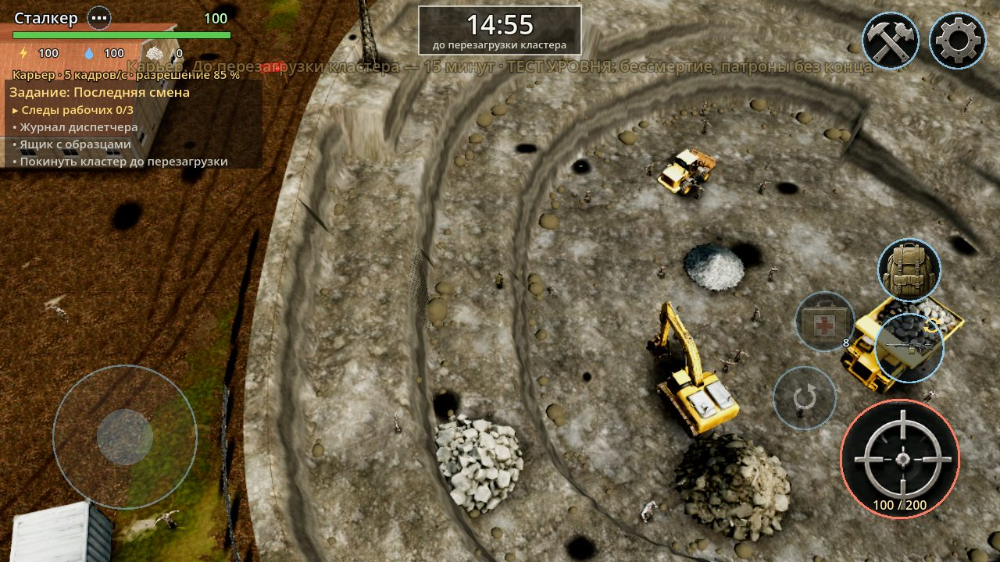 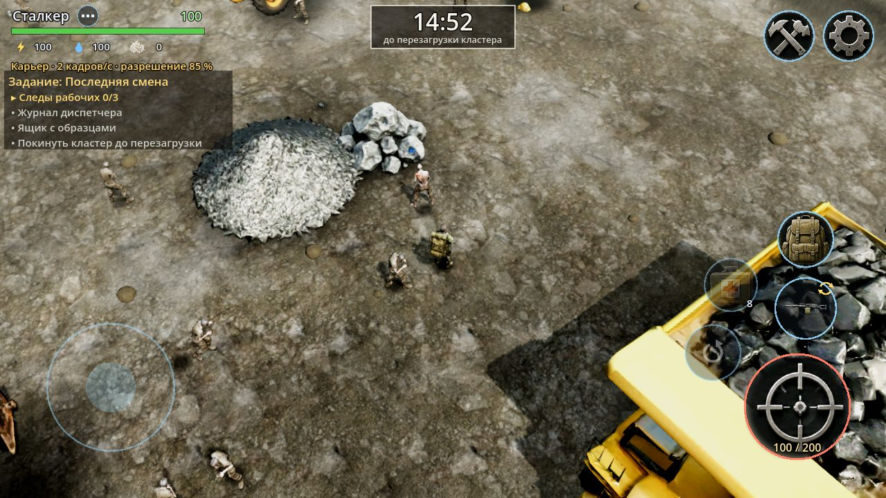 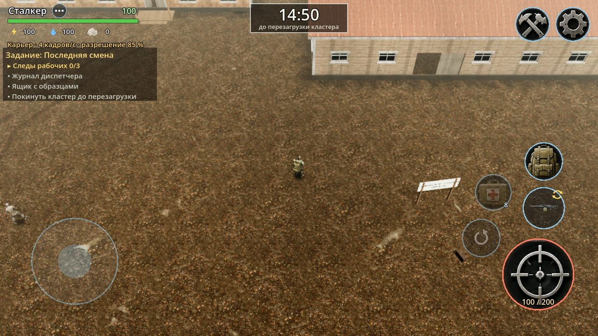
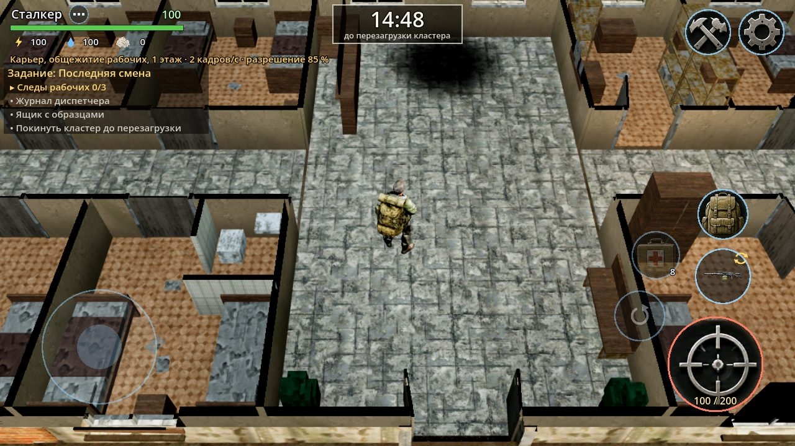 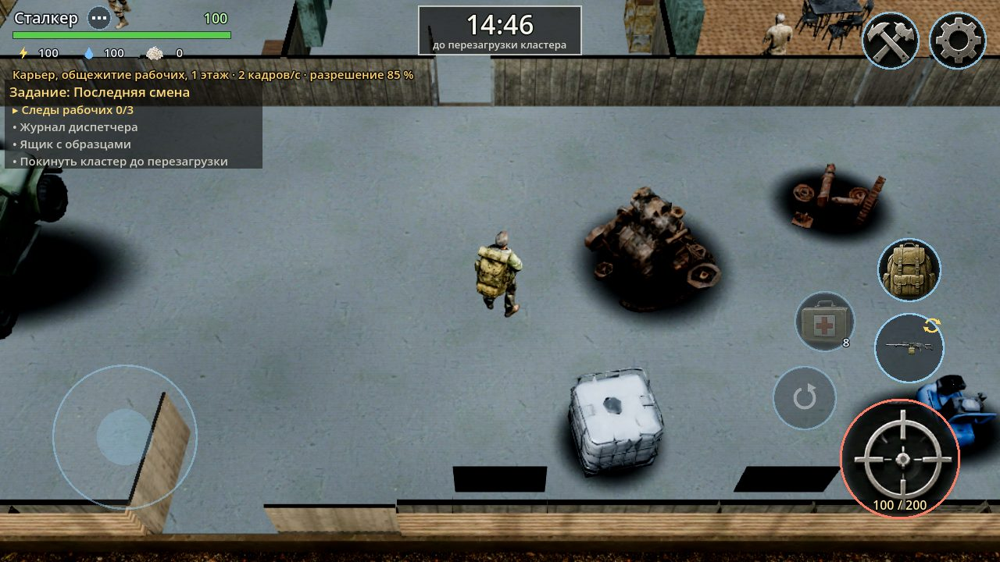 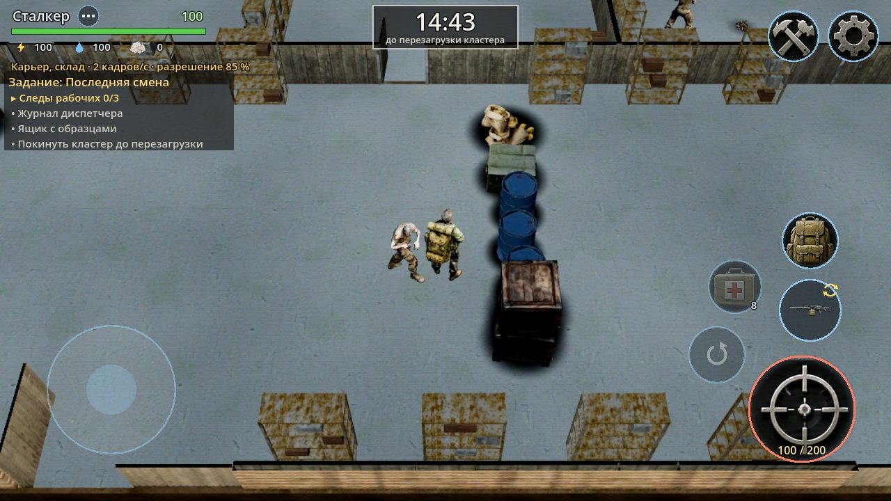
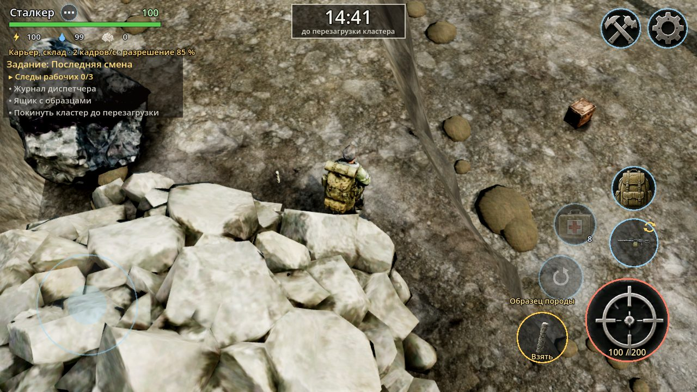 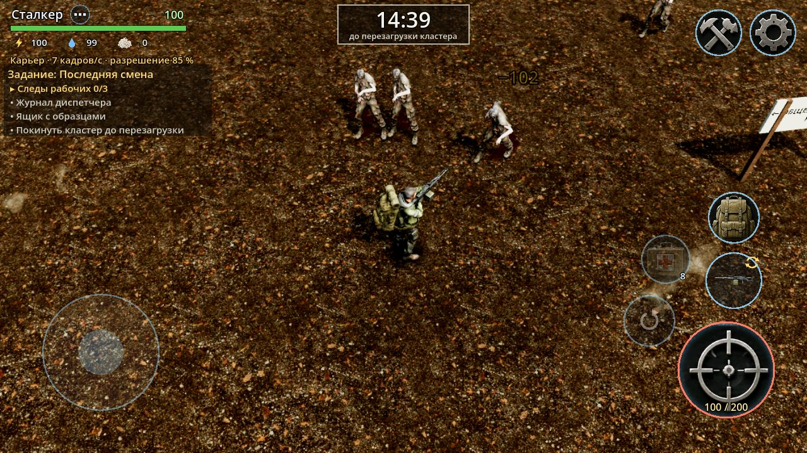

