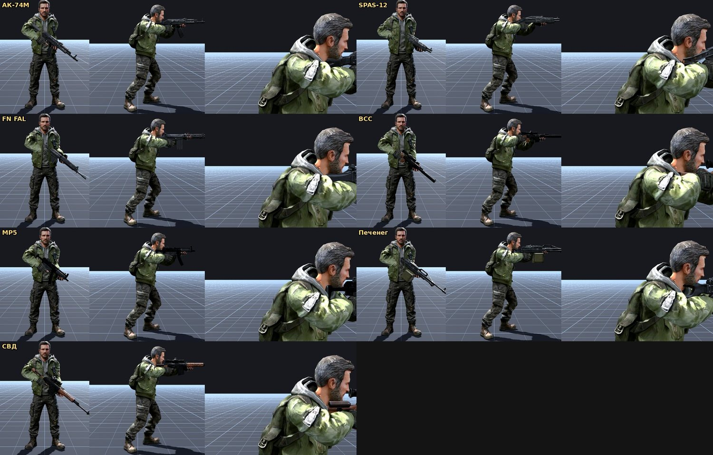
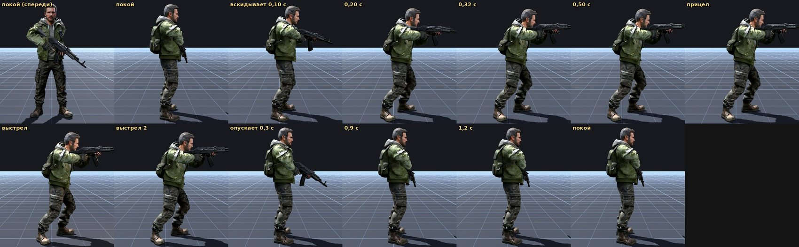
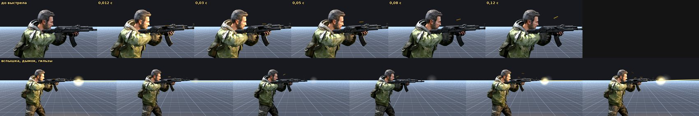
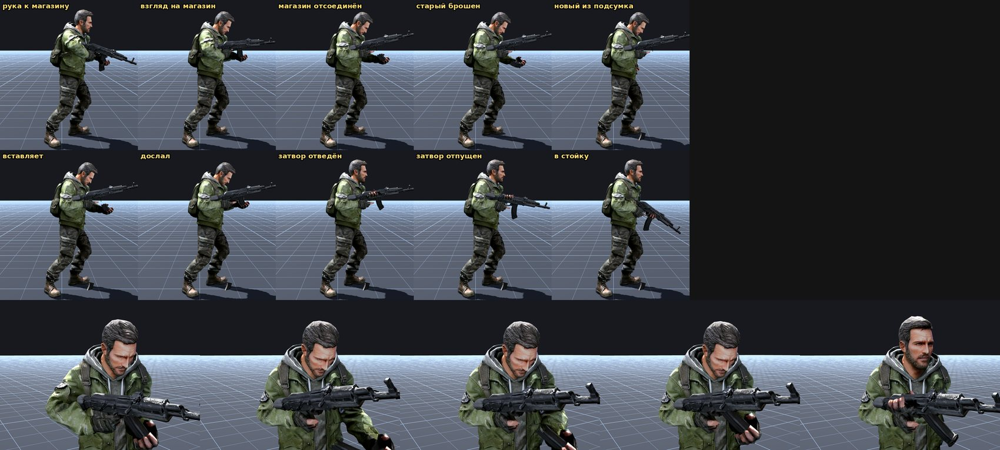
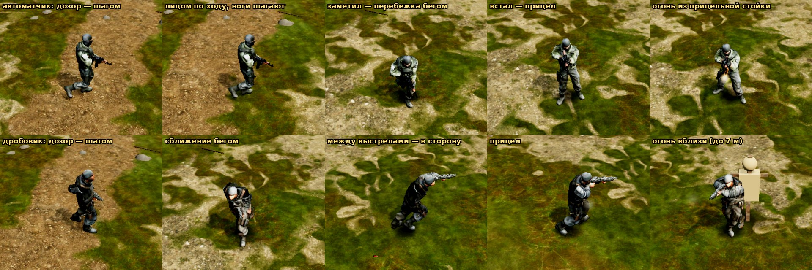
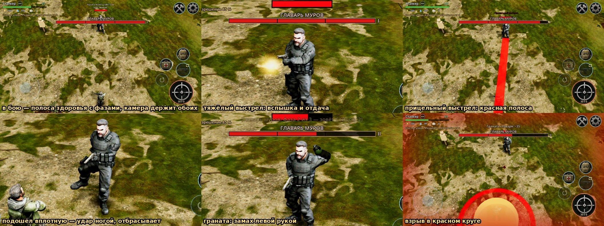

# Стенд анимаций

Стартовая локация (стабильный кластер для проверки) — `docs/WORLD.md`. Приложение открывается на ней.

Отдельное приложение для проверки движений одного персонажа (герой бункера, модель и скелет Tripo). На нём
исправляется главный дефект прошлых игр: персонажи неправильно держат оружие, руки и ноги стоят неестественно.

## Что внутри
- 56 движений в девяти группах: без оружия, пистолет ТТ, автомат АК-74М, дробовик SPAS-12, FN FAL, ВСС, MP5,
  пулемёт «Печенег», холодное оружие.
- Палец по экрану вращает камеру, два пальца приближают. Справа кнопки видов: спереди, сбоку, сзади, сверху, руки, ноги.
- Внизу: пауза, скорость (1× / 0.5× / 0.25×), «Хват: новый / как было», отметки «Годится» и «Брак», «Итог».
- «Итог» показывает список отметок: сделать снимок экрана и прислать.

## Как устроен новый хват (`core/weapon_hold.gd`)
- Оружие стоит в позе относительно груди (стойки: прицел, наготове, бег), а не приклеено к кисти.
- Обе руки тянутся к оружию обратной кинематикой: правая к рукояти, левая к цевью (у пистолета поддерживает правую).
- Пальцы сгибаются вокруг рукояти, указательный лежит у спуска.
- Клип тела даёт ноги, корпус и голову; руки держат оружие одинаково правильно с любым клипом.
- Отдача и перезарядка — движение самого оружия и левой руки, без отдельных клипов.
- Холодное оружие: стойка и удары заданы движением клинка (ключевые позы), рука идёт за ним.
- Описание оружия, точек хвата и стоек — `data/weapons.json`.

## Стойки и движения без оружия (`core/animation/pose_builder.gd`)
- Клип стойки Tripo оказался раскачиванием: таз ходил на 31 см, голова на 38 см, кисти на 30 см, стопы
  скользили на 4 см. Стойки теперь строятся по правилам: где стоят стопы, высота таза, разворот и наклон таза
  и груди, куда смотрит голова, где кисти. Ноги и руки ставятся обратной кинематикой.
- Замер построенной стойки: таз 1,0 см, голова 2,0 см, кисти 1,8 см, стопы 0,0 см (дыхание и лёгкий перенос веса).
- Построены: стойка, боевая стойка (левая нога и плечо впереди, кулаки у подбородка, локти вниз), стойка
  стрелка, джеб, кросс, прямой удар ногой, реакция на попадание, отскок назад.
- Клипы Tripo остаются в библиотеке под именем `<клип>_tripo`. Старые поправки под них (разворот локтей,
  руки вне тела) на построенных движениях отключаются: они ломали кисть в ударе.
- Падение и подъём — клипы Tripo с прижатием к полу; ходьба, бег, крадучись — клипы Tripo.

## Кисть и кулак
- У каждой фаланги своя ось сгиба — поперёк самой фаланги, сгиб к ладони. В основании палец сводится к
  среднему: в кулаке пальцы параллельны и прижаты друг к другу. Раньше все фаланги гнулись вокруг одной
  общей оси, и кисть выглядела растопыренной «лапой».
- Кулак: пальцы свёрнуты плотно (основание 90°, средний сустав 110°, концевой 76°), большой палец лежит
  поперёк указательного и среднего — не внутри кулака и не торчит. Большой палец ставится по цели (где его
  последний сустав и где кончик), а не подбором углов.
- В ударе запястье прямое: кисть — продолжение предплечья, костяшки указательного и среднего пальцев лежат
  на оси предплечья. Замер в момент удара: сгиб кисти 0°, отведение 6° (ровно столько нужно, чтобы первые
  две костяшки встали на ось). То же в боевой стойке.
- Удар идёт по цепочке: джеб — без замаха, рука выбрасывается с разгоном и сразу отдёргивается; кросс —
  сначала таз и задняя пятка, потом плечи, потом рука. Кулак приходит в цель на полной скорости.
- Позы пальцев (`CURL` в `core/weapon_hold.gd`): расслабленная кисть, раскрытая, кулак, рукоять с пальцем на
  спуске, рукоять с пальцем вдоль рамки, обхват цевья, поддержка пистолета, рукоять ножа. Пальцы переходят
  из позы в позу плавно.
- `--as-test=hands` — каждая поза пальцев крупно с шести сторон; `--as-test=grips` — кисти на оружии крупно.

## Взять оружие и стрельба
- Панель «В руки»: Ничего / Пистолет / Автомат / Мачете — в любом движении. Прежнее оружие убирается, новое
  достаётся.
- Пистолет достаётся так, как учат стрелков, в четыре счёта: 1 — правая кисть берёт рукоять в кобуре, левая
  ладонь ложится на грудь (не перед стволом); 2 — пистолет выходит из кобуры вверх и поворачивается стволом
  вперёд у правого бока, локоть высоко и назад; 3 — руки встречаются перед грудью; 4 — пистолет выносится
  в стойку. Уборка — в обратном порядке.
- Палец лежит вдоль рамки и ложится на спуск только в прицеле и при выстреле (подпись под названием движения:
  «палец вдоль рамки» / «палец на спуске»).
- Пистолет «наготове» — у груди двумя руками, ствол вперёд и чуть вниз; «прицел» — руки вынесены вперёд.
- Автомат висит на ремне справа стволом вниз: правая берёт рукоять, поднимает, левая подхватывает цевьё,
  приклад идёт в плечо.
- Мачете — в ножнах на рюкзаке за правым плечом: кисть берёт рукоять за плечом, вытягивает клинок вверх,
  проносит над плечом в стойку. С левого бедра эта модель достать не может: руки короткие (не хватало 7 см).
- Оружие ведёт себя как тело с массой: в новую стойку идёт с разгоном и торможением, с лёгким перелётом
  (около 2 %) и успокоением. Отдача подбрасывает ствол и толкает плечи назад.
- Путь оружия из кобуры задаётся в `data/weapons.json` (`draw`): когда взята рукоять, на сколько вытянуть
  из кобуры, промежуточные положения, когда подключается левая рука.
- «Огонь»: отдача, вспышка, трассер по стволу, отметка на мишени (10 м) и отклонение от центра.
- В прицеле ствол всегда смотрит в цель: наклон корпуса сдвигает оружие, но не поворачивает. Пистолет
  ложится в 3–4 см от центра мишени, автомат — в 10 см.
- `--as-test=draw` — доставание по счётам (снимки с четырёх точек, углы кисти на каждом счёте) и три выстрела.

## Длинное оружие: покой и прицел по видео-образцу
Образец — присланное видео с героем и автоматом: в покое автомат лежит поперёк груди стволом вниз-влево, для
выстрела приклад идёт в плечо, щека ложится на приклад, корпус подаётся вперёд, колени согнуты.
- **Покой** (стойка оружия `rest` в `data/weapons.json`, поза тела `rest_idle`): герой стоит прямо, ноги на
  ширине плеч, носки чуть врозь; правая кисть на рукояти у живота, левая под цевьём у левого бедра, приклад —
  перед правым плечом. Включается сам, когда герой с длинным оружием стоит на месте дольше 0,7 с и не целится
  (`BCWeaponHold.still`, `stance_now()`); на ходу — прежняя стойка «наготове» (ствол вперёд и вниз). Так же стоит
  герой в окне снаряжения и спокойный мур.
- **Прицел** (стойка `aim` + поза тела `aim_idle`): левая нога впереди, правая сзади и развёрнута наружу,
  колени согнуты, вес на передней ноге; оружие поднято к глазу (`pos`), корпус наклонён вперёд (`lean`, град),
  голова опущена и наклонена к прикладу и смотрит по стволу, куда бы ни развернулись плечи (`head` —
  [разворот вправо, наклон вниз, крен вправо], град). На ходу в прицеле ноги — из клипов шага, наклон корпуса
  и посадка головы остаются. У СВД оружие на 3,5 см ниже — глаз за окуляром прицела.
- Смена поз тела (стойка с оружием → прицел → покой) идёт плавным переходом между двумя ячейками позы
  (`BCCharacter.set_pose`), а не скачком.
- Стенд: «Покой (поперёк груди)» у каждого длинного ствола; `--as-test=sweep --as-views=vid` — виды как в
  видео (спереди в рост, справа в рост, справа крупно, спереди-справа). В журнале проверки кроме размаха углов
  за движение теперь есть строка «в конце» — углы кисти и промах ладоней в установившейся позе.
- `--as-test=vidseq` — кадры последовательности «покой → вскинул → прицел → выстрелы → опустил → покой».
- Итог 19.11: покой и прицел у семи длинных стволов (АК-74М, SPAS-12, FN FAL, ВСС, MP5, «Печенег», СВД) у трёх
  персонажей — ладони на рукояти и цевье 0,0 см, кисти в анатомических пределах (14 из 14 поз у каждого); в игре —
  полигон за троих, логово муров, инвентарь, коровник, санаторий без ошибок. На телефоне не проверялось.

## Выстрел и перезарядка по видео-образцу
В образце при каждом выстреле затворная рама уходит назад и открывает тёмное окно, гильза вылетает вверх-вправо,
автомат толкает плечо и корпус назад и за две десятых секунды возвращается, у ствола — вспышка и дымок.
- **Гильза, вспышка, дымок** — `core/shot_fx.gd` (`BCShotFx`), один узел на стрелка, всё из заготовленного набора
  (10 гильз, 4 дымка), в мировых координатах: вылетевшая гильза летит по дуге, раз отскакивает и лежит 5 с, не
  «едет» за персонажем. Гильза вылетает из окна у рукоятки затвора (`port`), размер — `case` в описании оружия
  (5,45 — 39 мм, 7,62×54 — 54 мм, 9×19 — 19 мм, 12-й калибр — красная 62 мм); у помпового ружья — при
  передёргивании цевья. Вспышку героя в игре рисует сам мир, у муров и на стенде — этот же узел.
- **Затвор**: при выстреле часть «затвор» уходит назад по кривой отдачи; за ней стоит тёмная пластина —
  «внутренность» коробки (раньше в вырезе модели была видна дыра насквозь).
- **Отдача автомата** заметнее и дольше: назад 2,8 см, подброс 3°, 0,16 с, плечи и корпус подаются назад на 2,4°
  (голова идёт вместе с прикладом). Остальные стволы — прежние значения (у MP5 и ВСС чуть больше). Чтобы левая
  кисть при такой отдаче оставалась в пределах, автомат в прицеле стоит на 2 см дальше от плеча.
- **Перезарядка** (в видео её нет — сделана в том же стиле): оружие поднимается перед грудью стволом
  вверх-вперёд и поворачивается магазином к левой руке (стойка `reload`), стрелок опускает голову и смотрит на
  приёмник магазина; левая рука отсоединяет магазин (у АК — качанием вперёд), бросает его — магазин падает на
  землю и остаётся лежать в мире; новый магазин из подсумка, вставить, дослать ладонью, отвести и отпустить
  затвор — взгляд снова вперёд; оружие возвращается в стойку. Пулемёт перезаряжается у пояса, как раньше (крышка,
  короб, лента, крышка, затвор; поднятым он выворачивал левое предплечье за предел), но стрелок тоже смотрит на
  оружие. Пистолеты и помповое ружьё перезаряжаются по-прежнему.
- Стенд: `--as-test=vidseq --as-seq=fire` (выстрел покадрово, время замедлено) и `--as-seq=reload`
  (перезарядка по шагам), `--as-only=<приставка оружия>`.
- Итог 19.11: на стенде у трёх персонажей по 73 движения, ошибок скрипта нет; прицел, стрельба и перезарядка
  автомата, FN FAL, ВСС, MP5, СВД — кисти в анатомических пределах (11 движений из 11 у каждого). Вне пределов
  осталось по одному движению на персонажа, они были и раньше и к этим правкам не относятся: перезарядка пистолета
  (Сталкер — Beretta, отведение левой кисти 33°, Лис — ТТ, 37° при пределе 32°) и перезарядка пулемёта у Рыси
  (поворот левого предплечья 107° при пределе 92°). В игре: полигон (новая проверка — четыре выстрела: четыре гильзы вылетели и лежат, четыре
  дымка), логово муров, инвентарь, коровник, санаторий — без ошибок. На телефоне не проверялось.

## Дальность огня и походка муров

Бой идёт в пределах экрана, как в изометрических выживалках: дальность оружия — жёсткий предел (в открытых
источниках чисел дальности Last Day on Earth нет; там дальность — наибольшее расстояние, на котором оружие
попадает, и бой не выходит за экран — от этого и отталкивались: камера показывает около 10 м вбок и 7 м вперёд).

| Оружие | Было, м | Стало, м |
|---|---|---|
| SPAS-12 | 13 | 6 |
| ТТ, Beretta 92FS | 18 | 8 |
| MP5 | 22 | 9 |
| АК-74М | 30 | 11 |
| ПКП «Печенег» | 34 | 12 |
| FN FAL, ВСС | 34 / 30 | 13 |
| СВД | 48 | 17 |

Пуля гаснет через метр после предела — ни у героя, ни у муров урона дальше дальности нет. Муры: замечают с
12–13 м (было 20–24), автоматчик и главарь стреляют до 11 м (было 26 и 22), дробовик — до 7 м (было 12).

Муры ходят теми же клипами и по тем же правилам, что герой: дозор — шагом, лицом по ходу; перебежка и погоня —
бегом, лицом по ходу; в прицеле — лицом к герою, шаг вбок и назад. Стойка с оружием держится только стоя (раньше
оставалась и на ходу — ноги не шагали, мур скользил по земле). Подробнее — `docs/WORLD.md`, «Муры».

## Главарь муров — босс

Был ростом с героя, с 900 прочности (из автомата — четыре секунды боя), дёргался от каждой пули и пятился; выстрел
его пистолета не отличался от остальных. Теперь это отдельный бой:

| | Было | Стало |
|---|---|---|
| Рост | 1,9 м | 2,25 м, пистолет под его руку (0,41 м) |
| Прочность | 900 | 3000, три фазы (66 % и 33 %) |
| От попаданий | дёргается | не дёргается; пошатывается только на смене фазы |
| Вблизи | пятится | бьёт ногой: 15 % здоровья и отбрасывание |
| Выстрел | 10 %, чужой звук | 12 %, свой грохот, большая вспышка, сильная отдача, крупная пуля |
| Особые атаки | прицельный выстрел | прицельный выстрел (30 %), граната с красным кругом (35 %), подмога |
| На экране | полоска над головой | имя и широкая полоса здоровья с фазами, камера держит обоих, надписи атак |

Числа — `data/enemies.json` (`mur_boss`), логика — `core/world/mur.gd`, граната — `core/world/grenade.gd`, бросок
левой рукой — клип `throw_l` в `core/animation/pose_builder.gd`. Проверка — `--as-test=bossview` (13 пунктов).

## Удары
- Пинок: вес на левую ногу, колено к груди, таз вперёд и нога выпрямляется пяткой в цель, корпус отклоняется
  назад, возврат через согнутое колено.
- Мачете, удар: замах к правому плечу → клинок идёт вперёд, рука вытянута перед собой на уровне груди →
  проводка вниз-влево → стойка. Сильный удар: замах над головой → удар сверху вниз перед собой → проводка.
- `--as-test=strip --as-only=движение --as-at=доли` — полоса кадров: время замедляется, кадры снимаются точно
  на заданных долях движения (замах, удар, возврат).

## Перезарядка
- Магазин: левая рука идёт к магазину, выдёргивает его (старый падает под своим весом), идёт к подсумку на
  поясе, берёт новый, вставляет, передёргивает затвор, возвращается на цевьё. Под названием движения
  показывается текущий шаг.
- Дробовик: по одному патрону с пояса в окно заряжания (четыре), в конце — цевьё назад и вперёд. После
  каждого выстрела левая рука передёргивает цевьё.
- Модели оружия — цельные: магазин на самой модели не отделяется, в руке показывается отдельный магазин,
  цевьё дробовика и затворы не двигаются (двигается только рука).

## Оружие (`data/weapons.json`)
ТТ, АК-74М, SPAS-12, FN FAL, ВСС, MP5, «Печенег», мачете. У каждого свои точки хвата, отдача, вид
перезарядки и длина очереди. Длинное оружие висит на ремне справа, берётся двумя руками. Отклонение на
мишени 10 м: ТТ 3–4 см, АК 10, SPAS-12 13 (плюс дробь вокруг), FAL 10, ВСС 9, MP5 10, «Печенег» 12.
«Печенег» — ручной пулемёт: очередь 8 выстрелов, перезарядка — крышка, короб, лента, крышка, затвор.
Модель в репозитории — с рожковым магазином и сошками, а не с лентой.

## Рюкзаки
Кнопки «Рюкзак: Нет / Малый 8 / Средний 12 / Большой 20» — число ячеек. Модели — Tripo (`assets/packs`),
подгонка под тело — `core/pack_fit.gd`:
- свои плечевые лямки модели убраны: они висели дугой «в воздухе», уходили в туловище и протыкали бока
  (на теле героя уже есть лямки через плечи);
- поясной ремень большого рюкзака висел ниже таза и был шире бёдер — крылья торчали в стороны. Теперь рюкзак
  ставится ремнём на таз, а крылья ремня оборачиваются вокруг бёдер по сечению тела (оно замеряется по самой
  модели героя), к пряжке спереди ремень сужается;
- рюкзак стал частью скелета: корпус идёт за грудью, ремень — за тазом, переход плавный, поэтому на бегу,
  в прицеле и при повороте корпуса рюкзак наклоняется вместе со спиной, а ремень не отходит от бёдер.
Рюкзак, вылепленный на самой модели героя, не снимается — надетые рюкзаки его закрывают.
`--as-test=packs --as-only=движение` — снимки с десяти сторон (в позе движения), `--as-test=packtop` —
вид сверху на ремень и сечение тела, `--as-test=body` — высоты костей и сечение тела.

## Оружие по фото (модели Tripo) и настоящая перезарядка
- По фото пользователя сделаны модели: MP5, Beretta 92FS, FN FAL, СВД, ВСС, ПКП «Печенег» (с коробом и лентой).
  Размер — настоящий: MP5 0,66 м, Beretta 0,217 м, FAL 1,09 м, СВД 1,225 м, ВСС 0,894 м, ПКП 1,155 м.
  Старые модели FAL, ВСС, MP5 и «Печенега» заменены новыми. АК-74 по фото не получился: Tripo трижды сделал его
  без приклада, а текстовое описание отклонил фильтром.
- Модель Tripo — цельная, поэтому подвижные части вырезаются из неё по области на виде сбоку
  (`core/weapon_parts.gd`, поле `parts` в `data/weapons.json`): магазин (у ПКП — короб с лентой), затвор
  (у пистолета — кожух-затвор), крышка ствольной коробки у ПКП. Магазин пистолета спрятан в рукоятке — он
  делается копией нижней части рукоятки, сжатой и тёмной, внутри рукоятки не виден.
- Перезарядка частями самой модели: рука берёт магазин, вынимает (у АК и FAL — с качанием вперёд), отбрасывает
  — он падает и остаётся лежать, — достаёт новый из подсумка, вставляет, досылает ладонью, передёргивает
  затвор (затвор отходит вместе с рукой и срывается вперёд сам). Пистолет: магазин выпадает сам по кнопке,
  новый — из подсумка, затем кожух-затвор. ПКП: открыть крышку, снять короб, новый короб, уложить ленту,
  закрыть крышку, взвести. При каждом выстреле затвор (у пистолета — кожух) отходит назад и возвращается.
- `--as-test=parts --as-only=оружие` — оружие отдельно: целиком, без частей, только части;
  `--as-test=strip --as-only=…_reload` — перезарядка по кадрам (вид «e» — крупно на магазин).
- Модели обработаны `tools/slim_glb.mjs` (текстуры 1024, без сжатия meshopt).

## Звуки
- Настоящие записи CC0 (источники — `docs/AUDIO.md`): выстрел у каждого ствола свой (ТТ, Beretta, АК,
  MP5, FAL, СВД, ВСС, ПКП, SPAS-12), гильза падает на землю через полсекунды, попадание в мишень слышно
  с задержкой звука на 10 м.
- Перезарядка звучит по шагам, в той точке, где это происходит: защёлка и магазин вынут, магазин падает на
  землю, подсумок, магазин вставлен, ладонь дослала, затвор назад и вперёд; пистолет — кожух-затвор; ПКП —
  крышка, короб, крышка, затвор; дробовик — каждый патрон и цевьё, после выстрела — передёргивание цевья.
- Тело: шаги по положению стоп (стопа поднялась и опустилась), дыхание на бегу, взмахи рук и ног, стон при
  попадании, падение тела, усилие при подъёме, ткань при доставании оружия, молния рюкзака.
- `--as-test=sound` — журнал «что прозвучало и когда» для каждого движения (прослушать в окружении сборки
  нельзя, проверено по журналу и на совпадение с кадрами).

## Анатомия рук
- Расчёт следит за пределами суставов: сгиб кисти −65…+70° (удобно −35…+25°), отведение кисти −32…+20°
  (удобно −18…+8°), поворот предплечья −88…+92°.
- Локоть в каждом кадре ставится в положение с наименьшей нагрузкой на кисть, не внутри туловища и не задран.
  Когда кисть под самым плечом (кобура на бедре, пистолет у груди), локоть уходит назад и вверх.
- Стойка подгоняется под длину рук персонажа: сдвиг оружия (приклад у плеча — до 3,5 см, оружие на руках —
  до 16 см) и допуски хвата (наклон и проворот кисти на рукояти, место и косой хват левой руки).
- В движении (отдача, перезарядка, удары) кисть сама выбирает допустимый поворот на рукояти; у холодного
  оружия при невозможном сгибе кисть остаётся в пределах, а клинок поворачивается вместе с ней.
- Автопроверка печатает размах углов за всё движение и отмечает выход за пределы. Сейчас все 16 движений
  с оружием — в пределах (было: отклонение кисти вбок 62–89°).

## Что ещё исправлено
- Лежащее тело не висит над полом (`core/animation/ground_clamp.gd`): клип подъёма Tripo начинался на высоте 0,7 м.
- Руки в стойке и при ходьбе ближе к телу: модуль «руки вне тела» разводил их примерно на 35°.

## Проверка
- `godot --path . -- --as-test=sheets --as-out=папка` — снимки каждого движения с пяти точек и замеры
  (расстояние ладонь — рукоять, отклонение ствола). Лист из снимков: `python3 tools/sheet.py папка лист.png`.
- `--as-test=ui` — снимки самого стенда с интерфейсом.
- На компьютере проверено по кадрам и числам. Плавность движения на телефоне не проверялась.

## Чего пока нет
- Левая рука на автомате держится ближе к магазину, чем к концу цевья: у модели короткие руки.
- Ходьба, бег, крадучись, падение и подъём — клипы Tripo как есть.
- Кисть модели — перчатка без пальцев с короткими пальцами и длинной ладонью: кулак получается плотным, но
  кончики пальцев до ладони не достают.
- Библиотека готовых анимаций Quaternius не подключена: её сайт из этого окружения недоступен.

## Сборка APK
Изменить `tools/apk_build.txt` и отправить в ветку — GitHub Actions соберёт `Stiks.apk` в ветку `stand-apk` (больше 95 МБ — частями `Stiks.apk.part-NN`, собрать: `cat Stiks.apk.part-* > Stiks.apk`).
