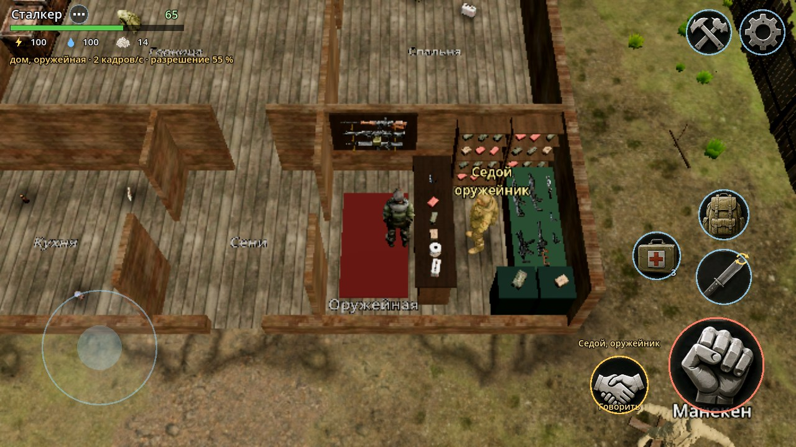
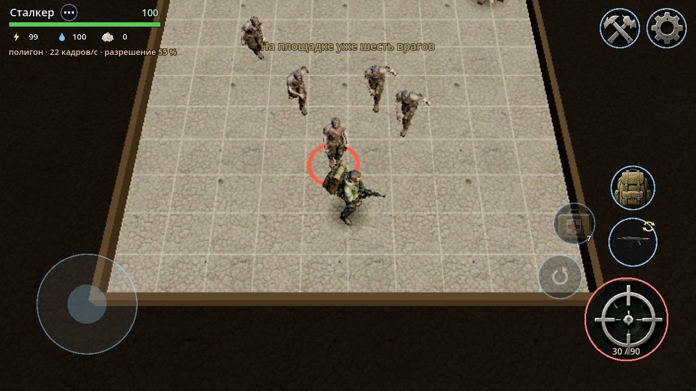
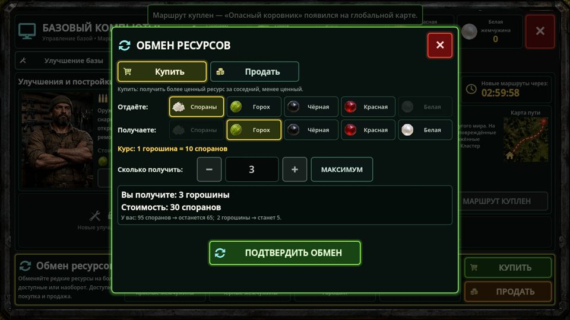
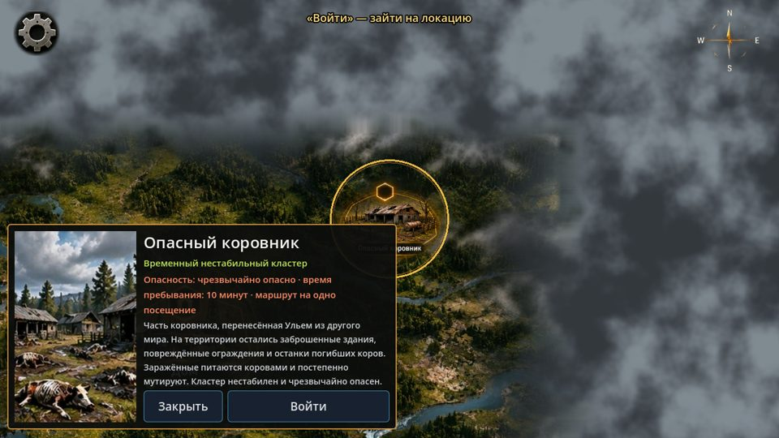
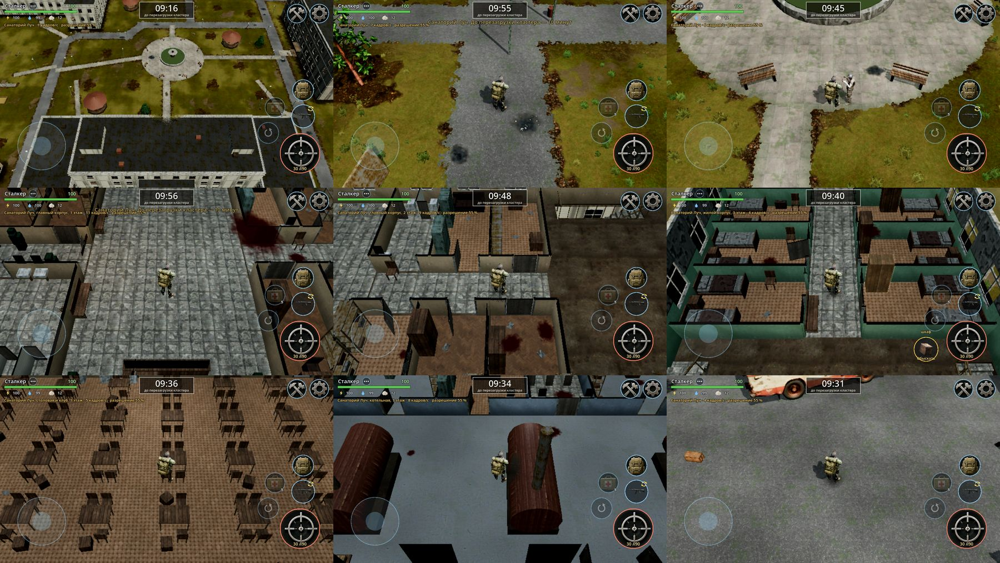
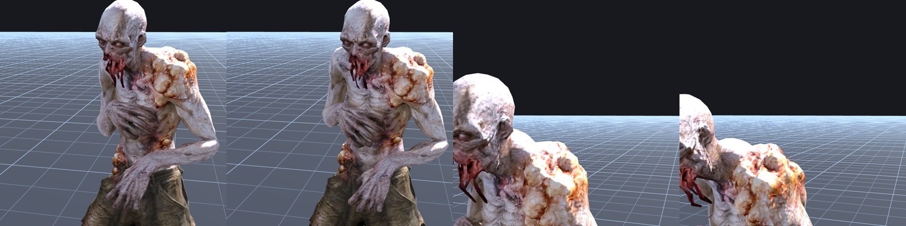
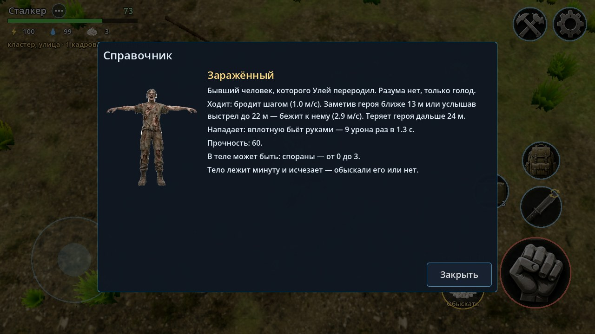

# Стартовая локация — стабильный кластер (проверка)

Игра открывается главным меню (`menu.tscn`): «Новая игра», «Продолжить», «Настройки», «Выход». Дальше — карта
мира (`map.tscn`), с неё — вход на локацию (`world.tscn`, `world.gd`). Стенд анимаций — из меню локации
(шестерёнка → «Стенд»).

## Меню, карта мира, настройки
- Главное меню — картинка с нарисованными кнопками (`core/world/backdrop.gd`: картинка занимает экран телефона
  целиком — растягивается на всю ширину, лишнее по высоте срезается снизу; области нажатия заданы в её точках). «Новая игра» стирает сохранение локации (с подтверждением; имя героя
  и настройки остаются), «Продолжить» ведёт на карту с прежним сохранением (нет сохранения — кнопка затемнена).
- Карта мира (`map.gd`) большая — в 2.5 раза шире и выше экрана: разведанная часть посередине, остальное
  закрыто клубящимся туманом; двигается пальцем. Видно, где герой («Вы здесь»). Нажатие на локацию — слева
  выезжает панель с её рисунком, названием и описанием; вход — только кнопкой «Войти» (повторное нажатие
  на локацию не заводит). Шестерёнка — настройки, «Главное меню» и «Выйти из игры». Локации — в `PLACES`.
- За краем поля — туман, как на границе кластера: начинается у кромки и густеет наружу, клубится
  (`FOG_SHADER`, три слоя на разной высоте; внутри поля тумана нет).
- С локации на карту: выйти за край поля 100×100 м — идёт отсчёт 5 секунд («Вы покидаете локацию»); вернулся —
  отсчёт сброшен, не вернулся — переход на карту мира. Или шестерёнка → «Карта».
- Настройки (`core/world/settings.gd`, `user://settings.json`): графика «Низкая / Средняя / Высокая» и громкость;
  с карты и из игры в том же окне — «Главное меню» и «Выйти из игры».
- Музыка меню и карты мира (`core/music.gd`, `assets/audio/music_menu.mp3`) — «Dead Sector», прислана
  пользователем (его композиция). Играет по кругу без перерыва: и при открытых настройках, и при переходе
  между меню и картой; стихает при входе на локацию. Громкость — в настройках.
- Кнопки в игре собраны у правого края вокруг кнопки атаки: слева — взаимодействие, выше-левее — перезарядка,
  прямо над атакой — смена оружия, над ней — рюкзак (инвентарь), рядом — лечение.

## Частота кадров на телефоне
- Замер пользователя на телефоне (сборка 17): 18–20 кадров/с при 97 вызовах отрисовки и 119 тыс. треугольников —
  значит, телефон упирался не в геометрию, а в закраску точек экрана. Что сделано:
  - трёхмерная картинка рисуется в меньшем разрешении и растягивается (кнопки и надписи остаются чёткими):
    42 / 55 / 80 % по качеству графики, и подстраивается сама так, чтобы частота не опускалась ниже 38–40:
    меньше 38 кадров/с — разрешение сразу падает на 8 %, 38–45 — на 3 %, больше 56 — понемногу растёт (до предела
    качества, не раньше чем через 6 с после снижения). После каждой перемены — секунда передышки (смена
    разрешения сама даёт заминку). Нижний предел — 30 %;
  - на «Низкой» и «Средней»: без анизотропной фильтрации, у елей меньше лап, трава реже и ближе; житель
    вдали не считается;
  - земля: расположение травы, тропы и гальки заранее посчитано в карту 256×256 (`ground_mask.png`,
    `--as-test=bake`) — 7 выборок текстур на точку вместо 12 и цикла по отрезкам тропы;
  - сглаживание MSAA — только на «Высокой»; травы меньше на «Низкой» и «Средней»;
  - прогрев при входе: пули, цифры урона и метка цели один раз рисуются сразу — первый выстрел без заминки.
- Проверить можно только на телефоне: шестерёнка → «Тест FPS».

## Что есть
- Кластер 100×100 м. Земля (`GROUND_SHADER` в `world.gd`): тёмная лесная почва с листвой, трава пятнами,
  россыпи гальки и натоптанная тропа с камешками — от крыльца к калитке и дальше через кластер двумя ветками
  (`TRAIL`). Текстуры берутся в двух масштабах под углом и смешиваются по шуму, рисунок не повторяется. У крыльца
  и вокруг фундамента — вытоптанная земля. Поверх — пучки травы (зелёные и сухие, качаются от ветра, видны
  до 30 м): растут там, где на земле трава, тропа свободна. По земле — сухие ветки и камни, у тропы — валуны.
  По краю кластера — полоса гравия, за ней — другой грунт и дымка. Пройти за край нельзя.
- Лес хвойный: ели трёх размеров (7, 9 и 11 м ±15 %, всего 32) — своя геометрия: ствол и ярусы лап с рисованной
  текстурой хвои (`tools/draw_flora.py`), концы лап качаются. Плюс модели Tripo: сосна (10), берёза (6),
  яблоня (3), куст (22). У стволов — столкновения. Расстановка всегда одинаковая (своё «зерно»); двор, тропа
  и старт свободны.
- Деревянный дом (модель Tripo) с пятью проходимыми комнатами (`core/world/house.gd`): сени (вход), кухня,
  кладовая, горница, спальня — проёмы дверей 1 м. Снаружи виден дом Tripo; когда герой входит, дом Tripo и
  крыша скрываются, видны свои стены (срезаны по 2 м — чуть выше роста героя) и пол, на полу — названия
  комнат. Столкновения — со стенами в полную высоту. Модель Tripo подогнана под стены (`SHELL_FIT` в `world.gd`).
  Собственная раскраска модели вблизи размыта, поэтому дом покрыт чёткими фототекстурами (`SHELL_SHADER`):
  кровля — старый шифер (волна вдоль ската), стены — потемневшая доска-обшивка, крыльцо — доски. Раскраска
  модели задаёт только светлоту — окна, двери и тени под свесом остаются на местах.
- Двор обнесён сплошным забором из серых старых досок (доски разной высоты 1.5–1.8 м, две жерди, столбы 2.2 м,
  по верху — две нити колючей проволоки), спереди — проход-калитка. У забора — бочки и покрышки, во дворе —
  поленница и колода.
- Ящики (модель Tripo) — хранилища на 12 ячеек: кнопка «Постройка» ставит ящик перед героем (не в стену),
  в меню — «Убрать ящик». Ящики сохраняются. В начале игры в горнице стоит один пустой ящик под свои вещи.
- **Начало игры: у героя пистолет ТТ** с полным магазином, 60 патронов и мачете в кармане (мачете носится в слоте
  пистолета — поменять в инвентаре), плюс бинты, вода и
  тушёнка. Остальное оружие покупается у оружейника. (Сохранения прежних сборок не подходят — игра начнётся
  заново: `SAVE_V` 7. Всё оружие сразу — на полигоне.)
- Манекен во дворе справа от крыльца — фигура в рост человека из мешковины на стойке: на нём пробуют оружие.
  Не падает (запас прочности восстанавливается сам), над головой — урон серии и урон в секунду.
- **Оружейная** — в доме, при входе справа (бывшая кладовая). Пока оружейник не куплен через компьютер базы,
  комната **пустая** и подписана «Кладовая»; после покупки в ней сразу появляется всё: прилавок с застеклённой
  витриной, за ним оружейник Седой; на стене — щит с винтовками и стойка с ружьями над столом под зелёным сукном
  (автоматы, дробовик, пистолеты), у задней стены — два металлических стеллажа с ящиками патронов, в углу — два
  сейфа. Прилавок, стеллажи и стойка — модели Tripo (`ul_gun_counter`, `ul_ammo_shelf`, `ul_gun_rack`; нет
  модели — простые объёмы), `_armory` в `world.gd`; оружие на витрине — одна сетка без текстур, цвет
  в вершинах (`tools/bake_armory.gd` → `assets/world/ul_armory_guns.res`, 66 тыс. треугольников, 1.2 МБ; рисуется
  только когда герой в доме). Седой поворачивается к герою; разговор — через прилавок.
  
- Герой — тот же, что на стенде (движения, рюкзаки, оружие, звуки).

## Вид и графика
- Камера как в изометрических выживалках: неподвижна, угол — в настройках («Камера»): «Сверху» (61°), «С наклоном»
  (52°, как в DoZ Survival; по умолчанию), «По диагонали» (50° и поворот на 45°, как в Last Day on Earth — дома и
  заборы ромбом; стены, закрывающие героя, выбираются по углу камеры),
  только следует за героем; двумя пальцами можно приблизить или отдалить (10–22 м, по умолчанию 12 м).
  Неба в кадре нет.
- Теней от солнца нет (ради скорости): под героем, деревьями, кустами и предметами — мягкие тёмные пятна.
  Сглаживание MSAA 2×, анизотропная фильтрация 4×, текстуры земли и дома — 2K.
- В доме стены 2 м; стены между камерой и героем опускаются до 0.4 м — героя и комнату всегда видно.
- Сверху слева — имя героя, полоса здоровья, энергия и вода. Справа от имени — три точки: нажатие открывает
  панель, где имя можно сменить (до 16 знаков; хранится в `user://profile.json` отдельно от сохранения локации).

## Управление (Android)
- Левая половина экрана — джойстик, появляется под пальцем: слегка отклонить — лёгкий бег (2 м/с), сильнее —
  быстрее, до полного бега (4.2 м/с). Быстрый бег тратит энергию; без энергии герой бежит медленнее.
- Справа внизу — круглые кнопки (значки — из присланного набора, `assets/icons/ui/`):
  - большая — **атака**: с огнестрельным оружием — выстрел (автомат и пулемёт — очередь, пока держишь), с мачете —
    удар с замахом, без оружия — удары кулаками. Герой сам доворачивается на ближайшую цель;
  - **смена оружия** (значок оружия со стрелками): основное → второй слот (пистолет или мачете) → убрать;
  - **лечение**: само выбирает бинт или аптечку (при большой потере — аптечку), число — сколько осталось;
  - **кнопка взаимодействия** появляется, только когда рядом есть с чем: у жителя, с которым можно говорить
    и торговать, — рукопожатие («Говорить»); у ящика — значок ящика («Открыть»); у предмета или рюкзака — его
    значок («Взять» / «Открыть»). Рядом ничего нет — кнопки нет. Сам предмет при этом слегка подсвечивается;
    нажать можно и прямо на него;
  - **перезарядка** — магазин из запаса патронов в инвентаре (пустой магазин перезаряжается сам при атаке);
  - **инвентарь**.
- Справа вверху — «Постройка» (поставить ящик) и «Меню» («Убрать ящик», «Стенд»).
- Каждый палец обрабатывается отдельно: можно бежать и одновременно стрелять.
- Отклик: полный бег — через 0.1–0.2 с после нажатия, остановка — за 0.1 с; центр джойстика подтягивается
  за пальцем (развернуться можно коротким движением); камера идёт за героем без отставания.
- Атака: удержание кнопки повторяет атаку в темпе оружия (и кулаки, и мачете, и одиночный огонь). Нажатие чуть
  раньше срока — пока оружие достаётся или не кончился прошлый удар — не теряется. Герой сам поворачивается
  к ближайшей цели: вплотную — для кулаков и мачете, в пределах дальности оружия — для огнестрела (только к той,
  что видно: через забор и стены цель не берётся). Под целью — красная метка.
- В игре оружие достаётся в 2.2 раза быстрее, чем на стенде, удары мачете и кулаков — в 1.3, перезарядка — в 1.25.
- На компьютере: WASD, Shift — быстрее, пробел — атака, E — действие, I — инвентарь, Q — оружие, R — перезарядка,
  H — лечение, колесо — приблизить.

## Бой
- Урон, скорострельность, магазин, патроны и дальность — в `core/world/items.gd`. Выстрел — пуля своего калибра
  вылетает из ствола и летит по прямой (без баллистики) до того, во что попадёт; урон — когда долетит. Лучей нет.
  Вид пули — по патрону (`BULLETS` в `world.gd`): длина, толщина, цвет оболочки, остроносая или тупоносая;
  у дробовика — 8 дробин. Пули крупнее настоящих и летят 62 м/с — иначе сверху их не разглядеть.
- Огонь при удержании кнопки: любое оружие стреляет подряд в своём темпе, пока в магазине есть патроны, —
  автомат и пулемёт очередью, пистолет, винтовки и дробовик выстрел за выстрелом. Отпустили кнопку — огонь
  прекращается. Магазин пуст — стрельбы нет до перезарядки: кнопка перезарядки рядом с кнопкой огня, при пустом
  магазине она красная (нажатие огня с пустым магазином тоже начинает перезарядку). Кулаки и мачете при
  удержании бьют подряд.
- Прицельное движение: пока герой стреляет (кнопка удержана или после выстрела прошло меньше полсекунды), он стоит
  лицом к цели, а идёт туда, куда ведёт джойстик. Шаг — в любую сторону относительно взгляда
  (`BCCharacter.set_dir_move`): вперёд — бег, назад — шаг назад, вбок — шаг боком, промежуточные направления —
  смесь соседних клипов; направление меняется плавно, темп шага подстраивается под скорость (ноги не скользят).
  Вперёд — до 3 м/с, боком и назад — 1.75 м/с. Не стреляет — бежит лицом по ходу.
- **Дальность и прицел.** Дальность оружия (`range` в `items.gd`): дробовик 13 м, пистолеты 18, MP5 22, АК-74М и
  ВСС 30, FN FAL и ПКП 34, СВД 48. На обычном приближении камеры от героя до края экрана — около 10 м вбок, 7 м
  вперёд и 4 м назад (`--as-test=screen`), так что всё, что видно на экране, любое оружие достаёт. Автоприцел
  берёт ближайшую цель **в пределах дальности и на линии огня**: деревья, забор (сплошной, 1.9 м), стены дома
  закрывают. Сначала — враги; манекен и чучела только когда врагов в досягаемости нет (раньше прицел хватал
  ближайшее чучело, и враг за ним оставался без огня).
- Огонь без цели, когда враг на экране есть: подсказка сверху — «Далеко: N м — оружие бьёт на M м. Подойдите
  ближе» или «Цель за укрытием — нет линии огня» (не чаще раза в 2.5 с).
- Кончил стрелять — оружие сразу опускается из прицела в положение «наготове».
- Стрельба не просаживает кадры: вспышка у ствола — светящееся пятно, а не источник света; попадания по одной
  мишени чаще трёх раз в секунду складываются в одну растущую цифру урона; звук гильзы в очереди — на каждый
  третий выстрел, звук попадания — не чаще восьми раз в секунду.
- Звука одышки на бегу нет.
- Перезарядка идёт движением героя (магазин, затвор) и забирает патроны нужного калибра из карманов и рюкзака.
- Мачете носится во втором слоте вместо пистолета: удар 40. Кулаки — 8 за удар.
- Манекен у базы и две мишени-чучела в поле (12 и 25 м от калитки): урон показывается цифрой; чучела на нуле
  падают и через 6 с встают.
- Здоровье 100, энергия 100, вода 100. Вода медленно убывает; без воды энергия не восстанавливается.

## Полигон и стенд 3D

- В главном меню под «Выходом» — две кнопки: **«Полигон»** и **«3D»**.
- **Полигон** — пустая площадка 10×10 м с разметкой через метр и бортом по краю (за борт не выйти ни герою, ни
  врагу). Это та же сцена `world.tscn` в режиме `ULSettings.arena`: тот же герой, управление и бой, что на
  локации. Герой сразу с АК-74М, ТТ и большим рюкзаком; в двух ящиках у борта — остальное оружие и патроны ко
  всему; в углу — манекен. В меню (шестерёнка): «Враг +» (ставит заражённого у борта подальше от героя, не
  больше шести сразу), «Убрать врагов», «Патроны» (запас к оружию в слотах), «Здоровье», «Справочник»,
  «Настройки», «Тест FPS», «3D». Погиб — заново посреди площадки, враги убраны. Полигон ничего не сохраняет.
  
- **Стенд 3D** (`stand.tscn`) — персонаж крупным планом, список движений, камера пальцем. Теперь на нём
  переключается, кого смотреть: «Герой» или «Заражённый» (`ULSettings.stand_who`; виды берутся из
  `ULEnemy.KINDS`, новый враг появится в списке сам). Враг показан той же моделью и теми же клипами, что в игре:
  стоит, бродит, бежит, бьёт, попадание, гибель и тело, подъём и ещё три движения; сверху — его числа (прочность,
  удар, скорости, как видит и слышит). «Назад» ведёт туда, откуда пришли: в главное меню, на локацию или на
  полигон.
  
- Кнопки проверки на локации и полигоне (ряд под шестерёнкой) растут влево: раньше длинный ряд уходил за правый
  край экрана.

## Ресурсы и торговля

- Пять ресурсов — спораны, горошина, чёрная, красная и белая жемчужины (`ULItems.MONEY`) — это валюта. Они не
  лежат в ячейках, а копятся в кошельке (`ULInventory.wallet`): сколько ни собери, складываются в одно число.
  Взял с тела («Взять всё» или по одному) — сразу в кошелёк. Кошелёк сохраняется вместе с инвентарём; ресурсы из
  старого сохранения, лежавшие в ячейках, при загрузке переходят в кошелёк.
- Окошко «Ресурсы» — в инвентаре под героем и в окне ящика или обыска под карманами: значок и количество каждого
  ресурса (чего нет — значок тусклый); нажатие показывает название.
- **Магазин оружейника** («Говорить» → «Торговать»). Три раздела: «Оружие», «Патроны», «Припасы и снаряжение»
  (бинты, аптечки, еда, вода, рюкзаки). Товар — карточками; нажатие выбирает, справа — карточка товара: картинка,
  описание, у оружия — урон, магазин, темп, дальность и прочность, сколько такого уже есть, цена и «Купить».
  **У оружия тут же — патроны к нему** с ценой и кнопкой «Купить патроны» (и сколько их уже при себе): не надо
  искать калибр в другом разделе. Купленное оружие встаёт в свободный слот, остальное — в карманы и рюкзак.
  Не хватает ресурсов или нет места — покупки нет, ничего не списывается (цена красная, кнопка тусклая).
  Товар и цены — `SHOP` в `world.gd`; цены пробные: пистолеты и мачете 6–10 споранов, MP5 24, SPAS-12 30, АК-74М 40,
  ВСС 50, FN FAL 55, СВД — 2 горошины, ПКП — 3; патроны 1–4 спорана за пачку. Продажи вещей оружейнику пока нет.
  
- **Прочность оружия** — сколько выстрелов (у мачете — ударов) оно выдержит до ремонта: ТТ 300, Beretta 400,
  мачете 400, SPAS-12 400, СВД 500, ВСС 500, FN FAL 700, MP5 800, АК-74М 1000, ПКП 1500 (`dur` в `items.gd`).
  Каждый выстрел и удар снимает единицу; осталось 10 % — предупреждение. Видно в инвентаре: полоска по низу ячейки
  (зелёная → жёлтая → красная) и строка в карточке «прочность 143 из 300 выстрелов». На нуле оружие **сломано**:
  остаётся в слоте с патронами, на ячейке — «СЛОМАНО», но не стреляет и не рубит.
- **Ремонт — у оружейника** («Говорить» → «Торговать» → «Ремонт»): всё изношенное оружие героя (в слотах, карманах,
  рюкзаке) с прочностью и ценой; «Починить» — до полной прочности, «Починить всё». Платите спорами только за
  изношенную часть: полный ремонт ТТ — 6, мачете — 4, Beretta — 8, MP5 — 12, SPAS-12 — 14, АК-74М — 18, ВСС — 22,
  FN FAL — 24, СВД — 30, ПКП — 40 (`fix` в `items.gd`); ТТ на 150 из 300 — 3 спорана. Пока оружейник не куплен,
  чинить негде.
  
  

## Хлам и барахольщик (`junk` в `items.gd`, `sell_junk` в `world.gd`, `junk_price` в `data/base_shop.json`)
- **Хлам** — новый ресурс: кучки (модель Tripo `ul_junk` — ржавые детали, болты, провода, обломок платы) лежат
  в постройках временных кластеров: в «Опасном коровнике» — по 2–4 в каждой постройке, каждый вход заново
  (`_spawn_junk`; новые локации с постройками зовут то же). Подобрал — «Хлам» в кармане, кучки складываются в
  одну стопку (до 50 в ячейке). Погиб или кластер перезагрузился — хлам при себе теряется, как остальное.
- **Барахольщик Кузьмич** стоит у крыльца дома, слева от входа (у него ящик и кучки хлама). Своя модель Tripo со
  скелетом (`assets/models/dealer.glb`: бородатый старик в стёганке и вязаной шапке, с сумкой железок); движения —
  героя, переносятся на его скелет. «Говорить» →
  «Продать хлам (N)» — продаётся весь хлам при себе: **одна кучка — один споран**.

## Базовый компьютер (`core/world/base_pc.gd`, `base_state.gd`, `economy.gd`, `data/base_shop.json`)

- Компьютер (модель Tripo `ul_computer`: металлический стол, старый ЭЛТ-монитор, клавиатура, системный блок) — в
  сенях у правой стены, между входной дверью и дверью в кладовую. Подойти — «Открыть». Экран во весь экран
  по макету: сверху — название и **пять ресурсов** (те же значки и тот же кошелёк, что в инвентаре; добыча, покупки
  и обмен сразу меняют числа), справа вверху — крест «закрыть». Слева — **улучшения базы**, справа — **маршруты**,
  снизу — **обмен ресурсов**; всё видно одновременно. Вкладки под шапкой только подсвечивают свой раздел.
  На маленьком экране середина прокручивается, нижняя полоса и рамка не уезжают.
- **Оружейник** — 30 горошин + 50 споранов. До покупки его на базе нет (и торговли тоже). «Купить и установить»:
  не хватает — окно с недостачей («не хватает: 20 горошин»), ничего не списано; хватает — подтверждение, списание,
  оружейник встаёт за прилавок, кнопка становится «УСТАНОВЛЕНО». Повторно не купить. Ниже — «В доработке».
- **Маршруты**: «Опасный коровник» — 10 споранов, «Санаторий Луч» — 25 споранов, на одно посещение. Пока маршрут куплен или идёт посещение,
  повторно не купить. После покупки коровник появляется на глобальной карте (справа выше дома). «Новые маршруты
  через ЧЧ:ММ:СС» — срок хранится в `user://base.json` (unix-время), идёт и при закрытой игре, не сбрасывается при
  открытии компьютера; период — `route_refresh_h` (сейчас 3 ч). Санаторий после покупки — слева выше дома.
  Две карточки помещаются без прокрутки (характеристики — в две колонки).
- **Обмен ресурсов**: белая ⇄ красная ⇄ чёрная жемчужина ⇄ горох ⇄ спораны, только соседние, в обе стороны по
  одному курсу (1 белая = 3 красные, 1 красная = 3 чёрные, 1 чёрная = 5 горошин, 1 горошина = 10 споранов —
  предварительные, из макета; `exchange` в `data/base_shop.json`). Четыре карточки и кнопки «Купить» / «Продать»
  открывают окно обмена: вкладки, «Отдаёте» / «Получаете» (второй ресурс пары подбирается сам), количество (−, +,
  поле только для цифр, «Максимум»), расчёт («Вы получите: 3 горошины · Стоимость: 30 споранов»), остаток после
  сделки, предупреждение о нехватке, «Подтвердить обмен». Сделка — целиком или никак (`ULEconomy.exchange`), без
  дробей и минуса; после неё кнопка на полсекунды выключена — двойное касание не спишет дважды.
  
- Сохранение: кошелёк — в сохранении героя, база (оружейник, маршруты, срок обновления) — в `user://base.json`;
  оба пишутся через временный файл (обрыв посреди записи не портит сохранение). Новая игра в меню стирает и базу.
- На старте новой игры — 10 споранов (`start_wallet`): хватает на первый маршрут.
- Картинки и значки экрана вырезаны из макета пользователя: `tools/ui_src/pc_assets.py` (макеты лежат рядом).

## «Опасный коровник» — временный нестабильный кластер (`core/world/cowshed.gd`, `data/cowshed.json`)

- 150×150 м, расставлен по эталону пользователя: вход снизу по центру, слева два длинных коровника и загон под
  ними, сверху водонапорная башня с баками и пристройка, справа ещё три коровника, между ними — дороги с колеями,
  техника, сено, хлам; по краю — деревянный забор с проломами, за ним лес. Постоянная часть одна и та же при
  каждом посещении (координаты — константы в начале `cowshed.gd`).
- **Постройки** (`core/world/farm_building.gd`, `ULFarmBuilding`) собираются из деталей, как настоящие: бетонный
  цоколь, кирпич до 1,1 м, выше — серые доски, столбы и обвязка из бруса, окна с рамами и выбитыми стёклами,
  большие ворота (створка распахнута, прикрыта, висит или сорвана), фронтоны, фермы под крышей, кровля из листов
  профнастила с ржавчиной и дырами, пролом в стене с кучей кирпича. Внутри: бетонный пол в навозе, стойла с
  жердями, кормушки, сено (в пристройке — верстак и полки, в малом коровнике — корма). Материал — текстура по
  мировым координатам, к земле стена темнее и грязнее, пятна и мох. **Во все можно зайти**; герой внутри — крыша и
  стена со стороны камеры плавно растворяются (точечный узор, без прозрачности), вышел — проявляются. Столкновения —
  коробки стен (и под окнами), перегородки, кормушки; проёмы свободны.
- **Земля** — тот же шейдер, что на базе, слоями со смешиванием «по высоте»: трава (оливковая, с выгоревшими
  пятнами), лесная подстилка под деревьями, сырая грязь у построек, ворот и в загоне (скот вытоптал), накатанные
  дороги из утоптанной земли. Поверх — **колеи** по всем дорогам (две продавленные полосы сырой грязи, местами
  вода), **гравий** у ворот, **лужи** в колеях, у ворот и в загоне (мутная вода с отсветом неба и рябью).
  Карта слоёв `assets/world/tex/cowshed_mask.png` и карта проходимости `assets/world/nav_cowshed.res` строятся
  `--as-test=csbake`.
- **Растительность** (`core/world/vegetation.gd`, `ULVegetation`): пучки — спрайты, снятые с моделей растений
  Poly Haven (CC0) инструментом `tools/impostor.gd` и собранные в атласы `tools/veg_src/veg_atlas.py`. Злаки — по
  траве карты земли, цвет от приглушённо-зелёного до сухого жёлтого крупными пятнами, высота 0,25–0,7 м; на дорогах
  и во дворах почти нет. Сорняки — у стен построек, крапива — вдоль заборов, одуванчики и цветущий щавель — редкими
  куртинами, кусты — у забора. Все пучки участка 15×15 м — одна сетка; дальше дальности прорисовки не рисуются.
- **Заборы**: столбы разной высоты, три жерди; пролёты целые, покосившиеся, сломанные (жердь висит), пустые.
  **Деревья**: рощи (ели, сосны, дубы, берёзы, сухие; часть — молодые), лес за забором; деревья, закрывающие героя
  от камеры, растворяются. **Предметы**: водонапорная башня, ржавые баки с лестницей, техника — модели Tripo:
  тракторы, трактор с прицепом, зелёный грузовик с деревянным кузовом, деревянные телеги; круглые тюки сена, ящики, бочки, покрышки, ободья, вёдра (Poly Haven, CC0),
  ржавые листы, доски.
- **Свет**: пасмурно-приглушённый день, цвета спокойнее, лёгкая дымка; **мягкие тени** от построек, деревьев и
  техники на «Средней» и «Высокой» графике (до 38 м от камеры, атлас 2048, на телефоне 1024); на «Низкой» — без
  теней, как на базе.
- Каждое посещение заново: ~20 останков коров (скелеты на боку, черепа с костями, туши — модели Tripo, без живых
  коров) — на местах с эталона со сдвигом и поворотом и случайно: в коровниках, у заборов, в поле; **пустышей
  10–30 и лоторейщиков 3–8** (`pustysh`, `lottery`). Места врагов: в постройках, во дворах между ними, у останков
  коров, в рощах и у заборов; каждая точка проверяется по карте проходимости, не ближе 28 м к входу, не вплотную
  друг к другу. Убитые за посещение не возвращаются; тела обыскиваются как обычно. Коровы — только обстановка.
- **10 минут** (таймер сверху посередине): за 5 и 2 минуты — предупреждение и сигнал, за 30 с — красный мигающий
  таймер и сирена. На нуле кластер перезагружается: герой погибает, **всё, что при себе, теряется**, вещи на базе
  целы; маршрут закрыт, коровник пропадает с карты, герой — дома с запиской. Погиб от врагов — так же
  (`lose_on_death`, `lose_wallet` — настраиваются). Ушёл за край поля (5 с) — посещение окончено с добычей.
  В коровнике нет «Карты», «3D», ящиков; «Главное меню» — уход с добычей.
- Карта мира: метка коровника из макета — справа выше дома, только пока маршрут куплен; панель слева внизу.
  
- Нагрузка: стены, жерди, доски, хлам склеены в несколько сеток на постройку (а не сотни деталей), растения —
  сетками по участкам, у деревьев и предметов — дальность прорисовки; враги: ближе 8 м — всё, 8–18 м — движения
  через кадр, дальше — без движений тела, думают раз в 4 кадра. Частота кадров и память **на телефоне здесь не
  измерялись** (телефона в этой среде нет) — «Тест FPS» в меню игры.
- Источники: текстуры и модели предметов — Poly Haven (CC0): brick_4, wood_planks_grey, brown_planks_03,
  wood_planks_dirt, corrugated_iron_02, rusty_corrugated_iron, damaged_concrete_floor, brown_mud_02, dirt,
  gravel_floor_02, sparse_grass, grass_ground, mud_forest, leafy_grass; модели растений для спрайтов; ящик, бочка,
  покрышка, обод, ведро. ambientCG доступен, но не понадобился. Fab и Textures.com не использовались (нужна учётная
  запись).

## «Санаторий Луч» — временный нестабильный кластер (`core/world/sanatorium.gd`, `block_building.gd`, `door.gd`, `data/sanatorium.json`)

- 150×150 м, расставлен по утверждённой карте пользователя: ворота с проходной и аркой «САНАТОРИЙ «ЛУЧ»» посередине
  южной ограды, от них аллея к **главному корпусу** (портик с шестью колоннами в два этажа), за ним — **площадь с
  фонтаном**, скамейками и беседками; слева вверху — **лечебный корпус** (Г-образный, два блока), сверху —
  **котельная** с кирпичной трубой и цистерной и **хозблок**, справа — **жилой корпус** в четыре этажа, слева внизу —
  **столовая с клубом**, справа внизу — **хоздвор** с автобусом, грузовиком, легковушками и гаражами; детская
  площадка, фонари (часть погнута), асфальтовые дороги и плиточные дорожки с выкрошенными краями и мхом в трещинах,
  лужи, бетонная ограда с проломами, рощи внутри и лес за оградой. Постоянная часть одна и та же при каждом
  посещении (координаты — константы в начале `sanatorium.gd`).
- **Корпуса** (`ULBlock`) — из одного или нескольких блоков; **во все можно зайти и подняться на каждый этаж**.
  Коридорный блок: коридор вдоль длинной оси, комнаты по обе стороны (по 1–2 окна, перегородки — между окнами,
  поэтому ряды окон на фасаде ровные), вестибюль у входа, лестничные клетки в торцах (марши «туда-обратно» по
  сторонам клетки, в перекрытии — проём над маршем, вокруг — перила). Зальный блок: большой зал и ряд комнат вдоль
  одной стены. Блоки одного корпуса соединены сквозными проёмами (главный корпус — центр и два крыла, лечебный —
  два блока). Этажи: главный — 3 (крылья — 2), лечебный — 2 и 3, жилой — 4, столовая, котельная, хозблок — по 1.
  Всего 232 помещения, 176 дверей, 437 тайников.
- **Что внутри**: вестибюль с регистратурой и скамейками; кабинеты (стол, шкаф, стеллаж, доска объявлений),
  комнаты персонала (шкафчики, стол со стульями, диван), архивы и подсобки (стеллажи с коробками, ящики), туалеты
  с кабинками; в лечебном — палаты (2–4 койки с тумбочками, медицинский шкаф, раковина), процедурные (кушетка,
  стойка капельницы), сестринские, каталки в коридорах; в жилом — номера (две кровати, тумбочка, шкаф, свой санузел
  в плитке), бельевые, холлы этажей с диванами и телевизором; столовая — столы на четверых рядами, раздача, кухня
  (плиты, кухонные шкафы, мойки), холодильная камера, кладовая, клуб с бильярдом и пианино; котельная — три котла,
  трубы, щиты, верстак; хозблок — склад со стеллажами рядами, мастерская с верстаками. Сор: листы бумаги,
  опрокинутые стулья, чемоданы, засохшая кровь в коридорах и палатах — следы недавней гибели людей (каждый вход
  по-новому).
- **Двери** открываются, когда к ним подходит герой или гонящийся враг; закрытая — преграда для героя, врагов и
  пуль. Карта проходимости строится без дверей (путь идёт через проём). Входы — двустворчатые, с козырьком и
  ступенями. Окна — рамы и тёмное стекло (часть выбита, часть заколочена).
- **Вид внутри**: герой вошёл — крыша и все этажи выше скрыты, на его этаже стены изнутри и фасад со стороны камеры
  срезаны на высоте 1,2 м (видно комнаты и врагов в них), ниже его этажа — только фасады. Переход между этажами —
  с запасом на лестнице (не мигает). Вне корпуса за высоким зданием вокруг героя «окно» — стены и крыша между ним
  и камерой растворяются кругом. Внутренности не освещает солнце (свой слой отрисовки): ровный рассеянный свет из
  окон и **две лампы без теней** у ближайших к герою светильников (одна мигает) — на телефоне каждый источник
  света дорог.
- **Земля**: газоны, вытоптанная земля у дорожек и стен, подстилка в рощах (карта слоёв
  `assets/world/tex/sanatorium_mask.png`), сверху асфальт и плитка. Карта проходимости с этажами и лестницами —
  `assets/world/nav_sanatorium.res` (сетка 15 см: двери узкие). Обе строятся `--as-test=snbake`.
- **Готовые корпуса** (`assets/world/sanatorium_blocks.res`, `ULBlockCache`, 2,4 МБ): сетки, двери, комнаты,
  тайники, места врагов, столкновения и карта расстояний до дорог и корпусов (по ней расставляются растения).
  Пишутся тем же `--as-test=snbake`; при входе корпуса не строятся, а загружаются. Подпись кэша — описания
  корпусов и `ULBlock.GEN_V`: после правки генератора корпусов нужно поднять `GEN_V` и снова запустить `snbake`
  (иначе кэш не возьмётся и корпуса соберутся заново — медленнее); проверка `sn` сверяет кэш со свежей сборкой.
  Столкновения копятся в теле вне сцены и попадают в мир одним разом (раньше каждая из 2700 коробок
  пересобирала всё тело). Сборка локации на компьютере: было 5,5 с, стало 0,4 с (корпуса 0,1 с, растения 0,17 с).
- **Враги** — каждое посещение заново: **пустышей 20–40, лоторейщиков 5–15** (`pustysh`, `lottery`). Где —
  зоны с весами (`zones_pustysh`, `zones_lottery`): пустыши — двор и площадь, у ограды и в зарослях, жилой корпус,
  палаты, столовая, коридоры главного; лоторейщики — дальние коридоры (дальше 14 м от входов), лечебный корпус,
  подсобки, котельная и двор у неё, заросли. Каждая точка проверяется по карте проходимости (не в стене, не в
  мебели, на своём этаже), не ближе 25 м к воротам, не вплотную друг к другу; часть стоит, часть бродит (в комнате —
  в её пределах). Убитые за посещение не возвращаются.
- **Враги в корпусах**: идут к герою по карте проходимости — через двери (толкают закрытые), по коридорам и
  лестницам на другие этажи; через перекрытие не бьют и не «видят» (луч упирается в плиту), с другого этажа не
  атакуют. Враги в скрытых частях корпусов не рисуются.
- **Тайники**: медицинские шкафы, тумбочки, шкафчики персонала, письменные столы, стеллажи и хозяйственные ящики,
  кухонные шкафы, стойка регистратуры, верстаки. Подойти — светящаяся рамка и «Обыскать», окно — то же, что у
  ящика и тела. Содержимое — каждый вход заново по таблицам `loot` (бинты, аптечки, «живчик», еда, вода, патроны
  ТТ и 9×19, спораны, редко горошина и малый рюкзак, хлам); часть тайников пустая (`empty_chance`). Хлам кучками —
  в комнатах всех корпусов (3–6 на корпус).
- **Время** — 10 минут (`minutes`, можно увеличить для крупного комплекса), всё остальное — как в коровнике:
  предупреждения, тревога, на нуле гибель с потерей всего, что при себе; ушёл через ворота за край — с добычей;
  маршрут закрывается, санаторий пропадает с карты.
- **Компьютер базы**: карточка по макету пользователя — снимок, описание, размер, время, число врагов, «Карта
  пути», «Открыть маршрут», **25 споранов** (цена — из макета). После покупки санаторий — на карте мира слева выше
  дома (метка из макета карты).
- Нагрузка: снаружи каждый блок рисуется несколькими общими сетками (по материалу), внутренности — только этажа
  героя; мебель склеена в сетки этажа; враги — те же ступени, что в коровнике (ближе 18 м — полностью, дальше —
  упрощённо, дальше 80 м спокойные стоят). Модели Tripo: автобус и легковушка (50 кредитов). Частота кадров
  **на телефоне здесь не измерялась** (телефона в этой среде нет) — «Тест FPS» в меню игры.
- Источники текстур — Poly Haven (CC0): rectangular_facade_tiles, worn_plaster_wall, peeling_painted_wall,
  old_linoleum_flooring_01, worn_tile_floor, dirty_tiles, long_white_tiles, herringbone_parquet,
  concrete_floor_worn_001, overgrown_concrete_pavers, worn_asphalt, rusty_metal_02.

## Враги и добыча (`core/world/enemy.gd`)

- Весь баланс врагов — в отдельном файле `data/enemies.json` (правится без кода): прочность, скорости, с какого
  расстояния видит и слышит (выстрел, бег, шаги), сколько кричит перед погоней, когда теряет, удары (клип, урон,
  на какой доле клипа удар доходит), добыча (предмет, от, до, шанс), рост.
- **Пустыш** (заражённый низшей ступени) — первый враг. Модель по присланному фото: Tripo, со скелетом (`assets/models/zombie.glb`,
  12 тыс. треугольников, текстуры 1024). Прочность 75; бродит шагом 1 м/с вокруг своего места; видит героя ближе
  13 м (стены и забор закрывают обзор), слышит выстрел до 22 м (стрельба по манекену у дома не привлекает) и бег
  до 7 м — бежит 2.9 м/с. Вплотную бьёт руками: 9 урона раз в 1.3 с. **Удар доходит до героя**: клипы Tripo
  машут лапой «в воздух», поэтому в момент удара бьющая кисть доводится (IK руки, `BCHandIK`) до плеча или груди
  героя со стороны этой руки и сразу уходит назад — правой, левой; «два удара подряд» — правой, потом левой
  (`_plan_strikes` в `enemy.gd`). Укусы и захваты — головой. Стоит при ударе на 0.8 м от героя (не влезает в него).
  Герой от удара **отшатывается** — поясница, грудь, шея и голова коротко дёргаются от ударившего и за 0.4 с
  возвращаются (`core/animation/flinch.gd`, поверх любой анимации; руки и оружие идут вместе с корпусом), с этой
  стороны брызжет кровь (капли и пятно на земле, тает за 20 с; так же — из ран врагов).
- **Лоторейщик** — второй враг, по присланной картинке (вид спереди; Tripo, `assets/models/lottery.glb`: 13 тыс.
  треугольников, один материал, цвет 2048, нормали и шероховатость 1024; скелет 78 костей с пальцами). Рост 1.9 м,
  прочность 200, шаг 1.2 и бег 3.7 м/с (герой бежит 4.4 — уйти можно, но с трудом). Видит с 16 м, слышит выстрел
  с 30 м, бег с 11 м и даже шаги с 4 м. Заметив — **кричит 0.9 с** и только потом бежит. Шесть ударов вплотную, раз
  в 1.5 с (см. «Ближний бой»). В теле —
  1–4 спорана всегда и горошина с шансом 35 %. На локации один, в дальнем углу поля; на полигоне — кнопка
  «Лоторейщик +».
  
- **Поведение (у всех врагов).** Бродит у своего места → замечает (увидел, услышал выстрел, бег, шаги) →
  кричит, если виду положено → бежит туда, где видел героя в последний раз → вплотную бьёт: у удара замах, урон
  доходит на середине клипа, и если герой успел отойти дальше дальности удара — мимо. Потерял из виду — доходит до
  последнего места, озирается и через несколько секунд успокаивается; далеко убежавшего героя бросает.
  **Обход препятствий:** луч вперёд на уровне голени, упёрся (стена, забор, ящик, другой враг) — пробуются
  повороты всё круче в обе стороны, берётся первый свободный и держится полсекунды; сквозь стены не ходит
  (столкновения — обычные). Это не поиск пути: из тупика (комната с одной дверью за спиной) он может не выбраться.
- **Ближний бой — вплотную.** Заметив героя, враг подбегает до касания (`close` в `enemies.json`: 0.70 м между
  центрами у пустыша, 0.74 у Лоторейщика; тела соприкасаются на 0.62) и только оттуда бьёт; на замахе ещё дожимает
  вперёд. Удар выбирается из тех, что достают с этого расстояния (`reach` у каждого удара): захват с укусом — только
  впритык. Урон — в момент удара, если герой всё ещё в досягаемости: успел отскочить — мимо. Между ударами враг
  стоит вплотную, покачивается и тянется руками (стойка `menace`).
  Удары пустыша: правой и левой (9), тянется руками и кусает (16), хватает за плечи и кусает в шею (20).
  Лоторейщика: когтями слева и справа (14, 16), тянется и кусает (22), выпад пастью (24), хватает за плечи и кусает
  в шею (30). Ещё три удара заказаны (два подряд, обеими руками сверху, бросок с укусом в лицо) и стоят в списке:
  враг выбирает только те, движение для которых у модели есть, так что они включатся сами, когда движения придут.
- Красный круг под целью и круг дальности вокруг героя не рисуются: цель и дальность считаются как прежде, о
  промахе по дальности или укрытию говорит подсказка сверху.
- **Попадания и гибель.** Попадание спереди и сзади — разные движения; сильное попадание (от 60 урона разом или
  от 30 % прочности — СВД, дробовик в упор) сбивает с ног и срывает удар, который он готовил. Падает по стороне удара: спереди —
  на спину, сзади — лицом вперёд, сбоку — набок.
- **Голос.** Рычит, пока бродит и гонится, кричит при обнаружении и ударе, хрипит при гибели — шесть записей CC0
  из набора проекта (`growl`, `roar`, `zdeath`; источники — `bunker/docs/AUDIO_SOURCES.md`). Слышно в 30 м.
- **Движения врагов — свои.** У пустыша и Лоторейщика отдельные наборы клипов (`assets/anim/zombie`,
  `assets/anim/lottery`): 17 движений (у пустыша в игре используется 14 — у него один удар) заказаны в Tripo по описанию («зомби стоит сгорбившись, руки висят…») и
  перенесены самим Tripo на собственный скелет каждой модели — без пересчёта с героя. Стойка — сгорбленная, руки
  висят; шаг — шаркающий, с подволакиванием ноги; бег — с наклоном вперёд; удары левой и правой, укус, выпад
  пастью; попадания спереди и сзади, потеря равновесия; крик, тревога, повороты; падения вперёд, назад и набок.
  Описание клипов — `data/anim_enemy.json` (каждый клип берётся из своей папки модели; чего там нет — из набора
  героя с пересчётом под скелет, `BCAnimSet._rest_fix`). Новые движения добавляются так: файлы Tripo
  `m_<набор>_<метка>.glb` в папку → `tools/extract_anims.gd` → клипы.
- **Генератор мелких движений существа** (`core/animation/creature_fx.gd`, настройки — `fx` в `enemies.json`) —
  то, чего нет в клипах Tripo и в автоматическом скелете. Работает поверх любого клипа, каждый кадр:
  пальцы согнуты когтями и подрагивают вразнобой, к моменту удара раскрываются; грудь дышит (в погоне чаще);
  на укусе и выпаде пастью шея и голова подаются вперёд; у Лоторейщика колышутся отростки у пасти (шейдер на
  вершинах вокруг точки пасти — точка находится по сетке сама: самые выступающие вперёд вершины головы). Оси
  сгиба пальцев считаются из исходной позы модели, поэтому генератор подходит к любому скелету Tripo. Челюсть он
  не открывает — для этого в сетке нет отдельной нижней челюсти.
  
- **Очередь движений для нового врага** — `tools/tripo/queue_motions.py имя:проект`: ставит в задания Tripo весь
  стандартный набор из `tools/tripo/enemy_motions.json` (17 описаний) или только названные метки (повтор
  неудачного); готовые файлы превращает в клипы `tools/extract_anims.gd`.
- **Без рывков вбок.** В движениях Tripo по описанию поворачивается сам корень скелета (тело виляет на 15–20°,
  путь идёт дугой), а таз едет в системе этого вращающегося корня. Раньше ход вычитался в неподвижной системе — и
  тело врага моталось до метра вбок от места, где он стоит на самом деле. Теперь корень считается в системе скелета
  (`BCAnimSet._bake_root`): курс тела держится по ходу, путь выпрямляется, ход вычитается, остаётся только
  покачивание. Замер в беге (`--as-test=loco` и проверка в `inv`): таз уходит вбок не дальше 0.16 м (было до
  0.97), корпус смотрит по ходу с отклонением до 18° (было 27–28°).
- **Обход забора и стен — по карте проходимости.** Карта строится один раз по столкновениям мира
  (`--as-test=bake` → `assets/world/nav_cluster.res`, 600 многоугольников, 62 мс) и в игре только загружается.
  Враг, который видит героя, бежит прямо; не видит (забор, дом) — идёт по карте: вокруг двора к калитке, в дом
  через дверь. Проверка `--as-test=nav`: от заднего забора до героя во дворе пустыш доходит за 14 с, Лоторейщик
  за 11 с. Другие враги больше не считаются препятствием при выборе пути — толпа не виляет.
- Нижняя стопа врага всегда на земле (`stand_clamp`); подстройка высоты сглажена, тело не подпрыгивает на шаге: в движениях по описанию высота таза записана неточно,
  без этого фигура висела над землёй на несколько сантиметров.
- **Что не сделано из задания на Лоторейщика и почему.** Отдельных костей челюсти и ротовых отростков нет:
  скелет ставит Tripo автоматически, он человеческий (78 костей, пальцы есть) — пасть и отростки не двигаются
  сами; пальцы, дыхание, выпад головы и колыхание отростков добавляет генератор (ниже), но раскрыть пасть он не
  может — нужна сетка с отдельной челюстью. LOD: упрощённые сетки строит импорт
  Godot (`generate_lods`), вдали берётся более грубая; дальше 36 м враг не считается вовсе.
- На локации трое пустышей за забором в поле и один Лоторейщик в дальнем углу (`ENEMY_SPAWNS`). Убитый
  появляется на своём месте снова через 25 с после того, как тело исчезло, и только когда герой дальше 16 м.
  Дальше 36 м от героя враг не считается и не двигается.
  В меню (шестерёнка) — «Враг +»: ставит ещё одного в 9 м перед героем, для проверки оружия.
- Враг — обычная цель: автонаведение, пули, кулаки и мачете работают как по манекену.
- Герой получает удар — экран на миг краснеет, здоровье убывает. Здоровье кончилось — «Вы погибли», через три
  секунды герой снова у дома с половиной здоровья; вещи остаются при нём.
- **Тело и обыск.** Убитый падает и лежит. Рядом с телом появляется кнопка взаимодействия со значком споранов и
  подписью «Обыскать»; она открывает окно «Обыск» — добыча тела в четырёх ячейках, «Взять всё» или по одному.
  Тело исчезает ровно через минуту после гибели (`CORPSE_S`) — обыскали его или нет; открытое окно обыска при
  этом закрывается.
  
- **Добыча** (`items.gd`, вид «loot»): спораны — валюта (мелкие белые шарики; счёт — в шапке рядом
  со здоровьем), горошина, чёрная, красная и белая жемчужины. В заражённом — от нуля до трёх споранов (`loot` в
  `KINDS`: предмет, от, до); что именно лежит, решается при появлении. Горошина и жемчужины в игре есть как
  предметы, но пока ни в ком не лежат: они для существ сильнее. Значки вырезаны из присланной картинки.
  
- Картинка врага (окно обыска и справочник) — снимок его 3D-модели в живой позе, а не в исходной «руки в
  стороны»: `tools/portrait.tscn` ставит кадр клипа (`POSES`: у заражённого — крадётся, руки тянутся вперёд) и
  пишет `assets/icons/enemy_<вид>.png`. Для нового врага достаточно добавить его в `ULEnemy.KINDS` и запустить.
- **Справочник** (меню → «Справочник»): картинка врага и строки, собранные из тех же чисел, по которым он живёт
  (`ULEnemy.describe`): как ходит, как нападает, прочность, что бывает в теле, сколько лежит тело.
  
- Движения врага — те же клипы, что у героя. Кости у моделей Tripo называются одинаково, но в исходной позе
  повёрнуты по-разному (у заражённого иначе стоят корень, таз и вся правая рука), поэтому при переносе повороты
  пересчитываются в исходную позу своего скелета (`BCAnimSet._rest_fix`). Библиотека клипов строится один раз на
  модель: первый заражённый — 80 мс при загрузке, следующие — 3 мс.

## Инвентарь (`core/world/items.gd`, `inventory.gd`, `inventory_ui.gd`)
- Отдельное меню на весь экран (игра за ним не видна), «Закрыть» — обратно в игру. В шапке — сколько ячеек занято.
- Экран «Инвентарь»: слева — слоты одежды (шлем, жилет, куртка, штаны, обувь — пока заготовки), в центре —
  герой в полный рост (3D, можно повернуть пальцем; с оружием — в стойке, рюкзак — на спине), под ним — здоровье,
  энергия, вода; рядом — слоты «Основное», «Пистолет / нож», «Рюкзак» и строка «В руках: …». Справа — карманы
  (8 ячеек) и ячейки надетого рюкзака: малый +8, средний +12, большой +20.
- Экран «Хранилище»: слева — картинка ящика или рюкзака, вместимость, «Взять всё» (у рюкзака — «Надеть»);
  затем содержимое (4 в ряд), слоты снаряжения, карманы и рюкзак.
- Нажатие на предмет выбирает его; внизу — описание и действия: «Экипировать» / «Надеть», «В руки» / «Убрать
  из рук», «Снять», «Использовать», «В хранилище» / «Взять», «Выбросить». Повторное нажатие — быстрое действие
  (экипировать, использовать, переложить). Патроны и расходники складываются в стопки.
- Выброшенный предмет ложится на землю перед героем — своей 3D-моделью.
- Рюкзак с земли можно надеть вместе с вещами; надетый при этом ложится на землю со своими вещами. Рюкзак
  с вещами нельзя убрать в ячейку — только выбросить.
- Всё сохраняется (`user://cluster.json`, версия 6): инвентарь, предметы на земле, содержимое ящиков, здоровье,
  энергия, вода, патроны в магазинах.

## Патроны — одна модель Tripo по фото
- `ul_ammo` — по присланной картинке одной генерацией (55 кредитов): семь коробок (7,62×25, 9×19, 5,45×39,
  7,62×51, 7,62×54R, 9×39, 12 калибр), у шести рядом стоит патрон (у 9×19 патрон не получился — на значке стоит
  патрон от 7,62×25). `tools/split_glb.mjs` режет набор на семь предметов и у каждого выделяет части: `item_N` —
  коробка с патроном, `item_N_a` — коробка, `item_N_b` — патрон.
- В инвентаре патроны — значок «патрон и коробка», как на фото, и количество (`assets/icons/ammo_N.png`, снимок
  той же модели); на земле лежит только коробка.

## Набор припасов — одна модель Tripo
- `ul_supplies` — девять предметов одной генерацией (55 кредитов): красная коробка пистолетных патронов, зелёный
  цинк, коробка патронов 12 калибра, аптечный пузырёк, бинт, аптечка, пачка сухарей, бутылка воды, консервная
  банка. `tools/split_glb.mjs` выравнивает набор, делит его на связные куски и собирает в `assets/world/
  ul_supplies.glb` девять отдельных предметов (`item_1`…`item_9`) с одной общей текстурой.
- Каждый предмет каталога ссылается на свой номер (`kit` в `items.gd`): эта модель лежит на земле, а значок
  в инвентаре — снимок той же модели (`tools/icons.gd` → `assets/icons/kit_N.png`). Патроны разных калибров
  делят одну модель и различаются оттенком значка и названием.
- Новый предмет — «Живчик» (пузырёк): +60 энергии, +5 здоровья.
- Так же можно добавлять следующие наборы: одна генерация — много предметов (`tools/kit_view.gd` — обзор набора).

## Проверка
- `godot --path . --headless res://world.tscn -- --as-test=inv` — 136 случаев (без экрана — около минуты, время
  считается честно, 60 кадров/с): отклик управления (разгон, остановка, камера), нажатие во время доставания
  оружия, автонаведение за спину и через забор, удержание кнопки, манекен, содержимое ящиков, кнопка
  взаимодействия (нет цели — нет кнопки; житель, ящик), разговор, смена имени, режимы огня (пистолет — один
  выстрел, автомат — очередь до нуля, перезарядка кнопкой), полёт пуль и дробин, выход с локации по отсчёту, враг (замечает, слышит выстрел, бьёт, гибнет, 0–3 спорана, обыск, тело исчезает через
  минуту — обысканное и нет, гибель героя, справочник), ресурсы (кошелёк без ячеек, все пять, окошко, покупка,
  отказ при нехватке, сохранение, перенос из старого сохранения), прочность оружия (выстрел снимает единицу,
  строка в инвентаре, поломка и возврат патронов), Лоторейщик (рост, слух на бег и шаги, крик перед погоней,
  обход ящика, сильное попадание, падение по стороне удара, горошина в трети тел),
  а также логика
  инвентаря (стопки, слоты, ёмкость
  с каждым рюкзаком, переполнение, выброс и подбор, смена рюкзака с вещами, ящик, сохранение) и бой (кулаки,
  мачете во втором слоте, выстрел и расход патронов, попадание по мишени, перезарядка из запаса, пустой запас,
  лечение, вода, энергия) с ответом «верно / ОШИБКА».
- `--as-test=pc` — базовый компьютер (41 случай): пять ресурсов, добыча на панели, отказ и недостача, покупка
  оружейника один раз, маршрут, таймер маршрутов, обмен по всей цепочке в обе стороны, окно обмена, двойное
  касание, сохранение и загрузка; `--as-out=папка` — снимки экрана компьютера и окна обмена.
- `--as-test=cs` — коровник (22 случая): размер, постройки (стены непроходимы, в каждую можно зайти, крыша над
  героем растворяется), коровы двух видов, число и места врагов, 30 разных
  посещений, враг замечает и бьёт, таймер, уход за край с добычей, повторная покупка, тревога, перезагрузка с потерей
  вещей при себе, вещи базы целы, коровник пропал с карты; `csview` — снимки, `csperf` — нагрузка при 38 врагах.
- `--as-test=sn` — санаторий (31 случай, по списку задания): размер, расположение корпусов по карте, комнаты и
  двери, путь от входа на каждый этаж каждого корпуса, стены непроходимы, на этаже героя крыша и верхние этажи
  скрыты и стены срезаны, герой сам поднимается и спускается по лестнице, закрытая дверь — преграда и открывается
  при подходе, пустыш из кабинета 1 этажа доходит до героя на 2 этаже и бьёт, число врагов и где они (в корпусах и
  снаружи, лоторейщики — в своих зонах), никто не в стене и мебели, не у ворот, не толпой, 30 разных посещений,
  обыск тайника и тела, таймер, убитые не возвращаются, хлам во всех корпусах, уход с добычей, повторная покупка,
  перезагрузка с потерей вещей при себе; `snview` — снимки, `snperf` — нагрузка при 55 врагах, `snbake` — карты
  земли и проходимости.
- Нагрузка санатория при 55 врагах (`snperf`): средняя графика — до 252 вызовов отрисовки и 352 тыс. треугольников
  (тени солнца — одна карта на 32 м, тень отбрасывают только стены и крыши), низкая — до 162 вызовов и 115 тыс.;
  текстуры 66 МБ; скрипты и физика на компьютере 3,6–7,9 мс за кадр — столько же, сколько у коровника на той же
  машине в тот же час (4,7–7,8 мс; из этого ИИ врагов — 0,3–1 мс, остальное — движения скелетов в движке).
- `res://map.tscn -- --as-test=map` — карта мира, в том числе коровник и санаторий до и после покупки маршрута и вход.
- `--as-test=world --as-out=папка` — сценарий со снимками: открыть рюкзак на земле и надеть, дойти до ящика,
  взять оружие, взять в руки, открыть инвентарь, выбросить, переложить в рюкзак на земле, пройти по дому.
- `--as-test=view --as-out=папка` — обзор локации: снимки в шести точках.
- `--as-test=arena --as-out=папка` — полигон: борт держит героя, враги по кнопке (не больше шести), патроны,
  уборка врагов, гибель; `--as-test=shop` — разговор, торговля, покупка; `res://stand.tscn -- --as-test=enemy` —
  враг на стенде, по снимку на движение.
- `--as-test=enemy --as-out=папка` — заражённый: стоит, бежит, бьёт, падает, обыск, справочник (общий вид и
  крупный план); `--as-test=eclips` — его движения по кадрам.
- **Проверка производительности для Android** — в конце каждой проверки (`_perf_report`) и отдельно
  `--as-test=perf`: замеры в семи местах (старт, калитка, двор, ельник, тропа, дом, открытый инвентарь) против
  бюджета кадра для телефона среднего класса (Mali-G57 / Adreno 610, цель 60 кадров/с): вызовов отрисовки ≤ 350,
  треугольников ≤ 450 тыс., текстуры ≤ 450 МБ, свои скрипты и физика ≤ 4 мс в худшем кадре (на компьютере; телефон
  считает в 3–4 раза медленнее). Отрисовка считается при запуске с экраном, скрипты — при запуске без экрана
  (`--headless`: под программной отрисовкой время кадра — это сама отрисовка). Сейчас: до 133 вызовов,
  143 тыс. треугольников, 99 МБ текстур, 3.2 мс — всё в бюджете.
- Саму частоту кадров можно измерить только на телефоне: меню (шестерёнка) → «Тест FPS» — 10 секунд игры,
  на экране остаются средняя частота, худший кадр, вызовы отрисовки, треугольники и память текстур; то же
  пишется в `user://perf.txt`.
- Проверено на компьютере (программная отрисовка, поэтому 1–3 кадра/с в журнале — не показатель). На телефоне
  не проверялось: управление пальцами и частоту кадров нужно смотреть там.

## Источники
- Модели дома, ящика, сосны, берёзы, яблони, куста, набора припасов — Tripo AI, аккаунт пользователя
  (`tools/tripo/budget.md`).
- Текстуры — Poly Haven, CC0 (`assets/world/tex/`): forrest_ground_01 и leafy_grass (трава), grass_path_2 (сухая
  земля), rocky_trail (галечная тропа), rock_boulder_dry (валуны), old_planks_02 (серые доски забора),
  bark_brown_02 (кора), dry_ground_01, rocky_gravel, weathered_brown_planks, brown_planks_03 (дом внутри),
  weathered_plank_siding (стены дома снаружи), worn_corrugated_iron (кровля). Гамма светлая: зелёный луг
  с проплешинами сухой земли, а не тёмная лесная почва.
- Откуда брать текстуры дальше: Poly Haven (polyhaven.com) и ambientCG (ambientcg.com) — обе библиотеки CC0
  (можно в коммерческой игре, без указания автора), обе доступны из сборочной среды. Модели Tripo с размытой
  раскраской улучшаются тем же приёмом, что дом: чёткая фототекстура поверх, раскраска модели — как светлота.
- Бочка и покрышка — модели Poly Haven, CC0: barrel_03, old_tyre (`assets/world/ph_barrel.glb`, `ph_tyre.glb`,
  текстуры уменьшены до 512).
- Еловая лапа (`spruce_bough.png`) и пучок травы (`grass_tuft.png`) — нарисованы скриптами, собственные.
- Значки кнопок (`assets/icons/ui/`) — из набора, присланного пользователем. Забор, проволока, ели, поленница,
  колода, камни, ветки — своя геометрия.
