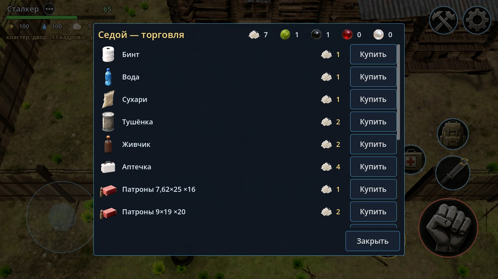
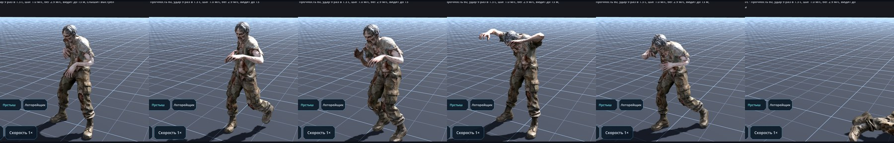

# Стартовая локация — стабильный кластер (проверка)

Игра открывается главным меню (`menu.tscn`): «Новая игра», «Продолжить», «Настройки», «Выход». Дальше — карта
мира (`map.tscn`), с неё — вход на локацию (`world.tscn`, `world.gd`). Стенд анимаций — из меню локации
(шестерёнка → «Стенд»).

## Меню, карта мира, настройки
- Главное меню — картинка с нарисованными кнопками (`core/world/backdrop.gd`: картинка занимает экран телефона
  целиком — растягивается на всю ширину, лишнее по высоте срезается снизу; области нажатия заданы в её точках). «Новая игра» стирает сохранение локации (с подтверждением; имя героя
  и настройки остаются), «Продолжить» ведёт на карту с прежним сохранением (нет сохранения — кнопка затемнена).
- Карта мира (`map.gd`) большая — в 2.5 раза шире и выше экрана: разведанная часть посередине, остальное
  закрыто клубящимся туманом; двигается пальцем. Видно, где герой («Вы здесь»). Нажатие на локацию — слева
  выезжает панель с её рисунком, названием и описанием; вход — только кнопкой «Войти» (повторное нажатие
  на локацию не заводит). Шестерёнка — настройки, «Главное меню» и «Выйти из игры». Локации — в `PLACES`.
- За краем поля — туман, как на границе кластера: начинается у кромки и густеет наружу, клубится
  (`FOG_SHADER`, три слоя на разной высоте; внутри поля тумана нет).
- С локации на карту: выйти за край поля 100×100 м — идёт отсчёт 5 секунд («Вы покидаете локацию»); вернулся —
  отсчёт сброшен, не вернулся — переход на карту мира. Или шестерёнка → «Карта».
- Настройки (`core/world/settings.gd`, `user://settings.json`): графика «Низкая / Средняя / Высокая» и громкость;
  с карты и из игры в том же окне — «Главное меню» и «Выйти из игры».
- Музыка меню и карты мира (`core/music.gd`, `assets/audio/music_menu.mp3`) — «Dead Sector», прислана
  пользователем (его композиция). Играет по кругу без перерыва: и при открытых настройках, и при переходе
  между меню и картой; стихает при входе на локацию. Громкость — в настройках.
- Кнопки в игре собраны у правого края вокруг кнопки атаки: слева — взаимодействие, выше-левее — перезарядка,
  прямо над атакой — смена оружия, над ней — рюкзак (инвентарь), рядом — лечение.

## Частота кадров на телефоне
- Замер пользователя на телефоне (сборка 17): 18–20 кадров/с при 97 вызовах отрисовки и 119 тыс. треугольников —
  значит, телефон упирался не в геометрию, а в закраску точек экрана. Что сделано:
  - трёхмерная картинка рисуется в меньшем разрешении и растягивается (кнопки и надписи остаются чёткими):
    42 / 55 / 80 % по качеству графики, и подстраивается сама так, чтобы частота не опускалась ниже 38–40:
    меньше 38 кадров/с — разрешение сразу падает на 8 %, 38–45 — на 3 %, больше 56 — понемногу растёт (до предела
    качества, не раньше чем через 6 с после снижения). После каждой перемены — секунда передышки (смена
    разрешения сама даёт заминку). Нижний предел — 30 %;
  - на «Низкой» и «Средней»: без анизотропной фильтрации, у елей меньше лап, трава реже и ближе; житель
    вдали не считается;
  - земля: расположение травы, тропы и гальки заранее посчитано в карту 256×256 (`ground_mask.png`,
    `--as-test=bake`) — 7 выборок текстур на точку вместо 12 и цикла по отрезкам тропы;
  - сглаживание MSAA — только на «Высокой»; травы меньше на «Низкой» и «Средней»;
  - прогрев при входе: пули, цифры урона и метка цели один раз рисуются сразу — первый выстрел без заминки.
- Проверить можно только на телефоне: шестерёнка → «Тест FPS».

## Что есть
- Кластер 100×100 м. Земля (`GROUND_SHADER` в `world.gd`): тёмная лесная почва с листвой, трава пятнами,
  россыпи гальки и натоптанная тропа с камешками — от крыльца к калитке и дальше через кластер двумя ветками
  (`TRAIL`). Текстуры берутся в двух масштабах под углом и смешиваются по шуму, рисунок не повторяется. У крыльца
  и вокруг фундамента — вытоптанная земля. Поверх — пучки травы (зелёные и сухие, качаются от ветра, видны
  до 30 м): растут там, где на земле трава, тропа свободна. По земле — сухие ветки и камни, у тропы — валуны.
  По краю кластера — полоса гравия, за ней — другой грунт и дымка. Пройти за край нельзя.
- Лес хвойный: ели трёх размеров (7, 9 и 11 м ±15 %, всего 32) — своя геометрия: ствол и ярусы лап с рисованной
  текстурой хвои (`tools/draw_flora.py`), концы лап качаются. Плюс модели Tripo: сосна (10), берёза (6),
  яблоня (3), куст (22). У стволов — столкновения. Расстановка всегда одинаковая (своё «зерно»); двор, тропа
  и старт свободны.
- Деревянный дом (модель Tripo) с пятью проходимыми комнатами (`core/world/house.gd`): сени (вход), кухня,
  кладовая, горница, спальня — проёмы дверей 1 м. Снаружи виден дом Tripo; когда герой входит, дом Tripo и
  крыша скрываются, видны свои стены (срезаны по 2 м — чуть выше роста героя) и пол, на полу — названия
  комнат. Столкновения — со стенами в полную высоту. Модель Tripo подогнана под стены (`SHELL_FIT` в `world.gd`).
  Собственная раскраска модели вблизи размыта, поэтому дом покрыт чёткими фототекстурами (`SHELL_SHADER`):
  кровля — старый шифер (волна вдоль ската), стены — потемневшая доска-обшивка, крыльцо — доски. Раскраска
  модели задаёт только светлоту — окна, двери и тени под свесом остаются на местах.
- Двор обнесён сплошным забором из серых старых досок (доски разной высоты 1.5–1.8 м, две жерди, столбы 2.2 м,
  по верху — две нити колючей проволоки), спереди — проход-калитка. У забора — бочки и покрышки, во дворе —
  поленница и колода.
- Ящики (модель Tripo) — хранилища на 12 ячеек: кнопка «Постройка» ставит ящик перед героем (не в стену),
  в меню — «Убрать ящик». Ящики сохраняются. В начале игры в горнице стоит один пустой ящик под свои вещи.
- **Начало игры: у героя только пистолет ТТ** с полным магазином и 16 патронов в кармане, плюс бинты, вода и
  тушёнка. Остальное оружие покупается у оружейника. (Сохранения прежних сборок не подходят — игра начнётся
  заново: `SAVE_V` 7. Всё оружие сразу — на полигоне.)
- Манекен во дворе справа от крыльца — фигура в рост человека из мешковины на стойке: на нём пробуют оружие.
  Не падает (запас прочности восстанавливается сам), над головой — урон серии и урон в секунду.
- **Оружейная** — в доме, при входе справа (бывшая кладовая): прилавок с товаром, за ним оружейник Седой;
  на стене — щит с винтовками, у дальней стены — стол под зелёным сукном с автоматами, дробовиком и пистолетами,
  за прилавком — два шкафа с коробками патронов по калибрам, в углу — два сейфа. Мебель — простые объёмы с
  текстурой досок и крашеным металлом (`_armory` в `world.gd`); оружие на витрине — одна сетка без текстур, цвет
  в вершинах (`tools/bake_armory.gd` → `assets/world/ul_armory_guns.res`, 66 тыс. треугольников, 1.2 МБ; рисуется
  только когда герой в доме). Седой поворачивается к герою; разговор — через прилавок.
  
- Герой — тот же, что на стенде (движения, рюкзаки, оружие, звуки).

## Вид и графика
- Камера как в изометрических выживалках: неподвижна, сверху под 61°, смотрит на север (дом — вверху экрана),
  только следует за героем; двумя пальцами можно приблизить или отдалить (10–22 м, по умолчанию 12 м).
  Неба в кадре нет.
- Теней от солнца нет (ради скорости): под героем, деревьями, кустами и предметами — мягкие тёмные пятна.
  Сглаживание MSAA 2×, анизотропная фильтрация 4×, текстуры земли и дома — 2K.
- В доме стены 2 м; стены между камерой и героем опускаются до 0.4 м — героя и комнату всегда видно.
- Сверху слева — имя героя, полоса здоровья, энергия и вода. Справа от имени — три точки: нажатие открывает
  панель, где имя можно сменить (до 16 знаков; хранится в `user://profile.json` отдельно от сохранения локации).

## Управление (Android)
- Левая половина экрана — джойстик, появляется под пальцем: слегка отклонить — лёгкий бег (2 м/с), сильнее —
  быстрее, до полного бега (4.2 м/с). Быстрый бег тратит энергию; без энергии герой бежит медленнее.
- Справа внизу — круглые кнопки (значки — из присланного набора, `assets/icons/ui/`):
  - большая — **атака**: с огнестрельным оружием — выстрел (автомат и пулемёт — очередь, пока держишь), с мачете —
    удар с замахом, без оружия — удары кулаками. Герой сам доворачивается на ближайшую цель;
  - **смена оружия** (значок оружия со стрелками): основное → второй слот (пистолет или мачете) → убрать;
  - **лечение**: само выбирает бинт или аптечку (при большой потере — аптечку), число — сколько осталось;
  - **кнопка взаимодействия** появляется, только когда рядом есть с чем: у жителя, с которым можно говорить
    и торговать, — рукопожатие («Говорить»); у ящика — значок ящика («Открыть»); у предмета или рюкзака — его
    значок («Взять» / «Открыть»). Рядом ничего нет — кнопки нет. Сам предмет при этом слегка подсвечивается;
    нажать можно и прямо на него;
  - **перезарядка** — магазин из запаса патронов в инвентаре (пустой магазин перезаряжается сам при атаке);
  - **инвентарь**.
- Справа вверху — «Постройка» (поставить ящик) и «Меню» («Убрать ящик», «Стенд»).
- Каждый палец обрабатывается отдельно: можно бежать и одновременно стрелять.
- Отклик: полный бег — через 0.1–0.2 с после нажатия, остановка — за 0.1 с; центр джойстика подтягивается
  за пальцем (развернуться можно коротким движением); камера идёт за героем без отставания.
- Атака: удержание кнопки повторяет атаку в темпе оружия (и кулаки, и мачете, и одиночный огонь). Нажатие чуть
  раньше срока — пока оружие достаётся или не кончился прошлый удар — не теряется. Герой сам поворачивается
  к ближайшей цели: вплотную — для кулаков и мачете, в пределах дальности оружия — для огнестрела (только к той,
  что видно: через забор и стены цель не берётся). Под целью — красная метка.
- В игре оружие достаётся в 2.2 раза быстрее, чем на стенде, удары мачете и кулаков — в 1.3, перезарядка — в 1.25.
- На компьютере: WASD, Shift — быстрее, пробел — атака, E — действие, I — инвентарь, Q — оружие, R — перезарядка,
  H — лечение, колесо — приблизить.

## Бой
- Урон, скорострельность, магазин, патроны и дальность — в `core/world/items.gd`. Выстрел — пуля своего калибра
  вылетает из ствола и летит по прямой (без баллистики) до того, во что попадёт; урон — когда долетит. Лучей нет.
  Вид пули — по патрону (`BULLETS` в `world.gd`): длина, толщина, цвет оболочки, остроносая или тупоносая;
  у дробовика — 8 дробин. Пули крупнее настоящих и летят 62 м/с — иначе сверху их не разглядеть.
- Огонь при удержании кнопки: любое оружие стреляет подряд в своём темпе, пока в магазине есть патроны, —
  автомат и пулемёт очередью, пистолет, винтовки и дробовик выстрел за выстрелом. Отпустили кнопку — огонь
  прекращается. Магазин пуст — стрельбы нет до перезарядки: кнопка перезарядки рядом с кнопкой огня, при пустом
  магазине она красная (нажатие огня с пустым магазином тоже начинает перезарядку). Кулаки и мачете при
  удержании бьют подряд.
- Прицельное движение: пока герой стреляет (кнопка удержана или после выстрела прошло меньше полсекунды), он стоит
  лицом к цели, а идёт туда, куда ведёт джойстик. Шаг — в любую сторону относительно взгляда
  (`BCCharacter.set_dir_move`): вперёд — бег, назад — шаг назад, вбок — шаг боком, промежуточные направления —
  смесь соседних клипов; направление меняется плавно, темп шага подстраивается под скорость (ноги не скользят).
  Вперёд — до 3 м/с, боком и назад — 1.75 м/с. Не стреляет — бежит лицом по ходу.
- Кончил стрелять — оружие сразу опускается из прицела в положение «наготове».
- Стрельба не просаживает кадры: вспышка у ствола — светящееся пятно, а не источник света; попадания по одной
  мишени чаще трёх раз в секунду складываются в одну растущую цифру урона; звук гильзы в очереди — на каждый
  третий выстрел, звук попадания — не чаще восьми раз в секунду.
- Звука одышки на бегу нет.
- Перезарядка идёт движением героя (магазин, затвор) и забирает патроны нужного калибра из карманов и рюкзака.
- Мачете носится во втором слоте вместо пистолета: удар 40. Кулаки — 8 за удар.
- Манекен у базы и две мишени-чучела в поле (12 и 25 м от калитки): урон показывается цифрой; чучела на нуле
  падают и через 6 с встают.
- Здоровье 100, энергия 100, вода 100. Вода медленно убывает; без воды энергия не восстанавливается.

## Полигон и стенд 3D

- В главном меню под «Выходом» — две кнопки: **«Полигон»** и **«3D»**.
- **Полигон** — пустая площадка 10×10 м с разметкой через метр и бортом по краю (за борт не выйти ни герою, ни
  врагу). Это та же сцена `world.tscn` в режиме `ULSettings.arena`: тот же герой, управление и бой, что на
  локации. Герой сразу с АК-74М, ТТ и большим рюкзаком; в двух ящиках у борта — остальное оружие и патроны ко
  всему; в углу — манекен. В меню (шестерёнка): «Враг +» (ставит заражённого у борта подальше от героя, не
  больше шести сразу), «Убрать врагов», «Патроны» (запас к оружию в слотах), «Здоровье», «Справочник»,
  «Настройки», «Тест FPS», «3D». Погиб — заново посреди площадки, враги убраны. Полигон ничего не сохраняет.
  
- **Стенд 3D** (`stand.tscn`) — персонаж крупным планом, список движений, камера пальцем. Теперь на нём
  переключается, кого смотреть: «Герой» или «Заражённый» (`ULSettings.stand_who`; виды берутся из
  `ULEnemy.KINDS`, новый враг появится в списке сам). Враг показан той же моделью и теми же клипами, что в игре:
  стоит, бродит, бежит, бьёт, попадание, гибель и тело, подъём и ещё три движения; сверху — его числа (прочность,
  удар, скорости, как видит и слышит). «Назад» ведёт туда, откуда пришли: в главное меню, на локацию или на
  полигон.
  
- Кнопки проверки на локации и полигоне (ряд под шестерёнкой) растут влево: раньше длинный ряд уходил за правый
  край экрана.

## Ресурсы и торговля

- Пять ресурсов — спораны, горошина, чёрная, красная и белая жемчужины (`ULItems.MONEY`) — это валюта. Они не
  лежат в ячейках, а копятся в кошельке (`ULInventory.wallet`): сколько ни собери, складываются в одно число.
  Взял с тела («Взять всё» или по одному) — сразу в кошелёк. Кошелёк сохраняется вместе с инвентарём; ресурсы из
  старого сохранения, лежавшие в ячейках, при загрузке переходят в кошелёк.
- Окошко «Ресурсы» — в инвентаре под героем и в окне ящика или обыска под карманами: значок и количество каждого
  ресурса (чего нет — значок тусклый); нажатие показывает название.
- **Магазин оружейника** («Говорить» → «Торговать»). Три раздела: «Оружие», «Патроны», «Припасы и снаряжение»
  (бинты, аптечки, еда, вода, рюкзаки). Товар — карточками; нажатие выбирает, справа — карточка товара: картинка,
  описание, у оружия — урон, магазин, темп, дальность и прочность, сколько такого уже есть, цена и «Купить».
  **У оружия тут же — патроны к нему** с ценой и кнопкой «Купить патроны» (и сколько их уже при себе): не надо
  искать калибр в другом разделе. Купленное оружие встаёт в свободный слот, остальное — в карманы и рюкзак.
  Не хватает ресурсов или нет места — покупки нет, ничего не списывается (цена красная, кнопка тусклая).
  Товар и цены — `SHOP` в `world.gd`; цены пробные: пистолеты и мачете 6–10 споранов, MP5 24, SPAS-12 30, АК-74М 40,
  ВСС 50, FN FAL 55, СВД — 2 горошины, ПКП — 3; патроны 1–4 спорана за пачку. Продажи вещей оружейнику пока нет.
  
- **Прочность оружия** — сколько выстрелов (у мачете — ударов) оно выдержит: ТТ 150, Beretta 200, мачете 120,
  SPAS-12 160, СВД 250, ВСС 300, FN FAL 400, MP5 500, АК-74М 600, ПКП 900 (`dur` в `items.gd`). Каждый выстрел и
  удар снимает единицу. Видно только в инвентаре: полоска по низу ячейки (зелёная → жёлтая → красная) и строка в
  карточке оружия «прочность 143 из 600 выстрелов». На нуле оружие ломается и пропадает из слота; патроны из
  магазина возвращаются в карманы. Ремонта пока нет.
  

## Враги и добыча (`core/world/enemy.gd`)

- Весь баланс врагов — в отдельном файле `data/enemies.json` (правится без кода): прочность, скорости, с какого
  расстояния видит и слышит (выстрел, бег, шаги), сколько кричит перед погоней, когда теряет, удары (клип, урон,
  на какой доле клипа удар доходит), добыча (предмет, от, до, шанс), рост.
- **Пустыш** (заражённый низшей ступени) — первый враг. Модель по присланному фото: Tripo, со скелетом (`assets/models/zombie.glb`,
  12 тыс. треугольников, текстуры 1024). Прочность 60; бродит шагом 1 м/с вокруг своего места; видит героя ближе
  13 м (стены и забор закрывают обзор), слышит выстрел до 22 м (стрельба по манекену у дома не привлекает) и бег
  до 7 м — бежит 2.9 м/с. Вплотную (1.35 м) бьёт руками: 9 урона раз в 1.3 с.
- **Лоторейщик** — второй враг, по присланной картинке (вид спереди; Tripo, `assets/models/lottery.glb`: 13 тыс.
  треугольников, один материал, цвет 2048, нормали и шероховатость 1024; скелет 78 костей с пальцами). Рост 1.9 м,
  прочность 150, шаг 1.2 и бег 3.7 м/с (герой бежит 4.2 — уйти можно, но с трудом). Видит с 16 м, слышит выстрел
  с 30 м, бег с 11 м и даже шаги с 4 м. Заметив — **кричит 0.9 с** и только потом бежит. Четыре удара, выбираются
  случайно, раз в 1.5 с: когти слева 14, когти справа 16, укус 20, выпад головой с раскрытой пастью 24. В теле —
  1–4 спорана всегда и горошина с шансом 35 %. На локации один, в дальнем углу поля; на полигоне — кнопка
  «Лоторейщик +».
  
- **Поведение (у всех врагов).** Бродит у своего места → замечает (увидел, услышал выстрел, бег, шаги) →
  кричит, если виду положено → бежит туда, где видел героя в последний раз → вплотную бьёт: у удара замах, урон
  доходит на середине клипа, и если герой успел отойти дальше дальности удара — мимо. Потерял из виду — доходит до
  последнего места, озирается и через несколько секунд успокаивается; далеко убежавшего героя бросает.
  **Обход препятствий:** луч вперёд на уровне голени, упёрся (стена, забор, ящик, другой враг) — пробуются
  повороты всё круче в обе стороны, берётся первый свободный и держится полсекунды; сквозь стены не ходит
  (столкновения — обычные). Это не поиск пути: из тупика (комната с одной дверью за спиной) он может не выбраться.
- **Попадания и гибель.** Попадание спереди и сзади — разные движения; сильное попадание (от 30 % прочности разом,
  например дробовик в упор) сбивает с ног и срывает удар, который он готовил. Падает по стороне удара: спереди —
  на спину, сзади — лицом вперёд, сбоку — набок.
- **Голос.** Рычит, пока бродит и гонится, кричит при обнаружении и ударе, хрипит при гибели — шесть записей CC0
  из набора проекта (`growl`, `roar`, `zdeath`; источники — `bunker/docs/AUDIO_SOURCES.md`). Слышно в 30 м.
- **Движения врагов — свои.** У пустыша и Лоторейщика отдельные наборы клипов (`assets/anim/zombie`,
  `assets/anim/lottery`): 17 движений (у пустыша в игре используется 14 — у него один удар) заказаны в Tripo по описанию («зомби стоит сгорбившись, руки висят…») и
  перенесены самим Tripo на собственный скелет каждой модели — без пересчёта с героя. Стойка — сгорбленная, руки
  висят; шаг — шаркающий, с подволакиванием ноги; бег — с наклоном вперёд; удары левой и правой, укус, выпад
  пастью; попадания спереди и сзади, потеря равновесия; крик, тревога, повороты; падения вперёд, назад и набок.
  Описание клипов — `data/anim_enemy.json` (каждый клип берётся из своей папки модели; чего там нет — из набора
  героя с пересчётом под скелет, `BCAnimSet._rest_fix`). Новые движения добавляются так: файлы Tripo
  `m_<набор>_<метка>.glb` в папку → `tools/extract_anims.gd` → клипы.
- Нижняя стопа врага всегда на земле (`stand_clamp`): в движениях по описанию высота таза записана неточно,
  без этого фигура висела над землёй на несколько сантиметров.
- **Что не сделано из задания на Лоторейщика и почему.** Отдельных костей челюсти и ротовых отростков нет:
  скелет ставит Tripo автоматически, он человеческий (78 костей, пальцы есть) — пасть и отростки не двигаются
  сами; «укус» и «выпад пастью» — движения головы и корпуса. Движения по описанию не трогают пальцы (в клипе 24
  кости). Нужен ручной скелет лица (Blender) — тогда добавлю движения пасти. LOD: упрощённые сетки строит импорт
  Godot (`generate_lods`), вдали берётся более грубая; дальше 36 м враг не считается вовсе.
- На локации трое пустышей за забором в поле и один Лоторейщик в дальнем углу (`ENEMY_SPAWNS`). Убитый
  появляется на своём месте снова через 25 с после того, как тело исчезло, и только когда герой дальше 16 м.
  Дальше 36 м от героя враг не считается и не двигается.
  В меню (шестерёнка) — «Враг +»: ставит ещё одного в 9 м перед героем, для проверки оружия.
- Враг — обычная цель: автонаведение, пули, кулаки и мачете работают как по манекену.
- Герой получает удар — экран на миг краснеет, здоровье убывает. Здоровье кончилось — «Вы погибли», через три
  секунды герой снова у дома с половиной здоровья; вещи остаются при нём.
- **Тело и обыск.** Убитый падает и лежит. Рядом с телом появляется кнопка взаимодействия со значком споранов и
  подписью «Обыскать»; она открывает окно «Обыск» — добыча тела в четырёх ячейках, «Взять всё» или по одному.
  Тело исчезает ровно через минуту после гибели (`CORPSE_S`) — обыскали его или нет; открытое окно обыска при
  этом закрывается.
  
- **Добыча** (`items.gd`, вид «loot»): спораны — валюта (мелкие белые шарики; счёт — в шапке рядом
  со здоровьем), горошина, чёрная, красная и белая жемчужины. В заражённом — от нуля до трёх споранов (`loot` в
  `KINDS`: предмет, от, до); что именно лежит, решается при появлении. Горошина и жемчужины в игре есть как
  предметы, но пока ни в ком не лежат: они для существ сильнее. Значки вырезаны из присланной картинки.
  
- Картинка врага (окно обыска и справочник) — снимок его 3D-модели в живой позе, а не в исходной «руки в
  стороны»: `tools/portrait.tscn` ставит кадр клипа (`POSES`: у заражённого — крадётся, руки тянутся вперёд) и
  пишет `assets/icons/enemy_<вид>.png`. Для нового врага достаточно добавить его в `ULEnemy.KINDS` и запустить.
- **Справочник** (меню → «Справочник»): картинка врага и строки, собранные из тех же чисел, по которым он живёт
  (`ULEnemy.describe`): как ходит, как нападает, прочность, что бывает в теле, сколько лежит тело.
  
- Движения врага — те же клипы, что у героя. Кости у моделей Tripo называются одинаково, но в исходной позе
  повёрнуты по-разному (у заражённого иначе стоят корень, таз и вся правая рука), поэтому при переносе повороты
  пересчитываются в исходную позу своего скелета (`BCAnimSet._rest_fix`). Библиотека клипов строится один раз на
  модель: первый заражённый — 80 мс при загрузке, следующие — 3 мс.

## Инвентарь (`core/world/items.gd`, `inventory.gd`, `inventory_ui.gd`)
- Отдельное меню на весь экран (игра за ним не видна), «Закрыть» — обратно в игру. В шапке — сколько ячеек занято.
- Экран «Инвентарь»: слева — слоты одежды (шлем, жилет, куртка, штаны, обувь — пока заготовки), в центре —
  герой в полный рост (3D, можно повернуть пальцем; с оружием — в стойке, рюкзак — на спине), под ним — здоровье,
  энергия, вода; рядом — слоты «Основное», «Пистолет / нож», «Рюкзак» и строка «В руках: …». Справа — карманы
  (8 ячеек) и ячейки надетого рюкзака: малый +8, средний +12, большой +20.
- Экран «Хранилище»: слева — картинка ящика или рюкзака, вместимость, «Взять всё» (у рюкзака — «Надеть»);
  затем содержимое (4 в ряд), слоты снаряжения, карманы и рюкзак.
- Нажатие на предмет выбирает его; внизу — описание и действия: «Экипировать» / «Надеть», «В руки» / «Убрать
  из рук», «Снять», «Использовать», «В хранилище» / «Взять», «Выбросить». Повторное нажатие — быстрое действие
  (экипировать, использовать, переложить). Патроны и расходники складываются в стопки.
- Выброшенный предмет ложится на землю перед героем — своей 3D-моделью.
- Рюкзак с земли можно надеть вместе с вещами; надетый при этом ложится на землю со своими вещами. Рюкзак
  с вещами нельзя убрать в ячейку — только выбросить.
- Всё сохраняется (`user://cluster.json`, версия 6): инвентарь, предметы на земле, содержимое ящиков, здоровье,
  энергия, вода, патроны в магазинах.

## Патроны — одна модель Tripo по фото
- `ul_ammo` — по присланной картинке одной генерацией (55 кредитов): семь коробок (7,62×25, 9×19, 5,45×39,
  7,62×51, 7,62×54R, 9×39, 12 калибр), у шести рядом стоит патрон (у 9×19 патрон не получился — на значке стоит
  патрон от 7,62×25). `tools/split_glb.mjs` режет набор на семь предметов и у каждого выделяет части: `item_N` —
  коробка с патроном, `item_N_a` — коробка, `item_N_b` — патрон.
- В инвентаре патроны — значок «патрон и коробка», как на фото, и количество (`assets/icons/ammo_N.png`, снимок
  той же модели); на земле лежит только коробка.

## Набор припасов — одна модель Tripo
- `ul_supplies` — девять предметов одной генерацией (55 кредитов): красная коробка пистолетных патронов, зелёный
  цинк, коробка патронов 12 калибра, аптечный пузырёк, бинт, аптечка, пачка сухарей, бутылка воды, консервная
  банка. `tools/split_glb.mjs` выравнивает набор, делит его на связные куски и собирает в `assets/world/
  ul_supplies.glb` девять отдельных предметов (`item_1`…`item_9`) с одной общей текстурой.
- Каждый предмет каталога ссылается на свой номер (`kit` в `items.gd`): эта модель лежит на земле, а значок
  в инвентаре — снимок той же модели (`tools/icons.gd` → `assets/icons/kit_N.png`). Патроны разных калибров
  делят одну модель и различаются оттенком значка и названием.
- Новый предмет — «Живчик» (пузырёк): +60 энергии, +5 здоровья.
- Так же можно добавлять следующие наборы: одна генерация — много предметов (`tools/kit_view.gd` — обзор набора).

## Проверка
- `godot --path . --headless res://world.tscn -- --as-test=inv` — 132 случая (без экрана — около минуты, время
  считается честно, 60 кадров/с): отклик управления (разгон, остановка, камера), нажатие во время доставания
  оружия, автонаведение за спину и через забор, удержание кнопки, манекен, содержимое ящиков, кнопка
  взаимодействия (нет цели — нет кнопки; житель, ящик), разговор, смена имени, режимы огня (пистолет — один
  выстрел, автомат — очередь до нуля, перезарядка кнопкой), полёт пуль и дробин, выход с локации по отсчёту, враг (замечает, слышит выстрел, бьёт, гибнет, 0–3 спорана, обыск, тело исчезает через
  минуту — обысканное и нет, гибель героя, справочник), ресурсы (кошелёк без ячеек, все пять, окошко, покупка,
  отказ при нехватке, сохранение, перенос из старого сохранения), прочность оружия (выстрел снимает единицу,
  строка в инвентаре, поломка и возврат патронов), Лоторейщик (рост, слух на бег и шаги, крик перед погоней,
  обход ящика, сильное попадание, падение по стороне удара, горошина в трети тел),
  а также логика
  инвентаря (стопки, слоты, ёмкость
  с каждым рюкзаком, переполнение, выброс и подбор, смена рюкзака с вещами, ящик, сохранение) и бой (кулаки,
  мачете во втором слоте, выстрел и расход патронов, попадание по мишени, перезарядка из запаса, пустой запас,
  лечение, вода, энергия) с ответом «верно / ОШИБКА».
- `--as-test=world --as-out=папка` — сценарий со снимками: открыть рюкзак на земле и надеть, дойти до ящика,
  взять оружие, взять в руки, открыть инвентарь, выбросить, переложить в рюкзак на земле, пройти по дому.
- `--as-test=view --as-out=папка` — обзор локации: снимки в шести точках.
- `--as-test=arena --as-out=папка` — полигон: борт держит героя, враги по кнопке (не больше шести), патроны,
  уборка врагов, гибель; `--as-test=shop` — разговор, торговля, покупка; `res://stand.tscn -- --as-test=enemy` —
  враг на стенде, по снимку на движение.
- `--as-test=enemy --as-out=папка` — заражённый: стоит, бежит, бьёт, падает, обыск, справочник (общий вид и
  крупный план); `--as-test=eclips` — его движения по кадрам.
- **Проверка производительности для Android** — в конце каждой проверки (`_perf_report`) и отдельно
  `--as-test=perf`: замеры в семи местах (старт, калитка, двор, ельник, тропа, дом, открытый инвентарь) против
  бюджета кадра для телефона среднего класса (Mali-G57 / Adreno 610, цель 60 кадров/с): вызовов отрисовки ≤ 350,
  треугольников ≤ 450 тыс., текстуры ≤ 450 МБ, свои скрипты и физика ≤ 4 мс в худшем кадре (на компьютере; телефон
  считает в 3–4 раза медленнее). Отрисовка считается при запуске с экраном, скрипты — при запуске без экрана
  (`--headless`: под программной отрисовкой время кадра — это сама отрисовка). Сейчас: до 133 вызовов,
  143 тыс. треугольников, 99 МБ текстур, 3.2 мс — всё в бюджете.
- Саму частоту кадров можно измерить только на телефоне: меню (шестерёнка) → «Тест FPS» — 10 секунд игры,
  на экране остаются средняя частота, худший кадр, вызовы отрисовки, треугольники и память текстур; то же
  пишется в `user://perf.txt`.
- Проверено на компьютере (программная отрисовка, поэтому 1–3 кадра/с в журнале — не показатель). На телефоне
  не проверялось: управление пальцами и частоту кадров нужно смотреть там.

## Источники
- Модели дома, ящика, сосны, берёзы, яблони, куста, набора припасов — Tripo AI, аккаунт пользователя
  (`tools/tripo/budget.md`).
- Текстуры — Poly Haven, CC0 (`assets/world/tex/`): forrest_ground_01 и leafy_grass (трава), grass_path_2 (сухая
  земля), rocky_trail (галечная тропа), rock_boulder_dry (валуны), old_planks_02 (серые доски забора),
  bark_brown_02 (кора), dry_ground_01, rocky_gravel, weathered_brown_planks, brown_planks_03 (дом внутри),
  weathered_plank_siding (стены дома снаружи), worn_corrugated_iron (кровля). Гамма светлая: зелёный луг
  с проплешинами сухой земли, а не тёмная лесная почва.
- Откуда брать текстуры дальше: Poly Haven (polyhaven.com) и ambientCG (ambientcg.com) — обе библиотеки CC0
  (можно в коммерческой игре, без указания автора), обе доступны из сборочной среды. Модели Tripo с размытой
  раскраской улучшаются тем же приёмом, что дом: чёткая фототекстура поверх, раскраска модели — как светлота.
- Бочка и покрышка — модели Poly Haven, CC0: barrel_03, old_tyre (`assets/world/ph_barrel.glb`, `ph_tyre.glb`,
  текстуры уменьшены до 512).
- Еловая лапа (`spruce_bough.png`) и пучок травы (`grass_tuft.png`) — нарисованы скриптами, собственные.
- Значки кнопок (`assets/icons/ui/`) — из набора, присланного пользователем. Забор, проволока, ели, поленница,
  колода, камни, ветки — своя геометрия.
