# Стартовая локация — стабильный кластер (проверка)

Игра открывается главным меню (`menu.tscn`): «Новая игра», «Продолжить», «Настройки», «Выход». Дальше — карта
мира (`map.tscn`), с неё — вход на локацию (`world.tscn`, `world.gd`). Стенд анимаций — из меню локации
(шестерёнка → «Стенд»).

## Меню, карта мира, настройки
- Главное меню — картинка с нарисованными кнопками (`core/world/backdrop.gd`: картинка занимает экран телефона
  целиком — растягивается на всю ширину, лишнее по высоте срезается снизу; области нажатия заданы в её точках). «Новая игра» стирает сохранение локации (с подтверждением; имя героя
  и настройки остаются), «Продолжить» ведёт на карту с прежним сохранением (нет сохранения — кнопка затемнена).
- Карта мира (`map.gd`) большая — в 2.5 раза шире и выше экрана: разведанная часть посередине, остальное
  закрыто клубящимся туманом; двигается пальцем. Видно, где герой («Вы здесь»). Нажатие на локацию — слева
  выезжает панель с её рисунком, названием и описанием; вход — только кнопкой «Войти» (повторное нажатие
  на локацию не заводит). Шестерёнка — настройки, «Главное меню» и «Выйти из игры». Локации — в `PLACES`.
- За краем поля — туман, как на границе кластера: начинается у кромки и густеет наружу, клубится
  (`FOG_SHADER`, три слоя на разной высоте; внутри поля тумана нет).
- С локации на карту: выйти за край поля 100×100 м — идёт отсчёт 5 секунд («Вы покидаете локацию»); вернулся —
  отсчёт сброшен, не вернулся — переход на карту мира. Или шестерёнка → «Карта».
- Главное меню — картинка пользователя (`assets/ui/title.jpg`) с кнопками «Новая игра», «Продолжить»,
  «Мультиплеер», «Настройки», «Выход» (области нажатия — `bd.areas` в `menu.gd`, в точках картинки 1672×941).
  Проверочные режимы убраны с главного экрана: **«Настройки» → «Лаборатория»** — «Полигон 10×10», «Стенд 3D:
  движения, редактор удара», «Тест уровней», «Тест кейсов».
- **«Тест уровней»** (Настройки → Лаборатория): окно выбора локации (дом,
  коровник, санаторий, конвой, хутор, полигон); герой появляется там сразу с пулемётом ПКП и запасом лент, бессмертный,
  патроны не кончаются, с большим рюкзаком, пистолетом ТТ и аптечками. Ничего не сохраняется (`ULSettings.level_test`, база — только в
  памяти): маршруты, споры и вещи на базе не меняются, таймер кластера не убивает, выход — за край поля или шестерёнка → «Главное меню» (возврат в меню).
- **«Замер FPS»** — галочка в окне «Тест уровней»: герой сам обходит 6–10 мест локации (входы, дома, подвал,
  магазин, улица, «все враги гонятся»), в каждом 1,5 с ждёт и 3 с меряет: кадры в секунду, худший кадр, вызовы
  отрисовки, треугольники. В конце — таблица на экране (с моделью телефона, видеочипом, качеством графики и
  размером экрана), копия в буфер обмена и файл `user://bench_<место>.txt`. Цифры с телефона можно прислать —
  по ним подстраивается графика.
- Настройки (`core/world/settings.gd`, `user://settings.json`) — одни на все локации, базу и стенд:
  - **качество**: «Низкая» (3D 70 %, без сглаживания и теней), «Средняя» (85 %, MSAA 2×, тени — карта 1024),
    «Высокая» (100 %, MSAA 2×, тени 2048, анизотропная фильтрация земли), «Ультра» (100 %, MSAA 4×, тени 4096
    мягче, трава гуще и дальше);
  - отдельно поверх качества: **разрешение 3D** (как в качестве / 60–100 %), **тени** (как в качестве / выкл /
    хорошие / лучшие), **трава** (как в качестве / мало / средне / много), **подстройка FPS** (вкл / выкл);
  - громкость; с карты и из игры в том же окне — «Главное меню» и «Выйти из игры».
- Музыка меню и карты мира (`core/music.gd`, `assets/audio/music_menu.mp3`) — «Dead Sector», прислана
  пользователем (его композиция). Играет по кругу без перерыва: и при открытых настройках, и при переходе
  между меню и картой; стихает при входе на локацию. Громкость — в настройках.
- Кнопки в игре собраны у правого края вокруг кнопки атаки: слева — взаимодействие, выше-левее — перезарядка,
  прямо над атакой — смена оружия, над ней — рюкзак (инвентарь), рядом — лечение.

## Частота кадров на телефоне
- **Почему на снимках с телефона было 39–42 % разрешения при 58–60 кадрах/с.** Прежняя подстройка мерила
  среднюю частоту за секунду с первых кадров на локации: постройка локации и первая закраска дают рывки в
  сотни миллисекунд — средняя падала ниже 38, и разрешение сразу сбрасывалось крупными шагами до нижнего
  предела 30 %, а поднималось по 4 % в секунду с паузами — и надолго оставалось низким. Теперь: первые 5 с на
  локации не считаются; частота — по срединному кадру секунды (одиночный рывок не в счёт); при нехватке
  кадров сначала снимается сглаживание, потом тени и только потом разрешение — не ниже 62 %; подстройку можно
  выключить в настройках. Всё ниже в этом разделе — история.
- Замер пользователя на телефоне (сборка 17): 18–20 кадров/с при 97 вызовах отрисовки и 119 тыс. треугольников —
  значит, телефон упирался не в геометрию, а в закраску точек экрана. Что сделано:
  - трёхмерная картинка рисуется в меньшем разрешении и растягивается (кнопки и надписи остаются чёткими):
    42 / 55 / 80 % по качеству графики, и подстраивается сама так, чтобы частота не опускалась ниже 38–40:
    меньше 38 кадров/с — разрешение сразу падает на 8 %, 38–45 — на 3 %, больше 56 — понемногу растёт (до предела
    качества, не раньше чем через 6 с после снижения). После каждой перемены — секунда передышки (смена
    разрешения сама даёт заминку). Нижний предел — 30 %;
  - на «Низкой» и «Средней»: без анизотропной фильтрации, у елей меньше лап, трава реже и ближе; житель
    вдали не считается;
  - земля: расположение травы, тропы и гальки заранее посчитано в карту 256×256 (`ground_mask.png`,
    `--as-test=bake`) — 7 выборок текстур на точку вместо 12 и цикла по отрезкам тропы;
  - сглаживание MSAA — только на «Высокой»; травы меньше на «Низкой» и «Средней»;
  - прогрев при входе: пули, цифры урона и метка цели один раз рисуются сразу — первый выстрел без заминки.
- Проверить можно только на телефоне: шестерёнка → «Тест FPS».

## Что есть
- Кластер 100×100 м. Земля (`GROUND_SHADER` в `world.gd`): тёмная лесная почва с листвой, трава пятнами,
  россыпи гальки и натоптанная тропа с камешками — от крыльца к калитке и дальше через кластер двумя ветками
  (`TRAIL`). Текстуры берутся в двух масштабах под углом и смешиваются по шуму, рисунок не повторяется. У крыльца
  и вокруг фундамента — вытоптанная земля. Поверх — пучки травы (зелёные и сухие, качаются от ветра, видны
  до 30 м): растут там, где на земле трава, тропа свободна. По земле — сухие ветки и камни, у тропы — валуны.
  По краю кластера — полоса гравия, за ней — другой грунт и дымка. Пройти за край нельзя.
- Лес хвойный: ели трёх размеров (7, 9 и 11 м ±15 %, всего 32) — своя геометрия: ствол и ярусы лап с рисованной
  текстурой хвои (`tools/draw_flora.py`), концы лап качаются. Плюс модели Tripo: сосна (10), берёза (6),
  яблоня (3), куст (22). У стволов — столкновения. Расстановка всегда одинаковая (своё «зерно»); двор, тропа
  и старт свободны.
- Деревянный дом (модель Tripo) с пятью проходимыми комнатами (`core/world/house.gd`): сени (вход), кухня,
  кладовая, горница, спальня — проёмы дверей 1 м. Снаружи виден дом Tripo; когда герой входит, дом Tripo и
  крыша скрываются, видны свои стены (срезаны по 2 м — чуть выше роста героя) и пол, на полу — названия
  комнат. Столкновения — со стенами в полную высоту. Модель Tripo подогнана под стены (`SHELL_FIT` в `world.gd`).
  Собственная раскраска модели вблизи размыта, поэтому дом покрыт чёткими фототекстурами (`SHELL_SHADER`):
  кровля — старый шифер (волна вдоль ската), стены — потемневшая доска-обшивка, крыльцо — доски. Раскраска
  модели задаёт только светлоту — окна, двери и тени под свесом остаются на местах.
- Двор обнесён сплошным забором из серых старых досок (доски разной высоты 1.5–1.8 м, две жерди, столбы 2.2 м,
  по верху — две нити колючей проволоки), спереди — проход-калитка. У забора — бочки и покрышки, во дворе —
  поленница и колода.
- Ящики (модель Tripo) — хранилища на 12 ячеек: кнопка «Постройка» ставит ящик перед героем (не в стену),
  в меню — «Убрать ящик». Ящики сохраняются. В начале игры в горнице стоит один пустой ящик под свои вещи.
- **Начало игры: у героя пистолет ТТ** с полным магазином, 60 патронов и мачете в кармане (мачете носится в слоте
  пистолета — поменять в инвентаре), плюс бинты, вода и
  тушёнка. Остальное оружие покупается у оружейника. (Сохранения прежних сборок не подходят — игра начнётся
  заново: `SAVE_V` 7. Всё оружие сразу — на полигоне.)
- Манекен во дворе справа от крыльца — фигура в рост человека из мешковины на стойке: на нём пробуют оружие.
  Не падает (запас прочности восстанавливается сам), над головой — урон серии и урон в секунду.
- **Оружейная** — в доме, при входе справа (бывшая кладовая). Пока оружейник не куплен через компьютер базы,
  комната **пустая** и подписана «Кладовая»; после покупки в ней сразу появляется всё: прилавок с застеклённой
  витриной, за ним оружейник Седой; на стене — щит с винтовками и стойка с ружьями над столом под зелёным сукном
  (автоматы, дробовик, пистолеты), у задней стены — два металлических стеллажа с ящиками патронов, в углу — два
  сейфа. Прилавок, стеллажи и стойка — модели Tripo (`ul_gun_counter`, `ul_ammo_shelf`, `ul_gun_rack`; нет
  модели — простые объёмы), `_armory` в `world.gd`; оружие на витрине — одна сетка без текстур, цвет
  в вершинах (`tools/bake_armory.gd` → `assets/world/ul_armory_guns.res`, 66 тыс. треугольников, 1.2 МБ; рисуется
  только когда герой в доме). Седой поворачивается к герою; разговор — через прилавок.
  
- Герой — тот же, что на стенде (движения, рюкзаки, оружие, звуки).

## Вид и графика
- Камера как в изометрических выживалках: неподвижна, угол — в настройках («Камера»): «Сверху» (61°), «С наклоном»
  (52°, как в DoZ Survival; по умолчанию), «По диагонали» (50° и поворот на 45°, как в Last Day on Earth — дома и
  заборы ромбом; стены, закрывающие героя, выбираются по углу камеры),
  только следует за героем; двумя пальцами можно приблизить или отдалить (10–22 м, по умолчанию 12 м).
  Неба в кадре нет.
- На базе теней от солнца нет (ради скорости): под героем, деревьями, кустами и предметами — мягкие тёмные пятна.
  Во временных кластерах на «Средней» и «Высокой» — тени солнца (одна карта теней на 34 м вокруг камеры).
  Сглаживание MSAA 2×, анизотропная фильтрация 4×, текстуры земли и дома — 2K.
- В доме стены 2 м; стены между камерой и героем опускаются до 0.4 м — героя и комнату всегда видно.
- Подстройка под телефон (`world.gd`, `_auto_res` / `adapt_step`): раз в секунду смотрится частота кадров. Ниже 40 —
  сначала выключается сглаживание MSAA, затем тени солнца и только потом снижается разрешение 3D (не ниже 62 %).
  Выше 52 — всё возвращается в обратном порядке (разрешение до выбранного качества, тени, сглаживание). Что
  сейчас снято — видно в строке под именем: «· без сглаживания», «· без теней».
- Резкость (`core/world/sharpen.gd`, `ULSharpen`; настройка «Резкость»: Выкл / Мягкая / Сильная, по умолчанию
  «Мягкая»). Откуда «мыло» на телефоне: 3D рисуется в доле разрешения экрана (70–85 % по качеству, при нехватке
  кадров подстройка опускает до 62 %) и растягивается на весь экран обычным линейным фильтром — другого растяжения
  в отрисовщике Compatibility (OpenGL ES 3) нет, сдвига уровней текстур тоже. `ULSharpen` — один проход поверх
  готовой трёхмерной картинки, под интерфейсом (надписи и кнопки он не трогает): возвращает контраст мелких
  деталей по способу AMD CAS (сила — по местному контрасту: ровные места не шумят, светлой каймы на границах
  нет); чем ниже доля разрешения, тем проход сильнее и шире. Цена — копия экрана и пять выборок на точку; на
  телефоне не замерялась. Один и тот же кадр (экран 2400×1080, фрагмент 1:1):
  
- Земля всех локаций — одна система: общий шейдер `GROUND_SHADER` и библиотека `GROUND_SETS` (какие фототекстуры
  грунта и тропы и какие оттенки у каждой локации; новая локация без своей строки берёт «default»). Мыльная
  текстура `dirt` заменена на brown_mud_dry / brown_mud_rocks_01 (Poly Haven, CC0).
- Земля (`GROUND_SHADER` в `world.gd`): слои — трава, сухая трава, лесная подстилка, грунт, тропа — смешиваются
  «по высоте»; две выборки одной фототекстуры против повторов тоже смешиваются «по высоте» (`hmix`), а не
  пополам — иначе камни и стебли гасили друг друга в ровное пятно. Слой, который в этой точке заведомо не
  проступит (вес меньше главного больше чем на 0,45), не читается вовсе. Земля рисуется после построек
  (`render_priority = 1`): под полом домов её точки отбрасываются по глубине до шейдера. За краем поля —
  рамка из четырёх полос (`ULHouse.outer_frame`), а не плита под всем полем. Вырез (`discard`) — только у хутора.
- Логово муров: двор — пятна тёмной грязи с камнями (`brown_mud_rocks_01`) и утоптанной сухой земли с галькой
  (`brown_mud_dry`, плитка 2 м); полы в помещениях — `old_wood_floor` (цвет, нормали, шероховатость);
  кусты — модель Poly Haven `searsia_lucida` (≈10 тыс. треугольников), папоротники — `fern_02` (3,5 тыс., без
  тени). Все текстуры и модели — Poly Haven, CC0.
- Замер графики по частям: `--as-test=gfxdiag` (два места логова, каждый эффект выключается по одному; время
  кадра, вызовы отрисовки, треугольники; отдельно — время ИИ врагов). В контейнере видеокарты нет (программная
  отрисовка llvmpipe), поэтому важны доли, а не сами числа кадров; на телефоне — «Тест уровней → Замер».
- Сверху слева — имя героя, полоса здоровья, энергия и вода. Справа от имени — три точки: нажатие открывает
  панель, где имя можно сменить (до 16 знаков; хранится в `user://profile.json` отдельно от сохранения локации).

## Карта локации на экране (`core/world/place_map.gd`, `map_view.gd`; в `world.gd` — `open_place_map`)
- Справа вверху, левее кнопок постройки и меню, — круглая кнопка «Карта». На базе карта есть всегда; во временном
  кластере — если куплена вместе с маршрутом (см. «Базовый компьютер»); в «Тесте уровней» — всегда. Не куплена —
  кнопка тусклая, с замком; нажатие подсказывает, где карту взять. На полигоне кнопки нет.
- Карта — снимок локации строго сверху (`assets/ui/topmaps/top_<место>.jpg`, 1536 точек по длинной стороне,
  сжатие с потерями, всего 3,6 МБ в сборке): всё поле и по 3 м за его краем; верх карты — «вверх» на экране в игре.
  Запекается проверкой `mapbake` (без героя, врагов и находок) — **после перестройки локации карту нужно
  перезапечь**; проверка `pmap` сравнивает свежий вид сверху с запечённым и ловит устаревшую или перевёрнутую.
  
- На карте: жёлтая стрелка — герой и куда он смотрит (живая: игра под картой продолжается), зелёная точка — вход
  на локацию, мерная линейка. «Крупнее» — в 2,6 раза вокруг героя, «Вся карта» — обратно. «Закрыть» или касание
  мимо карты закрывает её. Врагов, находок и напарника на карте нет.
  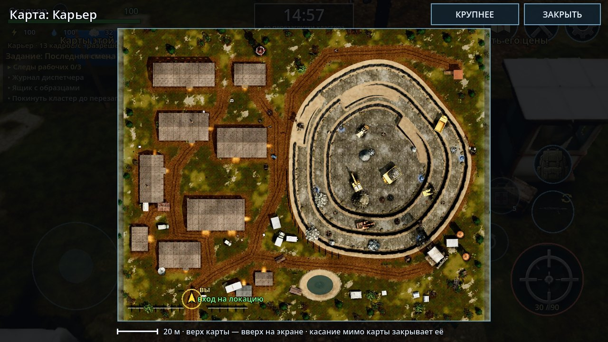
- В совместной игре сервер (`net/server_state.gd`) про карту пока не знает: покупка карты на общий маршрут —
  вместе с этапом совместных локаций.

## Управление (Android)
- Левая половина экрана — джойстик, появляется под пальцем: слегка отклонить — лёгкий бег (2 м/с), сильнее —
  быстрее, до полного бега (4.2 м/с). Быстрый бег тратит энергию; без энергии герой бежит медленнее.
- Справа внизу — круглые кнопки (значки — из присланного набора, `assets/icons/ui/`):
  - большая — **атака**: с огнестрельным оружием — выстрел (автомат и пулемёт — очередь, пока держишь), с мачете —
    удар с замахом, без оружия — удары кулаками. Герой сам доворачивается на ближайшую цель;
  - **смена оружия** (значок оружия со стрелками): основное → второй слот (пистолет или мачете) → убрать;
  - **лечение**: само выбирает бинт или аптечку (при большой потере — аптечку), число — сколько осталось;
  - **кнопка взаимодействия** появляется, только когда рядом есть с чем: у жителя, с которым можно говорить
    и торговать, — рукопожатие («Говорить»); у ящика — значок ящика («Открыть»); у предмета или рюкзака — его
    значок («Взять» / «Открыть»). Рядом ничего нет — кнопки нет. Сам предмет при этом слегка подсвечивается;
    нажать можно и прямо на него;
  - **перезарядка** — магазин из запаса патронов в инвентаре (пустой магазин перезаряжается сам при атаке);
  - **инвентарь**.
- Справа вверху — «Постройка» (поставить ящик) и «Меню» («Убрать ящик», «Стенд»).
- Каждый палец обрабатывается отдельно: можно бежать и одновременно стрелять.
- Отклик: полный бег — через 0.1–0.2 с после нажатия, остановка — за 0.1 с; центр джойстика подтягивается
  за пальцем (развернуться можно коротким движением); камера идёт за героем без отставания.
- Атака: удержание кнопки повторяет атаку в темпе оружия (и кулаки, и мачете, и одиночный огонь). Нажатие чуть
  раньше срока — пока оружие достаётся или не кончился прошлый удар — не теряется. Герой сам поворачивается
  к ближайшей цели: вплотную — для кулаков и мачете, в пределах дальности оружия — для огнестрела (только к той,
  что видно: через забор и стены цель не берётся). Под целью — красная метка.
- В игре оружие достаётся в 2.2 раза быстрее, чем на стенде, удары мачете и кулаков — в 1.3, перезарядка — в 1.25.
- На компьютере: WASD, Shift — быстрее, пробел — атака, E — действие, I — инвентарь, Q — оружие, R — перезарядка,
  H — лечение, колесо — приблизить.

## Бой
- Урон, скорострельность, магазин, патроны и дальность — в `core/world/items.gd`. Выстрел — пуля своего калибра
  вылетает из ствола и летит по прямой (без баллистики) до того, во что попадёт; урон — когда долетит. Лучей нет.
  Вид пули — по патрону (`BULLETS` в `world.gd`): длина, толщина, цвет оболочки, остроносая или тупоносая;
  у дробовика — 8 дробин. Пули крупнее настоящих и летят 62 м/с — иначе сверху их не разглядеть.
- Огонь при удержании кнопки: любое оружие стреляет подряд в своём темпе, пока в магазине есть патроны, —
  автомат и пулемёт очередью, пистолет, винтовки и дробовик выстрел за выстрелом. Отпустили кнопку — огонь
  прекращается. Магазин пуст — стрельбы нет до перезарядки: кнопка перезарядки рядом с кнопкой огня, при пустом
  магазине она красная (нажатие огня с пустым магазином тоже начинает перезарядку). Кулаки и мачете при
  удержании бьют подряд.
- Прицельное движение: пока герой стреляет (кнопка удержана или после выстрела прошло меньше полсекунды), он стоит
  лицом к цели, а идёт туда, куда ведёт джойстик. Шаг — в любую сторону относительно взгляда
  (`BCCharacter.set_dir_move`): вперёд — бег, назад — шаг назад, вбок — шаг боком, промежуточные направления —
  смесь соседних клипов; направление меняется плавно, темп шага подстраивается под скорость (ноги не скользят).
  Вперёд — до 3 м/с, боком и назад — 1.75 м/с. Не стреляет — бежит лицом по ходу.
- **Дальность и прицел.** Бой идёт в пределах экрана, как в изометрических выживалках (Last Day on Earth и
  подобных): дальность оружия — жёсткий предел, дальше него пуля не летит и урона нет. Дальность (`range` в
  `items.gd`): дробовик 6 м, пистолеты 8, MP5 9, АК-74М 11, ПКП 12, FN FAL и ВСС 13, СВД 17 (раньше было 13–48 м —
  через полкарты). На обычном приближении камеры от героя до края экрана — около 10 м вбок, 7 м вперёд и 4 м назад
  (`--as-test=screen`): пистолет и дробовик бьют ближе края экрана, автомат — до края, винтовки — чуть за край.
  Пуля гаснет через метр после предела дальности. Круг дальности не рисуется: если враг виден, но далеко, —
  подсказка сверху (см. ниже).
  Автоприцел берёт ближайшую цель **в пределах дальности и на линии огня**: деревья, забор (сплошной, 1.9 м), стены
  дома закрывают. Сначала — враги; манекен и чучела только когда врагов в досягаемости нет (раньше прицел хватал
  ближайшее чучело, и враг за ним оставался без огня). Проверка (`--as-test=inv`): цель в 14 м при АК-74М (11 м) —
  прицел её не берёт, пуля не долетает, урона нет; в 9 м — попадает.
- Огонь без цели, когда враг на экране есть: подсказка сверху — «Далеко: N м — оружие бьёт на M м. Подойдите
  ближе» или «Цель за укрытием — нет линии огня» (не чаще раза в 2.5 с).
- Кончил стрелять — оружие сразу опускается из прицела в положение «наготове».
- Стрельба не просаживает кадры: вспышка у ствола — светящееся пятно, а не источник света; попадания по одной
  мишени чаще трёх раз в секунду складываются в одну растущую цифру урона; звук гильзы в очереди — на каждый
  третий выстрел, звук попадания — не чаще восьми раз в секунду.
- Звука одышки на бегу нет.
- Перезарядка идёт движением героя (магазин, затвор) и забирает патроны нужного калибра из карманов и рюкзака.
- Мачете носится во втором слоте вместо пистолета: удар 40. Кулаки — 8 за удар.
- Манекен у базы и две мишени-чучела в поле (12 и 25 м от калитки): урон показывается цифрой; чучела на нуле
  падают и через 6 с встают.
- Здоровье 100, энергия 100, вода 100. Вода медленно убывает; без воды энергия не восстанавливается.

## Полигон и стенд 3D

- **«Полигон»** и **«Стенд 3D»** — в главном меню: «Настройки» → «Лаборатория».
- **Полигон** — пустая площадка 10×10 м с разметкой через метр и бортом по краю (за борт не выйти ни герою, ни
  врагу). Это та же сцена `world.tscn` в режиме `ULSettings.arena`: тот же герой, управление и бой, что на
  локации. Герой сразу с АК-74М, ТТ и малым рюкзаком; в двух ящиках у борта — остальное оружие и патроны ко
  всему; в углу — манекен. В меню (шестерёнка): «Враг +» (ставит заражённого у борта подальше от героя, не
  больше шести сразу), «Убрать врагов», «Патроны» (запас к оружию в слотах), «Здоровье», «Справочник»,
  «Настройки», «Тест FPS», «3D». Погиб — заново посреди площадки, враги убраны. Полигон ничего не сохраняет.
  
- **Редактор удара** (стенд, кнопка справа «Редактор удара»): мачете — стойка, «Удар», «Сильный», «Блок»;
  ключи движения по одному («◀ ключ ▶»), каждый показывается замороженным; «−/+» двигают точку хвата (вперёд,
  вверх, вправо), наклон и поворот клинка, разворот корпуса и время ключа; «▶ Проиграть». **«Помощник ИИ»**
  (`core/melee_tuner.gd`) строит стойку и удары заново по анатомии и биомеханике рубящего удара и проверяет
  каждый ключ на скелете героя: запястье в пределах подвижности, рука дотягивается до рукояти, удар — перед
  собой; где кисть «ломается», клинок доворачивается (но не дальше, чем нужно). «Сохранить» — в
  `user://weapon_tune.json`: так мачете держится и бьёт и в игре; «Сброс» — к `data/weapons.json`.
  - Что было не так с мачете: в стойке грудь развёрнута вправо на ~35°, а положение клинка считалось от груди —
    каждый удар уходил вбок, мимо цели перед героем. Теперь холодное оружие — в системе тела (куда смотрит
    герой). Обух клинка считается по плоскости удара (замах → удар): лезвие всегда ведёт удар; раньше обух
    считался «вверх» — на замахе лезвие смотрело назад, а у вертикали клинок перекручивался на пол-оборота.
  - Правила помощника (источники — в «Источниках»): хват «молотком» (держат большой и указательный пальцы),
    рабочий удар — диагональный под 30–45° от плеча той же руки через корпус к противоположному бедру, сильный
    — сверху; в момент удара рука почти прямая, клинок вперёд-вверх (в хвате «молотком» клинок не может лечь
    вдоль руки), лезвие ведёт удар; пределы запястья: сгибание ≈ 74°, разгибание ≈ 66°, к мизинцу ≈ 28°, к
    большому пальцу ≈ 19° (в помощнике — с запасом, внутри пределов IK).
- **Стенд 3D** (`stand.tscn`) — персонаж крупным планом, список движений, камера пальцем. Теперь на нём
  переключается, кого смотреть: «Герой» или «Заражённый» (`ULSettings.stand_who`; виды берутся из
  `ULEnemy.KINDS`, новый враг появится в списке сам). Враг показан той же моделью и теми же клипами, что в игре:
  стоит, бродит, бежит, бьёт, попадание, гибель и тело, подъём и ещё три движения; сверху — его числа (прочность,
  удар, скорости, как видит и слышит). «Назад» ведёт туда, откуда пришли: в главное меню, на локацию или на
  полигон.
  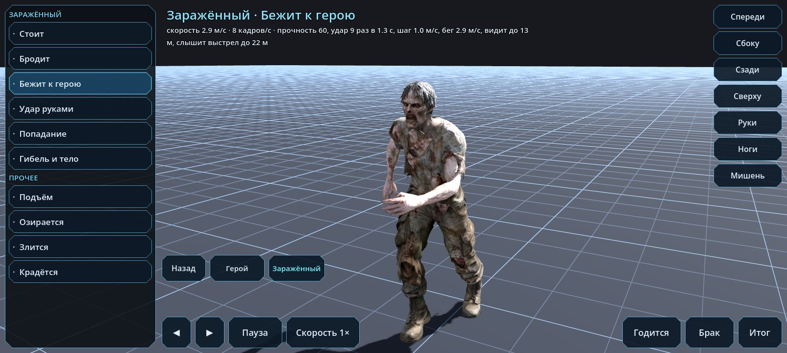
- Кнопки проверки на локации и полигоне (ряд под шестерёнкой) растут влево: раньше длинный ряд уходил за правый
  край экрана.

## Ресурсы и торговля
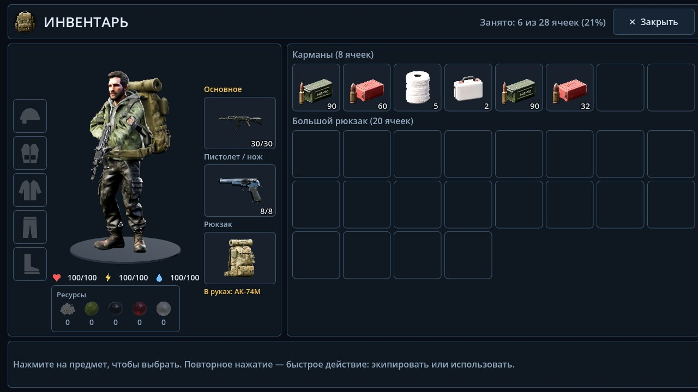
- Пять ресурсов — спораны, горошина, чёрная, красная и белая жемчужины (`ULItems.MONEY`) — это валюта. Они не
  лежат в ячейках, а копятся в кошельке (`ULInventory.wallet`): сколько ни собери, складываются в одно число.
  Взял с тела («Взять всё» или по одному) — сразу в кошелёк. Кошелёк сохраняется вместе с инвентарём; ресурсы из
  старого сохранения, лежавшие в ячейках, при загрузке переходят в кошелёк.
- Окошко «Ресурсы» — в инвентаре под героем и в окне ящика или обыска под карманами: значок и количество каждого
  ресурса (чего нет — значок тусклый); нажатие показывает название.
- **Магазин оружейника** («Говорить» → «Торговать»). Три раздела: «Оружие», «Патроны», «Припасы и снаряжение»
  (бинты, аптечки, еда, вода, рюкзаки). Товар — карточками; нажатие выбирает, справа — карточка товара: картинка,
  описание, у оружия — урон, магазин, темп, дальность и прочность, сколько такого уже есть, цена и «Купить».
  **У оружия тут же — патроны к нему** с ценой и кнопкой «Купить патроны» (и сколько их уже при себе): не надо
  искать калибр в другом разделе. Купленное оружие встаёт в свободный слот, остальное — в карманы и рюкзак.
  Не хватает ресурсов или нет места — покупки нет, ничего не списывается (цена красная, кнопка тусклая).
  Товар и цены — `SHOP` в `world.gd`; цены пробные: пистолеты и мачете 6–10 споранов, MP5 24, SPAS-12 30, АК-74М 40,
  ВСС 50, FN FAL 55, СВД — 2 горошины, ПКП — 3; патроны 1–4 спорана за пачку. Продажи вещей оружейнику пока нет.
  
- **Прочность оружия** — сколько выстрелов (у мачете — ударов) оно выдержит до ремонта: ТТ 300, Beretta 400,
  мачете 400, SPAS-12 400, СВД 500, ВСС 500, FN FAL 700, MP5 800, АК-74М 1000, ПКП 1500 (`dur` в `items.gd`).
  Каждый выстрел и удар снимает единицу; осталось 10 % — предупреждение. Видно в инвентаре: полоска по низу ячейки
  (зелёная → жёлтая → красная) и строка в карточке «прочность 143 из 300 выстрелов». На нуле оружие **сломано**:
  остаётся в слоте с патронами, на ячейке — «СЛОМАНО», но не стреляет и не рубит.
- **Ремонт — у оружейника** («Говорить» → «Торговать» → «Ремонт»): всё изношенное оружие героя (в слотах, карманах,
  рюкзаке) с прочностью и ценой; «Починить» — до полной прочности, «Починить всё». Платите спорами только за
  изношенную часть: полный ремонт ТТ — 6, мачете — 4, Beretta — 8, MP5 — 12, SPAS-12 — 14, АК-74М — 18, ВСС — 22,
  FN FAL — 24, СВД — 30, ПКП — 40 (`fix` в `items.gd`); ТТ на 150 из 300 — 3 спорана. Пока оружейник не куплен,
  чинить негде.
  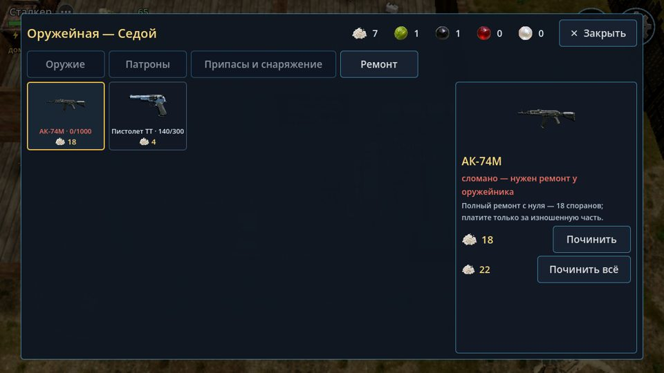
  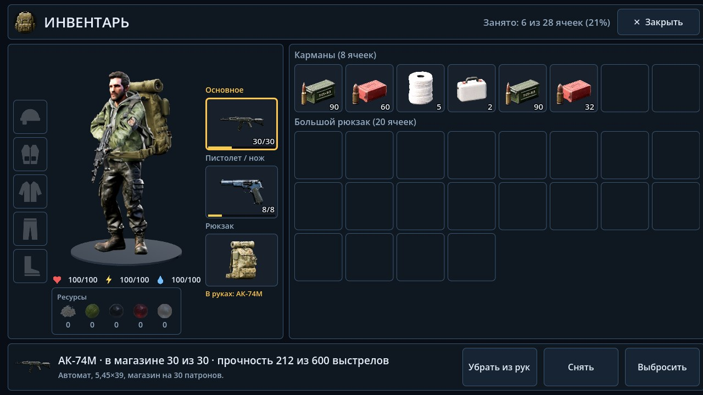

## Хлам и барахольщик (`junk` в `items.gd`, `sell_junk` в `world.gd`, `junk_price` в `data/base_shop.json`)
- **Хлам** — новый ресурс: кучки (модель Tripo `ul_junk` — ржавые детали, болты, провода, обломок платы) лежат
  в постройках временных кластеров: в «Опасном коровнике» — по 2–4 в каждой постройке, каждый вход заново
  (`_spawn_junk`; новые локации с постройками зовут то же). Подобрал — «Хлам» в кармане, кучки складываются в
  одну стопку (до 50 в ячейке). Погиб или кластер перезагрузился — хлам при себе теряется, как остальное.
- **Барахольщик Кузьмич** стоит у крыльца дома, слева от входа (у него ящик и кучки хлама). Своя модель Tripo со
  скелетом (`assets/models/dealer.glb`: бородатый старик в стёганке и вязаной шапке, с сумкой железок); движения —
  героя, переносятся на его скелет. «Говорить» →
  «Продать хлам (N)» — продаётся весь хлам при себе: **одна кучка — один споран**.
- **Торговля у барахольщика** (`core/world/dealer.gd` — правила, `dealer_ui.gd` — окно, `dealer` в
  `data/base_shop.json`): «Говорить» → «Торговать» — окно во весь экран. Сверху — пять ресурсов и «✕»; вкладки
  **«Продать»** и **«Купить»**; слева — витрина карточек (значок, название, сколько, цена; тянется пальцем), справа —
  выбранный предмет: описание, категория и редкость, масса, стопка, цена за штуку, количество (−, +, «Всё» /
  «Макс.»), «Вы получите» / «Стоимость», остаток ресурсов после сделки, большая кнопка «ПРОДАТЬ ×N» / «КУПИТЬ ×N».
  - Продать: всё из карманов и рюкзака, у чего в каталоге есть цена — хлам, минералы, технический хлам,
    инструменты, запчасти (фильтр: все / хлам / минералы / запчасти / инструменты), по базовой цене за штуку
    (руда — 2 спорана, редкий минерал — горошина…). Снизу — «Продать весь хлам: N → N споранов».
  - Купить: свой товар (вода, сухари, тушёнка, бинты, «Живчик», патроны 7,62×25 и 12 калибра лотами, малый
    рюкзак, мачете, ТТ — сколько и почём, в `dealer.stock`) и **выкуп**: сданное вами — в 2 раза дороже
    (`buy_k`). Запас — на период маршрутов: при сбросе (каждые 2 часа) пополняется, выкуп обнуляется.
  - Не хватает ресурсов или места — кнопка серая, причина красным, ничего не списано; после сделки кнопка на
    полсекунды выключена — двойное касание не проведёт сделку дважды. Запас и выкуп — в `user://base.json`.
  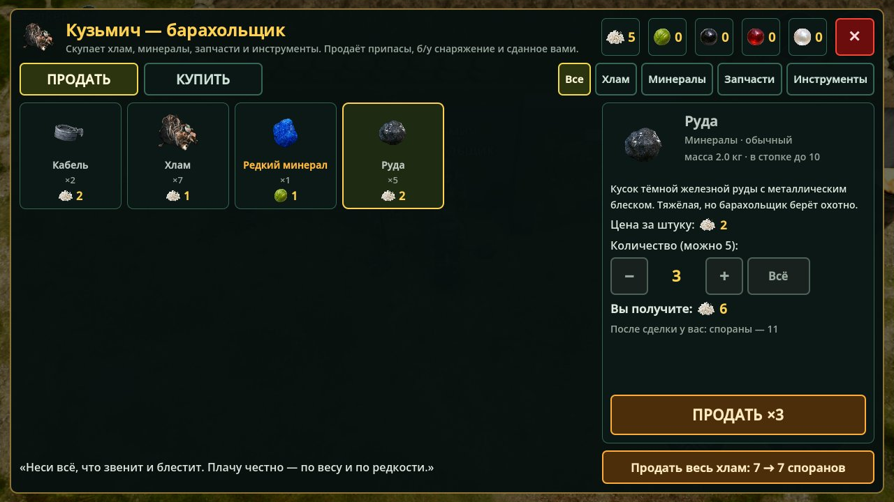 
  Проверка: `--as-test=dl` — 15 пунктов.

## Базовый компьютер (`core/world/base_pc.gd`, `base_state.gd`, `economy.gd`, `data/base_shop.json`)
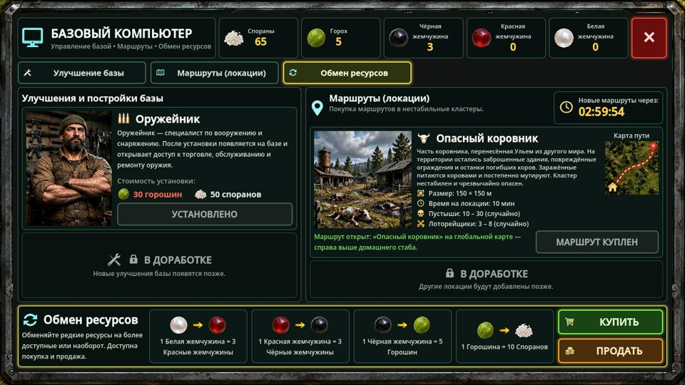
- Компьютер (модель Tripo `ul_computer`: металлический стол, старый ЭЛТ-монитор, клавиатура, системный блок) — в
  сенях у правой стены, между входной дверью и дверью в кладовую. Подойти — «Открыть». Экран во весь экран
  по макету: сверху — название и **пять ресурсов** (те же значки и тот же кошелёк, что в инвентаре; добыча, покупки
  и обмен сразу меняют числа), справа вверху — крест «закрыть». Слева — **улучшения базы**, справа — **маршруты**,
  снизу — **обмен ресурсов**; всё видно одновременно. Вкладки под шапкой только подсвечивают свой раздел.
  На маленьком экране середина прокручивается, нижняя полоса и рамка не уезжают.
- **Оружейник** — 30 горошин + 50 споранов. До покупки его на базе нет (и торговли тоже). «Купить и установить»:
  не хватает — окно с недостачей («не хватает: 20 горошин»), ничего не списано; хватает — подтверждение, списание,
  оружейник встаёт за прилавок, кнопка становится «УСТАНОВЛЕНО». Повторно не купить. Ниже — «В доработке».
- **Хранилище** — 6 уровней, на каждом +1 сейф на 30 ячеек (до 180). Карточка: «Ур. N / 6», «Сейфов: N ·
  Общая вместимость: N ячеек»; на 0 — «КУПИТЬ И УСТАНОВИТЬ ЗА 50 СПОРАНОВ», дальше — «УЛУЧШИТЬ ЗА 50 СПОРАНОВ» и строка
  следующего уровня, на 6 — неактивная «МАКСИМАЛЬНЫЙ УРОВЕНЬ — 6/6». Нехватка и подтверждение — как у оружейника.
  Цена, число уровней и ячеек — `upgrades.storage` в `data/base_shop.json`. Подробно — раздел «Хранилище» ниже.
- **Маршруты** (цены подняты в полтора раза 19.11): «Опасный коровник» — 15 споранов, «Хутор» — 27, «Санаторий Луч» и
  «Карьер» — 38, «Разбитый конвой» — 53, «Логово муров» — 75, на одно посещение.
  Пока маршрут куплен или идёт посещение, повторно не купить. **Компьютер предлагает 3 локации сразу, все разные**
  (`route_slots`): случайно из всех готовых, без повторов; **каждые 2 часа — сброс** (`route_refresh_h`): новый
  набор, и если локаций больше трёх, он не повторяет прошлый целиком (сейчас локаций ровно три — все три всегда в
  наборе; с хутором их четыре — набор из трёх, при сбросе хотя бы одна новая). **Пройденная локация (посещение
  окончено: ушёл, погиб, время вышло или игру закрыли) до следующего сброса из компьютера пропадает** и не
  покупается — вместо карточки строка «Пройдено, маршрут снова — после сброса: «…»» (`done` в `user://base.json`);
  после сброса снова доступна, если попала в новый набор. Новая локация, которую игрок ещё не
  видел в компьютере, сразу попадает в набор (вместо случайной некупленной). Купленный, но ещё не пройденный маршрут сброс переживает: остаётся на карте и в компьютере. Купить можно
  только из текущего набора. Сохранение с повтором или с исчезнувшей локацией исправляется само; локация,
  добавленная обновлением игры, попадает в набор сразу, если в нём есть место. «Новые маршруты через ЧЧ:ММ:СС» —
  срок хранится в `user://base.json` (unix-время), идёт и при закрытой игре, не сбрасывается при открытии
  компьютера. На глобальной карте после покупки: коровник — справа выше дома, санаторий — слева выше, конвой —
  ниже, хутор — слева ниже. Три карточки помещаются без прокрутки (плотный вид: без описания, характеристики в три колонки, цена и
  кнопка — рядом с ними).
- **Карта локации** (`ULBase.map_price`, `buy_route(…, with_map)`, `buy_map`, `has_map`) — продаётся вместе с
  маршрутом за **треть его цены сверху** (до целого, не меньше 1): коровник 15 + 5, хутор 27 + 9, санаторий и
  карьер 38 + 13, конвой 53 + 18, логово 75 + 25 споранов. В окне покупки маршрута — три кнопки: «Отмена», «Без
  карты», «С картой — N» (если на оба не хватает, вариант с картой неактивен и написано, сколько не хватает; платёж
  один — либо оба, либо ничего). Маршрут куплен без карты — на его карточке кнопка «Карта — N»: докупить можно, пока
  маршрут не использован. Карта действует вместе с маршрутом, на одно посещение: посещение окончено — карты нет.
  На карточке — строка «Карта +N» / «Карта куплена».
  
- **Обмен ресурсов**: белая ⇄ красная ⇄ чёрная жемчужина ⇄ горох ⇄ спораны, только соседние, в обе стороны по
  одному курсу (1 белая = 3 красные, 1 красная = 3 чёрные, 1 чёрная = 5 горошин, 1 горошина = 10 споранов —
  предварительные, из макета; `exchange` в `data/base_shop.json`). Четыре карточки и кнопки «Купить» / «Продать»
  открывают окно обмена: вкладки, «Отдаёте» / «Получаете» (второй ресурс пары подбирается сам), количество (−, +,
  поле только для цифр, «Максимум»), расчёт («Вы получите: 3 горошины · Стоимость: 30 споранов»), остаток после
  сделки, предупреждение о нехватке, «Подтвердить обмен». Сделка — целиком или никак (`ULEconomy.exchange`), без
  дробей и минуса; после неё кнопка на полсекунды выключена — двойное касание не спишет дважды.
  
- Сохранение: кошелёк — в сохранении героя, база (оружейник, маршруты, срок обновления) — в `user://base.json`;
  оба пишутся через временный файл (обрыв посреди записи не портит сохранение). Новая игра в меню стирает и базу.
- На старте новой игры — 15 споранов (`start_wallet`, столько стоит самый дешёвый маршрут): хватает на первый.
- Картинки и значки экрана вырезаны из макета пользователя: `tools/ui_src/pc_assets.py` (макеты лежат рядом).

## «Опасный коровник» — временный нестабильный кластер (`core/world/cowshed.gd`, `data/cowshed.json`)

- 150×150 м, расставлен по эталону пользователя: вход снизу по центру, слева два длинных коровника и загон под
  ними, сверху водонапорная башня с баками и пристройка, справа ещё три коровника, между ними — дороги с колеями,
  техника, сено, хлам; по краю — деревянный забор с проломами, за ним лес. Постоянная часть одна и та же при
  каждом посещении (координаты — константы в начале `cowshed.gd`).
- **Постройки** (`core/world/farm_building.gd`, `ULFarmBuilding`) собираются из деталей, как настоящие: бетонный
  цоколь, кирпич до 1,1 м, выше — серые доски, столбы и обвязка из бруса, окна с рамами и выбитыми стёклами,
  большие ворота (створка распахнута, прикрыта, висит или сорвана), фронтоны, фермы под крышей, кровля из листов
  профнастила с ржавчиной и дырами, пролом в стене с кучей кирпича. Внутри: бетонный пол в навозе, стойла с
  жердями, кормушки, сено (в пристройке — верстак и полки, в малом коровнике — корма). Материал — текстура по
  мировым координатам, к земле стена темнее и грязнее, пятна и мох. **Во все можно зайти**; герой внутри — крыша и
  стена со стороны камеры плавно растворяются (точечный узор, без прозрачности), вышел — проявляются. Столкновения —
  коробки стен (и под окнами), перегородки, кормушки; проёмы свободны.
- **Земля** — тот же шейдер, что на базе, слоями со смешиванием «по высоте»: трава (оливковая, с выгоревшими
  пятнами), лесная подстилка под деревьями, сырая грязь у построек, ворот и в загоне (скот вытоптал), накатанные
  дороги из утоптанной земли. Поверх — **колеи** по всем дорогам (две продавленные полосы сырой грязи, местами
  вода), **гравий** у ворот, **лужи** в колеях, у ворот и в загоне (мутная вода с отсветом неба и рябью).
  Карта слоёв `assets/world/tex/cowshed_mask.png` и карта проходимости `assets/world/nav_cowshed.res` строятся
  `--as-test=csbake`.
- **Растительность** (`core/world/vegetation.gd`, `ULVegetation`): пучки — спрайты, снятые с моделей растений
  Poly Haven (CC0) инструментом `tools/impostor.gd` и собранные в атласы `tools/veg_src/veg_atlas.py`. Злаки — по
  траве карты земли, цвет от приглушённо-зелёного до сухого жёлтого крупными пятнами, высота 0,25–0,7 м; на дорогах
  и во дворах почти нет. Сорняки — у стен построек, крапива — вдоль заборов, одуванчики и цветущий щавель — редкими
  куртинами, кусты — у забора. Все пучки участка 15×15 м — одна сетка; дальше дальности прорисовки не рисуются.
- **Заборы**: столбы разной высоты, три жерди; пролёты целые, покосившиеся, сломанные (жердь висит), пустые.
  **Деревья**: рощи (ели, сосны, дубы, берёзы, сухие; часть — молодые), лес за забором; деревья, закрывающие героя
  от камеры, растворяются. **Предметы**: водонапорная башня, ржавые баки с лестницей, техника — модели Tripo:
  тракторы, трактор с прицепом, зелёный грузовик с деревянным кузовом, деревянные телеги; круглые тюки сена, ящики, бочки, покрышки, ободья, вёдра (Poly Haven, CC0),
  ржавые листы, доски.
- **Свет**: пасмурно-приглушённый день, цвета спокойнее, лёгкая дымка; **мягкие тени** от построек, деревьев и
  техники на «Средней» и «Высокой» графике (до 38 м от камеры, атлас 2048, на телефоне 1024); на «Низкой» — без
  теней, как на базе.
- Каждое посещение заново: ~20 останков коров (скелеты на боку, черепа с костями, туши — модели Tripo, без живых
  коров) — на местах с эталона со сдвигом и поворотом и случайно: в коровниках, у заборов, в поле; **пустышей
  10–30 и лоторейщиков 3–8** (`pustysh`, `lottery`). Места врагов: в постройках, во дворах между ними, у останков
  коров, в рощах и у заборов; каждая точка проверяется по карте проходимости, не ближе 28 м к входу, не вплотную
  друг к другу. Убитые за посещение не возвращаются; тела обыскиваются как обычно. Коровы — только обстановка.
- **10 минут** (таймер сверху посередине): за 5 и 2 минуты — предупреждение и сигнал, за 30 с — красный мигающий
  таймер и сирена. На нуле кластер перезагружается: герой погибает, **всё, что при себе, теряется**, вещи на базе
  целы; маршрут закрыт, коровник пропадает с карты, герой — дома с запиской. Погиб от врагов — так же
  (`lose_on_death`, `lose_wallet` — настраиваются). Ушёл за край поля (5 с) — посещение окончено с добычей.
  В коровнике нет «Карты», «3D», ящиков; «Главное меню» — уход с добычей.
- Карта мира: метка коровника из макета — справа выше дома, только пока маршрут куплен; панель слева внизу.
  
- Нагрузка: стены, жерди, доски, хлам склеены в несколько сеток на постройку (а не сотни деталей), растения —
  сетками по участкам, у деревьев и предметов — дальность прорисовки; враги: ближе 8 м — всё, 8–18 м — движения
  через кадр, дальше — без движений тела, думают раз в 4 кадра. Частота кадров и память **на телефоне здесь не
  измерялись** (телефона в этой среде нет) — «Тест FPS» в меню игры.
- Источники: текстуры и модели предметов — Poly Haven (CC0): brick_4, wood_planks_grey, brown_planks_03,
  wood_planks_dirt, corrugated_iron_02, rusty_corrugated_iron, damaged_concrete_floor, brown_mud_02, dirt,
  gravel_floor_02, sparse_grass, grass_ground, mud_forest, leafy_grass; модели растений для спрайтов; ящик, бочка,
  покрышка, обод, ведро. ambientCG доступен, но не понадобился. Fab и Textures.com не использовались (нужна учётная
  запись).

## «Санаторий Луч» — временный нестабильный кластер (`core/world/sanatorium.gd`, `block_building.gd`, `door.gd`, `data/sanatorium.json`)

- 150×150 м, расставлен по утверждённой карте пользователя: ворота с проходной и аркой «САНАТОРИЙ «ЛУЧ»» посередине
  южной ограды, от них аллея к **главному корпусу** (портик с шестью колоннами в два этажа), за ним — **площадь с
  фонтаном**, скамейками и беседками; слева вверху — **лечебный корпус** (Г-образный, два блока), сверху —
  **котельная** с кирпичной трубой и цистерной и **хозблок**, справа — **жилой корпус** в четыре этажа, слева внизу —
  **столовая с клубом**, справа внизу — **хоздвор** с автобусом, грузовиком, легковушками и гаражами; детская
  площадка, фонари (часть погнута), асфальтовые дороги и плиточные дорожки с выкрошенными краями и мхом в трещинах,
  лужи, бетонная ограда с проломами, рощи внутри и лес за оградой. Постоянная часть одна и та же при каждом
  посещении (координаты — константы в начале `sanatorium.gd`).
- **Корпуса** (`ULBlock`) — из одного или нескольких блоков; **во все можно зайти и подняться на каждый этаж**.
  Коридорный блок: коридор вдоль длинной оси, комнаты по обе стороны (по 1–2 окна, перегородки — между окнами,
  поэтому ряды окон на фасаде ровные), вестибюль у входа, лестничные клетки в торцах (марши «туда-обратно» по
  сторонам клетки, в перекрытии — проём над маршем, вокруг — перила). Зальный блок: большой зал и ряд комнат вдоль
  одной стены. Блоки одного корпуса соединены сквозными проёмами (главный корпус — центр и два крыла, лечебный —
  два блока). Этажи: главный — 3 (крылья — 2), лечебный — 2 и 3, жилой — 4, столовая, котельная, хозблок — по 1.
  Всего 232 помещения, 176 дверей, 437 тайников.
- **Что внутри**: вестибюль с регистратурой и скамейками; кабинеты (стол, шкаф, стеллаж, доска объявлений),
  комнаты персонала (шкафчики, стол со стульями, диван), архивы и подсобки (стеллажи с коробками, ящики), туалеты
  с кабинками; в лечебном — палаты (2–4 койки с тумбочками, медицинский шкаф, раковина), процедурные (кушетка,
  стойка капельницы), сестринские, каталки в коридорах; в жилом — номера (две кровати, тумбочка, шкаф, свой санузел
  в плитке), бельевые, холлы этажей с диванами и телевизором; столовая — столы на четверых рядами, раздача, кухня
  (плиты, кухонные шкафы, мойки), холодильная камера, кладовая, клуб с бильярдом и пианино; котельная — три котла,
  трубы, щиты, верстак; хозблок — склад со стеллажами рядами, мастерская с верстаками. Сор: листы бумаги,
  опрокинутые стулья, чемоданы, засохшая кровь в коридорах и палатах — следы недавней гибели людей (каждый вход
  по-новому).
- **Двери** открываются, когда к ним подходит герой или гонящийся враг; закрытая — преграда для героя, врагов и
  пуль. Карта проходимости строится без дверей (путь идёт через проём). Входы — двустворчатые, с козырьком и
  ступенями. Окна — рамы и тёмное стекло (часть выбита, часть заколочена).
- **Вид внутри**: герой вошёл — крыша и все этажи выше скрыты, на его этаже стены изнутри и фасад со стороны камеры
  срезаны на высоте 1,2 м (видно комнаты и врагов в них), ниже его этажа — только фасады. Переход между этажами —
  с запасом на лестнице (не мигает). Вне корпуса за высоким зданием вокруг героя «окно» — стены и крыша между ним
  и камерой растворяются кругом. Внутренности не освещает солнце (свой слой отрисовки): ровный рассеянный свет из
  окон и **две лампы без теней** у ближайших к герою светильников (одна мигает) — на телефоне каждый источник
  света дорог.
- **Земля**: газоны, вытоптанная земля у дорожек и стен, подстилка в рощах (карта слоёв
  `assets/world/tex/sanatorium_mask.png`), сверху асфальт и плитка. Карта проходимости с этажами и лестницами —
  `assets/world/nav_sanatorium.res` (сетка 15 см: двери узкие). Обе строятся `--as-test=snbake`.
- **Готовые корпуса** (`assets/world/sanatorium_blocks.res`, `ULBlockCache`, 2,4 МБ): сетки, двери, комнаты,
  тайники, места врагов, столкновения и карта расстояний до дорог и корпусов (по ней расставляются растения).
  Пишутся тем же `--as-test=snbake`; при входе корпуса не строятся, а загружаются. Подпись кэша — описания
  корпусов и `ULBlock.GEN_V`: после правки генератора корпусов нужно поднять `GEN_V` и снова запустить `snbake`
  (иначе кэш не возьмётся и корпуса соберутся заново — медленнее); проверка `sn` сверяет кэш со свежей сборкой.
  Столкновения копятся в теле вне сцены и попадают в мир одним разом (раньше каждая из 2700 коробок
  пересобирала всё тело). Сборка локации на компьютере: было 5,5 с, стало 0,4 с (корпуса 0,1 с, растения 0,17 с).
- **Враги** — каждое посещение заново: **пустышей 20–40, лоторейщиков 5–15** (`pustysh`, `lottery`) и
  **0–2 Рубера** (см. «Враги и добыча»). Где —
  зоны с весами (`zones_pustysh`, `zones_lottery`): пустыши — двор и площадь, у ограды и в зарослях, жилой корпус,
  палаты, столовая, коридоры главного; лоторейщики — дальние коридоры (дальше 14 м от входов), лечебный корпус,
  подсобки, котельная и двор у неё, заросли. Каждая точка проверяется по карте проходимости (не в стене, не в
  мебели, на своём этаже), не ближе 25 м к воротам, не вплотную друг к другу; часть стоит, часть бродит (в комнате —
  в её пределах). Убитые за посещение не возвращаются.
- **Враги в корпусах**: идут к герою по карте проходимости — через двери (толкают закрытые), по коридорам и
  лестницам на другие этажи; через перекрытие не бьют и не «видят» (луч упирается в плиту), с другого этажа не
  атакуют. Враги в скрытых частях корпусов не рисуются.
- **Тайники**: медицинские шкафы, тумбочки, шкафчики персонала, письменные столы, стеллажи и хозяйственные ящики,
  кухонные шкафы, стойка регистратуры, верстаки. Подойти — светящаяся рамка и «Обыскать», окно — то же, что у
  ящика и тела. Содержимое — каждый вход заново по таблицам `loot` (бинты, аптечки, «живчик», еда, вода, патроны
  ТТ и 9×19, спораны, редко горошина и малый рюкзак, хлам); часть тайников пустая (`empty_chance`). Хлам кучками —
  в комнатах всех корпусов (3–6 на корпус).
- **Время** — 10 минут (`minutes`, можно увеличить для крупного комплекса), всё остальное — как в коровнике:
  предупреждения, тревога, на нуле гибель с потерей всего, что при себе; ушёл через ворота за край — с добычей;
  маршрут закрывается, санаторий пропадает с карты.
- **Компьютер базы**: карточка по макету пользователя — снимок, описание, размер, время, число врагов, «Карта
  пути», «Открыть маршрут», **38 споранов** (было 25 по макету; поднято 19.11). После покупки санаторий — на карте мира слева выше
  дома (метка из макета карты).
- Нагрузка: снаружи каждый блок рисуется несколькими общими сетками (по материалу), внутренности — только этажа
  героя; мебель склеена в сетки этажа; враги — те же ступени, что в коровнике (ближе 18 м — полностью, дальше —
  упрощённо, дальше 80 м спокойные стоят). Модели Tripo: автобус и легковушка (50 кредитов). Частота кадров
  **на телефоне здесь не измерялась** (телефона в этой среде нет) — «Тест FPS» в меню игры.
- Источники текстур — Poly Haven (CC0): rectangular_facade_tiles, worn_plaster_wall, peeling_painted_wall,
  old_linoleum_flooring_01, worn_tile_floor, dirty_tiles, long_white_tiles, herringbone_parquet,
  concrete_floor_worn_001, overgrown_concrete_pavers, worn_asphalt, rusty_metal_02.

## «Разбитый конвой» — временный нестабильный кластер (`core/world/convoy.gd`, `block_building.gd`, `data/convoy.json`)

- 150×150 м, по картам пользователя: **лесная дорога** с юга на север (вход и выход — снизу), посередине —
  **место гибели колонны**, справа вверху — **военный лагерь**, справа — **блокпост**, слева внизу — **склад
  снабжения**, слева вверху — **смотровая вышка**, справа внизу — **место падения Ми-8**, вокруг — лес, камни,
  поваленные стволы. Постоянная часть одна и та же при каждом посещении (координаты — константы в начале
  `convoy.gd`); `ULConvoy` наследует `ULSanatorium` — этаж героя, двери, свет, тайники, враги по зонам и Рубер общие.
- **Техника** — отдельные модели Tripo, каждая со своим столкновением: «Урал» целый — 1, сгоревших «Уралов» — 2,
  БТР-80 — 2, ГАЗ-66 — 1, УАЗ — 2, грузовик снабжения с кунгом — 1, Ми-8 — 1. Над сгоревшей техникой — огонь и дым
  (несколько плоскостей и частицы на процессоре, без источников света). Колеи, остатки асфальта, воронки, гильзы,
  каски, бумаги.
- **Куда можно зайти** (все — `ULBlock`, стили `tent` и `box`): **штабная палатка** 8×5 м (стол командира со
  стульями, карты на стене и столе, радиостанция, металлический шкаф, ящики с документами), **медицинская** 6×4 м
  с красным крестом (раскладушки, столики, медицинские шкафчики, ящики, сумки), **две жилые** 6×4 м (раскладушки,
  вещмешки, тумбочки, стол); вход — откинутый полог. **Командный кунг** и **сторожевой пост** — с дверью (открывается,
  когда подходит герой или гонящийся враг), **складской контейнер** — с распахнутыми створками. Герой вошёл —
  крыша палатки (кунга, поста, контейнера) скрывается, стена со стороны камеры срезается; вышел — всё на месте.
  Внутри — свет без теней (как в санатории).
- **Смотровая вышка**: площадка на высоте 3,3 м, наверх ведут пологие сходни (ходят и герой, и враги — они в карте
  проходимости); герой наверху — навес скрыт; там же ящик наблюдателя. Второй контейнер на складе, навес из
  маскировочной сети, мачта с прожектором, костёр, генератор, бетонные блоки, мешки с песком, ежи — обстановка.
- **Тайники** (53): в помещениях — шкафы, столы, тумбочки, армейские ящики, вещмешки, медицинские сумки; снаружи —
  **техника** (кузов и кабина грузовиков, БТР, УАЗы, сгоревшие «Уралы», грузовой отсек Ми-8), **тела военных**
  (8 из 11 можно обыскать), штабеля армейских ящиков, бочки с топливом. Подойти — подсветка и «Обыскать», окно —
  общее. Содержимое — каждый вход заново по таблицам `loot` в `data/convoy.json`: **патроны** всех калибров,
  бинты, аптечки, «живчик», консервы, сухари, вода, изредка малый рюкзак, **хлам**, редко оружие — только то, что уже есть в
  игре (АК-74М, MP5, ТТ, Beretta, SPAS-12, СВД, ПКП, мачете). Топливо, инструменты и запчасти в игре — это
  **хлам** для барахольщика (отдельных предметов для них нет). Спораны и горох — только с заражённых, чёрная
  жемчужина — только с Рубера (15 %). Хлам кучками — у каждой машины (1–2) и в помещениях.
- **Враги** — каждое посещение заново: **пустышей 15–35, лоторейщиков 3–10, Рубер — 0 или 1** (`ruber_chances`:
  65 % без него, 35 % с ним), всего 18–46. Зоны с весами (`zones_pustysh`, `zones_lottery`, `zones_ruber`): дорога у
  техники, лагерь, лес, склад, блокпост, вертолёт, вышка, палатки. Каждая точка — по карте проходимости и с
  проверкой формой тела (не в технике, ящиках, дереве), не ближе 24 м ко входу (Рубер — 40 м). Враги заходят в
  палатки и помещения, поднимаются на вышку.
- **Время** — 10 минут (`minutes`), правила — как в других временных кластерах: предупреждения, тревога, на нуле
  гибель с потерей всего при себе, уход по дороге за южный край — с добычей, маршрут закрывается.
- **Компьютер базы**: карточка «Разбитый конвой» — снимок, описание, 150×150 м, 10 минут, угрозы (пустыши,
  лоторейщики, Руберы 0–1), **53 спорана**. После покупки — на карте мира **ниже дома**, метка-грузовик.
- **Готовая сборка**: палатки и помещения — `assets/world/convoy_blocks.res`, карта проходимости —
  `nav_convoy.res`, карта слоёв земли — `tex/convoy_mask.png`; всё пишет `--as-test=cvbake`. Сборка локации на
  компьютере — 0,3 с.
- Модели Tripo (9): «Урал», сгоревший «Урал», БТР-80, ГАЗ-66, УАЗ, Ми-8, грузовик с кунгом, тело военного, армейский
  ящик (по 2–9 тыс. треугольников); текстуры — не больше 1024 (нормали и шероховатость — 512). Нагрузка при 46
  врагах — см. «Проверка».
  Частота кадров **на телефоне здесь не измерялась** (телефона в этой среде нет) — «Тест FPS» в меню игры.

## «Хутор» — временный нестабильный кластер (`core/world/khutor.gd`, `block_building.gd`, `data/khutor.json`)

- Поле 150×150 м, вход с юга (`K_ENTRY`), по картинке задания: улица-петля с домами, магазин, сараи и гараж,
  огороды и теплица, колодец, водонапорная башня, пасека, заборы и калитки, фруктовые деревья, лес по краю, техника
  (трактор, легковушка, прицеп, телега — отдельными моделями, непроходимы).
- **Постройки проходимые, с комнатами** (генератор корпусов `ULBlock`, стиль `wood`: дощатые стены разных цветов,
  ставни, двускатные крыши из жести и дранки, крыльцо): 7 домов — малые 7×6, средние 9×7, большие 11×8 (общая
  комната с прихожей, кухня, спальня, кладовая, санузел); магазин 9×7 с вывеской «МАГАЗИН» (зал с прилавком, полками
  и холодильниками, подсобка, склад); 2 сарая, хозпостройка и гараж с машиной. Двери настоящие (закрыты — преграда,
  герой подошёл — открываются), крыша скрывается, когда герой внутри, стены со стороны камеры срезаются.
- **Мебель — модели Tripo** (15 новых, список и расход — в `tools/tripo/budget.md`): холодильник, плита, шкаф,
  буфет, полка с закатками, железная кровать, бидоны, мешки с картошкой, стол со стульями, прилавок с весами, полка
  магазина; снаружи — колодец, ульи, поленницы, уличные туалеты. В постройку модель ставится лицом в комнату
  (`MODEL_FACE`), вписывается в своё место у стены; столкновение и тайник — по этому месту. Проходы у всех дверей
  свободны (проверка: весь пол каждой постройки достижим от входной двери).
- **Подвалы — подземные здания** (3 шт.: «Большой подвал» 12×9 м, «Подвал» 10×7, «Погреб» 9×6; пол на −2,6 м):
  зал у входа (стол с лампой и банками, полки с закатками, бидоны, мешки, ящик, закром) и за перегородкой с
  дверями — кладовые (стеллажи с закатками, ящики, бочки, бидоны) и овощные (закрома с картошкой, мешки): 4, 3 и 3
  помещения, 14–20 тайников в подвале. **Свет**: в каждом помещении под потолком лампочка с жестяным абажуром, и
  когда герой в подвале, горят все его лампы сразу (тёплый свет, до четырёх); у героя под землёй — свой фонарь
  (светит вокруг на 5 м), так что углы и кладовые не тонут в темноте. Вход — бетонный портал с двустворчатой дверью и лампой в
  насыпи, за ним лестница вниз (16 ступеней, уклон ~32°, оштукатуренные стенки, перила); над самим подвалом —
  ровная земля, на ней ничего не стоит (ни построек, ни деревьев). Когда герой внизу: земля над подвалом вырезана
  (шейдер земли и травы — `cut_rect`), вход и насыпь скрыты, вокруг виден срез земли, стены со стороны камеры
  срезаны (уровень −1). Внизу — заражённые (пустыши и лоторейщики), они же спускаются за героем по лестнице;
  Рубера под землёй не бывает, и камень он туда не бросает. Таймер идёт и под землёй.
- Враги (`data/khutor.json`): пустыши 20–30, лоторейщики 4–9, Рубер 0–1 (60 % — нет). Зоны: улица, дворы,
  огороды, поле, сараи, техника, лес, дома, магазин, подвалы (в подвалах — пустыши и лоторейщики, в среднем
  3 врага на посещение; Рубер — только на просторе: улица, поле, у сараев, дальше 40 м от входа). Никто не у входа
  (24 м) и не в мебели.
- Добыча: в домах и магазине — еда, вода, медицина (аптечки в умывальниках, бинты), хлам; в сараях и гараже —
  инструменты и хлам; в подвалах — закатки, картошка, сухари, вода, хлам в ящиках; в технике — хлам и немного патронов. Оружия почти нет.
- Маршрут — 27 споранов, кнопка «ОТКРЫТЬ МАРШРУТ»; на карте мира — слева ниже дома. Сброс, гибель и уход — как у
  других кластеров (10 минут, потеря вещей при себе).
- Сборка: постройки — из кэша `assets/world/khutor_blocks.res`, карта проходимости — `nav_khutor.res` (подвалы и
  лестницы входят), карта слоёв земли — `tex/khutor_mask.png`; всё пишет `--as-test=khbake`.

## «Логово муров» — вражеский стаб (`core/world/lair.gd`, `mur.gd`, `case.gd`, `case_ui.gd`, `data/lair.json`, `data/case.json`)

Укреплённый стаб группировки Муры, 200×200 м, опасность 2, маршрут — 75 споранов, посещение — 20 минут (карточка в
компьютере базы, на карте мира — справа ниже дома). Раскладка — по утверждённой карте: двор в кольце ограды из
бетонных блоков (местами в два яруса, заплаты из ржавого профлиста, покрышки), на юге — проход без ворот, к нему ведёт
грунтовка из леса. Постройки (`L_BUILDINGS`, генератор `ULBlock`, во все можно зайти: крыша скрывается, стены
срезаются): **штаб** на севере (красные знамёна с волком у двери; коридор вдоль фасада и ряд комнат у задней стены —
кабинет главаря 13 × 10,6 м, канцелярия, оружейная, радиорубка), **казарма** на западе (бетон, пять кубриков с
армейскими койками, шкафчиками и вещмешками), **склад** на юго-западе (стеллажи, оружейная), **мастерская** посередине
слева, **столовая** с кухней и трубой на востоке, **жилой блок** на юго-востоке, сараи, металлический навес-гараж,
контейнер, палатка, будка. По двору — костёр с шестью лавками, грузовики «Урал» и ГАЗ-66, УАЗ, штабеля армейских
ящиков, бочки; на северных углах — две вышки (на каждой снайпер, знамя, прожектор), водонапорный бак; за оградой — лес.
Кэш построек, карта земли и карта проходимости пекутся проверкой `lrbake`.

**Муры** (`data/enemies.json`: `mur_ak`, `mur_sg`, `mur_boss`; ИИ — `ULMur`, наследник `ULEnemy`). Модели Tripo (тот же
скелет из 78 костей, что у героя) — движения героя: ходьба и бег, шаг вбок и назад в прицеле, стойки с оружием,
попадания, падения; оружие держат обеими руками (`BCWeaponHold`, как у героя): АК-47 (модель Tripo, хват — по точкам
АК-74М), SPAS-12, пистолет главаря. При входе — 25–40 муров (`murs`, доли видов — `mix`): двое — снайперы на вышках
(видят и бьют дальше), три пары ходят дозором (вдоль ограды в обе стороны, вокруг костра), остальные — по зонам
`zones_mur` (у костра, во дворе, вдоль ограды, у прохода, в постройках); главарь — всегда в своём кабинете.
* Заметив героя (увидел, услышал выстрел, бег или шаги; выстрел слышат и другие муры) — вскидывает оружие и через
  `alert_s` открывает огонь. **Автоматчик** встаёт, целится (`aim_s`) и бьёт короткими очередями (3–5); между очередями
  перебегает в укрытие (точка рядом, откуда героя не видно на уровне груди: стена, ящики, техника, мебель) или шагает
  вбок, держит дистанцию (`keep`); магазин кончился — перезаряжается (в укрытии); за ушедшим героем гонится не дальше
  `pursue_r` от своего места; после смерти тело можно обыскать.
* Точность не 100 %: шанс попасть падает с расстоянием (`acc` → `acc_far`), промах уходит мимо героя. Пули летят от
  дульного среза оружия в руках, стены и укрытия их останавливают; урон — когда пуля долетит.
* **Дальности — как у героя, короткие.** Мур замечает героя с 12–13 м (`see`; выстрел слышит с 30 м, бег — с 10 м),
  автоматчик и главарь стреляют не дальше 11 м (`gun.range`), мур с дробовиком — 7 м; дальше — не стреляют, а
  сближаются (автоматчик держит 5–9 м, дробовик — 2,5–5,5 м). Пуля мура гаснет через метр после его дальности.
  Гонится не дальше 20 м от своего места (`pursue_r`), теряет героя за 18–24 м. Снайперы на вышках видят в 1,45 и
  бьют в 1,35 раза дальше (около 15 м). Раньше муры видели с 20–24 м и стреляли с 26 м — из-за края экрана.
* **Ходят как герой.** Те же клипы и те же правила, что у героя, только действий меньше (не перекатываются, не
  лечатся, не меняют оружие). Дозор и поиск — шагом (1,3 м/с), лицом по ходу; перебежка к укрытию и погоня — бегом,
  лицом по ходу (не боком); в прицеле и под огнём — лицом к герою, шаг вбок и назад теми же клипами, что у героя
  (`set_dir_move`), не быстрее 2,2–3,4 м/с; скорость набирается и гасится плавно. Стойка с оружием (покой — автомат
  поперёк груди, прицел — приклад в плечо) держится только когда мур стоит: раньше она оставалась и в движении, ноги
  не шагали и мур «ехал» по земле. Замер — `--as-test=murmove [--as-kind=mur_ak|mur_sg|mur_boss]`: угол между
  корпусом и направлением движения, скольжение стоп.
  
* **Мур с дробовиком** подбирается ближе, заходя сбоку и прикрываясь укрытиями, стреляет только вблизи (`range` 7 м):
  восемь дробин — восемь лучей с разбросом, урон дробины в упор 4,5 и слабеет с расстоянием (до `far_k` = 25 % на
  краю дальности); после выстрела передёргивает цевьё, патроны заряжает по одному.
* **Главарь — босс** (`mur_boss`; всё — в `data/enemies.json`). Раньше он был ростом с героя, с 900 прочности (из
  автомата — четыре секунды боя), дёргался от каждой пули, пятился и прятался, как рядовой, а выстрел его пистолета
  звучал и выглядел как у всех. Теперь:
  * **Крупный и крепкий.** Рост 2,25 м (герой — 1,8), пистолет Desert Eagle под его руку (`gun.scale` 1,5 — 0,41 м),
    прочность 3000. От попаданий не дёргается и не сбивается (`no_flinch`), за мебелью не прячется, вплотную не
    пятится. Из штаба не выходит.
  * **Полоса здоровья на экране.** Пока он в бою — вверху имя и широкая полоса с двумя засечками (границы фаз) и
    номером фазы; за красной полосой — светлый след недавнего урона. Камера в бою сдвигается к главарю и чуть
    отходит: в кадре оба. Над ним — его реплики и название начатой атаки.
  * **Три фазы** (`phases`: 66 % и 33 % здоровья). На смене фазы он пошатывается (единственное, что его сбивает),
    бросает реплику и **зовёт бойцов**: двое ближайших живых муров (не снайперы, `call`) бросают посты и идут к
    нему. Во второй фазе добавляются гранаты, в третьей он звереет (`rage`): паузы между выстрелами вдвое короче,
    прицельный выстрел раз в 6 с, граната раз в 7 с, шаг быстрее.
  * **Атаки** — у каждой свой замах, звук и надпись:
    1. *Тяжёлый выстрел*: вскидывает пистолет (`aim_s` 0,5 с), 2–3 выстрела подряд — грохот (свой звук
       `shot_deagle`), большая вспышка, сильная отдача, крупная светлая пуля; 10 % здоровья героя, попадает не
       каждый.
    2. *Прицельный выстрел* (`special`, раз в 10 с): взводит курок, на полу — красная полоса вдоль прицела (до первой
       стены); 1,2 с она идёт за героем, потом застывает, ещё 0,35 с — выстрел с усиленной вспышкой и отдачей: на
       полосе и не за стеной — треть здоровья и отбрасывание, ушёл — мимо.
    3. *Удар ногой* (`kick`): герой ближе 2,4 м — замах 0,42 с и удар: достал (до 2,9 м перед собой) — 15 % здоровья
       и отбрасывает на несколько метров.
    4. *Граната* (`grenade`, со второй фазы): на полу, где стоит герой, — красный круг 2,6 м с отсчётом; левая рука
       идёт к подсумку, граната с красным огоньком появляется в ладони, замах, бросок — граната падает в круг; через
       2,4 с от появления круга — взрыв: в центре 35 % здоровья, у края — 40 % от этого, стена или мебель между
       взрывом и героем закрывают. Бросает и за укрытие, куда герой только что спрятался. Радиус, урон, запал,
       дистанция и передышка — настраиваемые числа в `grenade`, это рабочие значения, а не утверждённый баланс.
  * Убит — сообщение на экране, ключ — в теле.
  * **Движения — свои клипы** (скелетные, по видео-образцу; `core/animation/pose_builder.gd`, подключение —
    `clips` и `stride_k` в описании главаря):

    | Состояние | Клип | Что в нём |
    |---|---|---|
    | Стоит | `boss_idle` | стойка с пистолетом, дыхание |
    | Бежит | `boss_pistol_run` | бег набора под рост 2,25 м (шаг длиннее в 1,25 раза — стопы не скользят), корпус наклонён, пистолет в правой руке у груди стволом вперёд, левая работает как при беге |
    | Целится | `boss_pistol_aim` | двуручный хват, левая нога на полшага впереди, колени согнуты, корпус подан вперёд, голова к прицелу |
    | Стреляет | `boss_pistol_fire` | спуск — и корпус с головой коротко отдают назад; выстрел (попадание, вспышка, звук) — по метке клипа |
    | Возврат | `boss_pistol_recover` | корпус проходит чуть вперёд и успокаивается; следующий выстрел — без нового вскидывания |
    | Готовит гранату | `boss_grenade_prepare` | пистолет в правой опущен, левая кисть — к подсумку на груди, взгляд вниз; граната появляется в ладони |
    | Бросает | `boss_grenade_throw` | шаг правой ногой, замах за плечо с разворотом корпуса, бросок с переносом веса; граната уходит по метке клипа |
    | После броска | `boss_grenade_recover` | проводка руки вниз-вперёд, возврат к оружию |
    | Пошатнулся | `boss_hit` | смена фазы |
    | Погиб | `boss_death` | падение |

    Правая рука держит пистолет расчётом хвата (`BCWeaponHold`): ладонь на рукояти, указательный палец у спуска;
    стойки — `data/weapons.json` (`deagle`: `aim` — двуручная, `run` и `throw` — одной рукой). Запись движений из
    игры: `--write-movie файл.avi --fixed-fps 30 … -- --as-test=bossdemo` (бег, стрельба, граната — игровым
    ракурсом, сбоку и крупно).
    
  * Звуки выстрела и взрыва — свои, синтезированы (`tools/make_boss_sounds.py`, numpy): `shot_deagle_1/2`,
    `grenade_boom`, `grenade_tink`.
  * Проверка: `--as-test=bossview --as-out=папка` — 16 пунктов (скелет, клипы, бег, атаки, фазы) и снимки каждой
    атаки (игровой камерой и крупно).
  

**Ключ и оружейный сундук.** Ключ главаря (`mur_key`, свой значок) — всегда в его теле, привязан к этому посещению
логова (`ULCase.new_instance()` при входе: главарь и сундук — заново, старые ключи не подходят). Сундук стоит у
дальней стены кабинета: без ключа — «Закрыто. Требуется ключ главаря муров», с ключом — «Открыть оружейный сундук».
Открытие (`ULCase.open_chest`): ключ убирается, награда выбирается **один раз** и вместе с отметкой «сундук пуст»
сразу пишется в `base.json` — до анимации; закрыть окно или перезапустить игру — результат тот же. Потом — прокрутка
как в CS (`ULCaseUI`): горизонтальная лента карточек справа налево (картинка, название, рамка редкости, состояние),
неподвижная линия посередине, быстро → медленно за 6–8 с, кнопка «Пропустить», крупная карточка результата,
«Забрать», тёмный металлический фон, подсветка, у легендарного — золотое сияние, звуки. «Забрать» кладёт оружие в
инвентарь; нет места — награда ждёт в окне выдачи (откроется снова у сундука), выдаётся один раз. Редкости и шансы —
`data/case.json`: Обычное 55 % (ПМ, ТТ, Beretta), Необычное 25 % (MP5, АКС-74У), Редкое 12 % (АК-74М, FN FAL,
SPAS-12), Очень редкое 7 % (СВД, ВСС, AUG, SCAR), Легендарное 1 % (ПКП «Печенег»); шанс редкости делится поровну между
моделями, которые есть в игре; моделей, которых нет (ПМ, АКС-74У, AUG, SCAR), не выпадает — в «Тесте кейсов» в
главном меню они показаны недоступными. Там же — прокрутка без выдачи награды.

## Общее для всех локаций: ресурсы на полу, свет у входов, листовая кровля
То, что сначала появилось в карьере, перенесено на остальные карты (20.11):
- **Ресурсы на полу построек** (`ULSanatorium.floor_loot` — общая основа санатория, конвоя, хутора, логова и карьера;
  у коровника свои постройки — `barn_floor_loot` в `world.gd`). Каждое посещение по-новому: часть свободных мест
  комнат (доля `floor_share` 30–55 %, не больше `floor_max` и не меньше одной находки на постройку) занята
  находками по назначению комнаты — таблицы `floor_loot` в `data/<локация>.json`: вид комнаты → [предмет, от,
  до, вес], «*» — прочие комнаты. В проверочном посещении: коровник 13 находок (6 построек), санаторий 41 (6),
  конвой 8 (7), хутор 30 (15, с погребами), логово 46 (12), карьер 35 (10). Находки кладутся своим генератором
  случайных чисел — расстановка хлама и врагов от них не меняется. Хлам кучками и тайники в мебели — как были.
- **Свет у входов** (`ULSanatorium._door_glows`): у каждой наружной двери на уровне земли — тёплое пятно на земле и
  лампа над дверью (один MultiMesh с прибавляющим смешением, источников света нет). Санаторий — 26 входов,
  хутор — 23 (с будками погребов), логово — 31, карьер — 27 и 5 отсветов у жил, конвой — 4; у палаток дверей нет,
  у коровников — ворота без двери: там света нет.
- **Листовая кровля** (режим `sheet` шейдера построек): «ржавое железо» (`rust` — крыши хутора и логова) и жесть
  (`roof_tin`) — листы 1,05 × 2,4 м, у каждого свой тон, тёмные нахлёсты, потёки ржавчины вдоль ската. Прежняя
  текстура сплошной ржавчины давала ровное розоватое пятно с размытыми полосами. У коровников (свой шейдер
  `ULFarmBuilding`) на серый профнастил добавлены те же листы и нахлёсты.
  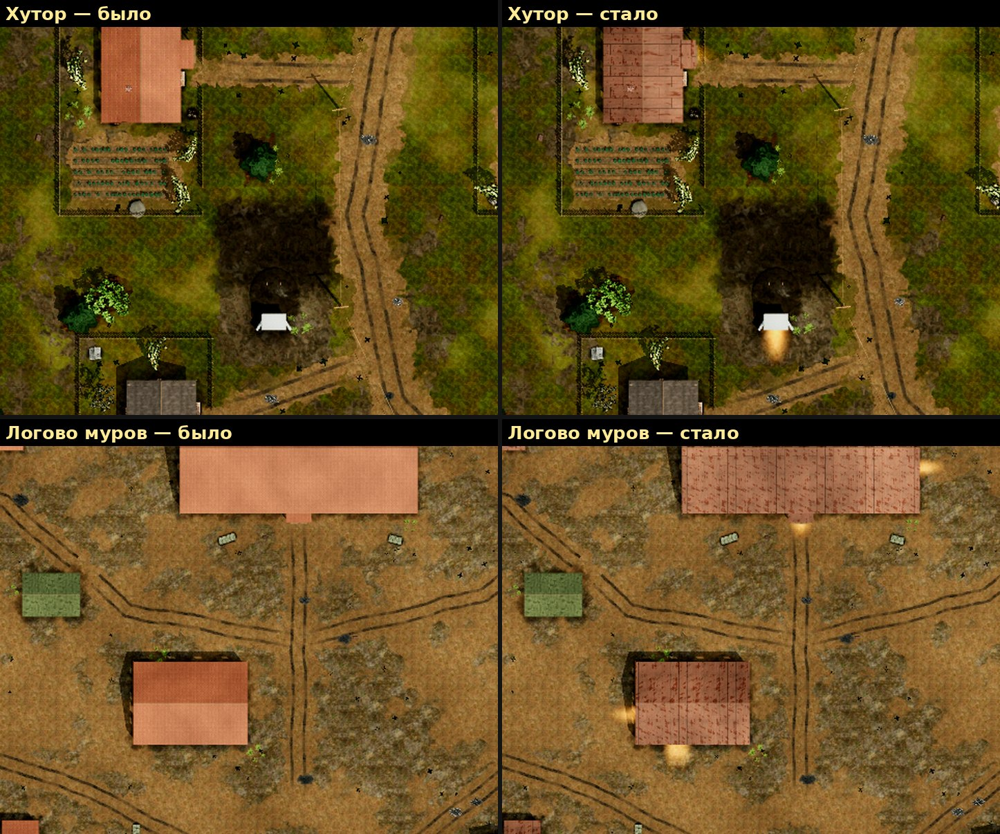
- Проверка: `--as-test=fldiag --as-place=<локация>` — справка по постройкам (виды комнат, места, двери) и проверки:
  находки в каждой постройке, предметы настоящие, лежат на земле, в другое посещение — иначе, пятен света —
  по числу наружных дверей.

## Графика: тени, текстуры, трава, модели Tripo по локациям
- **Чёткость** (17.11, снимки пользователя: 58–60 кадров/с при разрешении 39–42 % — картинка мыльная): трёхмерная
  картинка теперь рисуется в 62 / 80 / 100 % разрешения экрана (низкая / средняя / высокая графика, было 42 / 55 / 80),
  сглаживание краёв MSAA 2× на средней и 4× на высокой (на мобильных видеочипах почти бесплатно). Автоподстройка
  под частоту кадров не опускает разрешение ниже 55 % (было 30 %), снижает его только ниже 40 кадров/с и поднимает
  обратно уже от 50. Подсветки цели (засветка модели, светящаяся коробка) нет — цель видна по кнопке «Обыскать».
- **Пятна-тени** (`core/world/blobs.gd`): под мебелью, техникой, ящиками, героем и врагами — мягкое тёмное пятно
  (неподвижные — один MultiMesh, движущиеся — второй: два вызова отрисовки на всю локацию).
- **Против повтора текстур**: на стенах — крупная вариация светлоты той же текстурой, на земле — вторая выборка
  с поворотом у грунта, дороги и сухой травы. Крупные поверхности (доски, брёвна, штукатурка, кирпич, жесть,
  бетон, фасадная плитка, грунт, трава, тропа) — фототекстуры Poly Haven (CC0) в 2048, подогнанные по цвету.
- **Трава**: мелкие пучки по полю убраны (их заменяет трава на земле: вторая фототекстура зелёными куртинами,
  рельеф стеблей, пятнистое затенение «кочками», проплешины из увядшей травы); сорняки у стен и крапива у
  заборов — вдвое реже, цветы как были.
- **Дома хутора**: три сруба из брёвен с концами «в чашу», у дощатых — угловые доски; каменный или кирпичный
  цоколь; треугольный фронтон, причелины, лобовые доски; выпавшие доски, сорванные ставни; ржавчина на жести;
  антенны; мелочь у стен. Наличники со ставнями, печные трубы, резьба фронтонов — модели Tripo. Гараж —
  металлический (профлист), ворота из двух створок открываются наружу.
- **Модели Tripo по локациям** (32 шт., `tools/tripo/budget.md`): хутор — лавки у крылец, собачьи будки, пугала
  на огородах, двери на глухих стенах сараев, летняя веранда, пасека за штакетником с распахнутой калиткой;
  санаторий — парковые скамейки и фонари вдоль дорожек, гипсовые пионеры и бетонные вазы у фонтана, внутри —
  медицинские шкафы, пианино в клубе, столы в комнатах отдыха, кресла-каталки; коровник — ясли с сеном,
  кормушки, поилки, тюки, тачки у ворот, танк-охладитель молока у пристройки; конвой — мешки с песком у поста и
  лагеря, противотанковые ежи у блокпоста, рация у штаба, канистры у техники, носилки у медпалатки; база —
  генератор, оружейная стойка, бочка для дождевой воды у дома. Мелкие модели раньше уходят на упрощённые копии.
  Уличные детали хутора (наличники, резьба, двери, забор, калитка, лавки, будки, пугала, веранда) — с упрощённой
  сеткой (на треть меньше треугольников) и видны до 26 м от камеры.
- **Корпуса санатория**: водостоки на углах (воронка под карнизом, хомуты, колено и бетонный лоток у земли; часть
  ржавые), выбоины штукатурки с кирпичной кладкой (неровный край — два пятна), наружные блоки кондиционеров на
  кронштейнах под окнами верхних этажей, электрощиты с трубой провода на первом этаже. Котельная (кирпич) —
  без выбоин.
- **Коровники**: отлив-доска над кирпичным низом, заплаты из досок поверх обшивки (вкось и поперёк), прислонённые
  к стенам доски, водосточные желоба по краю кровли (местами оторваны и висят), трубы на углах. Мелочи — на своём
  зерне случайностей: расстановка остального не сдвигается.
- **Модели Poly Haven (CC0)**: валуны со мхом и упавшие сухие стволы в лесу (коровник, хутор, конвой — со
  столкновением), ржавые урны у каждой третьей скамейки санатория, пластиковые стулья в беседках, столы для
  пикника во дворах хутора (у одного — стул), урна и коробки у магазина. Место выбирается с проверкой по уже
  поставленным столкновениям (стены, деревья, техника, скамейки).

## Враги и добыча (`core/world/enemy.gd`)

- **Удар заражённого** (как в выживалках с видом сверху): подбежал — сразу бьёт. Замах начинается ещё на бегу, с
  `strike_d` м до касания, и длится `wind_t` секунд (пустыш 0,3, лотерейщик 0,22, Рубер 0,45) — клип ускоряется под
  этот срок, враг не останавливается; затем рывок `snap_t` до касания (`lunge`, до `lunge_v` м/с) и удар; отход —
  быстрее клипа (`recover_k`). Между ударами держится на шаг от героя (`keep`). Герой от удара отлетает на 15–35 см,
  камера вздрагивает, края экрана краснеют (середина остаётся видна).
- **Реакция на шум** (17.11, вдвое сильнее): выстрел слышат пустыш с 44 м, лотерейщик с 60, Рубер с 68; бег героя —
  14 / 22 / 24 м, шаги — 3 / 8 / 10 м; лотерейщик и Рубер кричат перед погоней вдвое короче.
- **Новые удары (Tripo, движения по тексту, новый аккаунт)**: пустыш — размашистый удар правой и левой с замахом за
  плечо, два тяжёлых удара подряд, удар обеими руками сверху вниз, захват за плечи с укусом; лотерейщик — прыжок с
  когтями, удар крест-накрест, три быстрых удара, вцепляется и рвёт, размашистые удары (быстрее, чем у пустыша).
  Новые выбираются чаще прежних (вес в `data/enemies.json`), прежние остались для разнообразия. Движения сняты на
  моделях-заместителях нового аккаунта (по исходным картинкам пустыша и лотерейщика; скелет Tripo у всех один —
  78 костей) и ложатся на наши модели с поправкой к исходной позе (`BCAnimSet._rest_fix`, образцы скелетов
  `assets/models/zombiepx.glb`, `lotterypx.glb`). Момент удара в клипе (поле `hit`) найден `tools/attack_hits.gd` —
  когда лапа дальше всего уходит вперёд. Покадровая проверка: `--as-test=atkview --as-kind=… --as-clip=<удар>`.
- Весь баланс врагов — в отдельном файле `data/enemies.json` (правится без кода): прочность, скорости, с какого
  расстояния видит и слышит (выстрел, бег, шаги), сколько кричит перед погоней, когда теряет, удары (клип, урон,
  на какой доле клипа удар доходит), добыча (предмет, от, до, шанс), рост.
- **Пустыш** (заражённый низшей ступени) — первый враг. Модель по присланному фото: Tripo, со скелетом (`assets/models/zombie.glb`,
  12 тыс. треугольников, текстуры 1024). Прочность 75; бродит шагом 1 м/с вокруг своего места; видит героя ближе
  13 м (стены и забор закрывают обзор), слышит выстрел до 28 м (стрельба по манекену у дома не привлекает) и бег
  до 7 м — бежит 2.9 м/с. Вплотную бьёт руками: 9 урона раз в 1.3 с. **Удар доходит до героя**: клипы Tripo
  машут лапой «в воздух», поэтому в момент удара бьющая кисть доводится (IK руки, `BCHandIK`) до плеча или груди
  героя со стороны этой руки и сразу уходит назад — правой, левой; «два удара подряд» — правой, потом левой
  (`_plan_strikes` в `enemy.gd`). Укусы и захваты — головой. Стоит при ударе на 0.8 м от героя (не влезает в него).
  Герой от удара **отшатывается** — поясница, грудь, шея и голова коротко дёргаются от ударившего и за 0.4 с
  возвращаются (`core/animation/flinch.gd`, поверх любой анимации; руки и оружие идут вместе с корпусом), с этой
  стороны брызжет кровь (капли и пятно на земле, тает за 20 с; так же — из ран врагов).
  **Движения Пустыша — свои клипы по видео-образцу** (скелетные, по ключевым позам; `install_extra("infected")` в
  `core/animation/pose_builder.gd`, подключение — `build`, `clips` и `attacks` в `data/enemies.json`; библиотека
  клипов одна на всех пустышей):

  | Состояние | Клип | Что в нём |
  |---|---|---|
  | Ожидание | `infected_idle` | сутулая стойка, руки висят чуть впереди с согнутыми локтями; медленно осматривается: голова ведёт, грудь доворачивает, вес переходит на ближнюю ногу; дыхание; цикл 7,2 с без скачка |
  | Погоня | `infected_chase_run` | тяжёлый бег с сильным наклоном под его скорость 2,9 м/с (цикл 0,7 с, шаг около метра): опорная стопа идёт по земле со скоростью тела, маховая — по дуге с подъёмом пятки и выносом колена; таз проседает на опоре и доворачивается за ногой, грудь — навстречу; руки разные — правая машет шире и ниже, левая поджата |
  | Удар правой | `infected_attack_right` | замах — плечо и рука назад-вбок на уровне плеча, вес на задней ноге; удар — таз и грудь доворачиваются, рука идёт по дуге вперёд и поперёк; проводка и возврат |
  | Удар левой | `infected_attack_left` | зеркально, ноги не переставляются |
  | Захват | `infected_attack_grab` | руки к груди, шаг передней ногой, выпад — обе руки вытянуты к цели и сходятся; возврат (только удар: удержания героя нет) |

  Из стойки в бег — через разгон (`accel` 7 м/с²: шаг → бег, а не рывок). Урон — как прежде: по метке клипа, если
  герой в досягаемости; отошёл — промах. Здоровье, скорость и урон ударов рукой не менялись (9), у захвата — 14.
  Прежний набор ударов сохранён в `attacks_old`. Проверка — `--as-test=melee --as-kind=infected`; запись движений
  из игры — `--write-movie файл.avi --fixed-fps 30 … -- --as-test=zdemo` (ожидание, бег, удары — спереди, сбоку,
  игровой камерой).
  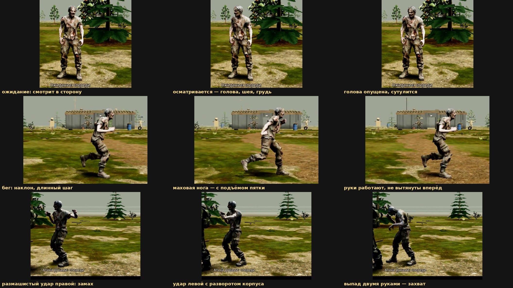
- **Лоторейщик** — второй враг, по присланной картинке (вид спереди; Tripo, `assets/models/lottery.glb`: 13 тыс.
  треугольников, один материал, цвет 2048, нормали и шероховатость 1024; скелет 78 костей с пальцами). Рост 1.9 м,
  прочность 200, шаг 1.2 и бег 3.7 м/с (герой бежит 4.4 — уйти можно, но с трудом). Видит с 16 м, слышит выстрел
  с 34 м, бег с 22 м и даже шаги с 8 м. Заметив — **кричит 0.9 с** и только потом бежит. Шесть ударов вплотную, раз
  в 1.5 с (см. «Ближний бой»). В теле —
  1–4 спорана всегда и горошина с шансом 35 %. На локации один, в дальнем углу поля; на полигоне — кнопка
  «Лоторейщик +».
  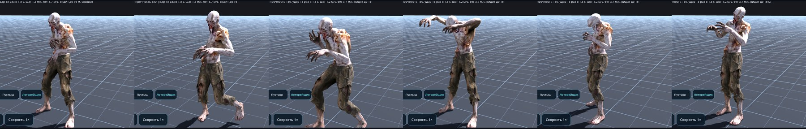
- **Поведение (у всех врагов).** Бродит у своего места → замечает (увидел, услышал выстрел, бег, шаги) →
  кричит, если виду положено → бежит туда, где видел героя в последний раз → вплотную бьёт: у удара замах, урон
  доходит на середине клипа, и если герой успел отойти дальше дальности удара — мимо. Потерял из виду — доходит до
  последнего места, озирается и через несколько секунд успокаивается; далеко убежавшего героя бросает.
  **Обход препятствий:** луч вперёд на уровне голени, упёрся (стена, забор, ящик, другой враг) — пробуются
  повороты всё круче в обе стороны, берётся первый свободный и держится полсекунды; сквозь стены не ходит
  (столкновения — обычные). Это не поиск пути: из тупика (комната с одной дверью за спиной) он может не выбраться.
- **Ближний бой — вплотную.** Заметив героя, враг подбегает до касания (`close` в `enemies.json`: 0.70 м между
  центрами у пустыша, 0.74 у Лоторейщика; тела соприкасаются на 0.62) и только оттуда бьёт; на замахе ещё дожимает
  вперёд. Удар выбирается из тех, что достают с этого расстояния (`reach` у каждого удара): захват с укусом — только
  впритык. Урон — в момент удара, если герой всё ещё в досягаемости: успел отскочить — мимо. Между ударами враг
  стоит вплотную, покачивается и тянется руками (стойка `menace`).
  Удары пустыша: правой и левой (9), тянется руками и кусает (16), хватает за плечи и кусает в шею (20).
  Лоторейщика: когтями слева и справа (14, 16), тянется и кусает (22), выпад пастью (24), хватает за плечи и кусает
  в шею (30). Ещё три удара заказаны (два подряд, обеими руками сверху, бросок с укусом в лицо) и стоят в списке:
  враг выбирает только те, движение для которых у модели есть, так что они включатся сами, когда движения придут.
- Красный круг под целью и круг дальности вокруг героя не рисуются: цель и дальность считаются как прежде, о
  промахе по дальности или укрытию говорит подсказка сверху.
- **Попадания и гибель.** Попадание спереди и сзади — разные движения; сильное попадание (от 60 урона разом или
  от 30 % прочности — СВД, дробовик в упор) сбивает с ног и срывает удар, который он готовил. Падает по стороне удара: спереди —
  на спину, сзади — лицом вперёд, сбоку — набок.
- **Голос.** Рычит, пока бродит и гонится, кричит при обнаружении и ударе, хрипит при гибели — шесть записей CC0
  из набора проекта (`growl`, `roar`, `zdeath`; источники — `bunker/docs/AUDIO_SOURCES.md`). Слышно в 30 м.
- **Движения врагов — свои.** У пустыша и Лоторейщика отдельные наборы клипов (`assets/anim/zombie`,
  `assets/anim/lottery`): 17 движений (у пустыша в игре используется 14 — у него один удар) заказаны в Tripo по описанию («зомби стоит сгорбившись, руки висят…») и
  перенесены самим Tripo на собственный скелет каждой модели — без пересчёта с героя. Стойка — сгорбленная, руки
  висят; шаг — шаркающий, с подволакиванием ноги; бег — с наклоном вперёд; удары левой и правой, укус, выпад
  пастью; попадания спереди и сзади, потеря равновесия; крик, тревога, повороты; падения вперёд, назад и набок.
  Описание клипов — `data/anim_enemy.json` (каждый клип берётся из своей папки модели; чего там нет — из набора
  героя с пересчётом под скелет, `BCAnimSet._rest_fix`). Новые движения добавляются так: файлы Tripo
  `m_<набор>_<метка>.glb` в папку → `tools/extract_anims.gd` → клипы.
- **Генератор мелких движений существа** (`core/animation/creature_fx.gd`, настройки — `fx` в `enemies.json`) —
  то, чего нет в клипах Tripo и в автоматическом скелете. Работает поверх любого клипа, каждый кадр:
  пальцы согнуты когтями и подрагивают вразнобой, к моменту удара раскрываются; грудь дышит (в погоне чаще);
  на укусе и выпаде пастью шея и голова подаются вперёд; у Лоторейщика колышутся отростки у пасти (шейдер на
  вершинах вокруг точки пасти — точка находится по сетке сама: самые выступающие вперёд вершины головы). Оси
  сгиба пальцев считаются из исходной позы модели, поэтому генератор подходит к любому скелету Tripo. Челюсть он
  не открывает — для этого в сетке нет отдельной нижней челюсти.
  
- **Очередь движений для нового врага** — `tools/tripo/queue_motions.py имя:проект`: ставит в задания Tripo весь
  стандартный набор из `tools/tripo/enemy_motions.json` (17 описаний) или только названные метки (повтор
  неудачного); готовые файлы превращает в клипы `tools/extract_anims.gd`.
- **Без рывков вбок.** В движениях Tripo по описанию поворачивается сам корень скелета (тело виляет на 15–20°,
  путь идёт дугой), а таз едет в системе этого вращающегося корня. Раньше ход вычитался в неподвижной системе — и
  тело врага моталось до метра вбок от места, где он стоит на самом деле. Теперь корень считается в системе скелета
  (`BCAnimSet._bake_root`): курс тела держится по ходу, путь выпрямляется, ход вычитается, остаётся только
  покачивание. Замер в беге (`--as-test=loco` и проверка в `inv`): таз уходит вбок не дальше 0.16 м (было до
  0.97), корпус смотрит по ходу с отклонением до 18° (было 27–28°).
- **Обход забора и стен — по карте проходимости.** Карта строится один раз по столкновениям мира
  (`--as-test=bake` → `assets/world/nav_cluster.res`, 600 многоугольников, 62 мс) и в игре только загружается.
  Враг, который видит героя, бежит прямо; не видит (забор, дом) — идёт по карте: вокруг двора к калитке, в дом
  через дверь. Проверка `--as-test=nav`: от заднего забора до героя во дворе пустыш доходит за 14 с, Лоторейщик
  за 11 с. Другие враги больше не считаются препятствием при выборе пути — толпа не виляет.
- Нижняя стопа врага всегда на земле (`stand_clamp`); подстройка высоты сглажена, тело не подпрыгивает на шаге: в движениях по описанию высота таза записана неточно,
  без этого фигура висела над землёй на несколько сантиметров.
- **Что не сделано из задания на Лоторейщика и почему.** Отдельных костей челюсти и ротовых отростков нет:
  скелет ставит Tripo автоматически, он человеческий (78 костей, пальцы есть) — пасть и отростки не двигаются
  сами; пальцы, дыхание, выпад головы и колыхание отростков добавляет генератор (ниже), но раскрыть пасть он не
  может — нужна сетка с отдельной челюстью. LOD: упрощённые сетки строит импорт
  Godot (`generate_lods`), вдали берётся более грубая; дальше 36 м враг не считается вовсе.
- На локации трое пустышей за забором в поле и один Лоторейщик в дальнем углу (`ENEMY_SPAWNS`). Убитый
  появляется на своём месте снова через 25 с после того, как тело исчезло, и только когда герой дальше 16 м.
  Дальше 36 м от героя враг не считается и не двигается.
  В меню (шестерёнка) — «Враг +»: ставит ещё одного в 9 м перед героем, для проверки оружия.
- Враг — обычная цель: автонаведение, пули, кулаки и мачете работают как по манекену.
- Герой получает удар — экран на миг краснеет, здоровье убывает. Здоровье кончилось — «Вы погибли», через три
  секунды герой снова у дома с половиной здоровья; вещи остаются при нём.
- **Тело и обыск.** Убитый падает и лежит. Рядом с телом появляется кнопка взаимодействия со значком споранов и
  подписью «Обыскать»; она открывает окно «Обыск» — добыча тела в четырёх ячейках, «Взять всё» или по одному.
  Тело исчезает ровно через минуту после гибели (`CORPSE_S`) — обыскали его или нет; открытое окно обыска при
  этом закрывается.
  
- **Добыча** (`items.gd`, вид «loot»): спораны — валюта (мелкие белые шарики; счёт — в шапке рядом
  со здоровьем), горошина, чёрная, красная и белая жемчужины. В заражённом — от нуля до трёх споранов (`loot` в
  `KINDS`: предмет, от, до); что именно лежит, решается при появлении. Горошина и жемчужины в игре есть как
  предметы, но пока ни в ком не лежат: они для существ сильнее. Значки вырезаны из присланной картинки.
  
- **Рубер** — третий враг, только в «Санатории Луч» (и изредка в «Разбитом конвое»).
  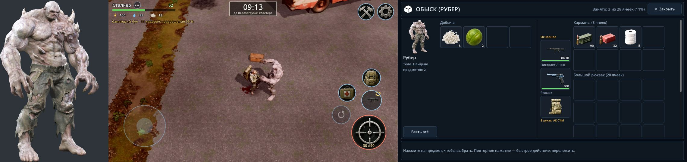
  Модель по присланной картинке: Tripo, со скелетом
  (`assets/models/ruber.glb`, 18 тыс. треугольников, цвет 2048, нормали 1024): рост 2,1 м, гора мышц, костяные
  наросты на плечах и спине, огромные руки с когтями, рваные брюки. Тело шире обычного (`radius` 0,36 м против 0,28).
  Прочность 700 (лоторейщик — 200); шаг 0,9 м/с, бег 3,3 м/с; видит на 18 м, слышит выстрел за 40 м, бег и шаги.
  Заметив героя — ревёт 1,2 с и идёт в погоню; **рывок** (`charge`): ближе 10 м срывается и 1,6 с несётся со
  скоростью 5,6 м/с (быстрее героя), потом 6 с отдышки. Удары редкие (раз в 2,4 с) и с долгим замахом (урон
  доходит через 0,6–0,7 клипа — можно отскочить): правой и левой — по 32, двумя руками сверху — 48 (обе кисти
  доводятся до героя). Обычные попадания его не сбивают; попадание от 75 урона (`stagger_dmg`: дробовик в упор)
  срывает удар и заставляет потерять равновесие. Голос — тот же, но ниже и громче (`voice`).
  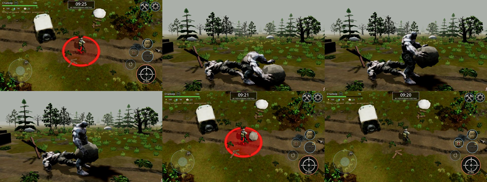
  **Бросок камня** (`rock` в `data/enemies.json`, `core/world/rock_throw.gd` — `ULRock`): видит героя с 11–24 м
  (ближе — рывок) — на земле там, где стоит герой, появляется **красный круг** (радиус 1,7 м, внутри растёт
  круг-отсчёт), Рубер приседает, вырывает из земли булыжник (остаётся яма, летят пыль и осколки), поднимает и
  **через 3 с** (`aim_s`) бросает двумя руками; камень летит по дуге 0,75 с (`fly_s`) точно в метку — за героем не
  доворачивает. Кто в круге в момент удара — получает 45 урона (`dmg`); **после попадания булыжник пропадает**
  (пыль, осколки), метка гаснет. Вышел из круга — мимо. Пока камень не брошен, Рубер стоит на месте: сильное
  попадание (от 75 урона) или гибель срывают бросок — камень рассыпается в руках; **подбежал вплотную**, пока
  камень не брошен, — Рубер роняет его (камень раскалывается, метка гаснет) и бьёт рукой. Передышка 11 с (`cd`);
  два Рубера одновременно круги не ставят — после начала броска другой ждёт 4 с (`gap`), обычно за это время он
  подходит ближе 11 м и идёт врукопашную. Только под открытым небом: если он сам или герой в помещении (палатка,
  корпус, дом) — не бросает; успел зайти под крышу, пока камень летит, — камень бьёт в крышу, урона нет.
  Бросающий издали Рубер движется полностью до 36 м (остальные враги во временных кластерах — до 18 м).
  **Звуки** — свои, синтезированы с нуля (`tools/make_rock_sounds.py`, numpy): `rock_rip` — гул земли, хруст и
  осыпь камешков, `rock_throw` — тяжёлый низкий свист, `rock_hit_1/2` — глухой удар с разлётом осколков; звучат
  в момент, когда камень в руках, когда уходит из рук и когда падает. На общей шине (`default_bus_layout.tres`) —
  ограничитель громкости (−0,5 дБ): громкие звуки рядом (удар, очередь, рёв) не хрипят на телефоне.
  На полигоне (10×10 м, «Рубер +») он бросает с 4,5 м — чтобы атаку можно было посмотреть сразу.
  Свои движения (`assets/anim/ruber`, 16 клипов Tripo по описанию): тяжёлое дыхание, шаг, бег, рёв, удар правой,
  левой, двумя руками, попадание спереди и сзади, потеря равновесия, падения на спину, лицом вперёд и набок,
  боевая стойка между ударами, «вырывает камень», «бросает камень» (`data/anim_ruber.json`). Проверка движений
  17.11 нашла и исправила: (1) падение вперёд, падение набок, попадание сзади и стойка были взяты у лоторейщика и
  на этом скелете ломались (ноги вверх, тело комком) — заменены своими; (2) клипы шага и бега содержали нецелое
  число шагов (≈2,5 и ≈3,7 двойных шага) при настройке «один», поэтому на беге 3,3 м/с шаг и бег смешивались
  вразнобой — ноги «плыли». Теперь оба клипа обрезаны до одного чистого двойного шага от постановки левой стопы
  (`from`/`to`), скорость клипа задана по опорной стопе (`speed`): скольжение стоп на беге упало с ≈41 % до ≈5 %
  скорости тела, на рывке — ≈4 %. У пустыша и лоторейщика та же обрезка замеры ухудшила — им оставлено как было.
  В теле: **спораны 3–9 и горошины 1–3 — всегда, чёрная жемчужина — с шансом 15 %**; красных и белых нет.
  В санатории их **0, 1 или 2 — поровну** (`ruber_chances` в `data/sanatorium.json`), сверх 20–40 пустышей и
  5–15 лоторейщиков (всего 25–57). Места (`zones_ruber`): у котельной, хоздвор, за главным корпусом, залы
  котельной, столовой и склада — только там, где вокруг свободно на метр; не ближе 45 м к воротам и 12 м друг к
  другу. Убитый за посещение не возвращается. На полигоне — кнопка «Рубер +».
- Картинка врага (окно обыска и справочник) — снимок его 3D-модели в живой позе, а не в исходной «руки в
  стороны»: `tools/portrait.tscn` ставит кадр клипа (`POSES`: у заражённого — крадётся, руки тянутся вперёд) и
  пишет `assets/icons/enemy_<вид>.png`. Для нового врага достаточно добавить его в `ULEnemy.KINDS` и запустить.
- **Справочник** (меню → «Справочник»): картинка врага и строки, собранные из тех же чисел, по которым он живёт
  (`ULEnemy.describe`): как ходит, как нападает, прочность, что бывает в теле, сколько лежит тело.
  
- Движения врага — те же клипы, что у героя. Кости у моделей Tripo называются одинаково, но в исходной позе
  повёрнуты по-разному (у заражённого иначе стоят корень, таз и вся правая рука), поэтому при переносе повороты
  пересчитываются в исходную позу своего скелета (`BCAnimSet._rest_fix`). Библиотека клипов строится один раз на
  модель: первый заражённый — 80 мс при загрузке, следующие — 3 мс.

## Инвентарь (`core/world/items.gd`, `inventory.gd`, `inventory_ui.gd`)
- Отдельное меню на весь экран (игра за ним не видна), «Закрыть» — обратно в игру. В шапке — сколько ячеек занято.
- Экран «Инвентарь»: слева — слоты одежды (шлем, жилет, куртка, штаны, обувь — пока заготовки), в центре —
  герой в полный рост (3D, можно повернуть пальцем; с оружием — в стойке, рюкзак — на спине), под ним — здоровье,
  энергия, вода; рядом — слоты «Основное», «Пистолет / нож», «Рюкзак» и строка «В руках: …». Справа — карманы
  (8 ячеек) и ячейки надетого рюкзака: малый +8, средний +12, большой +20. **В начале игры доступен только малый**
  (лежит у места появления; изредка попадается в тайниках); **средний и большой — только у торговца** (оружейник,
  «Припасы и снаряжение»: 1 и 2 горошины) — в добыче кластеров и в телах их нет. Купленный рюкзак больше
  надетого **надевается сразу**: вещи перекладываются в него, старый (пустой) — в карман. Надеть рюкзак из
  кармана можно и с вещами в надетом — они перекладываются, если помещаются (иначе смены нет, ничего не теряется).
- Экран «Хранилище»: слева — картинка ящика или рюкзака, вместимость, «Взять всё» (у рюкзака — «Надеть»);
  затем содержимое (4 в ряд), слоты снаряжения, карманы и рюкзак.
- Нажатие на предмет выбирает его; внизу — описание и действия: «Экипировать» / «Надеть», «В руки» / «Убрать
  из рук», «Снять», «Использовать», «В хранилище» / «Взять», «Выбросить». Повторное нажатие — быстрое действие
  (экипировать, использовать, переложить). Патроны и расходники складываются в стопки.
- Выброшенный предмет ложится на землю перед героем — своей 3D-моделью.
- Рюкзак с земли можно надеть вместе с вещами; надетый при этом ложится на землю со своими вещами. Рюкзак
  с вещами нельзя убрать в ячейку — только выбросить.
- Всё сохраняется (`user://cluster.json`, версия 6): инвентарь, предметы на земле, содержимое ящиков, здоровье,
  энергия, вода, патроны в магазинах.

## Патроны — одна модель Tripo по фото
- `ul_ammo` — по присланной картинке одной генерацией (55 кредитов): семь коробок (7,62×25, 9×19, 5,45×39,
  7,62×51, 7,62×54R, 9×39, 12 калибр), у шести рядом стоит патрон (у 9×19 патрон не получился — на значке стоит
  патрон от 7,62×25). `tools/split_glb.mjs` режет набор на семь предметов и у каждого выделяет части: `item_N` —
  коробка с патроном, `item_N_a` — коробка, `item_N_b` — патрон.
- В инвентаре патроны — значок «патрон и коробка», как на фото, и количество (`assets/icons/ammo_N.png`, снимок
  той же модели); на земле лежит только коробка.

## Набор припасов — одна модель Tripo
- `ul_supplies` — девять предметов одной генерацией (55 кредитов): красная коробка пистолетных патронов, зелёный
  цинк, коробка патронов 12 калибра, аптечный пузырёк, бинт, аптечка, пачка сухарей, бутылка воды, консервная
  банка. `tools/split_glb.mjs` выравнивает набор, делит его на связные куски и собирает в `assets/world/
  ul_supplies.glb` девять отдельных предметов (`item_1`…`item_9`) с одной общей текстурой.
- Каждый предмет каталога ссылается на свой номер (`kit` в `items.gd`): эта модель лежит на земле, а значок
  в инвентаре — снимок той же модели (`tools/icons.gd` → `assets/icons/kit_N.png`). Патроны разных калибров
  делят одну модель и различаются оттенком значка и названием.
- Новый предмет — «Живчик» (пузырёк): +60 энергии, +5 здоровья.
- Так же можно добавлять следующие наборы: одна генерация — много предметов (`tools/kit_view.gd` — обзор набора).

## Проверка
- `godot --path . --headless res://world.tscn -- --as-test=inv` — 151 случай (без экрана — около минуты, время
  считается честно, 60 кадров/с): отклик управления (разгон, остановка, камера), нажатие во время доставания
  оружия, автонаведение за спину и через забор, удержание кнопки, манекен, содержимое ящиков, кнопка
  взаимодействия (нет цели — нет кнопки; житель, ящик), разговор, смена имени, режимы огня (пистолет — один
  выстрел, автомат — очередь до нуля, перезарядка кнопкой), полёт пуль и дробин, выход с локации по отсчёту, враг (замечает, слышит выстрел, бьёт, гибнет, 0–3 спорана, обыск, тело исчезает через
  минуту — обысканное и нет, гибель героя, справочник), ресурсы (кошелёк без ячеек, все пять, окошко, покупка,
  отказ при нехватке, сохранение, перенос из старого сохранения), прочность оружия (выстрел снимает единицу,
  строка в инвентаре, поломка и возврат патронов), Лоторейщик (рост, слух на бег и шаги, крик перед погоней,
  обход ящика, сильное попадание, падение по стороне удара, горошина в трети тел),
  а также логика
  инвентаря (стопки, слоты, ёмкость
  с каждым рюкзаком, переполнение, выброс и подбор, смена рюкзака с вещами, ящик, сохранение) и бой (кулаки,
  мачете во втором слоте, выстрел и расход патронов, попадание по мишени, перезарядка из запаса, пустой запас,
  лечение, вода, энергия) с ответом «верно / ОШИБКА».
- `--as-test=pc` — базовый компьютер (41 случай): пять ресурсов, добыча на панели, отказ и недостача, покупка
  оружейника один раз, маршрут, таймер маршрутов, обмен по всей цепочке в обе стороны, окно обмена, двойное
  касание, сохранение и загрузка; `--as-out=папка` — снимки экрана компьютера и окна обмена.
- `--as-test=cs` — коровник (22 случая): размер, постройки (стены непроходимы, в каждую можно зайти, крыша над
  героем растворяется), коровы двух видов, число и места врагов, 30 разных
  посещений, враг замечает и бьёт, таймер, уход за край с добычей, повторная покупка, тревога, перезагрузка с потерей
  вещей при себе, вещи базы целы, коровник пропал с карты; `csview` — снимки, `csperf` — нагрузка при 38 врагах.
- `--as-test=sn` — санаторий (42 случая, по списку задания; в том числе Рубер: число 0–2, места, добыча, рывок, удар, оглушение, гибель, обыск): размер, расположение корпусов по карте, комнаты и
  двери, путь от входа на каждый этаж каждого корпуса, стены непроходимы, на этаже героя крыша и верхние этажи
  скрыты и стены срезаны, герой сам поднимается и спускается по лестнице, закрытая дверь — преграда и открывается
  при подходе, пустыш из кабинета 1 этажа доходит до героя на 2 этаже и бьёт, число врагов и где они (в корпусах и
  снаружи, лоторейщики — в своих зонах), никто не в стене и мебели, не у ворот, не толпой, 30 разных посещений,
  обыск тайника и тела, таймер, убитые не возвращаются, хлам во всех корпусах, уход с добычей, повторная покупка,
  перезагрузка с потерей вещей при себе; `snview` — снимки, `snperf` — нагрузка при 55 врагах, `snbake` — карты
  земли и проходимости.
- Погоня по этажам (`--as-test=snchase`, можно с `--as-fps=12`): пустыш из десяти комнат первого этажа главного
  корпуса идёт к герою на втором. Чтобы враги не застревали: тело врага уже запаса карты путей (0,28 м против
  0,3 м), по пути карты враг идёт без «щупа» перед собой (тот сбивал его у перил и косяков), столкновение перил
  у верхней площадки лестницы короче на 0,9 м.
- Нагрузка санатория при 57 врагах (два Рубера): до 252 вызовов и 358 тыс. треугольников — в бюджете.
- Нагрузка санатория при 55 врагах (`snperf`): средняя графика — до 252 вызовов отрисовки и 352 тыс. треугольников
  (тени солнца — одна карта на 32 м, тень отбрасывают только стены и крыши), низкая — до 162 вызовов и 115 тыс.;
  текстуры 66 МБ; скрипты и физика на компьютере 3,6–7,9 мс за кадр — столько же, сколько у коровника на той же
  машине в тот же час (4,7–7,8 мс; из этого ИИ врагов — 0,3–1 мс, остальное — движения скелетов в движке).
- `--as-test=cv` — «Разбитый конвой» (40 случаев, по списку задания): поле и вход с юга, зоны по карте, техника
  отдельными моделями и непроходима, размеры палаток, путь от входа внутрь каждой палатки, кунга, поста и
  контейнера, стены непроходимы, герой сам входит в штабную палатку (крыша скрывается, обстановка видна) и
  выходит, обстановка палаток, свет, дверь кунга (преграда — открывается), пустыш снаружи заходит за героем в
  палатку и бьёт, герой поднимается на вышку и спускается (навес скрывается, ящик наблюдателя), число врагов
  15–35 / 3–10 / 0–1 и всего 18–46, зоны, никто не в препятствии и не у входа (и в 30 посещениях), шанс Рубера,
  виды тайников, у каждого вида можно встать и получить «Обыскать», обыск кузова с переносом патронов и хлама,
  добыча за 300 посещений (патроны и хлам — в каждом, медикаменты, только существующее оружие, без жемчуга),
  добыча Рубера, хлам кучками, таймер 10:00, маршрут 53 спорана, место на карте, уход с добычей, покупка заново
  (за 34 — отказ), перезагрузка с героем в палатке; `cvview` — снимки (21 точка), `cvbake` — карты и готовая сборка.
- `--as-test=cvrock` — бросок камня Рубера (19 случаев): метка там, где герой; камень вырван, брошен через 3 с,
  летит по дуге; урон в круге; булыжник пропал, метка погасла, следы убраны; звуки по шагам и вовремя (свои
  файлы), ограничитель на общей шине и громкость на расстоянии камеры; передышка; вышел из круга — мимо;
  оглушение и гибель до броска срывают его, обычное попадание — нет; с 8 м — рывок вместо броска; в палатку не
  бросает; подбежал вплотную — роняет камень и бьёт; шагнул под крышу палатки — урона нет; два Рубера — не
  больше одного круга сразу; строка в справочнике; `--as-out` — снимки по шагам.
- Нагрузка хутора при 40 врагах (`khperf`, 10 мест, средняя графика): до 206 вызовов отрисовки и 431 тыс.
  треугольников (большой дом и магазин внутри; от прогона к прогону ±30 тыс. — враги стоят по-разному), текстуры
  129 МБ — в бюджете. После деталей Tripo на фасадах было 465 тыс.; вернули в бюджет: сетки мебели Tripo упрощены
  вдвое (полки, банки, мешки, шкафы, плиты, кровати), уличные детали — на треть; враги дальше 18 м от героя не
  отбрасывают настоящую тень (под ними остаётся мягкое пятно, а карта теней не рисует их тело второй раз).
  `--as-tris` к любому замеру печатает, из чего складываются треугольники в кадре (по моделям и группам).
- Нагрузка конвоя при 46 врагах (`cvperf`, 10 мест, средняя графика): до 179 вызовов отрисовки и 434 тыс.
  треугольников (склад; когда все 46 врагов гонятся за героем посреди дороги — 421 тыс.), текстуры 72 МБ — в
  бюджете, но по треугольникам запас мал: на открытом месте видно больше врагов, чем в корпусах санатория. Мелкие
  модели (ящики, тела) не отбрасывают тени и видны до 42 м, техника — до 60 м.
- `--as-test=kh` — «Хутор» (31 случай, по списку задания §16): поле и вход с юга, состав построек, размеры домов,
  комнаты, мебель-модели, путь от входа внутрь каждой постройки и в погреба по лестнице, весь пол построек достижим,
  стены непроходимы, дверь дома (преграда — открывается), крыша скрывается, магазин и сарай, спуск в погреб (вырез
  земли, вход скрыт, свет, обыск), подъём, тайники и добыча за 200 посещений, число и зоны врагов (и за 30 посещений),
  подвалы как здания (помещения, двери, свет, тайники, пусто сверху), заражённые в подвалах, пустыш заходит за
  героем в дом и спускается в подвал, таймер, маршрут 27 споранов, место на
  карте, уход, покупка заново, гибель в подвале по таймеру; `khview` — снимки (21 точка: снаружи, дом, кухня,
  магазин, подвалы и кладовая), `khbake` — кэш построек и карты, `khperf` — нагрузка при наибольшем числе врагов.
- `--as-test=lvl [--as-place=khutor]` — «Тест уровней»: герой с пулемётом, бессмертен, патроны не убывают, ничего не
  сохраняется, выход в меню; `--as-test=lvlbench --as-place=…` — «Замер FPS»: обход всех мест, таблица на экране,
  в буфере обмена и в файле.
- `res://map.tscn -- --as-test=map` — карта мира, в том числе коровник, санаторий, конвой и хутор до и после покупки маршрута и вход.
- `--as-test=world --as-out=папка` — сценарий со снимками: открыть рюкзак на земле и надеть, дойти до ящика,
  взять оружие, взять в руки, открыть инвентарь, выбросить, переложить в рюкзак на земле, пройти по дому.
- `--as-test=view --as-out=папка` — обзор локации: снимки в шести точках.
- `--as-test=mapbake --as-place=home|cowshed|sanatorium|convoy|khutor|lair|quarry --as-gfx=3 --as-out=папка` — запечь
  карту локации (`top_<место>.png`; затем — в `assets/ui/topmaps/top_<место>.jpg`, настройки импорта — как у
  соседних). `--as-test=pmap --as-place=quarry` (и `home`) — проверка карты: цена, покупка с маршрутом и отдельно,
  кнопка, метка героя, совпадение снимка с локацией.
- `--as-test=gqview --as-place=quarry --as-at=x,z --as-gfx=1 --as-out=папка` (окно `--resolution 2400x1080`) — сравнение
  чёткости: один неподвижный кадр игровой камеры (без врагов) при доле разрешения 62 / 70 / 85 / 100 % и резкости
  0 / 1 / 2 — снимки `gq_<доля>_s<резкость>.png`; с `--as-one` — один кадр (100 %, мягкая резкость): так
  сравнивается вид разных локаций (`--as-place=cowshed|sanatorium|convoy|khutor|lair|quarry`). `--as-sharp=0..2` — резкость для любых других снимков (в
  проверках она по умолчанию выключена).
- `--as-test=qrpano --as-out=папка [--as-only=p0_south,p1_village,…] [--as-gfx=3]` — обзорные снимки карьера с высоты
  (свободная камера, как пролёт над локацией; в игре такой камеры нет — у обзорной в кадре горизонт и небо).
- `--as-test=top --as-out=папка [--as-gfx=3] [--as-px=4096] [--as-span=106]` — цельный снимок локации строго сверху
  (`top.png`): отдельная камера без перспективы смотрит отвесно вниз на всё поле, без кнопок интерфейса, без дымки
  и без ограничения дальности прорисовки; верх снимка — «вверх» на экране в игре. Стартовая локация:
  
- `--as-test=bossview --as-out=папка` — главарь муров на открытом месте стартовой локации: размер, скелет и клипы, бег,
  вступление, тяжёлый выстрел, прицельный выстрел, удар ногой, фазы и подмога, граната (попала / вышел из круга),
  гибель — 16 пунктов; `--as-test=bossdemo` с `--write-movie` — запись его движений.
- `--as-test=photo --as-out=папка [--as-kind=mur_boss]` — портреты персонажа в полный рост на чистом белом фоне (шесть
  ракурсов, стойка и прицел) — образец для сторонних инструментов; `--as-test=zdemo` с `--write-movie` — запись
  движений заражённого.
- `--as-test=murmove --as-out=папка [--as-kind=mur_ak|mur_sg|mur_boss]` — походка мура: дозор, сближение, бой; печатает
  скорость, угол между корпусом и направлением движения, скольжение опорной стопы; снимки по стадиям.
- `--as-test=arena --as-out=папка` — полигон: борт держит героя, враги по кнопке (не больше шести), патроны,
  уборка врагов, гибель; `--as-test=shop` — разговор, торговля, покупка; `res://stand.tscn -- --as-test=enemy` —
  враг на стенде, по снимку на движение.
- `--as-test=enemy --as-out=папка` — заражённый: стоит, бежит, бьёт, падает, обыск, справочник (общий вид и
  крупный план); `--as-test=eclips` — его движения по кадрам.
- **Проверка производительности для Android** — в конце каждой проверки (`_perf_report`) и отдельно
  `--as-test=perf`: замеры в семи местах (старт, калитка, двор, ельник, тропа, дом, открытый инвентарь) против
  бюджета кадра для телефона среднего класса (Mali-G57 / Adreno 610, цель 60 кадров/с): вызовов отрисовки ≤ 350,
  треугольников ≤ 450 тыс., текстуры ≤ 450 МБ, свои скрипты и физика ≤ 4 мс в худшем кадре (на компьютере; телефон
  считает в 3–4 раза медленнее). Отрисовка считается при запуске с экраном, скрипты — при запуске без экрана
  (`--headless`: под программной отрисовкой время кадра — это сама отрисовка). Сейчас: до 133 вызовов,
  143 тыс. треугольников, 99 МБ текстур, 3.2 мс — всё в бюджете.
- Саму частоту кадров можно измерить только на телефоне: меню (шестерёнка) → «Тест FPS» — 10 секунд игры,
  на экране остаются средняя частота, худший кадр, вызовы отрисовки, треугольники и память текстур; то же
  пишется в `user://perf.txt`.
- Проверено на компьютере (программная отрисовка, поэтому 1–3 кадра/с в журнале — не показатель). На телефоне
  не проверялось: управление пальцами и частоту кадров нужно смотреть там.

## Источники
- Мачете (помощник `core/melee_tuner.gd`): хват и удар — [outdoors.codidact.com: Correct way to wield a machete](https://outdoors.codidact.com/posts/52671),
  [Everest Forge: How to Use a Machete](https://everestforge.com/everest-forge-blog/how-to-use-a-machete-beginner-training),
  [vivatropical: how to swing a machete like a local](https://vivatropical.com/lifestyle/how-to-swing-a-machete-like-a-local/),
  [bladeforums: the machete pinch grip](https://www.bladeforums.com/threads/the-machete-pinch-grip-or-how-to-use-a-machete-video.694505);
  подвижность запястья — [Mayo Clinic: functional ranges of motion of the wrist joint](https://mayoclinic.elsevierpure.com/en/publications/functional-ranges-of-motion-of-the-wrist-joint/),
  [PMC: wrist range of motion](https://pmc.ncbi.nlm.nih.gov/articles/PMC3016043). Это советы практиков и справочные
  нормы, а не измерения ударов мачете.
- Земля (общая библиотека `GROUND_SETS` в `world.gd`) — Poly Haven, CC0: brown_mud_rocks_01 (грязь с камнями),
  brown_mud_dry (утоптанная сухая земля с галькой), old_wood_floor (полы), кусты searsia_lucida, папоротник fern_02.
- Модели дома, ящика, сосны, берёзы, яблони, куста, набора припасов — Tripo AI, аккаунт пользователя
  (`tools/tripo/budget.md`).
- Текстуры — Poly Haven, CC0 (`assets/world/tex/`): forrest_ground_01 и leafy_grass (трава), grass_path_2 (сухая
  земля), rocky_trail (галечная тропа), rock_boulder_dry (валуны), old_planks_02 (серые доски забора),
  bark_brown_02 (кора), dry_ground_01, rocky_gravel, weathered_brown_planks, brown_planks_03 (дом внутри),
  weathered_plank_siding (стены дома снаружи), worn_corrugated_iron (кровля). Гамма светлая: зелёный луг
  с проплешинами сухой земли, а не тёмная лесная почва.
- Откуда брать текстуры дальше: Poly Haven (polyhaven.com) и ambientCG (ambientcg.com) — обе библиотеки CC0
  (можно в коммерческой игре, без указания автора), обе доступны из сборочной среды. Модели Tripo с размытой
  раскраской улучшаются тем же приёмом, что дом: чёткая фототекстура поверх, раскраска модели — как светлота.
- Бочка и покрышка — модели Poly Haven, CC0: barrel_03, old_tyre (`assets/world/ph_barrel.glb`, `ph_tyre.glb`,
  текстуры уменьшены до 512).
- Модели Poly Haven, CC0 (polyhaven.com, можно в коммерческой игре без указания автора): exterior_aircon_unit
  (ржавый вариант, `ph_aircon.glb`), metal_trash_can (ржавый, `ph_trash.glb`), rock_moss_set_01 (три камня
  набора — `ph_rock1..3.glb`), dead_tree_trunk_02 (`ph_trunk.glb`), wooden_picnic_table (`ph_picnic.glb`),
  plastic_monobloc_chair_01 (`ph_chair.glb`), cardboard_box_01 (`ph_box.glb`). Сетки упрощены (meshoptimizer через
  gltf-transform), модели выровнены по центру, цвет ≤ 1024, нормали и шероховатость ≤ 512.
- Еловая лапа (`spruce_bough.png`) и пучок травы (`grass_tuft.png`) — нарисованы скриптами, собственные.
- Значки кнопок (`assets/icons/ui/`) — из набора, присланного пользователем. Забор, проволока, ели, поленница,
  колода, камни, ветки — своя геометрия.

## Хранилище базы (`world.gd` — `_storage`, `open_safe`; `base_state.gd` — `buy_storage`, `safe_cells`)
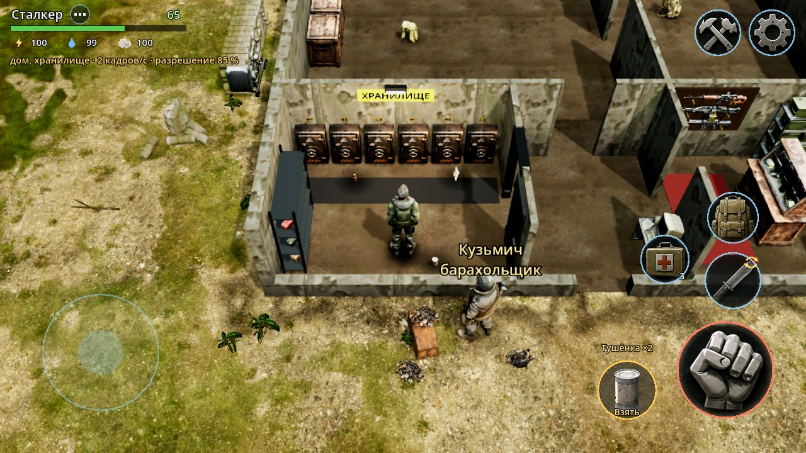
- Комната — **первая слева от входа** (бывшая кухня). До покупки пустая и называется «Кухня»; с первого уровня —
  «Хранилище»: металлическая дверь (открыта к стене, проём свободен), лампа с тёплым светом, металлический
  стеллаж с коробками у левой стены, жёлтые таблички «ХРАНИЛИЩЕ» над сейфами и у двери со стороны сеней,
  резиновый коврик.
- **Сейфы №1–№6 — в один ряд вдоль задней стены**, дверцами к герою (камере), промежутки 8 см, перед рядом —
  свободный проход от двери к каждому сейфу. Места ещё не купленных сейфов размечены на полу жёлтой рамкой с
  номером. Сейф — модели Tripo по эскизу пользователя (модель по картинке): `st_safe` — закрытый (штурвал,
  кодовая панель, массивные петли, знак, жёлто-чёрная полоса), `st_safe_open` — открытый (дверь распахнута,
  полки с ящиками, банками и аптечкой). «Открыть» — писк кодового замка, лязг засовов, сейф открывается;
  закрыли окно — закрывается. Номер — латунная табличка «№k» на стене над сейфом. Без моделей — свой сейф
  (корпус с полками и дверца на петлях, которая поворачивается).
- Подойти — «Сейф №k», «Открыть». Окно «СЕЙФ №k» (значок — сейф): **сетка 6 × 5 (30 ячеек)**, «Взять всё», «Положить всё» (из карманов и
  рюкзака), «Сортировать» (одинаковые стопки сливаются, затем оружие, патроны, лекарства, еда, ресурсы, минералы,
  хлам); у предмета — «Взять», «Разделить», «Переместить» (пустая ячейка — перенести, тот же предмет —
  объединить, другой — поменять), «В сейф…» (в любой другой сейф, со свободными ячейками), «Выбросить». Ресурсы
  (спораны, горох, жемчуг) — касанием по значку в кошельке. Оружие, патроны, всё из инвентаря — можно.
- Содержимое — `storage.safes.safe_1 … safe_6` в `user://base.json` (номер сейфа постоянный), сохраняется при
  каждом изменении и при закрытии окна. Гибель и перезагрузка кластера сейфы не трогают (теряется только то, что
  при себе).
- Проверка: `--as-test=st [--as-out=папка]` — 17 пунктов: карточка на уровнях 0/1/6, нехватка, покупка,
  улучшения, максимум, комната, ряд и проход, подход, окно, все действия, сохранение, гибель и сброс; снимки
  комнаты на уровнях 0, 1, 3, 6.
