# Стартовая локация — стабильный кластер (проверка)

Игра открывается главным меню (`menu.tscn`): «Новая игра», «Продолжить», «Настройки», «Выход». Дальше — карта
мира (`map.tscn`), с неё — вход на локацию (`world.tscn`, `world.gd`). Стенд анимаций — из меню локации
(шестерёнка → «Стенд»).

## Меню, карта мира, настройки
- Главное меню — картинка с нарисованными кнопками (`core/world/backdrop.gd`: картинка занимает экран телефона
  целиком — растягивается на всю ширину, лишнее по высоте срезается снизу; области нажатия заданы в её точках). «Новая игра» стирает сохранение локации (с подтверждением; имя героя
  и настройки остаются), «Продолжить» ведёт на карту с прежним сохранением (нет сохранения — кнопка затемнена).
- Карта мира (`map.gd`) большая — в 2.5 раза шире и выше экрана: разведанная часть посередине, остальное
  закрыто клубящимся туманом; двигается пальцем. Видно, где герой («Вы здесь»). Нажатие на локацию — слева
  выезжает панель с её рисунком, названием и описанием; вход — только кнопкой «Войти» (повторное нажатие
  на локацию не заводит). Шестерёнка — настройки, «Главное меню» и «Выйти из игры». Локации — в `PLACES`.
- За краем поля — туман, как на границе кластера: начинается у кромки и густеет наружу, клубится
  (`FOG_SHADER`, три слоя на разной высоте; внутри поля тумана нет).
- С локации на карту: выйти за край поля 100×100 м — идёт отсчёт 5 секунд («Вы покидаете локацию»); вернулся —
  отсчёт сброшен, не вернулся — переход на карту мира. Или шестерёнка → «Карта».
- Главное меню — картинка пользователя (`assets/ui/title.jpg`) с кнопками «Новая игра», «Продолжить»,
  «Мультиплеер», «Настройки», «Выход» (области нажатия — `bd.areas` в `menu.gd`, в точках картинки 1672×941).
  Проверочные режимы убраны с главного экрана: **«Настройки» → «Лаборатория»** — «Полигон 10×10», «Стенд 3D:
  движения, редактор удара», «Тест уровней», «Тест кейсов».
- **«Тест уровней»** (Настройки → Лаборатория): окно выбора локации (дом,
  коровник, санаторий, конвой, хутор, полигон); герой появляется там сразу с пулемётом ПКП и запасом лент, бессмертный,
  патроны не кончаются, с большим рюкзаком, пистолетом ТТ и аптечками. Ничего не сохраняется (`ULSettings.level_test`, база — только в
  памяти): маршруты, споры и вещи на базе не меняются, таймер кластера не убивает, выход — за край поля или шестерёнка → «Главное меню» (возврат в меню).
- **«Замер FPS»** — галочка в окне «Тест уровней»: герой сам обходит 6–10 мест локации (входы, дома, подвал,
  магазин, улица, «все враги гонятся»), в каждом 1,5 с ждёт и 3 с меряет: кадры в секунду, худший кадр, вызовы
  отрисовки, треугольники. В конце — таблица на экране (с моделью телефона, видеочипом, качеством графики и
  размером экрана), копия в буфер обмена и файл `user://bench_<место>.txt`. Цифры с телефона можно прислать —
  по ним подстраивается графика.
- Настройки (`core/world/settings.gd`, `user://settings.json`) — одни на все локации, базу и стенд:
  - **качество**: «Низкая» (3D 70 %, без сглаживания и теней), «Средняя» (85 %, MSAA 2×, тени — карта 1024),
    «Высокая» (100 %, MSAA 2×, тени 2048, анизотропная фильтрация земли), «Ультра» (100 %, MSAA 4×, тени 4096
    мягче, трава гуще и дальше);
  - отдельно поверх качества: **разрешение 3D** (как в качестве / 60–100 %), **тени** (как в качестве / выкл /
    хорошие / лучшие), **трава** (как в качестве / мало / средне / много), **подстройка FPS** (вкл / выкл);
  - громкость; с карты и из игры в том же окне — «Главное меню» и «Выйти из игры».
- Музыка меню и карты мира (`core/music.gd`, `assets/audio/music_menu.mp3`) — «Dead Sector», прислана
  пользователем (его композиция). Играет по кругу без перерыва: и при открытых настройках, и при переходе
  между меню и картой; стихает при входе на локацию. Громкость — в настройках.
- Кнопки в игре собраны у правого края вокруг кнопки атаки: слева — взаимодействие, выше-левее — перезарядка,
  прямо над атакой — смена оружия, над ней — рюкзак (инвентарь), рядом — лечение.

## Частота кадров на телефоне
- **Почему на снимках с телефона было 39–42 % разрешения при 58–60 кадрах/с.** Прежняя подстройка мерила
  среднюю частоту за секунду с первых кадров на локации: постройка локации и первая закраска дают рывки в
  сотни миллисекунд — средняя падала ниже 38, и разрешение сразу сбрасывалось крупными шагами до нижнего
  предела 30 %, а поднималось по 4 % в секунду с паузами — и надолго оставалось низким. Теперь: первые 5 с на
  локации не считаются; частота — по срединному кадру секунды (одиночный рывок не в счёт); при нехватке
  кадров сначала снимается сглаживание, потом тени и только потом разрешение — не ниже 62 %; подстройку можно
  выключить в настройках. Всё ниже в этом разделе — история.
- Замер пользователя на телефоне (сборка 17): 18–20 кадров/с при 97 вызовах отрисовки и 119 тыс. треугольников —
  значит, телефон упирался не в геометрию, а в закраску точек экрана. Что сделано:
  - трёхмерная картинка рисуется в меньшем разрешении и растягивается (кнопки и надписи остаются чёткими):
    42 / 55 / 80 % по качеству графики, и подстраивается сама так, чтобы частота не опускалась ниже 38–40:
    меньше 38 кадров/с — разрешение сразу падает на 8 %, 38–45 — на 3 %, больше 56 — понемногу растёт (до предела
    качества, не раньше чем через 6 с после снижения). После каждой перемены — секунда передышки (смена
    разрешения сама даёт заминку). Нижний предел — 30 %;
  - на «Низкой» и «Средней»: без анизотропной фильтрации, у елей меньше лап, трава реже и ближе; житель
    вдали не считается;
  - земля: расположение травы, тропы и гальки заранее посчитано в карту 256×256 (`ground_mask.png`,
    `--as-test=bake`) — 7 выборок текстур на точку вместо 12 и цикла по отрезкам тропы;
  - сглаживание MSAA — только на «Высокой»; травы меньше на «Низкой» и «Средней»;
  - прогрев при входе: пули, цифры урона и метка цели один раз рисуются сразу — первый выстрел без заминки.
- Проверить можно только на телефоне: шестерёнка → «Тест FPS».

## Что есть
- Кластер 100×100 м. Земля (`GROUND_SHADER` в `world.gd`): тёмная лесная почва с листвой, трава пятнами,
  россыпи гальки и натоптанная тропа с камешками — от крыльца к калитке и дальше через кластер двумя ветками
  (`TRAIL`). Текстуры берутся в двух масштабах под углом и смешиваются по шуму, рисунок не повторяется. У крыльца
  и вокруг фундамента — вытоптанная земля. Поверх — пучки травы (зелёные и сухие, качаются от ветра, видны
  до 30 м): растут там, где на земле трава, тропа свободна. По земле — сухие ветки и камни, у тропы — валуны.
  По краю кластера — полоса гравия, за ней — другой грунт и дымка. Пройти за край нельзя.
- Лес хвойный: ели трёх размеров (7, 9 и 11 м ±15 %, всего 32) — своя геометрия: ствол и ярусы лап с рисованной
  текстурой хвои (`tools/draw_flora.py`), концы лап качаются. Плюс модели Tripo: сосна (10), берёза (6),
  яблоня (3), куст (22). У стволов — столкновения. Расстановка всегда одинаковая (своё «зерно»); двор, тропа
  и старт свободны.
- Деревянный дом (модель Tripo) с пятью проходимыми комнатами (`core/world/house.gd`): сени (вход), кухня,
  кладовая, горница, спальня — проёмы дверей 1 м. Снаружи виден дом Tripo; когда герой входит, дом Tripo и
  крыша скрываются, видны свои стены (срезаны по 2 м — чуть выше роста героя) и пол, на полу — названия
  комнат. Столкновения — со стенами в полную высоту. Модель Tripo подогнана под стены (`SHELL_FIT` в `world.gd`).
  Собственная раскраска модели вблизи размыта, поэтому дом покрыт чёткими фототекстурами (`SHELL_SHADER`):
  кровля — старый шифер (волна вдоль ската), стены — потемневшая доска-обшивка, крыльцо — доски. Раскраска
  модели задаёт только светлоту — окна, двери и тени под свесом остаются на местах.
- Двор обнесён сплошным забором из серых старых досок (доски разной высоты 1.5–1.8 м, две жерди, столбы 2.2 м,
  по верху — две нити колючей проволоки), спереди — проход-калитка. У забора — бочки и покрышки, во дворе —
  поленница и колода.
- Ящики (модель Tripo) — хранилища на 12 ячеек: кнопка «Постройка» ставит ящик перед героем (не в стену),
  в меню — «Убрать ящик». Ящики сохраняются. В начале игры в горнице стоит один пустой ящик под свои вещи.
- **Начало игры: у героя пистолет ТТ** с полным магазином, 60 патронов и мачете в кармане (мачете носится в слоте
  пистолета — поменять в инвентаре), плюс бинты, вода и
  тушёнка. Остальное оружие покупается у оружейника. (Сохранения прежних сборок не подходят — игра начнётся
  заново: `SAVE_V` 7. Всё оружие сразу — на полигоне.)
- Манекен во дворе справа от крыльца — фигура в рост человека из мешковины на стойке: на нём пробуют оружие.
  Не падает (запас прочности восстанавливается сам), над головой — урон серии и урон в секунду.
- **Оружейная** — в доме, при входе справа (бывшая кладовая). Пока оружейник не куплен через компьютер базы,
  комната **пустая** и подписана «Кладовая»; после покупки в ней сразу появляется всё: прилавок с застеклённой
  витриной, за ним оружейник Седой; на стене — щит с винтовками и стойка с ружьями над столом под зелёным сукном
  (автоматы, дробовик, пистолеты), у задней стены — два металлических стеллажа с ящиками патронов, в углу — два
  сейфа. Прилавок, стеллажи и стойка — модели Tripo (`ul_gun_counter`, `ul_ammo_shelf`, `ul_gun_rack`; нет
  модели — простые объёмы), `_armory` в `world.gd`; оружие на витрине — одна сетка без текстур, цвет
  в вершинах (`tools/bake_armory.gd` → `assets/world/ul_armory_guns.res`, 66 тыс. треугольников, 1.2 МБ; рисуется
  только когда герой в доме). Седой поворачивается к герою; разговор — через прилавок.
  
- Герой — тот же, что на стенде (движения, рюкзаки, оружие, звуки).

## Вид и графика
- Камера как в изометрических выживалках: неподвижна, угол — в настройках («Камера»): «Сверху» (61°), «С наклоном»
  (52°, как в DoZ Survival; по умолчанию), «По диагонали» (50° и поворот на 45°, как в Last Day on Earth — дома и
  заборы ромбом; стены, закрывающие героя, выбираются по углу камеры),
  только следует за героем; двумя пальцами можно приблизить или отдалить (10–22 м, по умолчанию 12 м).
  Неба в кадре нет.
- На базе теней от солнца нет (ради скорости): под героем, деревьями, кустами и предметами — мягкие тёмные пятна.
  Во временных кластерах на «Средней» и «Высокой» — тени солнца (одна карта теней на 34 м вокруг камеры).
  Сглаживание MSAA 2×, анизотропная фильтрация 4×, текстуры земли и дома — 2K.
- В доме стены 2 м; стены между камерой и героем опускаются до 0.4 м — героя и комнату всегда видно.
- Подстройка под телефон (`world.gd`, `_auto_res` / `adapt_step`): раз в секунду смотрится частота кадров. Ниже 40 —
  сначала выключается сглаживание MSAA, затем тени солнца и только потом снижается разрешение 3D (не ниже 62 %).
  Выше 52 — всё возвращается в обратном порядке (разрешение до выбранного качества, тени, сглаживание). Что
  сейчас снято — видно в строке под именем: «· без сглаживания», «· без теней».
- Резкость (`core/world/sharpen.gd`, `ULSharpen`; настройка «Резкость»: Выкл / Мягкая / Сильная, по умолчанию
  «Мягкая»). Откуда «мыло» на телефоне: 3D рисуется в доле разрешения экрана (70–85 % по качеству, при нехватке
  кадров подстройка опускает до 62 %) и растягивается на весь экран обычным линейным фильтром — другого растяжения
  в отрисовщике Compatibility (OpenGL ES 3) нет, сдвига уровней текстур тоже. `ULSharpen` — один проход поверх
  готовой трёхмерной картинки, под интерфейсом (надписи и кнопки он не трогает): возвращает контраст мелких
  деталей по способу AMD CAS (сила — по местному контрасту: ровные места не шумят, светлой каймы на границах
  нет); чем ниже доля разрешения, тем проход сильнее и шире. Цена — копия экрана и пять выборок на точку; на
  телефоне не замерялась. Один и тот же кадр (экран 2400×1080, фрагмент 1:1):
  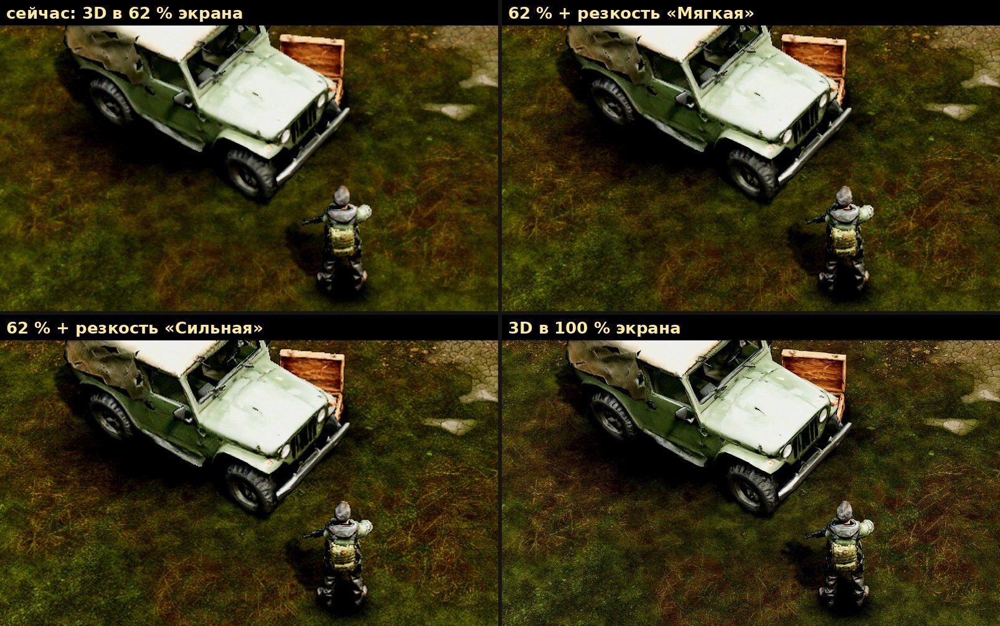
- Земля всех локаций — одна система: общий шейдер `GROUND_SHADER` и библиотека `GROUND_SETS` (какие фототекстуры
  грунта и тропы и какие оттенки у каждой локации; новая локация без своей строки берёт «default»). Мыльная
  текстура `dirt` заменена на brown_mud_dry / brown_mud_rocks_01 (Poly Haven, CC0).
- Земля (`GROUND_SHADER` в `world.gd`): слои — трава, сухая трава, лесная подстилка, грунт, тропа — смешиваются
  «по высоте»; две выборки одной фототекстуры против повторов тоже смешиваются «по высоте» (`hmix`), а не
  пополам — иначе камни и стебли гасили друг друга в ровное пятно. Слой, который в этой точке заведомо не
  проступит (вес меньше главного больше чем на 0,45), не читается вовсе. Земля рисуется после построек
  (`render_priority = 1`): под полом домов её точки отбрасываются по глубине до шейдера. За краем поля —
  рамка из четырёх полос (`ULHouse.outer_frame`), а не плита под всем полем. Вырез (`discard`) — только у хутора.
- Логово муров: двор — пятна тёмной грязи с камнями (`brown_mud_rocks_01`) и утоптанной сухой земли с галькой
  (`brown_mud_dry`, плитка 2 м); полы в помещениях — `old_wood_floor` (цвет, нормали, шероховатость);
  кусты — модель Poly Haven `searsia_lucida` (≈10 тыс. треугольников), папоротники — `fern_02` (3,5 тыс., без
  тени). Все текстуры и модели — Poly Haven, CC0.
- Замер графики по частям: `--as-test=gfxdiag` (два места логова, каждый эффект выключается по одному; время
  кадра, вызовы отрисовки, треугольники; отдельно — время ИИ врагов). В контейнере видеокарты нет (программная
  отрисовка llvmpipe), поэтому важны доли, а не сами числа кадров; на телефоне — «Тест уровней → Замер».
- Сверху слева — имя героя, полоса здоровья, энергия и вода. Справа от имени — три точки: нажатие открывает
  панель, где имя можно сменить (до 16 знаков; хранится в `user://profile.json` отдельно от сохранения локации).

## Карта локации на экране (`core/world/place_map.gd`, `map_view.gd`; в `world.gd` — `open_place_map`)
- Справа вверху, левее кнопок постройки и меню, — круглая кнопка «Карта». На базе карта есть всегда; во временном
  кластере — если куплена вместе с маршрутом (см. «Базовый компьютер»); в «Тесте уровней» — всегда. Не куплена —
  кнопка тусклая, с замком; нажатие подсказывает, где карту взять. На полигоне кнопки нет.
- Карта — снимок локации строго сверху (`assets/ui/topmaps/top_<место>.jpg`, 1536 точек по длинной стороне,
  сжатие с потерями, всего 3,6 МБ в сборке): всё поле и по 3 м за его краем; верх карты — «вверх» на экране в игре.
  Запекается проверкой `mapbake` (без героя, врагов и находок) — **после перестройки локации карту нужно
  перезапечь**; проверка `pmap` сравнивает свежий вид сверху с запечённым и ловит устаревшую или перевёрнутую.
  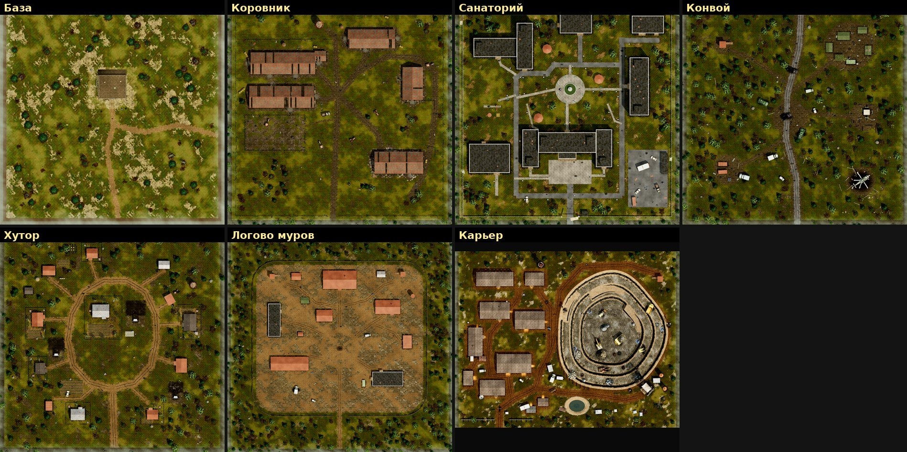
- На карте: жёлтая стрелка — герой и куда он смотрит (живая: игра под картой продолжается), зелёная точка — вход
  на локацию, мерная линейка. «Крупнее» — в 2,6 раза вокруг героя, «Вся карта» — обратно. «Закрыть» или касание
  мимо карты закрывает её. Врагов, находок и напарника на карте нет.
  
- В совместной игре сервер (`net/server_state.gd`) про карту пока не знает: покупка карты на общий маршрут —
  вместе с этапом совместных локаций.

## Управление (Android)
- Левая половина экрана — джойстик, появляется под пальцем: слегка отклонить — лёгкий бег (2 м/с), сильнее —
  быстрее, до полного бега (4.2 м/с). Быстрый бег тратит энергию; без энергии герой бежит медленнее.
- Справа внизу — круглые кнопки (значки — из присланного набора, `assets/icons/ui/`):
  - большая — **атака**: с огнестрельным оружием — выстрел (автомат и пулемёт — очередь, пока держишь), с мачете —
    удар с замахом, без оружия — удары кулаками. Герой сам доворачивается на ближайшую цель;
  - **смена оружия** (значок оружия со стрелками): основное → второй слот (пистолет или мачете) → убрать;
  - **лечение**: само выбирает бинт или аптечку (при большой потере — аптечку), число — сколько осталось;
  - **кнопка взаимодействия** появляется, только когда рядом есть с чем: у жителя, с которым можно говорить
    и торговать, — рукопожатие («Говорить»); у ящика — значок ящика («Открыть»); у предмета или рюкзака — его
    значок («Взять» / «Открыть»). Рядом ничего нет — кнопки нет. Сам предмет при этом слегка подсвечивается;
    нажать можно и прямо на него;
  - **перезарядка** — магазин из запаса патронов в инвентаре (пустой магазин перезаряжается сам при атаке);
  - **инвентарь**.
- Справа вверху — «Постройка» (поставить ящик) и «Меню» («Убрать ящик», «Стенд»).
- Каждый палец обрабатывается отдельно: можно бежать и одновременно стрелять.
- Отклик: полный бег — через 0.1–0.2 с после нажатия, остановка — за 0.1 с; центр джойстика подтягивается
  за пальцем (развернуться можно коротким движением); камера идёт за героем без отставания.
- Атака: удержание кнопки повторяет атаку в темпе оружия (и кулаки, и мачете, и одиночный огонь). Нажатие чуть
  раньше срока — пока оружие достаётся или не кончился прошлый удар — не теряется. Герой сам поворачивается
  к ближайшей цели: вплотную — для кулаков и мачете, в пределах дальности оружия — для огнестрела (только к той,
  что видно: через забор и стены цель не берётся). Под целью — красная метка.
- В игре оружие достаётся в 2.2 раза быстрее, чем на стенде, удары мачете и кулаков — в 1.3, перезарядка — в 1.25.
- На компьютере: WASD, Shift — быстрее, пробел — атака, E — действие, I — инвентарь, Q — оружие, R — перезарядка,
  H — лечение, колесо — приблизить.

## Бой
- Урон, скорострельность, магазин, патроны и дальность — в `core/world/items.gd`. Выстрел — пуля своего калибра
  вылетает из ствола и летит по прямой (без баллистики) до того, во что попадёт; урон — когда долетит. Лучей нет.
  Вид пули — по патрону (`BULLETS` в `world.gd`): длина, толщина, цвет оболочки, остроносая или тупоносая;
  у дробовика — 8 дробин. Пули крупнее настоящих и летят 62 м/с — иначе сверху их не разглядеть.
- Огонь при удержании кнопки: любое оружие стреляет подряд в своём темпе, пока в магазине есть патроны, —
  автомат и пулемёт очередью, пистолет, винтовки и дробовик выстрел за выстрелом. Отпустили кнопку — огонь
  прекращается. Магазин пуст — стрельбы нет до перезарядки: кнопка перезарядки рядом с кнопкой огня, при пустом
  магазине она красная (нажатие огня с пустым магазином тоже начинает перезарядку). Кулаки и мачете при
  удержании бьют подряд.
- Прицельное движение: пока герой стреляет (кнопка удержана или после выстрела прошло меньше полсекунды), он стоит
  лицом к цели, а идёт туда, куда ведёт джойстик. Шаг — в любую сторону относительно взгляда
  (`BCCharacter.set_dir_move`): вперёд — бег, назад — шаг назад, вбок — шаг боком, промежуточные направления —
  смесь соседних клипов; направление меняется плавно, темп шага подстраивается под скорость (ноги не скользят).
  Вперёд — до 3 м/с, боком и назад — 1.75 м/с. Не стреляет — бежит лицом по ходу.
- **Дальность и прицел.** Бой идёт в пределах экрана, как в изометрических выживалках (Last Day on Earth и
  подобных): дальность оружия — жёсткий предел, дальше него пуля не летит и урона нет. Дальность (`range` в
  `items.gd`): дробовик 6 м, пистолеты 8, MP5 9, АК-74М 11, ПКП 12, FN FAL и ВСС 13, СВД 17 (раньше было 13–48 м —
  через полкарты). На обычном приближении камеры от героя до края экрана — около 10 м вбок, 7 м вперёд и 4 м назад
  (`--as-test=screen`): пистолет и дробовик бьют ближе края экрана, автомат — до края, винтовки — чуть за край.
  Пуля гаснет через метр после предела дальности. Круг дальности не рисуется: если враг виден, но далеко, —
  подсказка сверху (см. ниже).
  Автоприцел берёт ближайшую цель **в пределах дальности и на линии огня**: деревья, забор (сплошной, 1.9 м), стены
  дома закрывают. Сначала — враги; манекен и чучела только когда врагов в досягаемости нет (раньше прицел хватал
  ближайшее чучело, и враг за ним оставался без огня). Проверка (`--as-test=inv`): цель в 14 м при АК-74М (11 м) —
  прицел её не берёт, пуля не долетает, урона нет; в 9 м — попадает.
- Огонь без цели, когда враг на экране есть: подсказка сверху — «Далеко: N м — оружие бьёт на M м. Подойдите
  ближе» или «Цель за укрытием — нет линии огня» (не чаще раза в 2.5 с).
- Кончил стрелять — оружие сразу опускается из прицела в положение «наготове».
- Стрельба не просаживает кадры: вспышка у ствола — светящееся пятно, а не источник света; попадания по одной
  мишени чаще трёх раз в секунду складываются в одну растущую цифру урона; звук гильзы в очереди — на каждый
  третий выстрел, звук попадания — не чаще восьми раз в секунду.
- Звука одышки на бегу нет.
- Перезарядка идёт движением героя (магазин, затвор) и забирает патроны нужного калибра из карманов и рюкзака.
- Мачете носится во втором слоте вместо пистолета: удар 40. Кулаки — 8 за удар.
- Манекен у базы и две мишени-чучела в поле (12 и 25 м от калитки): урон показывается цифрой; чучела на нуле
  падают и через 6 с встают.
- Здоровье 100, энергия 100, вода 100. Вода медленно убывает; без воды энергия не восстанавливается.

## Полигон и стенд 3D
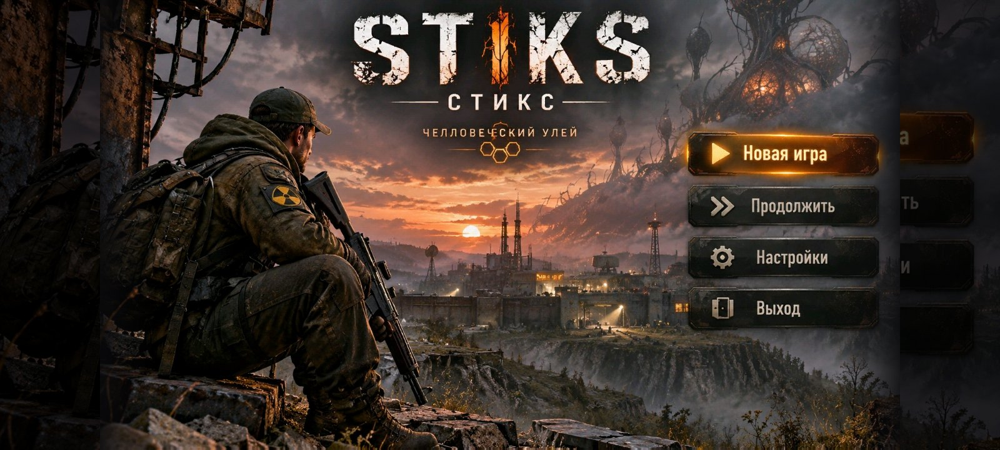
- **«Полигон»** и **«Стенд 3D»** — в главном меню: «Настройки» → «Лаборатория».
- **Полигон** — пустая площадка 10×10 м с разметкой через метр и бортом по краю (за борт не выйти ни герою, ни
  врагу). Это та же сцена `world.tscn` в режиме `ULSettings.arena`: тот же герой, управление и бой, что на
  локации. Герой сразу с АК-74М, ТТ и малым рюкзаком; в двух ящиках у борта — остальное оружие и патроны ко
  всему; в углу — манекен. В меню (шестерёнка): «Враг +» (ставит заражённого у борта подальше от героя, не
  больше шести сразу), «Убрать врагов», «Патроны» (запас к оружию в слотах), «Здоровье», «Справочник»,
  «Настройки», «Тест FPS», «3D». Погиб — заново посреди площадки, враги убраны. Полигон ничего не сохраняет.
  
- **Редактор удара** (стенд, кнопка справа «Редактор удара»): мачете — стойка, «Удар», «Сильный», «Блок»;
  ключи движения по одному («◀ ключ ▶»), каждый показывается замороженным; «−/+» двигают точку хвата (вперёд,
  вверх, вправо), наклон и поворот клинка, разворот корпуса и время ключа; «▶ Проиграть». **«Помощник ИИ»**
  (`core/melee_tuner.gd`) строит стойку и удары заново по анатомии и биомеханике рубящего удара и проверяет
  каждый ключ на скелете героя: запястье в пределах подвижности, рука дотягивается до рукояти, удар — перед
  собой; где кисть «ломается», клинок доворачивается (но не дальше, чем нужно). «Сохранить» — в
  `user://weapon_tune.json`: так мачете держится и бьёт и в игре; «Сброс» — к `data/weapons.json`.
  - Что было не так с мачете: в стойке грудь развёрнута вправо на ~35°, а положение клинка считалось от груди —
    каждый удар уходил вбок, мимо цели перед героем. Теперь холодное оружие — в системе тела (куда смотрит
    герой). Обух клинка считается по плоскости удара (замах → удар): лезвие всегда ведёт удар; раньше обух
    считался «вверх» — на замахе лезвие смотрело назад, а у вертикали клинок перекручивался на пол-оборота.
  - Правила помощника (источники — в «Источниках»): хват «молотком» (держат большой и указательный пальцы),
    рабочий удар — диагональный под 30–45° от плеча той же руки через корпус к противоположному бедру, сильный
    — сверху; в момент удара рука почти прямая, клинок вперёд-вверх (в хвате «молотком» клинок не может лечь
    вдоль руки), лезвие ведёт удар; пределы запястья: сгибание ≈ 74°, разгибание ≈ 66°, к мизинцу ≈ 28°, к
    большому пальцу ≈ 19° (в помощнике — с запасом, внутри пределов IK).
- **Стенд 3D** (`stand.tscn`) — персонаж крупным планом, список движений, камера пальцем. Теперь на нём
  переключается, кого смотреть: «Герой» или «Заражённый» (`ULSettings.stand_who`; виды берутся из
  `ULEnemy.KINDS`, новый враг появится в списке сам). Враг показан той же моделью и теми же клипами, что в игре:
  стоит, бродит, бежит, бьёт, попадание, гибель и тело, подъём и ещё три движения; сверху — его числа (прочность,
  удар, скорости, как видит и слышит). «Назад» ведёт туда, откуда пришли: в главное меню, на локацию или на
  полигон.
  
- Кнопки проверки на локации и полигоне (ряд под шестерёнкой) растут влево: раньше длинный ряд уходил за правый
  край экрана.

## Ресурсы и торговля

- Пять ресурсов — спораны, горошина, чёрная, красная и белая жемчужины (`ULItems.MONEY`) — это валюта. Они не
  лежат в ячейках, а копятся в кошельке (`ULInventory.wallet`): сколько ни собери, складываются в одно число.
  Взял с тела («Взять всё» или по одному) — сразу в кошелёк. Кошелёк сохраняется вместе с инвентарём; ресурсы из
  старого сохранения, лежавшие в ячейках, при загрузке переходят в кошелёк.
- Окошко «Ресурсы» — в инвентаре под героем и в окне ящика или обыска под карманами: значок и количество каждого
  ресурса (чего нет — значок тусклый); нажатие показывает название.
- **Магазин оружейника** («Говорить» → «Торговать»). Три раздела: «Оружие», «Патроны», «Припасы и снаряжение»
  (бинты, аптечки, еда, вода, рюкзаки). Товар — карточками; нажатие выбирает, справа — карточка товара: картинка,
  описание, у оружия — урон, магазин, темп, дальность и прочность, сколько такого уже есть, цена и «Купить».
  **У оружия тут же — патроны к нему** с ценой и кнопкой «Купить патроны» (и сколько их уже при себе): не надо
  искать калибр в другом разделе. Купленное оружие встаёт в свободный слот, остальное — в карманы и рюкзак.
  Не хватает ресурсов или нет места — покупки нет, ничего не списывается (цена красная, кнопка тусклая).
  Товар и цены — `data/shop.json` (с 23.11; раньше — `SHOP` в `world.gd`). Цены подняты и выстроены по силе
  оружия (указание пользователя 23.11), числа — предложение: ТТ 15 споранов, мачете 20, Beretta 30, MP5 80,
  SPAS-12 110, АК-74М 150, ВСС 190, FN FAL 220, СВД — 20 горошин, ПКП — 28 (сначала было 30 и 45 — пользователь: «сильно дорого»); патроны 1–4 спорана за пачку (как
  были); бинт 2, аптечка 8, живчик 3, малый рюкзак 15 споранов, средний — 4 горошины, большой — 8. Полный ремонт
  (`fix` в `items.gd`) — около пятой части цены: ТТ 6, АК 30, СВД 40, ПКП 56 споранов. Курсы обмена и добыча с
  тел не менялись (1 горошина = 10 споранов). Прежние цены: АК 40 (одна вылазка), СВД — 2 горошины (дешевле АК). Продажи вещей оружейнику пока нет.
  
- **Прочность оружия** — сколько выстрелов (у мачете — ударов) оно выдержит до ремонта: ТТ 300, Beretta 400,
  мачете 400, SPAS-12 400, СВД 500, ВСС 500, FN FAL 700, MP5 800, АК-74М 1000, ПКП 1500 (`dur` в `items.gd`).
  Каждый выстрел и удар снимает единицу; осталось 10 % — предупреждение. Видно в инвентаре: полоска по низу ячейки
  (зелёная → жёлтая → красная) и строка в карточке «прочность 143 из 300 выстрелов». На нуле оружие **сломано**:
  остаётся в слоте с патронами, на ячейке — «СЛОМАНО», но не стреляет и не рубит.
- **Ремонт — у оружейника** («Говорить» → «Торговать» → «Ремонт»): всё изношенное оружие героя (в слотах, карманах,
  рюкзаке) с прочностью и ценой; «Починить» — до полной прочности, «Починить всё». Платите спорами только за
  изношенную часть: полный ремонт ТТ — 6, мачете — 4, Beretta — 8, MP5 — 12, SPAS-12 — 14, АК-74М — 18, ВСС — 22,
  FN FAL — 24, СВД — 30, ПКП — 40 (`fix` в `items.gd`); ТТ на 150 из 300 — 3 спорана. Пока оружейник не куплен,
  чинить негде.
  
  

## Хлам и барахольщик (`junk` в `items.gd`, `sell_junk` в `world.gd`, `junk_price` в `data/base_shop.json`)
- **Хлам** — новый ресурс: кучки (модель Tripo `ul_junk` — ржавые детали, болты, провода, обломок платы) лежат
  в постройках временных кластеров: в «Опасном коровнике» — по 2–4 в каждой постройке, каждый вход заново
  (`_spawn_junk`; новые локации с постройками зовут то же). Подобрал — «Хлам» в кармане, кучки складываются в
  одну стопку (до 50 в ячейке). Погиб или кластер перезагрузился — хлам при себе теряется, как остальное.
- **Барахольщик Кузьмич** стоит у крыльца дома, слева от входа (у него ящик и кучки хлама). Своя модель Tripo со
  скелетом (`assets/models/dealer.glb`: бородатый старик в стёганке и вязаной шапке, с сумкой железок); движения —
  героя, переносятся на его скелет. «Говорить» →
  «Продать хлам (N)» — продаётся весь хлам при себе: **одна кучка — один споран**.
- **Торговля у барахольщика** (`core/world/dealer.gd` — правила, `dealer_ui.gd` — окно, `dealer` в
  `data/base_shop.json`): «Говорить» → «Торговать» — окно во весь экран. Сверху — пять ресурсов и «✕»; вкладки
  **«Продать»** и **«Купить»**; слева — витрина карточек (значок, название, сколько, цена; тянется пальцем), справа —
  выбранный предмет: описание, категория и редкость, масса, стопка, цена за штуку, количество (−, +, «Всё» /
  «Макс.»), «Вы получите» / «Стоимость», остаток ресурсов после сделки, большая кнопка «ПРОДАТЬ ×N» / «КУПИТЬ ×N».
  - Продать: всё из карманов и рюкзака, у чего в каталоге есть цена — хлам, минералы, технический хлам,
    инструменты, запчасти (фильтр: все / хлам / минералы / запчасти / инструменты), по базовой цене за штуку
    (руда — 2 спорана, редкий минерал — горошина…). Снизу — «Продать весь хлам: N → N споранов».
  - Купить: свой товар (вода, сухари, тушёнка, бинты, «Живчик», патроны 7,62×25 и 12 калибра лотами, малый
    рюкзак, мачете, ТТ — сколько и почём, в `dealer.stock`) и **выкуп**: сданное вами — в 2 раза дороже
    (`buy_k`). Запас — на период маршрутов: при сбросе (каждые 2 часа) пополняется, выкуп обнуляется.
  - Не хватает ресурсов или места — кнопка серая, причина красным, ничего не списано; после сделки кнопка на
    полсекунды выключена — двойное касание не проведёт сделку дважды. Запас и выкуп — в `user://base.json`.
   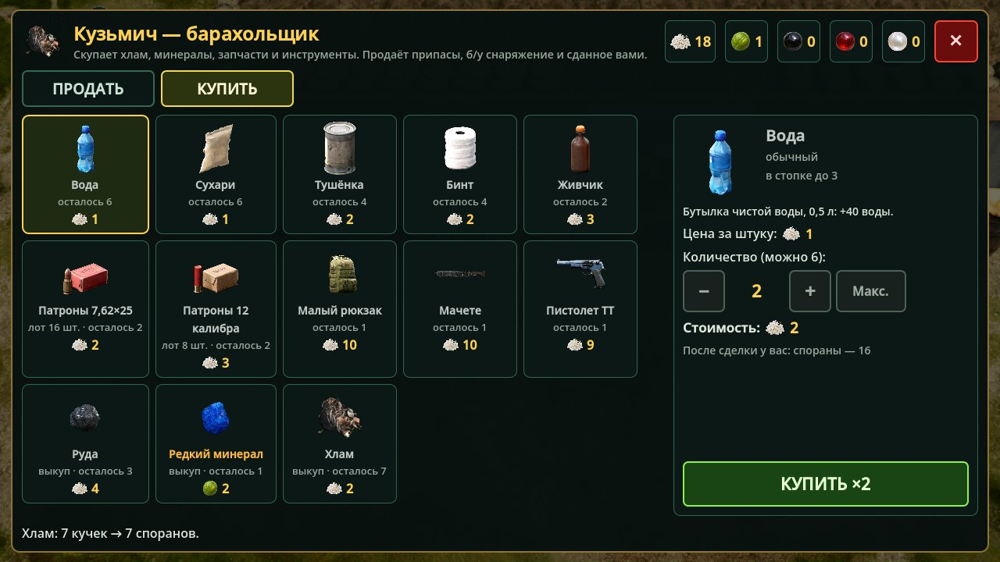
  Проверка: `--as-test=dl` — 15 пунктов.

## Базовый компьютер (`core/world/base_pc.gd`, `base_state.gd`, `economy.gd`, `data/base_shop.json`)

- Компьютер (модель Tripo `ul_computer`: металлический стол, старый ЭЛТ-монитор, клавиатура, системный блок) — в
  сенях у правой стены, между входной дверью и дверью в кладовую. Подойти — «Открыть». Экран во весь экран
  по макету: сверху — название и **пять ресурсов** (те же значки и тот же кошелёк, что в инвентаре; добыча, покупки
  и обмен сразу меняют числа), справа вверху — крест «закрыть». Слева — **улучшения базы**, справа — **маршруты**,
  снизу — **обмен ресурсов**; всё видно одновременно. Вкладки под шапкой только подсвечивают свой раздел.
  На маленьком экране середина прокручивается, нижняя полоса и рамка не уезжают.
- **Оружейник** — 50 споранов (указание пользователя 23.11: постройка за стартовый запас; до этого — 2 горошины, просьба 22.11: стартовых 50 споранов хватает — 1 горошина = 10 споранов в «Обмене»). До покупки его на базе нет (и торговли тоже). «Купить и установить»:
  не хватает — окно с недостачей («не хватает: 20 горошин»), ничего не списано; хватает — подтверждение, списание,
  оружейник встаёт за прилавок, кнопка становится «УСТАНОВЛЕНО». Повторно не купить. Ниже — «В доработке».
- **Хранилище** — 6 уровней, на каждом +1 сейф на 30 ячеек (до 180). Карточка: «Ур. N / 6», «Сейфов: N ·
  Общая вместимость: N ячеек»; на 0 — «КУПИТЬ И УСТАНОВИТЬ ЗА 50 СПОРАНОВ», дальше — «УЛУЧШИТЬ ЗА 50 СПОРАНОВ» и строка
  следующего уровня, на 6 — неактивная «МАКСИМАЛЬНЫЙ УРОВЕНЬ — 6/6». Нехватка и подтверждение — как у оружейника.
  Цена, число уровней и ячеек — `upgrades.storage` в `data/base_shop.json`. Подробно — раздел «Хранилище» ниже.
- **Маршруты** (цены подняты в полтора раза 19.11): «Опасный коровник» — 15 споранов, «Хутор» — 27, «Санаторий Луч» и
  «Карьер» — 38, «Разбитый конвой» — 53, «Логово муров» — 75, на одно посещение.
  Пока маршрут куплен или идёт посещение, повторно не купить. **Компьютер предлагает 3 локации сразу, все разные**
  (`route_slots`): случайно из всех готовых, без повторов; **каждые 2 часа — сброс** (`route_refresh_h`): новый
  набор, и если локаций больше трёх, он не повторяет прошлый целиком (сейчас локаций ровно три — все три всегда в
  наборе; с хутором их четыре — набор из трёх, при сбросе хотя бы одна новая). **Пройденная локация (посещение
  окончено: ушёл, погиб, время вышло или игру закрыли) до следующего сброса из компьютера пропадает** и не
  покупается — вместо карточки строка «Пройдено, маршрут снова — после сброса: «…»» (`done` в `user://base.json`);
  после сброса снова доступна, если попала в новый набор. Новая локация, которую игрок ещё не
  видел в компьютере, сразу попадает в набор (вместо случайной некупленной). Купленный, но ещё не пройденный маршрут сброс переживает: остаётся на карте и в компьютере. Купить можно
  только из текущего набора. Сохранение с повтором или с исчезнувшей локацией исправляется само; локация,
  добавленная обновлением игры, попадает в набор сразу, если в нём есть место. «Новые маршруты через ЧЧ:ММ:СС» —
  срок хранится в `user://base.json` (unix-время), идёт и при закрытой игре, не сбрасывается при открытии
  компьютера. На глобальной карте после покупки: коровник — справа выше дома, санаторий — слева выше, конвой —
  ниже, хутор — слева ниже. Три карточки помещаются без прокрутки (плотный вид: без описания, характеристики в три колонки, цена и
  кнопка — рядом с ними).
- **Карта локации** (`ULBase.map_price`, `buy_route(…, with_map)`, `buy_map`, `has_map`) — продаётся вместе с
  маршрутом за **треть его цены сверху** (до целого, не меньше 1): коровник 15 + 5, хутор 27 + 9, санаторий и
  карьер 38 + 13, конвой 53 + 18, логово 75 + 25 споранов. В окне покупки маршрута — три кнопки: «Отмена», «Без
  карты», «С картой — N» (если на оба не хватает, вариант с картой неактивен и написано, сколько не хватает; платёж
  один — либо оба, либо ничего). Маршрут куплен без карты — на его карточке кнопка «Карта — N»: докупить можно, пока
  маршрут не использован. Карта действует вместе с маршрутом, на одно посещение: посещение окончено — карты нет.
  На карточке — строка «Карта +N» / «Карта куплена».
  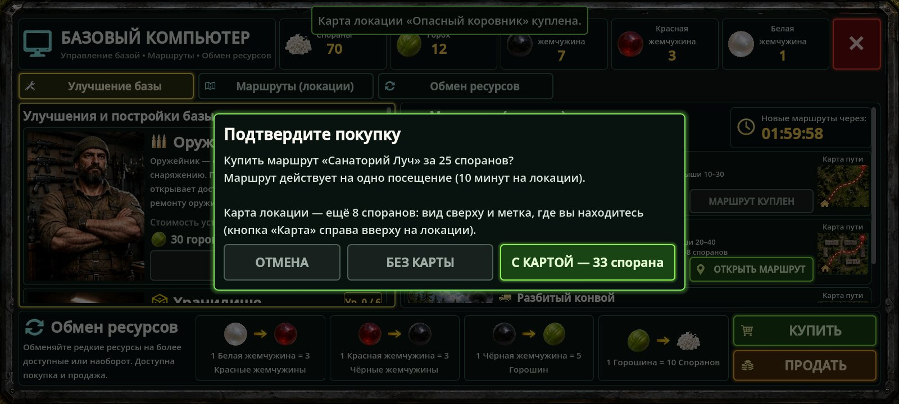
- **Обмен ресурсов**: белая ⇄ красная ⇄ чёрная жемчужина ⇄ горох ⇄ спораны, только соседние, в обе стороны по
  одному курсу (1 белая = 3 красные, 1 красная = 3 чёрные, 1 чёрная = 5 горошин, 1 горошина = 10 споранов —
  предварительные, из макета; `exchange` в `data/base_shop.json`). Четыре карточки и кнопки «Купить» / «Продать»
  открывают окно обмена: вкладки, «Отдаёте» / «Получаете» (второй ресурс пары подбирается сам), количество (−, +,
  поле только для цифр, «Максимум»), расчёт («Вы получите: 3 горошины · Стоимость: 30 споранов»), остаток после
  сделки, предупреждение о нехватке, «Подтвердить обмен». Сделка — целиком или никак (`ULEconomy.exchange`), без
  дробей и минуса; после неё кнопка на полсекунды выключена — двойное касание не спишет дважды.
  
- Сохранение: кошелёк — в сохранении героя, база (оружейник, маршруты, срок обновления) — в `user://base.json`;
  оба пишутся через временный файл (обрыв посреди записи не портит сохранение). Новая игра в меню стирает и базу.
- На старте новой игры — 15 споранов (`start_wallet`, столько стоит самый дешёвый маршрут): хватает на первый.
- Картинки и значки экрана вырезаны из макета пользователя: `tools/ui_src/pc_assets.py` (макеты лежат рядом).

## «Опасный коровник» — временный нестабильный кластер (`core/world/cowshed.gd`, `data/cowshed.json`)
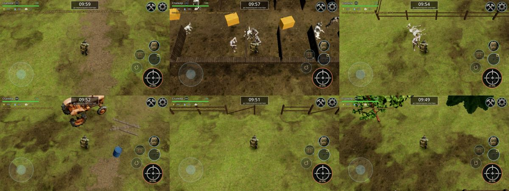
- 150×150 м, расставлен по эталону пользователя: вход снизу по центру, слева два длинных коровника и загон под
  ними, сверху водонапорная башня с баками и пристройка, справа ещё три коровника, между ними — дороги с колеями,
  техника, сено, хлам; по краю — деревянный забор с проломами, за ним лес. Постоянная часть одна и та же при
  каждом посещении (координаты — константы в начале `cowshed.gd`).
- **Постройки** (`core/world/farm_building.gd`, `ULFarmBuilding`) собираются из деталей, как настоящие: бетонный
  цоколь, кирпич до 1,1 м, выше — серые доски, столбы и обвязка из бруса, окна с рамами и выбитыми стёклами,
  большие ворота (створка распахнута, прикрыта, висит или сорвана), фронтоны, фермы под крышей, кровля из листов
  профнастила с ржавчиной и дырами, пролом в стене с кучей кирпича. Внутри: бетонный пол в навозе, стойла с
  жердями, кормушки, сено (в пристройке — верстак и полки, в малом коровнике — корма). Материал — текстура по
  мировым координатам, к земле стена темнее и грязнее, пятна и мох. **Во все можно зайти**; герой внутри — крыша и
  стена со стороны камеры плавно растворяются (точечный узор, без прозрачности), вышел — проявляются. Столкновения —
  коробки стен (и под окнами), перегородки, кормушки; проёмы свободны.
- **Земля** — тот же шейдер, что на базе, слоями со смешиванием «по высоте»: трава (оливковая, с выгоревшими
  пятнами), лесная подстилка под деревьями, сырая грязь у построек, ворот и в загоне (скот вытоптал), накатанные
  дороги из утоптанной земли. Поверх — **колеи** по всем дорогам (две продавленные полосы сырой грязи, местами
  вода), **гравий** у ворот, **лужи** в колеях, у ворот и в загоне (мутная вода с отсветом неба и рябью).
  Карта слоёв `assets/world/tex/cowshed_mask.png` и карта проходимости `assets/world/nav_cowshed.res` строятся
  `--as-test=csbake`.
- **Растительность** (`core/world/vegetation.gd`, `ULVegetation`): пучки — спрайты, снятые с моделей растений
  Poly Haven (CC0) инструментом `tools/impostor.gd` и собранные в атласы `tools/veg_src/veg_atlas.py`. Злаки — по
  траве карты земли, цвет от приглушённо-зелёного до сухого жёлтого крупными пятнами, высота 0,25–0,7 м; на дорогах
  и во дворах почти нет. Сорняки — у стен построек, крапива — вдоль заборов, одуванчики и цветущий щавель — редкими
  куртинами, кусты — у забора. Все пучки участка 15×15 м — одна сетка; дальше дальности прорисовки не рисуются.
- **Заборы**: столбы разной высоты, три жерди; пролёты целые, покосившиеся, сломанные (жердь висит), пустые.
  **Деревья**: рощи (ели, сосны, дубы, берёзы, сухие; часть — молодые), лес за забором; деревья, закрывающие героя
  от камеры, растворяются. **Предметы**: водонапорная башня, ржавые баки с лестницей, техника — модели Tripo:
  тракторы, трактор с прицепом, зелёный грузовик с деревянным кузовом, деревянные телеги; круглые тюки сена, ящики, бочки, покрышки, ободья, вёдра (Poly Haven, CC0),
  ржавые листы, доски.
- **Свет**: пасмурно-приглушённый день, цвета спокойнее, лёгкая дымка; **мягкие тени** от построек, деревьев и
  техники на «Средней» и «Высокой» графике (до 38 м от камеры, атлас 2048, на телефоне 1024); на «Низкой» — без
  теней, как на базе.
- Каждое посещение заново: ~20 останков коров (скелеты на боку, черепа с костями, туши — модели Tripo, без живых
  коров) — на местах с эталона со сдвигом и поворотом и случайно: в коровниках, у заборов, в поле; **пустышей
  10–30 и лоторейщиков 3–8** (`pustysh`, `lottery`). Места врагов: в постройках, во дворах между ними, у останков
  коров, в рощах и у заборов; каждая точка проверяется по карте проходимости, не ближе 28 м к входу, не вплотную
  друг к другу. Убитые за посещение не возвращаются; тела обыскиваются как обычно. Коровы — только обстановка.
- **10 минут** (таймер сверху посередине): за 5 и 2 минуты — предупреждение и сигнал, за 30 с — красный мигающий
  таймер и сирена. На нуле кластер перезагружается: герой погибает, **всё, что при себе, теряется**, вещи на базе
  целы; маршрут закрыт, коровник пропадает с карты, герой — дома с запиской. Погиб от врагов — так же
  (`lose_on_death`, `lose_wallet` — настраиваются). Ушёл за край поля (5 с) — посещение окончено с добычей.
  В коровнике нет «Карты», «3D», ящиков; «Главное меню» — уход с добычей.
- Карта мира: метка коровника из макета — справа выше дома, только пока маршрут куплен; панель слева внизу.
  
- Нагрузка: стены, жерди, доски, хлам склеены в несколько сеток на постройку (а не сотни деталей), растения —
  сетками по участкам, у деревьев и предметов — дальность прорисовки; враги: ближе 8 м — всё, 8–18 м — движения
  через кадр, дальше — без движений тела, думают раз в 4 кадра. Частота кадров и память **на телефоне здесь не
  измерялись** (телефона в этой среде нет) — «Тест FPS» в меню игры.
- Источники: текстуры и модели предметов — Poly Haven (CC0): brick_4, wood_planks_grey, brown_planks_03,
  wood_planks_dirt, corrugated_iron_02, rusty_corrugated_iron, damaged_concrete_floor, brown_mud_02, dirt,
  gravel_floor_02, sparse_grass, grass_ground, mud_forest, leafy_grass; модели растений для спрайтов; ящик, бочка,
  покрышка, обод, ведро. ambientCG доступен, но не понадобился. Fab и Textures.com не использовались (нужна учётная
  запись).

## «Санаторий Луч» — временный нестабильный кластер (`core/world/sanatorium.gd`, `block_building.gd`, `door.gd`, `data/sanatorium.json`)

- 150×150 м, расставлен по утверждённой карте пользователя: ворота с проходной и аркой «САНАТОРИЙ «ЛУЧ»» посередине
  южной ограды, от них аллея к **главному корпусу** (портик с шестью колоннами в два этажа), за ним — **площадь с
  фонтаном**, скамейками и беседками; слева вверху — **лечебный корпус** (Г-образный, два блока), сверху —
  **котельная** с кирпичной трубой и цистерной и **хозблок**, справа — **жилой корпус** в четыре этажа, слева внизу —
  **столовая с клубом**, справа внизу — **хоздвор** с автобусом, грузовиком, легковушками и гаражами; детская
  площадка, фонари (часть погнута), асфальтовые дороги и плиточные дорожки с выкрошенными краями и мхом в трещинах,
  лужи, бетонная ограда с проломами, рощи внутри и лес за оградой. Постоянная часть одна и та же при каждом
  посещении (координаты — константы в начале `sanatorium.gd`).
- **Корпуса** (`ULBlock`) — из одного или нескольких блоков; **во все можно зайти и подняться на каждый этаж**.
  Коридорный блок: коридор вдоль длинной оси, комнаты по обе стороны (по 1–2 окна, перегородки — между окнами,
  поэтому ряды окон на фасаде ровные), вестибюль у входа, лестничные клетки в торцах (марши «туда-обратно» по
  сторонам клетки, в перекрытии — проём над маршем, вокруг — перила). Зальный блок: большой зал и ряд комнат вдоль
  одной стены. Блоки одного корпуса соединены сквозными проёмами (главный корпус — центр и два крыла, лечебный —
  два блока). Этажи: главный — 3 (крылья — 2), лечебный — 2 и 3, жилой — 4, столовая, котельная, хозблок — по 1.
  Всего 232 помещения, 176 дверей, 437 тайников.
- **Что внутри**: вестибюль с регистратурой и скамейками; кабинеты (стол, шкаф, стеллаж, доска объявлений),
  комнаты персонала (шкафчики, стол со стульями, диван), архивы и подсобки (стеллажи с коробками, ящики), туалеты
  с кабинками; в лечебном — палаты (2–4 койки с тумбочками, медицинский шкаф, раковина), процедурные (кушетка,
  стойка капельницы), сестринские, каталки в коридорах; в жилом — номера (две кровати, тумбочка, шкаф, свой санузел
  в плитке), бельевые, холлы этажей с диванами и телевизором; столовая — столы на четверых рядами, раздача, кухня
  (плиты, кухонные шкафы, мойки), холодильная камера, кладовая, клуб с бильярдом и пианино; котельная — три котла,
  трубы, щиты, верстак; хозблок — склад со стеллажами рядами, мастерская с верстаками. Сор: листы бумаги,
  опрокинутые стулья, чемоданы, засохшая кровь в коридорах и палатах — следы недавней гибели людей (каждый вход
  по-новому).
- **Двери** открываются, когда к ним подходит герой или гонящийся враг; закрытая — преграда для героя, врагов и
  пуль. Карта проходимости строится без дверей (путь идёт через проём). Входы — двустворчатые, с козырьком и
  ступенями. Окна — рамы и тёмное стекло (часть выбита, часть заколочена).
- **Вид внутри**: герой вошёл — крыша и все этажи выше скрыты, на его этаже стены изнутри и фасад со стороны камеры
  срезаны на высоте 1,2 м (видно комнаты и врагов в них), ниже его этажа — только фасады. Переход между этажами —
  с запасом на лестнице (не мигает). Вне корпуса за высоким зданием вокруг героя «окно» — стены и крыша между ним
  и камерой растворяются кругом. Внутренности не освещает солнце (свой слой отрисовки): ровный рассеянный свет из
  окон и **две лампы без теней** у ближайших к герою светильников (одна мигает) — на телефоне каждый источник
  света дорог.
- **Земля**: газоны, вытоптанная земля у дорожек и стен, подстилка в рощах (карта слоёв
  `assets/world/tex/sanatorium_mask.png`), сверху асфальт и плитка. Карта проходимости с этажами и лестницами —
  `assets/world/nav_sanatorium.res` (сетка 15 см: двери узкие). Обе строятся `--as-test=snbake`.
- **Готовые корпуса** (`assets/world/sanatorium_blocks.res`, `ULBlockCache`, 2,4 МБ): сетки, двери, комнаты,
  тайники, места врагов, столкновения и карта расстояний до дорог и корпусов (по ней расставляются растения).
  Пишутся тем же `--as-test=snbake`; при входе корпуса не строятся, а загружаются. Подпись кэша — описания
  корпусов и `ULBlock.GEN_V`: после правки генератора корпусов нужно поднять `GEN_V` и снова запустить `snbake`
  (иначе кэш не возьмётся и корпуса соберутся заново — медленнее); проверка `sn` сверяет кэш со свежей сборкой.
  Столкновения копятся в теле вне сцены и попадают в мир одним разом (раньше каждая из 2700 коробок
  пересобирала всё тело). Сборка локации на компьютере: было 5,5 с, стало 0,4 с (корпуса 0,1 с, растения 0,17 с).
- **Враги** — каждое посещение заново: **пустышей 20–40, лоторейщиков 5–15** (`pustysh`, `lottery`) и
  **0–2 Рубера** (см. «Враги и добыча»). Где —
  зоны с весами (`zones_pustysh`, `zones_lottery`): пустыши — двор и площадь, у ограды и в зарослях, жилой корпус,
  палаты, столовая, коридоры главного; лоторейщики — дальние коридоры (дальше 14 м от входов), лечебный корпус,
  подсобки, котельная и двор у неё, заросли. Каждая точка проверяется по карте проходимости (не в стене, не в
  мебели, на своём этаже), не ближе 25 м к воротам, не вплотную друг к другу; часть стоит, часть бродит (в комнате —
  в её пределах). Убитые за посещение не возвращаются.
- **Враги в корпусах**: идут к герою по карте проходимости — через двери (толкают закрытые), по коридорам и
  лестницам на другие этажи; через перекрытие не бьют и не «видят» (луч упирается в плиту), с другого этажа не
  атакуют. Враги в скрытых частях корпусов не рисуются.
- **Тайники**: медицинские шкафы, тумбочки, шкафчики персонала, письменные столы, стеллажи и хозяйственные ящики,
  кухонные шкафы, стойка регистратуры, верстаки. Подойти — светящаяся рамка и «Обыскать», окно — то же, что у
  ящика и тела. Содержимое — каждый вход заново по таблицам `loot` (бинты, аптечки, «живчик», еда, вода, патроны
  ТТ и 9×19, спораны, редко горошина и малый рюкзак, хлам); часть тайников пустая (`empty_chance`). Хлам кучками —
  в комнатах всех корпусов (3–6 на корпус).
- **Время** — 10 минут (`minutes`, можно увеличить для крупного комплекса), всё остальное — как в коровнике:
  предупреждения, тревога, на нуле гибель с потерей всего, что при себе; ушёл через ворота за край — с добычей;
  маршрут закрывается, санаторий пропадает с карты.
- **Компьютер базы**: карточка по макету пользователя — снимок, описание, размер, время, число врагов, «Карта
  пути», «Открыть маршрут», **38 споранов** (было 25 по макету; поднято 19.11). После покупки санаторий — на карте мира слева выше
  дома (метка из макета карты).
- Нагрузка: снаружи каждый блок рисуется несколькими общими сетками (по материалу), внутренности — только этажа
  героя; мебель склеена в сетки этажа; враги — те же ступени, что в коровнике (ближе 18 м — полностью, дальше —
  упрощённо, дальше 80 м спокойные стоят). Модели Tripo: автобус и легковушка (50 кредитов). Частота кадров
  **на телефоне здесь не измерялась** (телефона в этой среде нет) — «Тест FPS» в меню игры.
- Источники текстур — Poly Haven (CC0): rectangular_facade_tiles, worn_plaster_wall, peeling_painted_wall,
  old_linoleum_flooring_01, worn_tile_floor, dirty_tiles, long_white_tiles, herringbone_parquet,
  concrete_floor_worn_001, overgrown_concrete_pavers, worn_asphalt, rusty_metal_02.

## «Разбитый конвой» — временный нестабильный кластер (`core/world/convoy.gd`, `block_building.gd`, `data/convoy.json`)
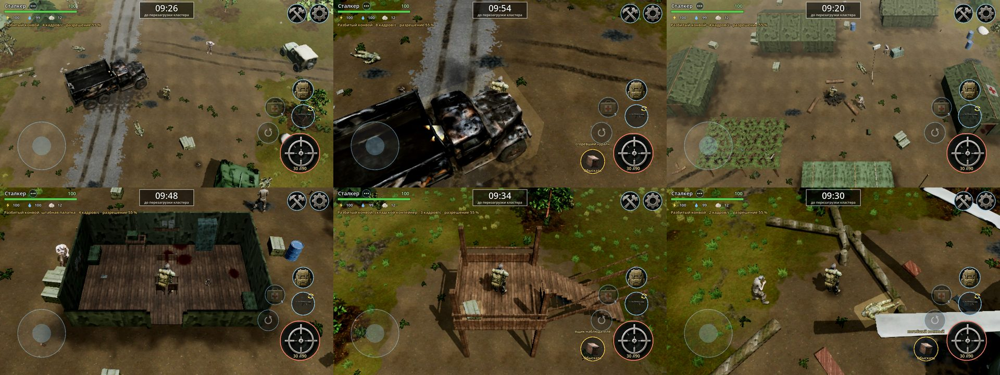
- 150×150 м, по картам пользователя: **лесная дорога** с юга на север (вход и выход — снизу), посередине —
  **место гибели колонны**, справа вверху — **военный лагерь**, справа — **блокпост**, слева внизу — **склад
  снабжения**, слева вверху — **смотровая вышка**, справа внизу — **место падения Ми-8**, вокруг — лес, камни,
  поваленные стволы. Постоянная часть одна и та же при каждом посещении (координаты — константы в начале
  `convoy.gd`); `ULConvoy` наследует `ULSanatorium` — этаж героя, двери, свет, тайники, враги по зонам и Рубер общие.
- **Техника** — отдельные модели Tripo, каждая со своим столкновением: «Урал» целый — 1, сгоревших «Уралов» — 2,
  БТР-80 — 2, ГАЗ-66 — 1, УАЗ — 2, грузовик снабжения с кунгом — 1, Ми-8 — 1. Над сгоревшей техникой — огонь и дым
  (несколько плоскостей и частицы на процессоре, без источников света). Колеи, остатки асфальта, воронки, гильзы,
  каски, бумаги.
- **Куда можно зайти** (все — `ULBlock`, стили `tent` и `box`): **штабная палатка** 8×5 м (стол командира со
  стульями, карты на стене и столе, радиостанция, металлический шкаф, ящики с документами), **медицинская** 6×4 м
  с красным крестом (раскладушки, столики, медицинские шкафчики, ящики, сумки), **две жилые** 6×4 м (раскладушки,
  вещмешки, тумбочки, стол); вход — откинутый полог. **Командный кунг** и **сторожевой пост** — с дверью (открывается,
  когда подходит герой или гонящийся враг), **складской контейнер** — с распахнутыми створками. Герой вошёл —
  крыша палатки (кунга, поста, контейнера) скрывается, стена со стороны камеры срезается; вышел — всё на месте.
  Внутри — свет без теней (как в санатории).
- **Смотровая вышка**: площадка на высоте 3,3 м, наверх ведут пологие сходни (ходят и герой, и враги — они в карте
  проходимости); герой наверху — навес скрыт; там же ящик наблюдателя. Второй контейнер на складе, навес из
  маскировочной сети, мачта с прожектором, костёр, генератор, бетонные блоки, мешки с песком, ежи — обстановка.
- **Тайники** (53): в помещениях — шкафы, столы, тумбочки, армейские ящики, вещмешки, медицинские сумки; снаружи —
  **техника** (кузов и кабина грузовиков, БТР, УАЗы, сгоревшие «Уралы», грузовой отсек Ми-8), **тела военных**
  (8 из 11 можно обыскать), штабеля армейских ящиков, бочки с топливом. Подойти — подсветка и «Обыскать», окно —
  общее. Содержимое — каждый вход заново по таблицам `loot` в `data/convoy.json`: **патроны** всех калибров,
  бинты, аптечки, «живчик», консервы, сухари, вода, изредка малый рюкзак, **хлам**, редко оружие — только то, что уже есть в
  игре (АК-74М, MP5, ТТ, Beretta, SPAS-12, СВД, ПКП, мачете). Топливо, инструменты и запчасти в игре — это
  **хлам** для барахольщика (отдельных предметов для них нет). Спораны и горох — только с заражённых, чёрная
  жемчужина — только с Рубера (15 %). Хлам кучками — у каждой машины (1–2) и в помещениях.
- **Враги** — каждое посещение заново: **пустышей 15–35, лоторейщиков 3–10, Рубер — 0 или 1** (`ruber_chances`:
  65 % без него, 35 % с ним), всего 18–46. Зоны с весами (`zones_pustysh`, `zones_lottery`, `zones_ruber`): дорога у
  техники, лагерь, лес, склад, блокпост, вертолёт, вышка, палатки. Каждая точка — по карте проходимости и с
  проверкой формой тела (не в технике, ящиках, дереве), не ближе 24 м ко входу (Рубер — 40 м). Враги заходят в
  палатки и помещения, поднимаются на вышку.
- **Время** — 10 минут (`minutes`), правила — как в других временных кластерах: предупреждения, тревога, на нуле
  гибель с потерей всего при себе, уход по дороге за южный край — с добычей, маршрут закрывается.
- **Компьютер базы**: карточка «Разбитый конвой» — снимок, описание, 150×150 м, 10 минут, угрозы (пустыши,
  лоторейщики, Руберы 0–1), **53 спорана**. После покупки — на карте мира **ниже дома**, метка-грузовик.
- **Готовая сборка**: палатки и помещения — `assets/world/convoy_blocks.res`, карта проходимости —
  `nav_convoy.res`, карта слоёв земли — `tex/convoy_mask.png`; всё пишет `--as-test=cvbake`. Сборка локации на
  компьютере — 0,3 с.
- Модели Tripo (9): «Урал», сгоревший «Урал», БТР-80, ГАЗ-66, УАЗ, Ми-8, грузовик с кунгом, тело военного, армейский
  ящик (по 2–9 тыс. треугольников); текстуры — не больше 1024 (нормали и шероховатость — 512). Нагрузка при 46
  врагах — см. «Проверка».
  Частота кадров **на телефоне здесь не измерялась** (телефона в этой среде нет) — «Тест FPS» в меню игры.

## «Хутор» — временный нестабильный кластер (`core/world/khutor.gd`, `block_building.gd`, `data/khutor.json`)
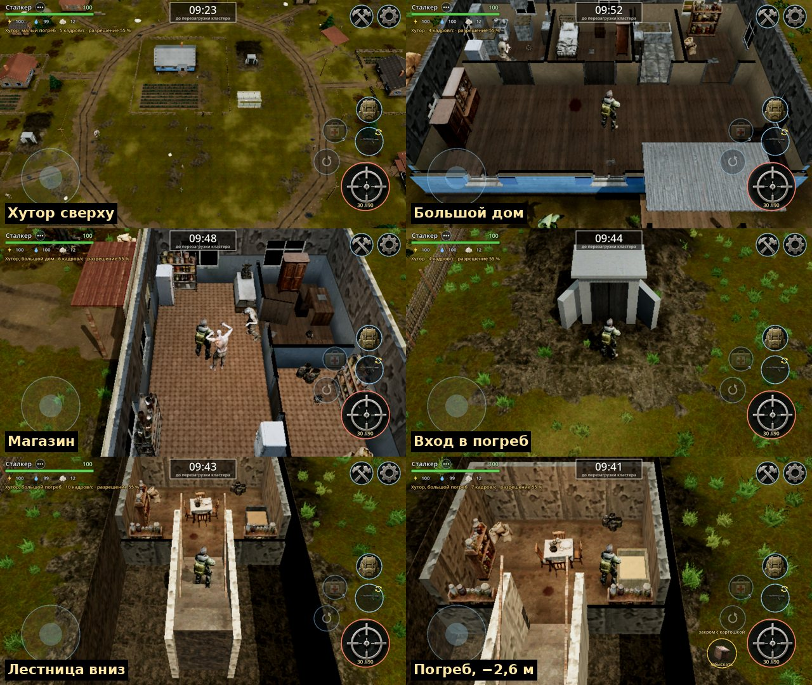

- Поле 150×150 м, вход с юга (`K_ENTRY`), по картинке задания: улица-петля с домами, магазин, сараи и гараж,
  огороды и теплица, колодец, водонапорная башня, пасека, заборы и калитки, фруктовые деревья, лес по краю, техника
  (трактор, легковушка, прицеп, телега — отдельными моделями, непроходимы).
- **Постройки проходимые, с комнатами** (генератор корпусов `ULBlock`, стиль `wood`: дощатые стены разных цветов,
  ставни, двускатные крыши из жести и дранки, крыльцо): 7 домов — малые 7×6, средние 9×7, большие 11×8 (общая
  комната с прихожей, кухня, спальня, кладовая, санузел); магазин 9×7 с вывеской «МАГАЗИН» (зал с прилавком, полками
  и холодильниками, подсобка, склад); 2 сарая, хозпостройка и гараж с машиной. Двери настоящие (закрыты — преграда,
  герой подошёл — открываются), крыша скрывается, когда герой внутри, стены со стороны камеры срезаются.
- **Мебель — модели Tripo** (15 новых, список и расход — в `tools/tripo/budget.md`): холодильник, плита, шкаф,
  буфет, полка с закатками, железная кровать, бидоны, мешки с картошкой, стол со стульями, прилавок с весами, полка
  магазина; снаружи — колодец, ульи, поленницы, уличные туалеты. В постройку модель ставится лицом в комнату
  (`MODEL_FACE`), вписывается в своё место у стены; столкновение и тайник — по этому месту. Проходы у всех дверей
  свободны (проверка: весь пол каждой постройки достижим от входной двери).
- **Подвалы — подземные здания** (3 шт.: «Большой подвал» 12×9 м, «Подвал» 10×7, «Погреб» 9×6; пол на −2,6 м):
  зал у входа (стол с лампой и банками, полки с закатками, бидоны, мешки, ящик, закром) и за перегородкой с
  дверями — кладовые (стеллажи с закатками, ящики, бочки, бидоны) и овощные (закрома с картошкой, мешки): 4, 3 и 3
  помещения, 14–20 тайников в подвале. **Свет**: в каждом помещении под потолком лампочка с жестяным абажуром, и
  когда герой в подвале, горят все его лампы сразу (тёплый свет, до четырёх); у героя под землёй — свой фонарь
  (светит вокруг на 5 м), так что углы и кладовые не тонут в темноте. Вход — бетонный портал с двустворчатой дверью и лампой в
  насыпи, за ним лестница вниз (16 ступеней, уклон ~32°, оштукатуренные стенки, перила); над самим подвалом —
  ровная земля, на ней ничего не стоит (ни построек, ни деревьев). Когда герой внизу: земля над подвалом вырезана
  (шейдер земли и травы — `cut_rect`), вход и насыпь скрыты, вокруг виден срез земли, стены со стороны камеры
  срезаны (уровень −1). Внизу — заражённые (пустыши и лоторейщики), они же спускаются за героем по лестнице;
  Рубера под землёй не бывает, и камень он туда не бросает. Таймер идёт и под землёй.
- Враги (`data/khutor.json`): пустыши 20–30, лоторейщики 4–9, Рубер 0–1 (60 % — нет). Зоны: улица, дворы,
  огороды, поле, сараи, техника, лес, дома, магазин, подвалы (в подвалах — пустыши и лоторейщики, в среднем
  3 врага на посещение; Рубер — только на просторе: улица, поле, у сараев, дальше 40 м от входа). Никто не у входа
  (24 м) и не в мебели.
- Добыча: в домах и магазине — еда, вода, медицина (аптечки в умывальниках, бинты), хлам; в сараях и гараже —
  инструменты и хлам; в подвалах — закатки, картошка, сухари, вода, хлам в ящиках; в технике — хлам и немного патронов. Оружия почти нет.
- Маршрут — 27 споранов, кнопка «ОТКРЫТЬ МАРШРУТ»; на карте мира — слева ниже дома. Сброс, гибель и уход — как у
  других кластеров (10 минут, потеря вещей при себе).
- Сборка: постройки — из кэша `assets/world/khutor_blocks.res`, карта проходимости — `nav_khutor.res` (подвалы и
  лестницы входят), карта слоёв земли — `tex/khutor_mask.png`; всё пишет `--as-test=khbake`.

## «Логово муров» — вражеский стаб (`core/world/lair.gd`, `mur.gd`, `case.gd`, `case_ui.gd`, `data/lair.json`, `data/case.json`)

Укреплённый стаб группировки Муры, 200×200 м, опасность 2, маршрут — 75 споранов, посещение — 20 минут (карточка в
компьютере базы, на карте мира — справа ниже дома). Раскладка — по утверждённой карте: двор в кольце ограды из
бетонных блоков (местами в два яруса, заплаты из ржавого профлиста, покрышки), на юге — проход без ворот, к нему ведёт
грунтовка из леса. Постройки (`L_BUILDINGS`, генератор `ULBlock`, во все можно зайти: крыша скрывается, стены
срезаются): **штаб** на севере (красные знамёна с волком у двери; коридор вдоль фасада и ряд комнат у задней стены —
кабинет главаря 13 × 10,6 м, канцелярия, оружейная, радиорубка), **казарма** на западе (бетон, пять кубриков с
армейскими койками, шкафчиками и вещмешками), **склад** на юго-западе (стеллажи, оружейная), **мастерская** посередине
слева, **столовая** с кухней и трубой на востоке, **жилой блок** на юго-востоке, сараи, металлический навес-гараж,
контейнер, палатка, будка. По двору — костёр с шестью лавками, грузовики «Урал» и ГАЗ-66, УАЗ, штабеля армейских
ящиков, бочки; на северных углах — две вышки (на каждой снайпер, знамя, прожектор), водонапорный бак; за оградой — лес.
Кэш построек, карта земли и карта проходимости пекутся проверкой `lrbake`.

**Муры** (`data/enemies.json`: `mur_ak`, `mur_sg`, `mur_boss`; ИИ — `ULMur`, наследник `ULEnemy`). Модели Tripo (тот же
скелет из 78 костей, что у героя) — движения героя: ходьба и бег, шаг вбок и назад в прицеле, стойки с оружием,
попадания, падения; оружие держат обеими руками (`BCWeaponHold`, как у героя): АК-47 (модель Tripo, хват — по точкам
АК-74М), SPAS-12, пистолет главаря. При входе — 25–40 муров (`murs`, доли видов — `mix`): двое — снайперы на вышках
(видят и бьют дальше), три пары ходят дозором (вдоль ограды в обе стороны, вокруг костра), остальные — по зонам
`zones_mur` (у костра, во дворе, вдоль ограды, у прохода, в постройках); главарь — всегда в своём кабинете.
* Заметив героя (увидел, услышал выстрел, бег или шаги; выстрел слышат и другие муры) — вскидывает оружие и через
  `alert_s` открывает огонь. **Автоматчик** встаёт, целится (`aim_s`) и бьёт короткими очередями (3–5); между очередями
  перебегает в укрытие (точка рядом, откуда героя не видно на уровне груди: стена, ящики, техника, мебель) или шагает
  вбок, держит дистанцию (`keep`); магазин кончился — перезаряжается (в укрытии); за ушедшим героем гонится не дальше
  `pursue_r` от своего места; после смерти тело можно обыскать.
* Точность не 100 %: шанс попасть падает с расстоянием (`acc` → `acc_far`), промах уходит мимо героя. Пули летят от
  дульного среза оружия в руках, стены и укрытия их останавливают; урон — когда пуля долетит.
* **Дальности — как у героя, короткие.** Мур замечает героя с 12–13 м (`see`; выстрел слышит с 30 м, бег — с 10 м),
  автоматчик и главарь стреляют не дальше 11 м (`gun.range`), мур с дробовиком — 7 м; дальше — не стреляют, а
  сближаются (автоматчик держит 5–9 м, дробовик — 2,5–5,5 м). Пуля мура гаснет через метр после его дальности.
  Гонится не дальше 20 м от своего места (`pursue_r`), теряет героя за 18–24 м. Снайперы на вышках видят в 1,45 и
  бьют в 1,35 раза дальше (около 15 м). Раньше муры видели с 20–24 м и стреляли с 26 м — из-за края экрана.
* **Ходят как герой.** Те же клипы и те же правила, что у героя, только действий меньше (не перекатываются, не
  лечатся, не меняют оружие). Дозор и поиск — шагом (1,3 м/с), лицом по ходу; перебежка к укрытию и погоня — бегом,
  лицом по ходу (не боком); в прицеле и под огнём — лицом к герою, шаг вбок и назад теми же клипами, что у героя
  (`set_dir_move`), не быстрее 2,2–3,4 м/с; скорость набирается и гасится плавно. Стойка с оружием (покой — автомат
  поперёк груди, прицел — приклад в плечо) держится только когда мур стоит: раньше она оставалась и в движении, ноги
  не шагали и мур «ехал» по земле. Замер — `--as-test=murmove [--as-kind=mur_ak|mur_sg|mur_boss]`: угол между
  корпусом и направлением движения, скольжение стоп.
  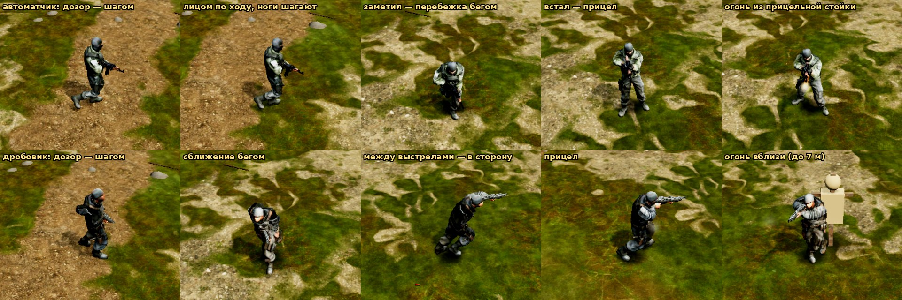
* **Мур с дробовиком** подбирается ближе, заходя сбоку и прикрываясь укрытиями, стреляет только вблизи (`range` 7 м):
  восемь дробин — восемь лучей с разбросом, урон дробины в упор 4,5 и слабеет с расстоянием (до `far_k` = 25 % на
  краю дальности); после выстрела передёргивает цевьё, патроны заряжает по одному.
* **Главарь — босс** (`mur_boss`; всё — в `data/enemies.json`). Раньше он был ростом с героя, с 900 прочности (из
  автомата — четыре секунды боя), дёргался от каждой пули, пятился и прятался, как рядовой, а выстрел его пистолета
  звучал и выглядел как у всех. Теперь:
  * **Крупный и крепкий.** Рост 2,25 м (герой — 1,8), пистолет Desert Eagle под его руку (`gun.scale` 1,5 — 0,41 м),
    прочность 3000. От попаданий не дёргается и не сбивается (`no_flinch`), за мебелью не прячется, вплотную не
    пятится. Из штаба не выходит.
  * **Полоса здоровья на экране.** Пока он в бою — вверху имя и широкая полоса с двумя засечками (границы фаз) и
    номером фазы; за красной полосой — светлый след недавнего урона. Камера в бою сдвигается к главарю и чуть
    отходит: в кадре оба. Над ним — его реплики и название начатой атаки.
  * **Три фазы** (`phases`: 66 % и 33 % здоровья). На смене фазы он пошатывается (единственное, что его сбивает),
    бросает реплику и **зовёт бойцов**: двое ближайших живых муров (не снайперы, `call`) бросают посты и идут к
    нему. Во второй фазе добавляются гранаты, в третьей он звереет (`rage`): паузы между выстрелами вдвое короче,
    прицельный выстрел раз в 6 с, граната раз в 7 с, шаг быстрее.
  * **Атаки** — у каждой свой замах, звук и надпись:
    1. *Тяжёлый выстрел*: вскидывает пистолет (`aim_s` 0,5 с), 2–3 выстрела подряд — грохот (свой звук
       `shot_deagle`), большая вспышка, сильная отдача, крупная светлая пуля; 10 % здоровья героя, попадает не
       каждый.
    2. *Прицельный выстрел* (`special`, раз в 10 с): взводит курок, на полу — красная полоса вдоль прицела (до первой
       стены); 1,2 с она идёт за героем, потом застывает, ещё 0,35 с — выстрел с усиленной вспышкой и отдачей: на
       полосе и не за стеной — треть здоровья и отбрасывание, ушёл — мимо.
    3. *Удар ногой* (`kick`): герой ближе 2,4 м — замах 0,42 с и удар: достал (до 2,9 м перед собой) — 15 % здоровья
       и отбрасывает на несколько метров.
    4. *Граната* (`grenade`, со второй фазы): на полу, где стоит герой, — красный круг 2,6 м с отсчётом; левая рука
       идёт к подсумку, граната с красным огоньком появляется в ладони, замах, бросок — граната падает в круг; через
       2,4 с от появления круга — взрыв: в центре 35 % здоровья, у края — 40 % от этого, стена или мебель между
       взрывом и героем закрывают. Бросает и за укрытие, куда герой только что спрятался. Радиус, урон, запал,
       дистанция и передышка — настраиваемые числа в `grenade`, это рабочие значения, а не утверждённый баланс.
  * Убит — сообщение на экране, ключ — в теле.
  * **Движения — свои клипы** (скелетные, по видео-образцу; `core/animation/pose_builder.gd`, подключение —
    `clips` и `stride_k` в описании главаря):

    | Состояние | Клип | Что в нём |
    |---|---|---|
    | Стоит | `boss_idle` | стойка с пистолетом, дыхание |
    | Бежит | `boss_pistol_run` | бег набора под рост 2,25 м (шаг длиннее в 1,25 раза — стопы не скользят), корпус наклонён, пистолет в правой руке у груди стволом вперёд, левая работает как при беге |
    | Целится | `boss_pistol_aim` | двуручный хват, левая нога на полшага впереди, колени согнуты, корпус подан вперёд, голова к прицелу |
    | Стреляет | `boss_pistol_fire` | спуск — и корпус с головой коротко отдают назад; выстрел (попадание, вспышка, звук) — по метке клипа |
    | Возврат | `boss_pistol_recover` | корпус проходит чуть вперёд и успокаивается; следующий выстрел — без нового вскидывания |
    | Готовит гранату | `boss_grenade_prepare` | пистолет в правой опущен, левая кисть — к подсумку на груди, взгляд вниз; граната появляется в ладони |
    | Бросает | `boss_grenade_throw` | шаг правой ногой, замах за плечо с разворотом корпуса, бросок с переносом веса; граната уходит по метке клипа |
    | После броска | `boss_grenade_recover` | проводка руки вниз-вперёд, возврат к оружию |
    | Пошатнулся | `boss_hit` | смена фазы |
    | Погиб | `boss_death` | падение |

    Правая рука держит пистолет расчётом хвата (`BCWeaponHold`): ладонь на рукояти, указательный палец у спуска;
    стойки — `data/weapons.json` (`deagle`: `aim` — двуручная, `run` и `throw` — одной рукой). Запись движений из
    игры: `--write-movie файл.avi --fixed-fps 30 … -- --as-test=bossdemo` (бег, стрельба, граната — игровым
    ракурсом, сбоку и крупно).
    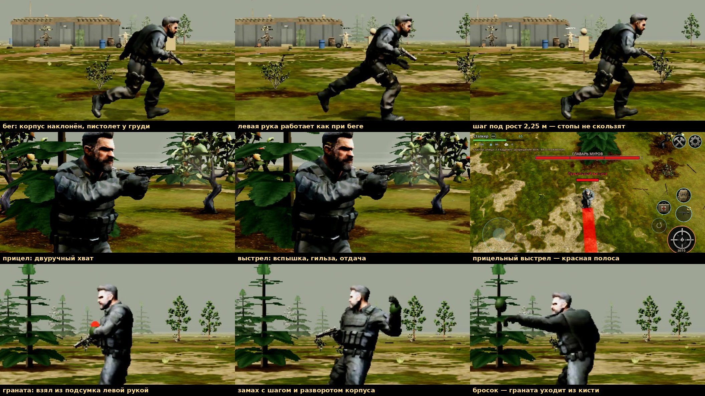
  * Звуки выстрела и взрыва — свои, синтезированы (`tools/make_boss_sounds.py`, numpy): `shot_deagle_1/2`,
    `grenade_boom`, `grenade_tink`.
  * Проверка: `--as-test=bossview --as-out=папка` — 16 пунктов (скелет, клипы, бег, атаки, фазы) и снимки каждой
    атаки (игровой камерой и крупно).
  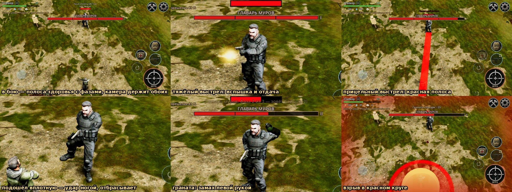

**Ключ и оружейный сундук.** Ключ главаря (`mur_key`, свой значок) — всегда в его теле, привязан к этому посещению
логова (`ULCase.new_instance()` при входе: главарь и сундук — заново, старые ключи не подходят). Сундук стоит у
дальней стены кабинета: без ключа — «Закрыто. Требуется ключ главаря муров», с ключом — «Открыть оружейный сундук».
Открытие (`ULCase.open_chest`): ключ убирается, награда выбирается **один раз** и вместе с отметкой «сундук пуст»
сразу пишется в `base.json` — до анимации; закрыть окно или перезапустить игру — результат тот же. Потом — прокрутка
как в CS (`ULCaseUI`): горизонтальная лента карточек справа налево (картинка, название, рамка редкости, состояние),
неподвижная линия посередине, быстро → медленно за 6–8 с, кнопка «Пропустить», крупная карточка результата,
«Забрать», тёмный металлический фон, подсветка, у легендарного — золотое сияние, звуки. «Забрать» кладёт оружие в
инвентарь; нет места — награда ждёт в окне выдачи (откроется снова у сундука), выдаётся один раз. Редкости и шансы —
`data/case.json`: Обычное 55 % (ПМ, ТТ, Beretta), Необычное 25 % (MP5, АКС-74У), Редкое 12 % (АК-74М, FN FAL,
SPAS-12), Очень редкое 7 % (СВД, ВСС, AUG, SCAR), Легендарное 1 % (ПКП «Печенег»); шанс редкости делится поровну между
моделями, которые есть в игре; моделей, которых нет (ПМ, АКС-74У, AUG, SCAR), не выпадает — в «Тесте кейсов» в
главном меню они показаны недоступными. Там же — прокрутка без выдачи награды.

## Общее для всех локаций: ресурсы на полу, свет у входов, листовая кровля
То, что сначала появилось в карьере, перенесено на остальные карты (20.11):
- **Ресурсы на полу построек** (`ULSanatorium.floor_loot` — общая основа санатория, конвоя, хутора, логова и карьера;
  у коровника свои постройки — `barn_floor_loot` в `world.gd`). Каждое посещение по-новому: часть свободных мест
  комнат (доля `floor_share` 30–55 %, не больше `floor_max` и не меньше одной находки на постройку) занята
  находками по назначению комнаты — таблицы `floor_loot` в `data/<локация>.json`: вид комнаты → [предмет, от,
  до, вес], «*» — прочие комнаты. В проверочном посещении: коровник 13 находок (6 построек), санаторий 41 (6),
  конвой 8 (7), хутор 30 (15, с погребами), логово 46 (12), карьер 35 (10). Находки кладутся своим генератором
  случайных чисел — расстановка хлама и врагов от них не меняется. Хлам кучками и тайники в мебели — как были.
- **Свет у входов** (`ULSanatorium._door_glows`): у каждой наружной двери на уровне земли — тёплое пятно на земле и
  лампа над дверью (один MultiMesh с прибавляющим смешением, источников света нет). Санаторий — 26 входов,
  хутор — 23 (с будками погребов), логово — 31, карьер — 27 и 5 отсветов у жил, конвой — 4; у палаток дверей нет,
  у коровников — ворота без двери: там света нет.
- **Листовая кровля** (режим `sheet` шейдера построек): «ржавое железо» (`rust` — крыши хутора и логова) и жесть
  (`roof_tin`) — листы 1,05 × 2,4 м, у каждого свой тон, тёмные нахлёсты, потёки ржавчины вдоль ската. Прежняя
  текстура сплошной ржавчины давала ровное розоватое пятно с размытыми полосами. У коровников (свой шейдер
  `ULFarmBuilding`) на серый профнастил добавлены те же листы и нахлёсты.
  
- Проверка: `--as-test=fldiag --as-place=<локация>` — справка по постройкам (виды комнат, места, двери) и проверки:
  находки в каждой постройке, предметы настоящие, лежат на земле, в другое посещение — иначе, пятен света —
  по числу наружных дверей.

## Запечённые тени солнца на земле (`core/world/sun_shadow.gd`, `tools/shadow_post.py`)
«Запечь» — посчитать один раз заранее и положить готовой картинкой, чтобы телефон не считал это каждый кадр.
- **Что запечено** (20.11): тени солнца от построек, деревьев, заборов и техники на земле — для всех семи
  локаций (дом, коровник, санаторий, конвой, хутор, логово, карьер). Картинка `assets/world/tex/shadow_<место>.png`:
  вид строго сверху на всё поле, 2048 × 2048 точек (5–10 см на точку), один канал, без сжатия с потерями;
  белое — свет, чёрное — тень. Семь картинок — 2,7 МБ; в памяти одновременно только картинка текущей локации (4 МБ).
- **Когда показываются**: когда тени солнца в реальном времени выключены — на «Низкой» графике и когда подстройка
  под частоту кадров сняла тени. Раньше в этих случаях теней на земле не было совсем. Когда настоящие тени
  включены, запечённые выключены (двойной тени нет) и картинка даже не читается.
- **На что ложатся**: земля, порода карьера (уступы и дно), асфальт и плитка санатория, колеи, проплешины, лужи —
  всё, что рисуется «земляными» шейдерами (в исходнике шейдера метка `//#SUN_SHADOW`, её подменяет
  `ULSunShadow.with()`; параметры общие — `[shader_globals]` в `project.godot`). На персонажей, предметы и полы
  построек не ложатся: под ними — прежние мягкие пятна (`blobs.gd`).
- **Что в картинку не попадает**: герой, враги, жители дома, находки и всё, что расставляется случайно при входе
  (останки коров, хлам, тайники) — иначе в следующее посещение тень лежала бы на пустом месте. Скрыто при
  запекании: коровник 77 предметов, санаторий 128, конвой 60, хутор 112, логово 119, карьер 117. Два расчёта с
  разной случайностью посещения дают одну и ту же картинку (различие — доли процента на краях теней).
- **Сила тени** подобрана по кадрам сверху: земля в запечённой тени темнее освещённой во столько же раз, во
  сколько в настоящей (земля в тени от освещённой: карьер 0,56 против 0,54, санаторий 0,54 против 0,52, дом
  0,73 против 0,74 — на базе тени мягче, `SHADOW_HOME_K`).
- Доля земли в тени: дом 2,6 %, коровник 17,1 %, санаторий 30,3 %, конвой 11,2 %, хутор 11,6 %, логово 13,1 %,
  карьер 13,0 %.

  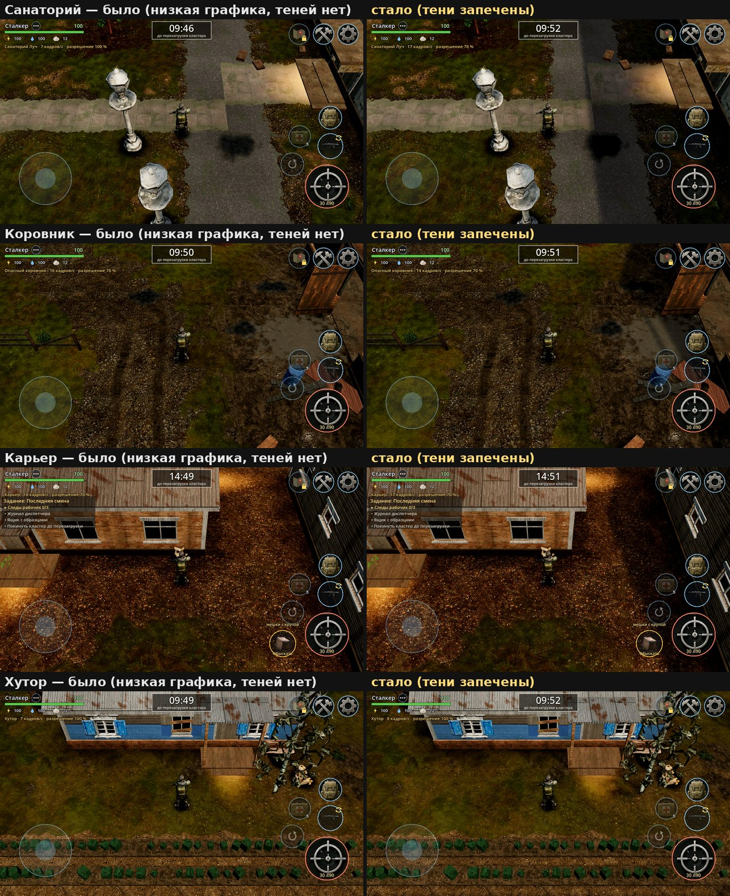
  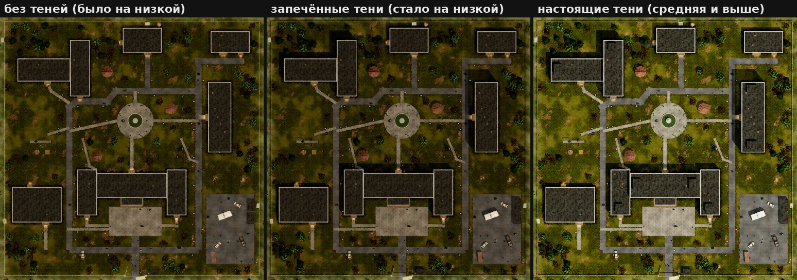
- **После перестройки локации тени нужно перезапечь** (как и карту): `--as-test=shbake --as-place=<место>
  --as-gfx=3 --as-out=папка` → `python3 tools/shadow_post.py папка/shadow_<место>_raw.png
  assets/world/tex/shadow_<место>.png` → `godot --headless --path . --import`. Проверка `--as-test=shcheck
  --as-place=<место>` (и с `--as-seed=4242` — другое посещение) ловит устаревшую, сдвинутую или перевёрнутую
  картинку: растянута по размеру земли сразу после входа; включается только без настоящих теней; в кадре игры
  земля темнеет там же, где тень на картинке; сила — как у настоящих теней; совпадает со свежим расчётом.
  `--as-nobake` — запустить без запечённых теней (снимки «как было»).
- **Одинаковая яркость с тенями и без** (21.11): в рендерере телефона (Compatibility) солнце с тенями рисуется
  отдельным проходом и прибавляется к кадру уже после перевода в sRGB — кадр с тенями выходил в 1,5–1,8 раза ярче,
  чем без них. «Низкая» графика была заметно темнее «Средней», а когда подстройка снимала тени, картинка резко
  темнела. Вся игра настроена по виду с тенями, поэтому без теней солнце теперь сильнее (×1,9 во временных
  кластерах, ×2,2 на базе) и чуть холоднее (цвет × 0,95 / 1,02 / 1,05) — `SUN_NOSHADOW_K` в `world.gd`,
  подобрано по сетке кадров на четырёх локациях (`--as-test=lumtest --as-lumfit`). Разница средних цветов кадра
  была 0,08–0,14 (из 1), стала 0,01–0,02 на всех семи локациях (в светлой выработке карьера — до 0,035); ничего не стоит — меняются только сила и цвет
  солнца. Проверка: `--as-test=lumtest --as-place=<место> --as-at=x,z` (при 100, 85 и 70 % разрешения).
  Цвет запечённой тени после этого подобран заново: (0,5; 0,54; 0,62) вместо (0,6; 0,64; 0,72).

  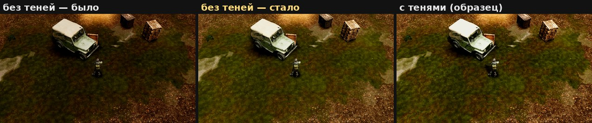
- **Персонажи**: запекание затенения в текстуры моделей пробовалось и не включено — у моделей Tripo складки и
  затенение уже нарисованы в самой текстуре и есть карты рельефа, добавка меняла картинку меньше чем на 1/255
  яркости.
- На телефоне не проверялось: цена одной лишней выборки текстуры в шейдере земли на «Низкой» не измерена.

## Запечённая земля — «быстрая земля» (`core/world/ground_bake.gd`, `tools/ground_post.py`)
Земля занимает почти весь экран, а её шейдер — самый тяжёлый в игре: в каждой точке каждый кадр он решает, где
трава, тропа, грунт и подстилка (карта, пять чтений шума, смешивание «по высоте»), и читает каждый слой дважды —
9–12 чтений текстур, на стыках до 20.
- **Что запечено** (20.11): всё, что не меняется от кадра к кадру, — для всех семи локаций.
  `assets/world/tex/ground_<место>_w.jpg` — раскладка слоёв (вид строго сверху на всё поле: R — трава,
  G — подстилка, B — тропа, остаток — грунт); `ground_<место>_t.png` — общий тон (без сжатия) (сухие пятна, зелёные куртины,
  кочки, затенение, рельеф под солнцем: во сколько раз и в какой цвет подвести землю, чтобы издалека она была
  как подробная). Сами текстуры травы, подстилки, грунта и тропы — те же, что у подробной земли, только каждая
  читается один раз. В точке остаётся 4 чтения: раскладка, слой, тон, запечённая тень.
  На локацию — 2048 × 2048 точек раскладки (сжатие для видеопамяти, 2 МБ) и 1024 × 1024 тона (без сжатия,
  0,7 МБ в сборке, 3–4 МБ в памяти); на все семь — около 20 МБ в сборке, в памяти только текущая локация.

  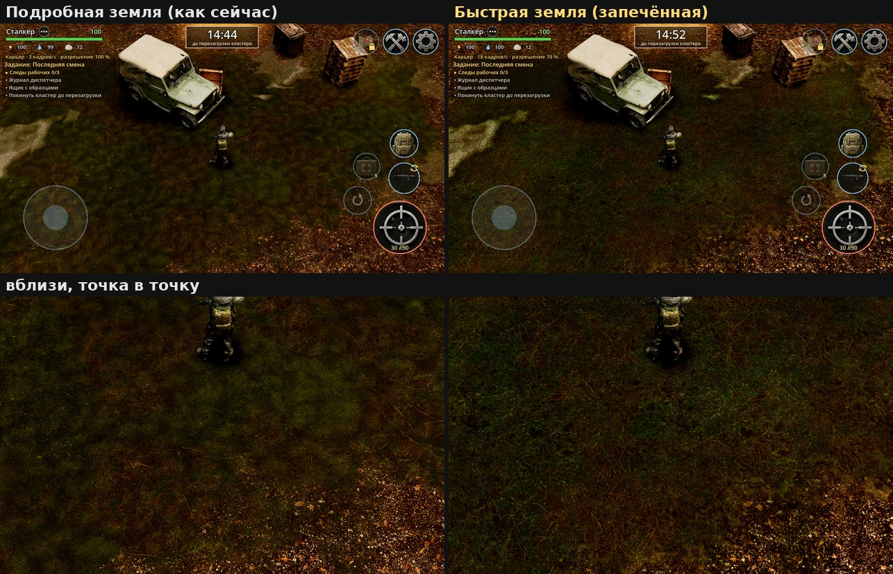
- **Замер** (`gperf`, точка входа на локацию, 1280 × 720 при 100 % разрешения; программная отрисовка без
  видеочипа — на телефоне соотношение будет другим): время кадра с подробной и с быстрой землёй — карьер
  110 → 75 мс, санаторий 105 → 72, хутор 104 → 66, коровник 100 → 60 (на 32–40 % меньше).
  На телефоне не проверялось.
- **Почему не одна готовая картинка земли**: первый вариант был таким (4096 точек на поле — 4,4 см на точку) и
  вышел мыльным вблизи: резкость 41 % от подробной земли. С раскладкой и настоящими текстурами — 93–97 %.
- **Когда включается**: на «Низкой» графике; настройкой «Земля» (как в качестве / подробная / быстрая);
  подстройка под частоту кадров переходит на быструю землю после снятия теней и до понижения разрешения
  (в строке состояния — «земля быстрая») и возвращает подробную первой, когда кадров снова хватает. Второй
  шейдер земли прогревается при входе на локацию — переключение без заминки.
- **Что не запекается**: колеи, проплешины, лужи, асфальт и плитка санатория, порода карьера (у стенок
  выработки своя развёртка и «окно» вокруг героя) — рисуются как раньше. Персонажи и постройки — см. ниже.
- **Особенность рендерера, на которой споткнулось запекание**: в Compatibility шейдер работает с цветом в sRGB,
  в линейный свет его переводит движок уже после шейдера. Поэтому тон считается и хранится в sRGB
  (вдвое уменьшенным: 0…2 → 0…1; синий канал травы выше двух — около 1 % точек — срезается без вреда), а множители в шейдере — тоже в sRGB.
- **Как перезапечь** (после правки земли, дорог, расстановки построек и деревьев — вместе с картой и тенями):
  1. `--as-test=gbake --as-place=<место> --as-px=2048 --as-tiles=2 --as-lpx=2048 --as-out=папка` →
     `python3 tools/ground_post.py папка <место> w 2048 2` → `godot --headless --path . --import`;
  2. снова `gbake` (теперь снимается и быстрая земля без тона) → `python3 tools/ground_post.py папка <место> t 1024`
     → импорт;
  3. `--as-test=gcheck --as-place=<место>`: строка «яркость быстрая/подробная R»; если R дальше 3,5 % от
     единицы — `python3 tools/ground_post.py - <место> s <(1/R) в степени 1/3>`, импорт и снова проверка
     (тон считается в ровном свете, а цветокоррекция игры сжимает тёмные тона сильнее — остаток в несколько
     процентов снимается одним множителем).
- **Проверка** `--as-test=gcheck --as-place=<место>` (всё, кроме земли, скрыто; без теней солнца, как на
  «Низкой»): картинки есть; быстрая земля включается; после возврата подробной кадр прежний; яркость — в
  пределах 3,5 % от подробной; рисунок тот же и не перевёрнут; вблизи не мыльная (резкость не ниже 0,8 от
  подробной). `--as-test=gperf --as-place=<место> --as-at=x,z` — время кадра с подробной и с быстрой землёй.
  `--as-ground=fast|full` — принудительно выбрать землю для снимков и проверок.

## Цена поверхностей и порода карьера (21.11)
Замер `--as-test=wperf --as-place=<место> --as-at=x,z`: время кадра как есть и с подменой шейдеров одной группы
на простейший (потолок возможной выгоды; программная отрисовка без видеочипа):
- **стены и крыши построек** — 1–7 % кадра (посёлок карьера, санаторий, хутор), сараи коровника — 0 %. Переделывать
  их шейдер ради скорости смысла нет.
- **порода карьера** — до половины кадра на дне выработки: шейдер на каждой точке читал все 13 текстур (скалу и
  щебень сразу). Теперь скала читается только на стенках, щебень и пыль — только на полках и съездах (7 чтений;
  вид тот же — разница кадров 0,05–0,4 %): на дне кадр 131 → 112 мс («Средняя»), 119 → 96 мс («Низкая»).
- **облегчённая порода** — вместе с быстрой землёй (`ground_alt` в `world.gd`, `#define PIT_LOW` в `PIT_SHADER`):
  без второй выборки скалы, третьей щебня и карт неровностей (у быстрой земли их тоже нет), 4 чтения на точку —
  ещё 96 → 76 мс. Итого на дне карьера на «Низкой» 119 → 76 мс (−36 %). В посёлке карьера с быстрой землёй
  107 → 67 мс.

## Графика: тени, текстуры, трава, модели Tripo по локациям
- **Чёткость** (17.11, снимки пользователя: 58–60 кадров/с при разрешении 39–42 % — картинка мыльная): трёхмерная
  картинка теперь рисуется в 62 / 80 / 100 % разрешения экрана (низкая / средняя / высокая графика, было 42 / 55 / 80),
  сглаживание краёв MSAA 2× на средней и 4× на высокой (на мобильных видеочипах почти бесплатно). Автоподстройка
  под частоту кадров не опускает разрешение ниже 55 % (было 30 %), снижает его только ниже 40 кадров/с и поднимает
  обратно уже от 50. Подсветки цели (засветка модели, светящаяся коробка) нет — цель видна по кнопке «Обыскать».
- **Тени солнца на «Низкой» графике** — запечённые, см. раздел выше.
- **Пятна-тени** (`core/world/blobs.gd`): под мебелью, техникой, ящиками, героем и врагами — мягкое тёмное пятно
  (неподвижные — один MultiMesh, движущиеся — второй: два вызова отрисовки на всю локацию).
- **Против повтора текстур**: на стенах — крупная вариация светлоты той же текстурой, на земле — вторая выборка
  с поворотом у грунта, дороги и сухой травы. Крупные поверхности (доски, брёвна, штукатурка, кирпич, жесть,
  бетон, фасадная плитка, грунт, трава, тропа) — фототекстуры Poly Haven (CC0) в 2048, подогнанные по цвету.
- **Трава**: мелкие пучки по полю убраны (их заменяет трава на земле: вторая фототекстура зелёными куртинами,
  рельеф стеблей, пятнистое затенение «кочками», проплешины из увядшей травы); сорняки у стен и крапива у
  заборов — вдвое реже, цветы как были.
- **Дома хутора**: три сруба из брёвен с концами «в чашу», у дощатых — угловые доски; каменный или кирпичный
  цоколь; треугольный фронтон, причелины, лобовые доски; выпавшие доски, сорванные ставни; ржавчина на жести;
  антенны; мелочь у стен. Наличники со ставнями, печные трубы, резьба фронтонов — модели Tripo. Гараж —
  металлический (профлист), ворота из двух створок открываются наружу.
- **Модели Tripo по локациям** (32 шт., `tools/tripo/budget.md`): хутор — лавки у крылец, собачьи будки, пугала
  на огородах, двери на глухих стенах сараев, летняя веранда, пасека за штакетником с распахнутой калиткой;
  санаторий — парковые скамейки и фонари вдоль дорожек, гипсовые пионеры и бетонные вазы у фонтана, внутри —
  медицинские шкафы, пианино в клубе, столы в комнатах отдыха, кресла-каталки; коровник — ясли с сеном,
  кормушки, поилки, тюки, тачки у ворот, танк-охладитель молока у пристройки; конвой — мешки с песком у поста и
  лагеря, противотанковые ежи у блокпоста, рация у штаба, канистры у техники, носилки у медпалатки; база —
  генератор, оружейная стойка, бочка для дождевой воды у дома. Мелкие модели раньше уходят на упрощённые копии.
  Уличные детали хутора (наличники, резьба, двери, забор, калитка, лавки, будки, пугала, веранда) — с упрощённой
  сеткой (на треть меньше треугольников) и видны до 26 м от камеры.
- **Корпуса санатория**: водостоки на углах (воронка под карнизом, хомуты, колено и бетонный лоток у земли; часть
  ржавые), выбоины штукатурки с кирпичной кладкой (неровный край — два пятна), наружные блоки кондиционеров на
  кронштейнах под окнами верхних этажей, электрощиты с трубой провода на первом этаже. Котельная (кирпич) —
  без выбоин.
- **Коровники**: отлив-доска над кирпичным низом, заплаты из досок поверх обшивки (вкось и поперёк), прислонённые
  к стенам доски, водосточные желоба по краю кровли (местами оторваны и висят), трубы на углах. Мелочи — на своём
  зерне случайностей: расстановка остального не сдвигается.
- **Модели Poly Haven (CC0)**: валуны со мхом и упавшие сухие стволы в лесу (коровник, хутор, конвой — со
  столкновением), ржавые урны у каждой третьей скамейки санатория, пластиковые стулья в беседках, столы для
  пикника во дворах хутора (у одного — стул), урна и коробки у магазина. Место выбирается с проверкой по уже
  поставленным столкновениям (стены, деревья, техника, скамейки).

## Враги и добыча (`core/world/enemy.gd`)

- **Бой как в мобильных выживалках (22.11, просьба пользователя «почему так уродливо погибают… как в Last Day /
  Dawn of Zombies»)**:
  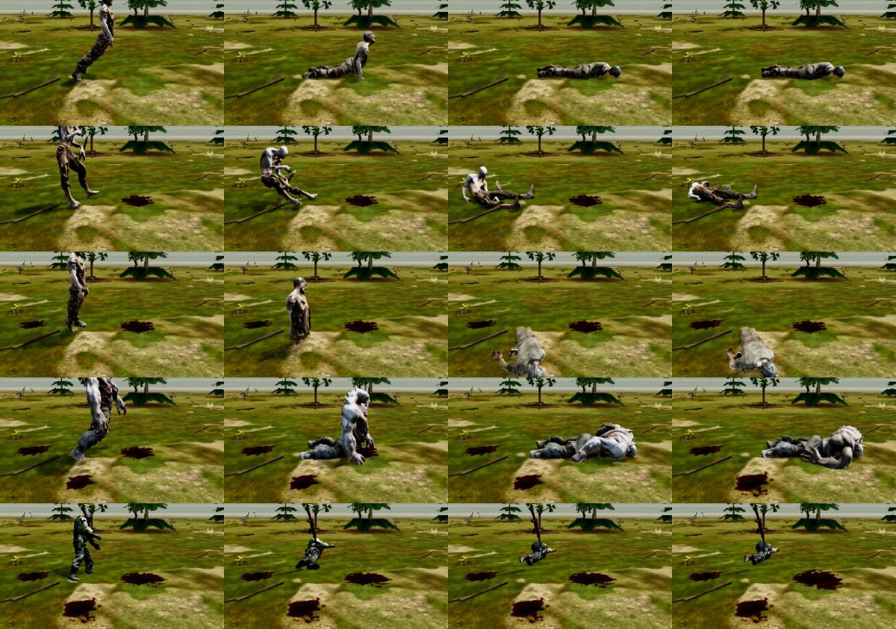
  - **Гибель на физике** (`core/animation/ragdoll.gd`, `BCRagdoll`): долю секунды идёт клип падения (`ragdoll_at`,
    0,22 с; у главаря муров 0,9 с — его своя гибель), потом тело валится всем весом от удара — 11 твёрдых тел (таз,
    грудь, голова, плечи, предплечья, бёдра, голени) на суставах, которые держат позу клипа (колено не выгнется
    назад), с толчком от того, кто ударил (`ragdoll_push`, сильнее при большом уроне). Тело ложится по земле, по
    склону и ступеням, не висит над полом; когда легло (обычно 1,5–3 с, не дольше 3,5 с), поза записывается в
    скелет и тела удаляются — лежащий труп ничего не считает. У вооружённого мура оружие выпадает из рук и падает
    рядом. Лужа крови — под тем местом, где тело легло. Последние 2 с из минуты тело уходит в землю, а не пропадает
    разом. Проверка: `--as-test=ragdoll` (пустыш, лотерейщик, Рубер, мур — снимки 0,15…4,5 с; таз и голова у земли).
  - **Попадание**: враг отлетает от удара (`knock_k`; мачете отталкивает заметнее пули), фигура на миг вспыхивает
    красным, над головой появляется полоска здоровья (светлый «след» потери догоняет её; без попаданий 6 с —
    прячется; у убитого — пропадает). Удар героя **на замахе врага сбивает его удар** (урон не меньше 15 %
    прочности врага, `interrupt_dmg`): враг дёргается от удара, его удар не доходит, следующий — через 0,6 паузы
    (у Рубера — нет, он не вздрагивает).
  - **Дистанция удара**: пустыш бьёт с вытянутой руки — 0,95 м между центрами (было 0,8 — «обнимал» героя),
    лотерейщик — 1,0 м. Проверка: `--as-test=hitfx` (6 пунктов).
- **Удар заражённого** (как в выживалках с видом сверху): подбежал — сразу бьёт. Замах начинается ещё на бегу, с
  `strike_d` м до касания, и длится `wind_t` секунд (пустыш 0,3, лотерейщик 0,22, Рубер 0,45) — клип ускоряется под
  этот срок, враг не останавливается; затем рывок `snap_t` до касания (`lunge`, до `lunge_v` м/с) и удар; отход —
  быстрее клипа (`recover_k`). Между ударами держится на шаг от героя (`keep`). Герой от удара отлетает на 15–35 см,
  камера вздрагивает, края экрана краснеют (середина остаётся видна).
- **Реакция на шум** (17.11, вдвое сильнее): выстрел слышат пустыш с 44 м, лотерейщик с 60, Рубер с 68; бег героя —
  14 / 22 / 24 м, шаги — 3 / 8 / 10 м; лотерейщик и Рубер кричат перед погоней вдвое короче.
- **Новые удары (Tripo, движения по тексту, новый аккаунт)**: пустыш — размашистый удар правой и левой с замахом за
  плечо, два тяжёлых удара подряд, удар обеими руками сверху вниз, захват за плечи с укусом; лотерейщик — прыжок с
  когтями, удар крест-накрест, три быстрых удара, вцепляется и рвёт, размашистые удары (быстрее, чем у пустыша).
  Новые выбираются чаще прежних (вес в `data/enemies.json`), прежние остались для разнообразия. Движения сняты на
  моделях-заместителях нового аккаунта (по исходным картинкам пустыша и лотерейщика; скелет Tripo у всех один —
  78 костей) и ложатся на наши модели с поправкой к исходной позе (`BCAnimSet._rest_fix`, образцы скелетов
  `assets/models/zombiepx.glb`, `lotterypx.glb`). Момент удара в клипе (поле `hit`) найден `tools/attack_hits.gd` —
  когда лапа дальше всего уходит вперёд. Покадровая проверка: `--as-test=atkview --as-kind=… --as-clip=<удар>`.
- Весь баланс врагов — в отдельном файле `data/enemies.json` (правится без кода): прочность, скорости, с какого
  расстояния видит и слышит (выстрел, бег, шаги), сколько кричит перед погоней, когда теряет, удары (клип, урон,
  на какой доле клипа удар доходит), добыча (предмет, от, до, шанс), рост.
- **Пустыш** (заражённый низшей ступени) — первый враг. Модель по присланному фото: Tripo, со скелетом (`assets/models/zombie.glb`,
  12 тыс. треугольников, текстуры 1024). Прочность 75; бродит шагом 1 м/с вокруг своего места; видит героя ближе
  13 м (стены и забор закрывают обзор), слышит выстрел до 28 м (стрельба по манекену у дома не привлекает) и бег
  до 7 м — бежит 2.9 м/с. Вплотную бьёт руками: 9 урона раз в 1.3 с. **Удар доходит до героя**: клипы Tripo
  машут лапой «в воздух», поэтому в момент удара бьющая кисть доводится (IK руки, `BCHandIK`) до плеча или груди
  героя со стороны этой руки и сразу уходит назад — правой, левой; «два удара подряд» — правой, потом левой
  (`_plan_strikes` в `enemy.gd`). Укусы и захваты — головой. Стоит при ударе на 0.8 м от героя (не влезает в него).
  Герой от удара **отшатывается** — поясница, грудь, шея и голова коротко дёргаются от ударившего и за 0.4 с
  возвращаются (`core/animation/flinch.gd`, поверх любой анимации; руки и оружие идут вместе с корпусом), с этой
  стороны брызжет кровь (капли и пятно на земле, тает за 20 с; так же — из ран врагов).
  **Движения Пустыша — свои клипы по видео-образцу** (скелетные, по ключевым позам; `install_extra("infected")` в
  `core/animation/pose_builder.gd`, подключение — `build`, `clips` и `attacks` в `data/enemies.json`; библиотека
  клипов одна на всех пустышей):

  | Состояние | Клип | Что в нём |
  |---|---|---|
  | Ожидание | `infected_idle` | сутулая стойка, руки висят чуть впереди с согнутыми локтями; медленно осматривается: голова ведёт, грудь доворачивает, вес переходит на ближнюю ногу; дыхание; цикл 7,2 с без скачка |
  | Погоня | `infected_chase_run` | тяжёлый бег с сильным наклоном под его скорость 2,9 м/с (цикл 0,7 с, шаг около метра): опорная стопа идёт по земле со скоростью тела, маховая — по дуге с подъёмом пятки и выносом колена; таз проседает на опоре и доворачивается за ногой, грудь — навстречу; руки разные — правая машет шире и ниже, левая поджата |
  | Удар правой | `infected_attack_right` | замах — плечо и рука назад-вбок на уровне плеча, вес на задней ноге; удар — таз и грудь доворачиваются, рука идёт по дуге вперёд и поперёк; проводка и возврат |
  | Удар левой | `infected_attack_left` | зеркально, ноги не переставляются |
  | Захват | `infected_attack_grab` | руки к груди, шаг передней ногой, выпад — обе руки вытянуты к цели и сходятся; возврат (только удар: удержания героя нет) |

  Из стойки в бег — через разгон (`accel` 7 м/с²: шаг → бег, а не рывок). Урон — как прежде: по метке клипа, если
  герой в досягаемости; отошёл — промах. Здоровье, скорость и урон ударов рукой не менялись (9), у захвата — 14.
  Прежний набор ударов сохранён в `attacks_old`. Проверка — `--as-test=melee --as-kind=infected`; запись движений
  из игры — `--write-movie файл.avi --fixed-fps 30 … -- --as-test=zdemo` (ожидание, бег, удары — спереди, сбоку,
  игровой камерой).
  
- **Лоторейщик** — второй враг, по присланной картинке (вид спереди; Tripo, `assets/models/lottery.glb`: 13 тыс.
  треугольников, один материал, цвет 2048, нормали и шероховатость 1024; скелет 78 костей с пальцами). Рост 1.9 м,
  прочность 200, шаг 1.2 и бег 3.7 м/с (герой бежит 4.4 — уйти можно, но с трудом). Видит с 16 м, слышит выстрел
  с 34 м, бег с 22 м и даже шаги с 8 м. Заметив — **кричит 0.9 с** и только потом бежит. Шесть ударов вплотную, раз
  в 1.5 с (см. «Ближний бой»). В теле —
  1–4 спорана всегда и горошина с шансом 35 %. На локации один, в дальнем углу поля; на полигоне — кнопка
  «Лоторейщик +».
  
- **Поведение (у всех врагов).** Бродит у своего места → замечает (увидел, услышал выстрел, бег, шаги) →
  кричит, если виду положено → бежит туда, где видел героя в последний раз → вплотную бьёт: у удара замах, урон
  доходит на середине клипа, и если герой успел отойти дальше дальности удара — мимо. Потерял из виду — доходит до
  последнего места, озирается и через несколько секунд успокаивается; далеко убежавшего героя бросает.
  **Обход препятствий:** луч вперёд на уровне голени, упёрся (стена, забор, ящик, другой враг) — пробуются
  повороты всё круче в обе стороны, берётся первый свободный и держится полсекунды; сквозь стены не ходит
  (столкновения — обычные). Это не поиск пути: из тупика (комната с одной дверью за спиной) он может не выбраться.
- **Ближний бой — вплотную.** Заметив героя, враг подбегает до касания (`close` в `enemies.json`: 0.70 м между
  центрами у пустыша, 0.74 у Лоторейщика; тела соприкасаются на 0.62) и только оттуда бьёт; на замахе ещё дожимает
  вперёд. Удар выбирается из тех, что достают с этого расстояния (`reach` у каждого удара): захват с укусом — только
  впритык. Урон — в момент удара, если герой всё ещё в досягаемости: успел отскочить — мимо. Между ударами враг
  стоит вплотную, покачивается и тянется руками (стойка `menace`).
  Удары пустыша: правой и левой (9), тянется руками и кусает (16), хватает за плечи и кусает в шею (20).
  Лоторейщика: когтями слева и справа (14, 16), тянется и кусает (22), выпад пастью (24), хватает за плечи и кусает
  в шею (30). Ещё три удара заказаны (два подряд, обеими руками сверху, бросок с укусом в лицо) и стоят в списке:
  враг выбирает только те, движение для которых у модели есть, так что они включатся сами, когда движения придут.
- Красный круг под целью и круг дальности вокруг героя не рисуются: цель и дальность считаются как прежде, о
  промахе по дальности или укрытию говорит подсказка сверху.
- **Попадания и гибель.** Попадание спереди и сзади — разные движения; сильное попадание (от 60 урона разом или
  от 30 % прочности — СВД, дробовик в упор) сбивает с ног и срывает удар, который он готовил. Падает по стороне удара: спереди —
  на спину, сзади — лицом вперёд, сбоку — набок.
- **Голос.** Рычит, пока бродит и гонится, кричит при обнаружении и ударе, хрипит при гибели — шесть записей CC0
  из набора проекта (`growl`, `roar`, `zdeath`; источники — `bunker/docs/AUDIO_SOURCES.md`). Слышно в 30 м.
- **Движения врагов — свои.** У пустыша и Лоторейщика отдельные наборы клипов (`assets/anim/zombie`,
  `assets/anim/lottery`): 17 движений (у пустыша в игре используется 14 — у него один удар) заказаны в Tripo по описанию («зомби стоит сгорбившись, руки висят…») и
  перенесены самим Tripo на собственный скелет каждой модели — без пересчёта с героя. Стойка — сгорбленная, руки
  висят; шаг — шаркающий, с подволакиванием ноги; бег — с наклоном вперёд; удары левой и правой, укус, выпад
  пастью; попадания спереди и сзади, потеря равновесия; крик, тревога, повороты; падения вперёд, назад и набок.
  Описание клипов — `data/anim_enemy.json` (каждый клип берётся из своей папки модели; чего там нет — из набора
  героя с пересчётом под скелет, `BCAnimSet._rest_fix`). Новые движения добавляются так: файлы Tripo
  `m_<набор>_<метка>.glb` в папку → `tools/extract_anims.gd` → клипы.
- **Генератор мелких движений существа** (`core/animation/creature_fx.gd`, настройки — `fx` в `enemies.json`) —
  то, чего нет в клипах Tripo и в автоматическом скелете. Работает поверх любого клипа, каждый кадр:
  пальцы согнуты когтями и подрагивают вразнобой, к моменту удара раскрываются; грудь дышит (в погоне чаще);
  на укусе и выпаде пастью шея и голова подаются вперёд; у Лоторейщика колышутся отростки у пасти (шейдер на
  вершинах вокруг точки пасти — точка находится по сетке сама: самые выступающие вперёд вершины головы). Оси
  сгиба пальцев считаются из исходной позы модели, поэтому генератор подходит к любому скелету Tripo. Челюсть он
  не открывает — для этого в сетке нет отдельной нижней челюсти.
  
- **Очередь движений для нового врага** — `tools/tripo/queue_motions.py имя:проект`: ставит в задания Tripo весь
  стандартный набор из `tools/tripo/enemy_motions.json` (17 описаний) или только названные метки (повтор
  неудачного); готовые файлы превращает в клипы `tools/extract_anims.gd`.
- **Без рывков вбок.** В движениях Tripo по описанию поворачивается сам корень скелета (тело виляет на 15–20°,
  путь идёт дугой), а таз едет в системе этого вращающегося корня. Раньше ход вычитался в неподвижной системе — и
  тело врага моталось до метра вбок от места, где он стоит на самом деле. Теперь корень считается в системе скелета
  (`BCAnimSet._bake_root`): курс тела держится по ходу, путь выпрямляется, ход вычитается, остаётся только
  покачивание. Замер в беге (`--as-test=loco` и проверка в `inv`): таз уходит вбок не дальше 0.16 м (было до
  0.97), корпус смотрит по ходу с отклонением до 18° (было 27–28°).
- **Обход забора и стен — по карте проходимости.** Карта строится один раз по столкновениям мира
  (`--as-test=bake` → `assets/world/nav_cluster.res`, 600 многоугольников, 62 мс) и в игре только загружается.
  Враг, который видит героя, бежит прямо; не видит (забор, дом) — идёт по карте: вокруг двора к калитке, в дом
  через дверь. Проверка `--as-test=nav`: от заднего забора до героя во дворе пустыш доходит за 14 с, Лоторейщик
  за 11 с. Другие враги больше не считаются препятствием при выборе пути — толпа не виляет.
- Нижняя стопа врага всегда на земле (`stand_clamp`); подстройка высоты сглажена, тело не подпрыгивает на шаге: в движениях по описанию высота таза записана неточно,
  без этого фигура висела над землёй на несколько сантиметров.
- **Что не сделано из задания на Лоторейщика и почему.** Отдельных костей челюсти и ротовых отростков нет:
  скелет ставит Tripo автоматически, он человеческий (78 костей, пальцы есть) — пасть и отростки не двигаются
  сами; пальцы, дыхание, выпад головы и колыхание отростков добавляет генератор (ниже), но раскрыть пасть он не
  может — нужна сетка с отдельной челюстью. LOD: упрощённые сетки строит импорт
  Godot (`generate_lods`), вдали берётся более грубая; дальше 36 м враг не считается вовсе.
- На локации трое пустышей за забором в поле и один Лоторейщик в дальнем углу (`ENEMY_SPAWNS`). Убитый
  появляется на своём месте снова через 25 с после того, как тело исчезло, и только когда герой дальше 16 м.
  Дальше 36 м от героя враг не считается и не двигается.
  В меню (шестерёнка) — «Враг +»: ставит ещё одного в 9 м перед героем, для проверки оружия.
- Враг — обычная цель: автонаведение, пули, кулаки и мачете работают как по манекену.
- Герой получает удар — экран на миг краснеет, здоровье убывает. Здоровье кончилось — «Вы погибли», через три
  секунды герой снова у дома с половиной здоровья; вещи остаются при нём.
- **Тело и обыск.** Убитый падает и лежит. Рядом с телом появляется кнопка взаимодействия со значком споранов и
  подписью «Обыскать»; она открывает окно «Обыск» — добыча тела в четырёх ячейках, «Взять всё» или по одному.
  Тело исчезает ровно через минуту после гибели (`CORPSE_S`) — обыскали его или нет; открытое окно обыска при
  этом закрывается.
  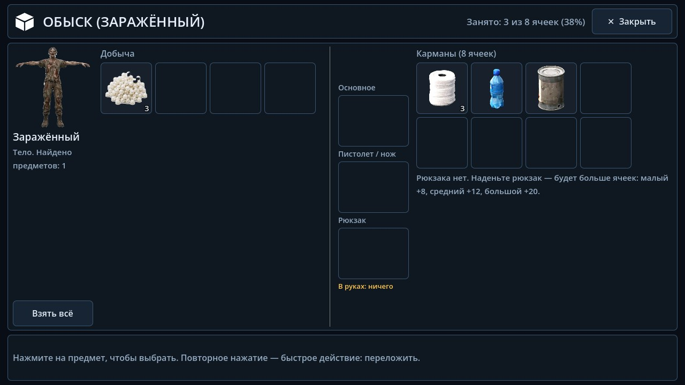
- **Добыча** (`items.gd`, вид «loot»): спораны — валюта (мелкие белые шарики; счёт — в шапке рядом
  со здоровьем), горошина, чёрная, красная и белая жемчужины. В заражённом — от нуля до трёх споранов (`loot` в
  `KINDS`: предмет, от, до); что именно лежит, решается при появлении. Горошина и жемчужины в игре есть как
  предметы, но пока ни в ком не лежат: они для существ сильнее. Значки вырезаны из присланной картинки.
  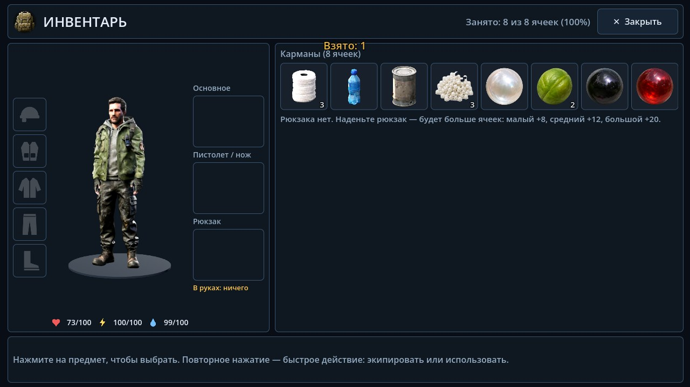
- **Рубер** — третий враг, только в «Санатории Луч» (и изредка в «Разбитом конвое»).
  
  Модель по присланной картинке: Tripo, со скелетом
  (`assets/models/ruber.glb`, 18 тыс. треугольников, цвет 2048, нормали 1024): рост 2,1 м, гора мышц, костяные
  наросты на плечах и спине, огромные руки с когтями, рваные брюки. Тело шире обычного (`radius` 0,36 м против 0,28).
  Прочность 700 (лоторейщик — 200); шаг 0,9 м/с, бег 3,3 м/с; видит на 18 м, слышит выстрел за 40 м, бег и шаги.
  Заметив героя — ревёт 1,2 с и идёт в погоню; **рывок** (`charge`): ближе 10 м срывается и 1,6 с несётся со
  скоростью 5,6 м/с (быстрее героя), потом 6 с отдышки. Удары редкие (раз в 2,4 с) и с долгим замахом (урон
  доходит через 0,6–0,7 клипа — можно отскочить): правой и левой — по 32, двумя руками сверху — 48 (обе кисти
  доводятся до героя). Обычные попадания его не сбивают; попадание от 75 урона (`stagger_dmg`: дробовик в упор)
  срывает удар и заставляет потерять равновесие. Голос — тот же, но ниже и громче (`voice`).
  
  **Бросок камня** (`rock` в `data/enemies.json`, `core/world/rock_throw.gd` — `ULRock`): видит героя с 11–24 м
  (ближе — рывок) — на земле там, где стоит герой, появляется **красный круг** (радиус 1,7 м, внутри растёт
  круг-отсчёт), Рубер приседает, вырывает из земли булыжник (остаётся яма, летят пыль и осколки), поднимает и
  **через 3 с** (`aim_s`) бросает двумя руками; камень летит по дуге 0,75 с (`fly_s`) точно в метку — за героем не
  доворачивает. Кто в круге в момент удара — получает 45 урона (`dmg`); **после попадания булыжник пропадает**
  (пыль, осколки), метка гаснет. Вышел из круга — мимо. Пока камень не брошен, Рубер стоит на месте: сильное
  попадание (от 75 урона) или гибель срывают бросок — камень рассыпается в руках; **подбежал вплотную**, пока
  камень не брошен, — Рубер роняет его (камень раскалывается, метка гаснет) и бьёт рукой. Передышка 11 с (`cd`);
  два Рубера одновременно круги не ставят — после начала броска другой ждёт 4 с (`gap`), обычно за это время он
  подходит ближе 11 м и идёт врукопашную. Только под открытым небом: если он сам или герой в помещении (палатка,
  корпус, дом) — не бросает; успел зайти под крышу, пока камень летит, — камень бьёт в крышу, урона нет.
  Бросающий издали Рубер движется полностью до 36 м (остальные враги во временных кластерах — до 18 м).
  **Звуки** — свои, синтезированы с нуля (`tools/make_rock_sounds.py`, numpy): `rock_rip` — гул земли, хруст и
  осыпь камешков, `rock_throw` — тяжёлый низкий свист, `rock_hit_1/2` — глухой удар с разлётом осколков; звучат
  в момент, когда камень в руках, когда уходит из рук и когда падает. На общей шине (`default_bus_layout.tres`) —
  ограничитель громкости (−0,5 дБ): громкие звуки рядом (удар, очередь, рёв) не хрипят на телефоне.
  На полигоне (10×10 м, «Рубер +») он бросает с 4,5 м — чтобы атаку можно было посмотреть сразу.
  Свои движения (`assets/anim/ruber`, 16 клипов Tripo по описанию): тяжёлое дыхание, шаг, бег, рёв, удар правой,
  левой, двумя руками, попадание спереди и сзади, потеря равновесия, падения на спину, лицом вперёд и набок,
  боевая стойка между ударами, «вырывает камень», «бросает камень» (`data/anim_ruber.json`). Проверка движений
  17.11 нашла и исправила: (1) падение вперёд, падение набок, попадание сзади и стойка были взяты у лоторейщика и
  на этом скелете ломались (ноги вверх, тело комком) — заменены своими; (2) клипы шага и бега содержали нецелое
  число шагов (≈2,5 и ≈3,7 двойных шага) при настройке «один», поэтому на беге 3,3 м/с шаг и бег смешивались
  вразнобой — ноги «плыли». Теперь оба клипа обрезаны до одного чистого двойного шага от постановки левой стопы
  (`from`/`to`), скорость клипа задана по опорной стопе (`speed`): скольжение стоп на беге упало с ≈41 % до ≈5 %
  скорости тела, на рывке — ≈4 %. У пустыша и лоторейщика та же обрезка замеры ухудшила — им оставлено как было.
  В теле: **спораны 3–9 и горошины 1–3 — всегда, чёрная жемчужина — с шансом 15 %**; красных и белых нет.
  В санатории их **0, 1 или 2 — поровну** (`ruber_chances` в `data/sanatorium.json`), сверх 20–40 пустышей и
  5–15 лоторейщиков (всего 25–57). Места (`zones_ruber`): у котельной, хоздвор, за главным корпусом, залы
  котельной, столовой и склада — только там, где вокруг свободно на метр; не ближе 45 м к воротам и 12 м друг к
  другу. Убитый за посещение не возвращается. На полигоне — кнопка «Рубер +».
- Картинка врага (окно обыска и справочник) — снимок его 3D-модели в живой позе, а не в исходной «руки в
  стороны»: `tools/portrait.tscn` ставит кадр клипа (`POSES`: у заражённого — крадётся, руки тянутся вперёд) и
  пишет `assets/icons/enemy_<вид>.png`. Для нового врага достаточно добавить его в `ULEnemy.KINDS` и запустить.
- **Справочник** (меню → «Справочник»): картинка врага и строки, собранные из тех же чисел, по которым он живёт
  (`ULEnemy.describe`): как ходит, как нападает, прочность, что бывает в теле, сколько лежит тело.
  
- Движения врага — те же клипы, что у героя. Кости у моделей Tripo называются одинаково, но в исходной позе
  повёрнуты по-разному (у заражённого иначе стоят корень, таз и вся правая рука), поэтому при переносе повороты
  пересчитываются в исходную позу своего скелета (`BCAnimSet._rest_fix`). Библиотека клипов строится один раз на
  модель: первый заражённый — 80 мс при загрузке, следующие — 3 мс.

## Перезагрузка кластера — кто кем стал (`core/world/reload.gd`, `data/reload.json`)
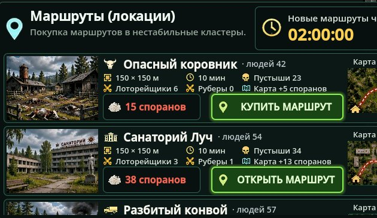
- Каждая перезагрузка кластера переносит на локацию людей: коровник — 35–70, санаторий — 50–80, конвой — 30–60,
  хутор — 35–55, карьер — 65–100 (`people`). 70 % из них сразу становятся пустышами (`infected`).
- Остальные — обычные люди, добыча. По очереди с каждым: с шансом `eat` его ловит и съедает пустыш — пустыш
  отъедается в **лотерейщика**; с шансом `kill` его убивает лотерейщик (если они уже появились) — лотерейщик
  становится **рубером** (не больше `ruber_max`: в санатории 2, в остальных 1); иначе человек прячется. Шансы
  `eat` и `kill` каждый раз свои — из промежутков в данных, поэтому картина каждый раз другая.
- Разыгрывается при **обновлении маршрутов** в компьютере базы (`ULBase.routes_tick`): в карточке маршрута —
  «Пустыши 23 · Лоторейщики 6 · Руберы 0» и «· людей 52» у названия; на карте мира, у выбранной локации —
  «Перенесло 52 человека: 36 сразу заражены; 7 съедены пустышами — те отъелись в лотерейщиков; …». Купленный
  маршрут хранит свою картину до посещения; на локации — ровно столько пустышей, лоторейщиков и руберов.
  В коровнике теперь тоже бывает Рубер (около четверти перезагрузок): во дворах и в поле, далеко от входа.
- Розыгрыш по 2000 перезагрузок (проверка `--as-test=reload`): коровник — пустышей 16–47, лоторейщиков 0–16,
  Рубер в 27 %; санаторий — 23–53 / 0–19 / руберы в 71 %; конвой — 13–40 / 0–13 / 34 %; хутор — 15–36 / 0–14 /
  35 %; карьер — 33–66 / 0–20 / 45 %. Всего тварей = 70 % людей (каждый лотерейщик был пустышом, каждый
  Рубер — лотерейщиком). Прежние промежутки `pustysh` / `lottery` / `ruber_chances` в данных локаций остались
  только для проверок самих локаций и в игре не используются.
- Скорость: в коровнике теперь до 49 тварей (было до 38). Замер на сервере разработки (программная отрисовка,
  `--as-test=csperf --as-n=49` против `--as-n=38`): по шести точкам обхода кадр различается не больше чем на 4 %
  (вход 79,8 / 80,9 мс, в коровнике 83,5 / 81,8, у останков 86,6 / 83,2, лес 82,5 / 80,5, середина 68,4 / 71,8,
  все гонятся 73,0 / 70,9) — дальние враги считаются упрощённо или стоят. На телефоне не замерено.
- Дальше на локации действует голод (раздел ниже): пустыши, наевшись тел, перерождаются уже при герое.
- Спрятавшиеся люди пока только считаются — это будущие новички, которых можно спасти (`docs/PLANS.md`, п. 6).
- Числа — предложение, а не утверждённый баланс: правятся в `data/reload.json`.

## Графика 22.11: цвет, погода, следы боя, текстуры, Vulkan, свет интерьеров, враги в высоком качестве
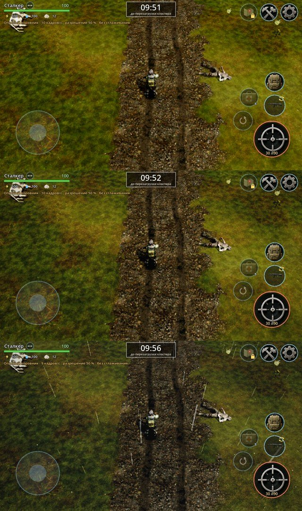
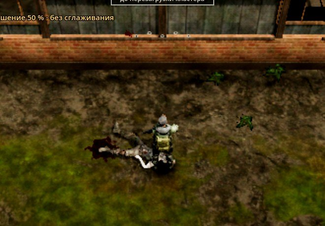
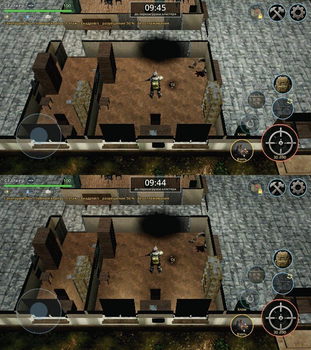
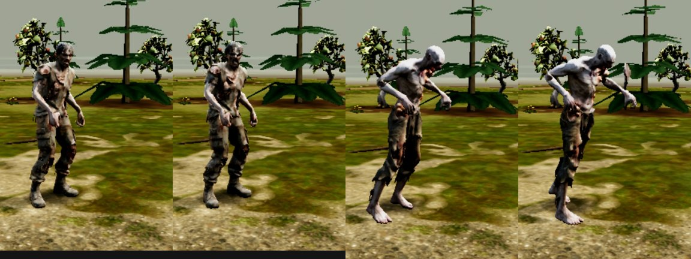
- **Цветокоррекция** (`core/world/grade.gd`, `data/grade.json`): таблица цветов 17³ в `Environment.adjustment_color_correction`
  — её применяет тот же проход, что тонмаппинг (проверено: в «Совместимости» работает), поэтому почти бесплатно.
  У каждой локации своё настроение (подкраска теней и светов, насыщенность, S-кривая, выцветание); в дождь —
  холоднее; в 3-й стадии голода — краснее и тревожнее, плавно за 3 с (таблица считается в фоновом потоке).
  Виньетка и зерно — один прямоугольник умножением поверх 3D (экран не копируется); на «Низкой» их нет.
- **Ветер** (`ULSunShadow.WIND`): глобальный параметр `wind` — направление, сила, порывы. Порыв — волна вдоль
  ветра бежит по полю: трава, ели и деревья-модели (раньше стояли) клонятся полосой, а не каждая сама по себе.
- **Тени облаков и мокрая земля**: в общем куске земляных шейдеров (`sun_shade`) — бесшовный шум 90 м плывёт по
  ветру; в дождь земля темнее и глаже (блики), лужи — тоже.
- **Погода посещения** (`core/world/weather.gd`, `data/weather.json`): шанс дождя на локацию (коровник, санаторий,
  хутор — 30 %, конвой 25 %, карьер и логово 20 %, база 12 %). Дождь — капли и брызги вокруг героя (под крышей нет),
  шум дождя (под крышей тише), гуще дымка, солнце чуть слабее (кадр в дождь темнее сухого на ~18 %). Без дождя —
  пылинки в воздухе. Над лежащими телами кружат мухи, рядом слышно жужжание. Звуки и текстура облаков — свои
  (`tools/make_weather_assets.py`).
- **Следы боя**: лужа крови под убитым растекается за 6 с и лежит до конца посещения (до 40); пуля прошла сквозь
  раненого — брызги со стёками на стене позади; дырки от пуль в стенах, заборах, технике — с пылью и искрами
  (до 70); пятно от удара ложится на пол своего этажа. Гильзы и раньше оставались лежать.
  На базе дырки в стене дома-бункера не видны: снаружи у него толще видимая оболочка, чем стена столкновений.
- **Текстуры**: 10 текстур земли, базовые цвета персонажей и оружия — сжатие высокого качества (на телефоне ASTC
  4×4 вместо ETC2: меньше «кубиков» и мыла). APK больше примерно на 37 МБ.
- **Сборка Б на Vulkan** (`.github/workflows/stand-apk.yml`): после обычного APK собирается `Stiks_vulkan.apk` с
  отрисовщиком «Мобильный»; у телефона без Vulkan — откат на OpenGL. В Vulkan: свечение, растяжение FSR, подробная
  земля, без поправки яркости солнца, подобранной под OpenGL; в главном меню мелкая подпись отрисовщика. Здесь,
  на сервере, режим «Мобильный» не проверить (нет видеокарты; программный Vulkan запустить не разрешено) —
  проверка только на телефоне.
- **Свет интерьеров** (`ULBlock.bake_light`): считается один раз по плану корпуса в фоне при входе на локацию —
  у наружных стен с окнами светлее, в глубине комнат и в комнатах без окон темнее, у окон — тёплые пятна света
  на полу, у ламп светлее. Рисуется двумя плоскостями на этаж (умножение и сложение), видна на этаже героя. Палатки
  и кунги — без него. Настоящие карты освещения через Blender не делались: корпуса строятся кодом при входе, и
  пришлось бы заменить все их сетки готовыми и заново запечь кэши корпусов.
- **Враги в высоком качестве** (Tripo, 150 кредитов): пустыш (цвет был 1024) и лоторейщик заново по исходным
  картинкам — `zombie_hd.glb`, `lottery_hd.glb` (цвет 2048); имена костей те же, но в исходной позе кости
  повёрнуты иначе. Клипы `anim/zombie`, `anim/lottery` сняты со старых моделей, а поправку под чужой скелет
  `BCAnimSet` считал по модели-образцу с именем набора — после замены модели её не стало, и враг на ходу «парил»
  (стопы на 0,7–1,3 м). Исправлено так: поза старого скелета записана (`tools/anim_rest_dump.gd`), по ней клипы
  набора один раз пересчитаны под новый скелет и сохранены (`tools/anim_rebake.gd`), а образцом набора теперь
  служит новая модель (`anim/<набор>/rest.json`) — в игре для неё ничего не пересчитывается, как было со старыми;
  Рубер, который берёт часть клипов лоторейщика, получает поправку уже от нового скелета. Стопы стоящего врага
  0,02–0,05 м, при ходьбе 0,02–0,3 м; лоторейщик бежит ровно (корпус отклоняется до 18°).
  Подсветка контура врагов (`ULEnemy._rim`): края фигуры светлее — сверху враг отделяется от земли; на «Низкой» нет.
- **Чёткость по экрану телефона** (`ULSettings.GFX`, `SCALE_MIN`): трёхмерная картинка на любом качестве рисуется
  в разрешении экрана (альбомная ориентация, полноэкранный режим) — 100 %, точка в точку, персонажи и локация так
  же чётки, как надписи (было 70 / 85 / 100 / 100 % по качеству, подстройка опускала до 62 %). Качество теперь
  меняет свет, тени, землю и траву, а не резкость. Подстройка под частоту кадров сначала снимает сглаживание, тени и
  подробную землю и только потом снижает разрешение — не ниже 85 %. Своё «Разрешение 3D» ниже 100 % игрок может
  выбрать сам, и подстройка его выбор не перебивает (раньше могла поднять выше выбранного). В настройках — строка
  с разрешением экрана телефона. Чего это стоит на телефоне, видно только на нём (замер «Тест уровней» → «Замер»).
- **Свет интерьеров и выход из игры**: фоновый расчёт света корпуса — статическая задача пула (не держит корпус);
  каждую задачу дожидаются ровно один раз — при готовности, при удалении корпуса, а при уходе со сцены
  (`world._exit_tree`) — все оставшиеся (раньше санаторий падал при выходе из игры, когда расчёт ещё шёл).
- Проверки: `look` (снимки: `--as-grade`, `--as-rain`, `--as-in=1` — в комнате, `--as-light=0` — без света
  интерьеров), `traces` (следы), `ux` (`--as-release=1`), `setshot` (снимок окна настроек).
- **Про сервер проверок**: у него нет видеокарты, отрисовка программная, и текстуры со сжатием высокого качества
  (на телефоне — ASTC, распаковывает видеочип) он распаковывает процессором — кадров там меньше (у входа в погреб
  хутора 2–3 в окне 1280×720), и подготовка локации, которая ждёт кадров, дольше (9–11 с вместо 5). Ход проверок
  от этого не зависит, кроме спуска в погреб хутора в окне 1280×720: герой не успевает за 15 с; в окне 640×360 и
  со старым сжатием земли — успевает, все 34 проверки хутора проходят.

## Голод заражённых — кластер «зреет», пока герой в нём (`world.gd` — `_evo_tick`, `data/evolve.json`)
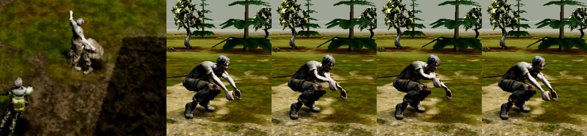
- Время посещения временного кластера делится на три стадии (`stage_at`: 30 % и 60 % времени). Под таймером со
  2-й стадии — оранжевая надпись «заражённые отъедаются», с 3-й — красная «заражённые звереют»; при смене стадии —
  сообщение внизу.
- **2-я стадия.** Раз в `pulse_s` (14 с) до `feeders` (1) спокойных пустышей в `feed_r` (24 м) от свежего тела
  (убитого врага) или останков локации (коровы коровника) идут к нему — быстрее обычного шага, по карте
  проходимости, — садятся на корточки и едят (поза `infected_feed`: тянут куски ко рту то одной, то другой рукой,
  голова клюёт; чавканье `chew_1..3.ogg` раз в 2–4 с). Через `feed_s` (22 с) пустыш с криком и брызгами
  перерождается в лотерейщика на том же месте («Пустыш отъелся и переродился в лотерейщика», если ближе 26 м);
  тело съедено — исчезает, останки больше не годятся. Пока тело едят, оно не пропадает по минутному сроку.
- **3-я стадия.** Едоков до 2, ищут в 34 м, едят 14 с, раз в 9 с. Раз в `unseen_every_s` (70 с) один спокойный
  пустыш дальше `unseen_min_d` (45 м) от героя, который героя не видит, перерождается сам — без тела.
- **Прервать:** едок, увидевший героя, услышавший его или выстрел, или раненый — бросает еду и нападает; не
  дошёл за 40 с — бросает. Убить едока, пока он ест, — обычная добыча с пустыша, перерождения нет.
- **Предел:** за посещение переродиться может не больше `max_share` (35 %) пустышей — от `max_min` (3) до
  `max_max` (12). Переродившийся лотерейщик с шансом `pearl` (5 %) несёт чёрную жемчужину.
- Сообщения при смене стадии: «Заражённые проголодались: едят тела и перерождаются», «Заражённые звереют:
  перерождаются и без тел».
- Смысл: сидеть в кластере до последней минуты опаснее — лотерейщиков становится больше, зато в них больше
  добычи и шанс жемчужины. Все числа — моё предложение, правятся в `data/evolve.json`.
- Проверка: `--as-place=cowshed --as-test=evo` — стадии по времени, едок идёт к телу (одно тело — один едок), ест в
  позе, перерождается на месте, тело съедено, прерывание раной и взглядом героя, предел, 3-я стадия без тел и
  жемчужина (шанс на время проверки поднят до 100 %).

## Дары героя и окно персонажа (`core/world/gifts.gd`, `world.gd` — `open_char_panel`, `data/gifts.json`)
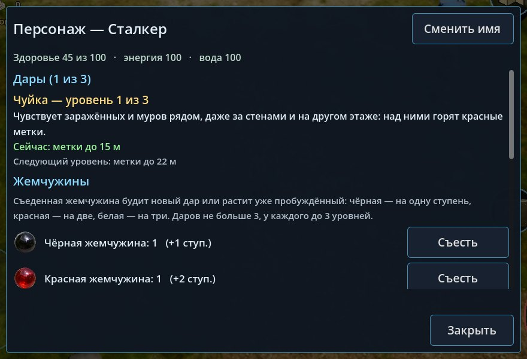
- **Окно персонажа** — кнопка «три точки» у имени (раньше открывала только смену имени): имя и кнопка «Сменить
  имя», здоровье, энергия, вода; «Дары (N из 3)» — у каждого уровень, описание, что даёт сейчас и что даст
  следующий уровень; жемчужины в кошельке с кнопкой «Съесть» (первое нажатие спрашивает «Точно съесть?», второе —
  ест); список всех шести даров (не пробуждённые — серым) с числами по уровням и где брать жемчужины.
- **Как получить:** съесть жемчужину. Чёрная — одна ступень, красная — две, белая — три. Ступень — новый случайный
  дар 1-го уровня (пока даров меньше 3) или +1 уровень случайному уже пробуждённому (до 3-го). Всего 9 ступеней;
  когда всё на пределе, жемчужина не съедается (её лучше обменять). Дары хранятся в профиле
  (`user://profile.json`, рядом с именем) и не теряются при гибели и сбросе добычи.
- **Дары** (числа по уровням 1 / 2 / 3 — предложение, правятся в `data/gifts.json`):
  - «Чуйка» — красные треугольники над заражёнными и мурами, которых герой не видит (за стеной, на другом этаже),
    в 15 / 22 / 30 м; кто за краем экрана — стрелка у края в его сторону;
    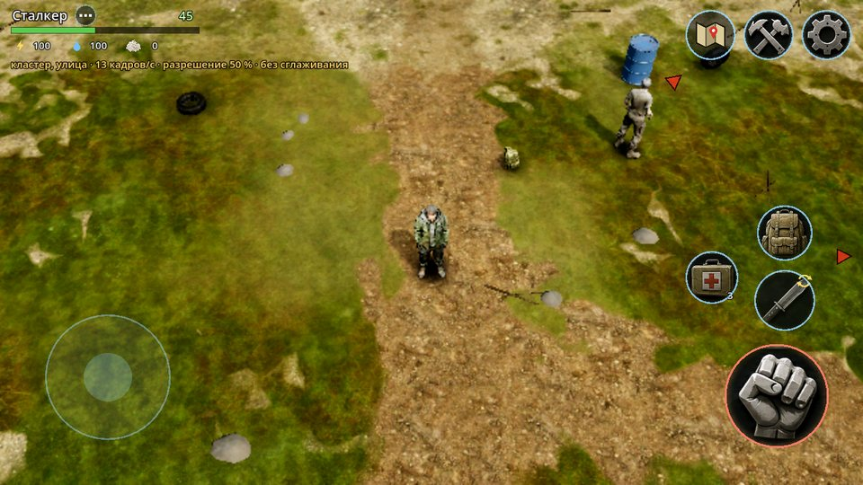
  - «Скороход» — скорость ходьбы и бега +6 / 12 / 18 %;
  - «Живучесть» — если 6 с никто не бил, здоровье прибывает 0,4 / 0,8 / 1,2 в секунду;
  - «Тихий шаг» — заражённые слышат шаги и бег героя на 20 / 35 / 50 % ближе;
  - «Крепкая кожа» — урон по герою −8 / 15 / 22 %;
  - «Фарт» — споранов в телах +20 / 40 / 60 %, шанс гороха во столько же раз выше.
- Проверка: `--as-test=gifts` — ступени по цвету жемчужины, предел 3 дара × 3 уровня, отказ на пределе,
  сохранение, действие каждого дара (урон, восстановление, скорость, добыча, слух, метки), окно и двойное
  нажатие «Съесть».

## Инвентарь (`core/world/items.gd`, `inventory.gd`, `inventory_ui.gd`)
- Отдельное меню на весь экран (игра за ним не видна), «Закрыть» — обратно в игру. В шапке — сколько ячеек занято.
- Экран «Инвентарь»: слева — слоты одежды (шлем, жилет, куртка, штаны, обувь — пока заготовки), в центре —
  герой в полный рост (3D, можно повернуть пальцем; с оружием — в стойке, рюкзак — на спине), под ним — здоровье,
  энергия, вода; рядом — слоты «Основное», «Пистолет / нож», «Рюкзак» и строка «В руках: …». Справа — карманы
  (8 ячеек) и ячейки надетого рюкзака: малый +8, средний +12, большой +20. **В начале игры доступен только малый**
  (лежит у места появления; изредка попадается в тайниках); **средний и большой — только у торговца** (оружейник,
  «Припасы и снаряжение»: 1 и 2 горошины) — в добыче кластеров и в телах их нет. Купленный рюкзак больше
  надетого **надевается сразу**: вещи перекладываются в него, старый (пустой) — в карман. Надеть рюкзак из
  кармана можно и с вещами в надетом — они перекладываются, если помещаются (иначе смены нет, ничего не теряется).
- Экран «Хранилище»: слева — картинка ящика или рюкзака, вместимость, «Взять всё» (у рюкзака — «Надеть»);
  затем содержимое (4 в ряд), слоты снаряжения, карманы и рюкзак.
- Нажатие на предмет выбирает его; внизу — описание и действия: «Экипировать» / «Надеть», «В руки» / «Убрать
  из рук», «Снять», «Использовать», «В хранилище» / «Взять», «Выбросить». Повторное нажатие — быстрое действие
  (экипировать, использовать, переложить). Патроны и расходники складываются в стопки.
- Выброшенный предмет ложится на землю перед героем — своей 3D-моделью.
- Рюкзак с земли можно надеть вместе с вещами; надетый при этом ложится на землю со своими вещами. Рюкзак
  с вещами нельзя убрать в ячейку — только выбросить.
- Всё сохраняется (`user://cluster.json`, версия 6): инвентарь, предметы на земле, содержимое ящиков, здоровье,
  энергия, вода, патроны в магазинах.

## Патроны — одна модель Tripo по фото
- `ul_ammo` — по присланной картинке одной генерацией (55 кредитов): семь коробок (7,62×25, 9×19, 5,45×39,
  7,62×51, 7,62×54R, 9×39, 12 калибр), у шести рядом стоит патрон (у 9×19 патрон не получился — на значке стоит
  патрон от 7,62×25). `tools/split_glb.mjs` режет набор на семь предметов и у каждого выделяет части: `item_N` —
  коробка с патроном, `item_N_a` — коробка, `item_N_b` — патрон.
- В инвентаре патроны — значок «патрон и коробка», как на фото, и количество (`assets/icons/ammo_N.png`, снимок
  той же модели); на земле лежит только коробка.

## Набор припасов — одна модель Tripo
- `ul_supplies` — девять предметов одной генерацией (55 кредитов): красная коробка пистолетных патронов, зелёный
  цинк, коробка патронов 12 калибра, аптечный пузырёк, бинт, аптечка, пачка сухарей, бутылка воды, консервная
  банка. `tools/split_glb.mjs` выравнивает набор, делит его на связные куски и собирает в `assets/world/
  ul_supplies.glb` девять отдельных предметов (`item_1`…`item_9`) с одной общей текстурой.
- Каждый предмет каталога ссылается на свой номер (`kit` в `items.gd`): эта модель лежит на земле, а значок
  в инвентаре — снимок той же модели (`tools/icons.gd` → `assets/icons/kit_N.png`). Патроны разных калибров
  делят одну модель и различаются оттенком значка и названием.
- Новый предмет — «Живчик» (пузырёк): +60 энергии, +5 здоровья.
- Так же можно добавлять следующие наборы: одна генерация — много предметов (`tools/kit_view.gd` — обзор набора).

## Проверка
- `godot --path . --headless res://world.tscn -- --as-test=inv` — 151 случай (без экрана — около минуты, время
  считается честно, 60 кадров/с): отклик управления (разгон, остановка, камера), нажатие во время доставания
  оружия, автонаведение за спину и через забор, удержание кнопки, манекен, содержимое ящиков, кнопка
  взаимодействия (нет цели — нет кнопки; житель, ящик), разговор, смена имени, режимы огня (пистолет — один
  выстрел, автомат — очередь до нуля, перезарядка кнопкой), полёт пуль и дробин, выход с локации по отсчёту, враг (замечает, слышит выстрел, бьёт, гибнет, 0–3 спорана, обыск, тело исчезает через
  минуту — обысканное и нет, гибель героя, справочник), ресурсы (кошелёк без ячеек, все пять, окошко, покупка,
  отказ при нехватке, сохранение, перенос из старого сохранения), прочность оружия (выстрел снимает единицу,
  строка в инвентаре, поломка и возврат патронов), Лоторейщик (рост, слух на бег и шаги, крик перед погоней,
  обход ящика, сильное попадание, падение по стороне удара, горошина в трети тел),
  а также логика
  инвентаря (стопки, слоты, ёмкость
  с каждым рюкзаком, переполнение, выброс и подбор, смена рюкзака с вещами, ящик, сохранение) и бой (кулаки,
  мачете во втором слоте, выстрел и расход патронов, попадание по мишени, перезарядка из запаса, пустой запас,
  лечение, вода, энергия) с ответом «верно / ОШИБКА».
- `--as-test=pc` — базовый компьютер (41 случай): пять ресурсов, добыча на панели, отказ и недостача, покупка
  оружейника один раз, маршрут, таймер маршрутов, обмен по всей цепочке в обе стороны, окно обмена, двойное
  касание, сохранение и загрузка; `--as-out=папка` — снимки экрана компьютера и окна обмена.
- `--as-test=cs` — коровник (22 случая): размер, постройки (стены непроходимы, в каждую можно зайти, крыша над
  героем растворяется), коровы двух видов, число и места врагов, 30 разных
  посещений, враг замечает и бьёт, таймер, уход за край с добычей, повторная покупка, тревога, перезагрузка с потерей
  вещей при себе, вещи базы целы, коровник пропал с карты; `csview` — снимки, `csperf` — нагрузка при 38 врагах.
- `--as-test=sn` — санаторий (42 случая, по списку задания; в том числе Рубер: число 0–2, места, добыча, рывок, удар, оглушение, гибель, обыск): размер, расположение корпусов по карте, комнаты и
  двери, путь от входа на каждый этаж каждого корпуса, стены непроходимы, на этаже героя крыша и верхние этажи
  скрыты и стены срезаны, герой сам поднимается и спускается по лестнице, закрытая дверь — преграда и открывается
  при подходе, пустыш из кабинета 1 этажа доходит до героя на 2 этаже и бьёт, число врагов и где они (в корпусах и
  снаружи, лоторейщики — в своих зонах), никто не в стене и мебели, не у ворот, не толпой, 30 разных посещений,
  обыск тайника и тела, таймер, убитые не возвращаются, хлам во всех корпусах, уход с добычей, повторная покупка,
  перезагрузка с потерей вещей при себе; `snview` — снимки, `snperf` — нагрузка при 55 врагах, `snbake` — карты
  земли и проходимости.
- Погоня по этажам (`--as-test=snchase`, можно с `--as-fps=12`): пустыш из десяти комнат первого этажа главного
  корпуса идёт к герою на втором. Чтобы враги не застревали: тело врага уже запаса карты путей (0,28 м против
  0,3 м), по пути карты враг идёт без «щупа» перед собой (тот сбивал его у перил и косяков), столкновение перил
  у верхней площадки лестницы короче на 0,9 м.
- Нагрузка санатория при 57 врагах (два Рубера): до 252 вызовов и 358 тыс. треугольников — в бюджете.
- Нагрузка санатория при 55 врагах (`snperf`): средняя графика — до 252 вызовов отрисовки и 352 тыс. треугольников
  (тени солнца — одна карта на 32 м, тень отбрасывают только стены и крыши), низкая — до 162 вызовов и 115 тыс.;
  текстуры 66 МБ; скрипты и физика на компьютере 3,6–7,9 мс за кадр — столько же, сколько у коровника на той же
  машине в тот же час (4,7–7,8 мс; из этого ИИ врагов — 0,3–1 мс, остальное — движения скелетов в движке).
- `--as-test=cv` — «Разбитый конвой» (40 случаев, по списку задания): поле и вход с юга, зоны по карте, техника
  отдельными моделями и непроходима, размеры палаток, путь от входа внутрь каждой палатки, кунга, поста и
  контейнера, стены непроходимы, герой сам входит в штабную палатку (крыша скрывается, обстановка видна) и
  выходит, обстановка палаток, свет, дверь кунга (преграда — открывается), пустыш снаружи заходит за героем в
  палатку и бьёт, герой поднимается на вышку и спускается (навес скрывается, ящик наблюдателя), число врагов
  15–35 / 3–10 / 0–1 и всего 18–46, зоны, никто не в препятствии и не у входа (и в 30 посещениях), шанс Рубера,
  виды тайников, у каждого вида можно встать и получить «Обыскать», обыск кузова с переносом патронов и хлама,
  добыча за 300 посещений (патроны и хлам — в каждом, медикаменты, только существующее оружие, без жемчуга),
  добыча Рубера, хлам кучками, таймер 10:00, маршрут 53 спорана, место на карте, уход с добычей, покупка заново
  (за 34 — отказ), перезагрузка с героем в палатке; `cvview` — снимки (21 точка), `cvbake` — карты и готовая сборка.
- `--as-test=cvrock` — бросок камня Рубера (19 случаев): метка там, где герой; камень вырван, брошен через 3 с,
  летит по дуге; урон в круге; булыжник пропал, метка погасла, следы убраны; звуки по шагам и вовремя (свои
  файлы), ограничитель на общей шине и громкость на расстоянии камеры; передышка; вышел из круга — мимо;
  оглушение и гибель до броска срывают его, обычное попадание — нет; с 8 м — рывок вместо броска; в палатку не
  бросает; подбежал вплотную — роняет камень и бьёт; шагнул под крышу палатки — урона нет; два Рубера — не
  больше одного круга сразу; строка в справочнике; `--as-out` — снимки по шагам.
- Нагрузка хутора при 40 врагах (`khperf`, 10 мест, средняя графика): до 206 вызовов отрисовки и 431 тыс.
  треугольников (большой дом и магазин внутри; от прогона к прогону ±30 тыс. — враги стоят по-разному), текстуры
  129 МБ — в бюджете. После деталей Tripo на фасадах было 465 тыс.; вернули в бюджет: сетки мебели Tripo упрощены
  вдвое (полки, банки, мешки, шкафы, плиты, кровати), уличные детали — на треть; враги дальше 18 м от героя не
  отбрасывают настоящую тень (под ними остаётся мягкое пятно, а карта теней не рисует их тело второй раз).
  `--as-tris` к любому замеру печатает, из чего складываются треугольники в кадре (по моделям и группам).
- Нагрузка конвоя при 46 врагах (`cvperf`, 10 мест, средняя графика): до 179 вызовов отрисовки и 434 тыс.
  треугольников (склад; когда все 46 врагов гонятся за героем посреди дороги — 421 тыс.), текстуры 72 МБ — в
  бюджете, но по треугольникам запас мал: на открытом месте видно больше врагов, чем в корпусах санатория. Мелкие
  модели (ящики, тела) не отбрасывают тени и видны до 42 м, техника — до 60 м.
- `--as-test=kh` — «Хутор» (31 случай, по списку задания §16): поле и вход с юга, состав построек, размеры домов,
  комнаты, мебель-модели, путь от входа внутрь каждой постройки и в погреба по лестнице, весь пол построек достижим,
  стены непроходимы, дверь дома (преграда — открывается), крыша скрывается, магазин и сарай, спуск в погреб (вырез
  земли, вход скрыт, свет, обыск), подъём, тайники и добыча за 200 посещений, число и зоны врагов (и за 30 посещений),
  подвалы как здания (помещения, двери, свет, тайники, пусто сверху), заражённые в подвалах, пустыш заходит за
  героем в дом и спускается в подвал, таймер, маршрут 27 споранов, место на
  карте, уход, покупка заново, гибель в подвале по таймеру; `khview` — снимки (21 точка: снаружи, дом, кухня,
  магазин, подвалы и кладовая), `khbake` — кэш построек и карты, `khperf` — нагрузка при наибольшем числе врагов.
- `--as-test=lvl [--as-place=khutor]` — «Тест уровней»: герой с пулемётом, бессмертен, патроны не убывают, ничего не
  сохраняется, выход в меню; `--as-test=lvlbench --as-place=…` — «Замер FPS»: обход всех мест, таблица на экране,
  в буфере обмена и в файле.
- `res://map.tscn -- --as-test=map` — карта мира, в том числе коровник, санаторий, конвой и хутор до и после покупки маршрута и вход.
- `--as-test=world --as-out=папка` — сценарий со снимками: открыть рюкзак на земле и надеть, дойти до ящика,
  взять оружие, взять в руки, открыть инвентарь, выбросить, переложить в рюкзак на земле, пройти по дому.
- `--as-test=view --as-out=папка` — обзор локации: снимки в шести точках.
- `--as-test=gbake` / `gcheck` / `gperf` — запекание, проверка и замер быстрой земли (раздел «Запечённая земля»);
  `wperf` — цена групп поверхностей, `lumtest` — яркость с тенями и без.
- `--as-test=shbake --as-place=<место> --as-gfx=3 --as-out=папка` — запечь тени солнца на земле (снимок
  `shadow_<место>_raw.png`; дальше — `tools/shadow_post.py`, см. раздел «Запечённые тени солнца на земле»);
  `--as-test=shcheck --as-place=<место>` — семь проверок запечённых теней локации.
- `--as-test=mapbake --as-place=home|cowshed|sanatorium|convoy|khutor|lair|quarry --as-gfx=3 --as-out=папка` — запечь
  карту локации (`top_<место>.png`; затем — в `assets/ui/topmaps/top_<место>.jpg`, настройки импорта — как у
  соседних). `--as-test=pmap --as-place=quarry` (и `home`) — проверка карты: цена, покупка с маршрутом и отдельно,
  кнопка, метка героя, совпадение снимка с локацией.
- `--as-test=gqview --as-place=quarry --as-at=x,z --as-gfx=1 --as-out=папка` (окно `--resolution 2400x1080`) — сравнение
  чёткости: один неподвижный кадр игровой камеры (без врагов) при доле разрешения 62 / 70 / 85 / 100 % и резкости
  0 / 1 / 2 — снимки `gq_<доля>_s<резкость>.png`; с `--as-one` — один кадр (100 %, мягкая резкость): так
  сравнивается вид разных локаций (`--as-place=cowshed|sanatorium|convoy|khutor|lair|quarry`). `--as-sharp=0..2` — резкость для любых других снимков (в
  проверках она по умолчанию выключена).
- `--as-test=qrpano --as-out=папка [--as-only=p0_south,p1_village,…] [--as-gfx=3]` — обзорные снимки карьера с высоты
  (свободная камера, как пролёт над локацией; в игре такой камеры нет — у обзорной в кадре горизонт и небо).
- `--as-test=top --as-out=папка [--as-gfx=3] [--as-px=4096] [--as-span=106]` — цельный снимок локации строго сверху
  (`top.png`): отдельная камера без перспективы смотрит отвесно вниз на всё поле, без кнопок интерфейса, без дымки
  и без ограничения дальности прорисовки; верх снимка — «вверх» на экране в игре. Стартовая локация:
  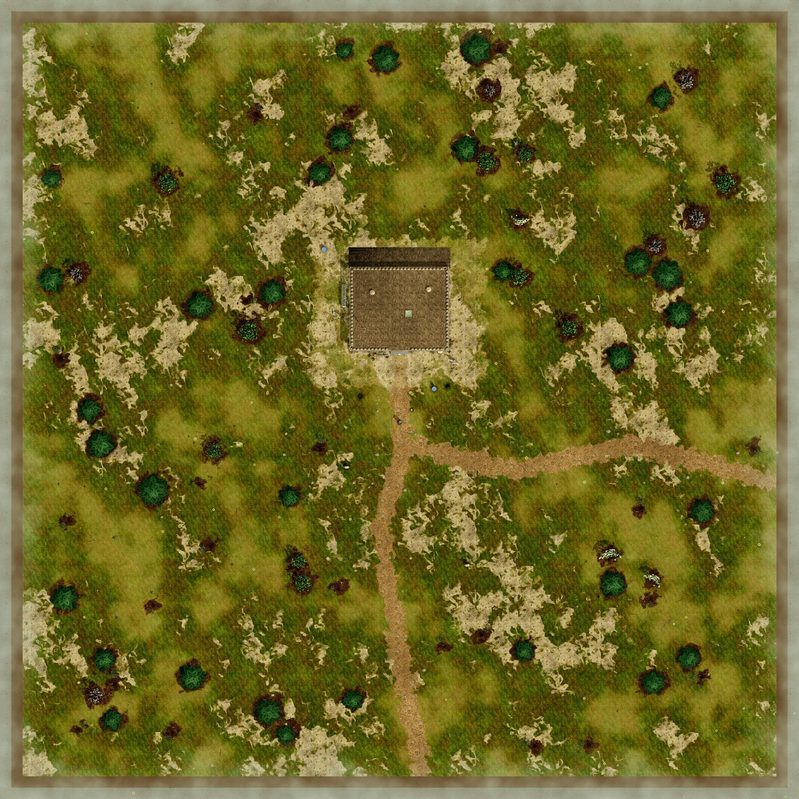
- `--as-test=bossview --as-out=папка` — главарь муров на открытом месте стартовой локации: размер, скелет и клипы, бег,
  вступление, тяжёлый выстрел, прицельный выстрел, удар ногой, фазы и подмога, граната (попала / вышел из круга),
  гибель — 16 пунктов; `--as-test=bossdemo` с `--write-movie` — запись его движений.
- `--as-test=photo --as-out=папка [--as-kind=mur_boss]` — портреты персонажа в полный рост на чистом белом фоне (шесть
  ракурсов, стойка и прицел) — образец для сторонних инструментов; `--as-test=zdemo` с `--write-movie` — запись
  движений заражённого.
- `--as-test=murmove --as-out=папка [--as-kind=mur_ak|mur_sg|mur_boss]` — походка мура: дозор, сближение, бой; печатает
  скорость, угол между корпусом и направлением движения, скольжение опорной стопы; снимки по стадиям.
- `--as-test=arena --as-out=папка` — полигон: борт держит героя, враги по кнопке (не больше шести), патроны,
  уборка врагов, гибель; `--as-test=shop` — разговор, торговля, покупка; `res://stand.tscn -- --as-test=enemy` —
  враг на стенде, по снимку на движение.
- `--as-test=enemy --as-out=папка` — заражённый: стоит, бежит, бьёт, падает, обыск, справочник (общий вид и
  крупный план); `--as-test=eclips` — его движения по кадрам.
- **Проверка производительности для Android** — в конце каждой проверки (`_perf_report`) и отдельно
  `--as-test=perf`: замеры в семи местах (старт, калитка, двор, ельник, тропа, дом, открытый инвентарь) против
  бюджета кадра для телефона среднего класса (Mali-G57 / Adreno 610, цель 60 кадров/с): вызовов отрисовки ≤ 350,
  треугольников ≤ 450 тыс., текстуры ≤ 450 МБ, свои скрипты и физика ≤ 4 мс в худшем кадре (на компьютере; телефон
  считает в 3–4 раза медленнее). Отрисовка считается при запуске с экраном, скрипты — при запуске без экрана
  (`--headless`: под программной отрисовкой время кадра — это сама отрисовка). Сейчас: до 133 вызовов,
  143 тыс. треугольников, 99 МБ текстур, 3.2 мс — всё в бюджете.
- Саму частоту кадров можно измерить только на телефоне: меню (шестерёнка) → «Тест FPS» — 10 секунд игры,
  на экране остаются средняя частота, худший кадр, вызовы отрисовки, треугольники и память текстур; то же
  пишется в `user://perf.txt`.
- Проверено на компьютере (программная отрисовка, поэтому 1–3 кадра/с в журнале — не показатель). На телефоне
  не проверялось: управление пальцами и частоту кадров нужно смотреть там.

## Источники
- Мачете (помощник `core/melee_tuner.gd`): хват и удар — [outdoors.codidact.com: Correct way to wield a machete](https://outdoors.codidact.com/posts/52671),
  [Everest Forge: How to Use a Machete](https://everestforge.com/everest-forge-blog/how-to-use-a-machete-beginner-training),
  [vivatropical: how to swing a machete like a local](https://vivatropical.com/lifestyle/how-to-swing-a-machete-like-a-local/),
  [bladeforums: the machete pinch grip](https://www.bladeforums.com/threads/the-machete-pinch-grip-or-how-to-use-a-machete-video.694505);
  подвижность запястья — [Mayo Clinic: functional ranges of motion of the wrist joint](https://mayoclinic.elsevierpure.com/en/publications/functional-ranges-of-motion-of-the-wrist-joint/),
  [PMC: wrist range of motion](https://pmc.ncbi.nlm.nih.gov/articles/PMC3016043). Это советы практиков и справочные
  нормы, а не измерения ударов мачете.
- Земля (общая библиотека `GROUND_SETS` в `world.gd`) — Poly Haven, CC0: brown_mud_rocks_01 (грязь с камнями),
  brown_mud_dry (утоптанная сухая земля с галькой), old_wood_floor (полы), кусты searsia_lucida, папоротник fern_02.
- Модели дома, ящика, сосны, берёзы, яблони, куста, набора припасов — Tripo AI, аккаунт пользователя
  (`tools/tripo/budget.md`).
- Текстуры — Poly Haven, CC0 (`assets/world/tex/`): forrest_ground_01 и leafy_grass (трава), grass_path_2 (сухая
  земля), rocky_trail (галечная тропа), rock_boulder_dry (валуны), old_planks_02 (серые доски забора),
  bark_brown_02 (кора), dry_ground_01, rocky_gravel, weathered_brown_planks, brown_planks_03 (дом внутри),
  weathered_plank_siding (стены дома снаружи), worn_corrugated_iron (кровля). Гамма светлая: зелёный луг
  с проплешинами сухой земли, а не тёмная лесная почва.
- Откуда брать текстуры дальше: Poly Haven (polyhaven.com) и ambientCG (ambientcg.com) — обе библиотеки CC0
  (можно в коммерческой игре, без указания автора), обе доступны из сборочной среды. Модели Tripo с размытой
  раскраской улучшаются тем же приёмом, что дом: чёткая фототекстура поверх, раскраска модели — как светлота.
- Бочка и покрышка — модели Poly Haven, CC0: barrel_03, old_tyre (`assets/world/ph_barrel.glb`, `ph_tyre.glb`,
  текстуры уменьшены до 512).
- Модели Poly Haven, CC0 (polyhaven.com, можно в коммерческой игре без указания автора): exterior_aircon_unit
  (ржавый вариант, `ph_aircon.glb`), metal_trash_can (ржавый, `ph_trash.glb`), rock_moss_set_01 (три камня
  набора — `ph_rock1..3.glb`), dead_tree_trunk_02 (`ph_trunk.glb`), wooden_picnic_table (`ph_picnic.glb`),
  plastic_monobloc_chair_01 (`ph_chair.glb`), cardboard_box_01 (`ph_box.glb`). Сетки упрощены (meshoptimizer через
  gltf-transform), модели выровнены по центру, цвет ≤ 1024, нормали и шероховатость ≤ 512.
- Еловая лапа (`spruce_bough.png`) и пучок травы (`grass_tuft.png`) — нарисованы скриптами, собственные.
- Значки кнопок (`assets/icons/ui/`) — из набора, присланного пользователем. Забор, проволока, ели, поленница,
  колода, камни, ветки — своя геометрия.

## Хранилище базы (`world.gd` — `_storage`, `open_safe`; `base_state.gd` — `buy_storage`, `safe_cells`)

- Комната — **первая слева от входа** (бывшая кухня). До покупки пустая и называется «Кухня»; с первого уровня —
  «Хранилище»: металлическая дверь (открыта к стене, проём свободен), лампа с тёплым светом, металлический
  стеллаж с коробками у левой стены, жёлтые таблички «ХРАНИЛИЩЕ» над сейфами и у двери со стороны сеней,
  резиновый коврик.
- **Сейфы №1–№6 — в один ряд вдоль задней стены**, дверцами к герою (камере), промежутки 8 см, перед рядом —
  свободный проход от двери к каждому сейфу. Места ещё не купленных сейфов размечены на полу жёлтой рамкой с
  номером. Сейф — модели Tripo по эскизу пользователя (модель по картинке): `st_safe` — закрытый (штурвал,
  кодовая панель, массивные петли, знак, жёлто-чёрная полоса), `st_safe_open` — открытый (дверь распахнута,
  полки с ящиками, банками и аптечкой). «Открыть» — писк кодового замка, лязг засовов, сейф открывается;
  закрыли окно — закрывается. Номер — латунная табличка «№k» на стене над сейфом. Без моделей — свой сейф
  (корпус с полками и дверца на петлях, которая поворачивается).
- Подойти — «Сейф №k», «Открыть». Окно «СЕЙФ №k» (значок — сейф): **сетка 6 × 5 (30 ячеек)**, «Взять всё», «Положить всё» (из карманов и
  рюкзака), «Сортировать» (одинаковые стопки сливаются, затем оружие, патроны, лекарства, еда, ресурсы, минералы,
  хлам); у предмета — «Взять», «Разделить», «Переместить» (пустая ячейка — перенести, тот же предмет —
  объединить, другой — поменять), «В сейф…» (в любой другой сейф, со свободными ячейками), «Выбросить». Ресурсы
  (спораны, горох, жемчуг) — касанием по значку в кошельке. Оружие, патроны, всё из инвентаря — можно.
- Содержимое — `storage.safes.safe_1 … safe_6` в `user://base.json` (номер сейфа постоянный), сохраняется при
  каждом изменении и при закрытии окна. Гибель и перезагрузка кластера сейфы не трогают (теряется только то, что
  при себе).
- Проверка: `--as-test=st [--as-out=папка]` — 17 пунктов: карточка на уровнях 0/1/6, нехватка, покупка,
  улучшения, максимум, комната, ряд и проход, подход, окно, все действия, сохранение, гибель и сброс; снимки
  комнаты на уровнях 0, 1, 3, 6.

## Столкновения предметов (22.11, просьба пользователя: «чтобы герой не проваливался в текстуры и не проходил
## через коров, стога сена и всякое остальное»)
- Стены бункера держат героя по наружной грани бетона (раньше — только внутренние стены дома, а бетон снаружи
  толще на 0,23 м: герой «входил» в него). Оружейная стойка и бочка у бункера отодвигаются от бетона сами.
- Мелкие предметы, которых нет в карте проходимости (останки коров — ставятся заново каждое посещение, тела
  военных, ящики и покрышки у стен, носилки, пугала), получили столкновение на отдельном слое
  `world.PROP_LAYER` (8): через них не проходят герой и машина, а заражённые их не задевают (их маска — без этого
  слоя) и не застревают.
- Проверка `--as-test=colaudit --as-place=…`: каждая модель выше колена должна иметь столкновение (деревья,
  папоротник, окна и двери в стенах, рюкзаки и вещи на земле — не в счёт). Все 7 мест — 0 предметов без столкновения.
- Ящик-хранилище (кнопка «Постройка») ставится только на свободное место: проверка коробкой ящика впереди, чуть
  дальше, сбоку, поперёк, позади; места нет — подсказка, ящик не ставится (раньше мог войти в стену).

## 23.11: контур, звуки по поверхностям, верстак, замер FPS, земля и свет базы

Выбор пользователя из предложенного списка: пункты 1, 2, 3, 4, 6, 10, 12.

- **Контур героя и заражённых** (`ULEnemy.outline`, вызывается и для героя в `heroes.gd`): второй проход материала —
  раздутая на 4,5 мм модель, видны только задние грани, тёмный неосвещённый цвет. Сверху фигура отделяется от земли.
- **Звуки** (`tools/make_sfx.py` — собственный синтез, numpy + ffmpeg, чужих записей нет): шаги по бетону, дереву и
  металлу (`step_concrete_*`, `step_wood_*`, `step_metal_*`; поверхность выбирает `_step_surface`), скрип двери
  (`door_creak_*`, через `ULDoor.on_sound`), лязг ворот гаража (`gate_open`). Обороты двигателя УАЗа по скорости были раньше.
- **Верстак** (`core/world/craft.gd` — `ULCraft`, рецепты `data/craft.json`): вкладка «Верстак» в окне гаража и
  пятое место в гараже — у стола модернизации (`g_bench`). Пока рецепт один (указание пользователя): из хлама —
  **ремкомплект машины** (`car_kit`). Ремкомплект применяется в окне машины, «Состояние»:
  чинит самую побитую деталь на четверть её прочности (`ULGarageOps.use_kit`). Не хватило места — материалы
  возвращаются. Все числа рецептов — предложение, не утверждённый баланс.
- **Замер FPS**: кнопка «Замер FPS» в «Настройках» главного меню — есть и в собранной игре (раньше замер был только в
  «Лаборатории», которой в сборке нет). Выбрать место — герой сам обходит точки; в конце крупная оценка словами
  (ПЛАВНО от 50 к/с в самом тяжёлом месте, НОРМАЛЬНО от 30, ПОДТОРМАЖИВАЕТ от 20, иначе ТОРМОЗИТ), таблица, кнопки
  «Скопировать ещё раз» и «В главное меню». Прошлый результат показывается в окне выбора (`user://bench_last.txt`).
- **Земля базы** (карта земли `ground_mask.png` перепечена): две колеи от ворот гаража к тропе (`DRIVE`), тропинка
  от двери гаража к крыльцу бункера (`FOOT`), вытоптанная полоса вокруг гаража, бурьян вдоль его стен, мелкие камни
  под стенами бункера и гаража (не у дверей и ворот).
- **Свет интерьеров базы** (`core/world/glows.gd` — `ULGlows`, `_glows_home`): под лампами — лужи тёплого света на
  полу (одна сетка, рисуется сложением, настоящих ламп не добавляет), в углах комнат бункера и гаража — тёмные пятна.

Проверки: `garage` (26а–26в — верстак и ремкомплект, 7 — пять мест), `lvlbench` (оценка и файл), `menu` («Замер FPS»
в настройках собранной игры), `garview` (снимки `gv_drive`, `gv_path`, `gv_in_hall`, `gv_in_armory`).
На телефоне эти изменения ещё не проверялись.
- **Гараж и площадка под него** (`garage.gd`): у всех коробок гаража нормали больше не сглаживаются через рёбра
  (`generate_normals` убран — у коробок и цилиндров нормали свои): плита под будущий гараж не темнеет чёрной полосой
  у края, стены читаются гранями и фактурой, а не «мыльным» переходом. На пустой площадке — покрышки, бочки, ящик,
  лом и мусор по дальним углам (середина и сторона ворот свободны).

## 23.11 (вечер): скрытность, эффекты попаданий, интерфейс, обжитость построек, палитра

Выбор пользователя: пункты 1, 2, 4, 6, 7, 8 из списка «графика и геймплей».

- **Скрытность — пока выключена** (указание пользователя 23.11: `enabled: 0` в `data/stealth.json` — кнопки с глазом
  нет, режим не включается; вернуть — `enabled: 1`). Как устроена:
  (`world.gd` — `sneak`, `set_sneak`, `sneak_see_k`; `data/stealth.json`): кнопка «Красться» (глаз,
  левее перезарядки). Герой идёт пригнувшись не быстрее `speed` (1,6 м/с), его шагов враги не слышат, спокойный
  враг замечает его ближе: спереди на `see_front` (0,55) дальности зрения, со спины — на `see_back` (0,3).
  Удар холодным оружием или кулаком по врагу, который героя не заметил, — ×`backstab_k` (4), обычного врага
  убивает сразу (главаря — нет); над врагом крупная красная цифра. Выстрел поднимает героя в рост; за рулём не
  крадутся. Под кнопкой — «скрытно» или «заметили». Все числа — предложение, не утверждённый баланс.
  Проверка: `--as-test=stealth` (7 пунктов).
- **Эффекты попаданий** (`_impact_fx`, `_bullet_hole`): пуля в землю или пол — клуб бурой пыли и выбоина; по железу
  (машина, предметы с меткой `metal`) — сноп искр и звон; частицы пыли и искр — мягкие круглые пятна, а не
  квадраты (и у прежнего облачка из стены). Выстрел толкает камеру (дробовик сильнее, очередь — мелкая дрожь).
  Гильзы лежат 25 с, до 24 штук (`BCShotFx`). Проверка: `--as-test=impactfx`.
- **Интерфейс**: предметы на земле ближе 9 м подсвечены «дышащим» золотистым кольцом (`ULLootMarks`, одна сетка);
  шапка — на тёмной плашке с рамкой, полоска здоровья с бликом, делениями по четверти и рамкой.
- **Обжитость построек на всех локациях** (`ULSanatorium._door_wear`): у каждой наружной двери — вытоптанное бурое
  пятно с рваным краем, под стенами — мелкие камни (не у дверей; палатки и погреба — без них). Две сетки на
  локацию, столкновений нет. Свет у входов приглушён (был ярко-жёлтым пятном днём). Хутор — 23 входа и 166
  камней, логово — 31 и 309, конвой — 4 и 21. У коровника постройки свои — там этого нет.
- **Единая палитра предметов** (`ULSanatorium.mute`): цвет материалов моделей на локациях подводится к общему
  тёплому приглушённому тону (× 0,86 / 0,82 / 0,74) — синие бочки и красные ящики меньше выбиваются. Текстуры
  не меняются. Растительность и коровы не затронуты.
- Проверка вида у входов: `--as-test=glowview --as-place=<локация>` (снимки с пятнами и без).

На телефоне не проверялось.

## 23.11: цены оружейника и контур дальних врагов

- **Цены** — см. раздел про магазин: `data/shop.json`, оружие от 15 споранов (ТТ) до 45 горошин (ПКП).
- **Оптимизация**: контур у врага рисуется отдельным проходом только пока враг рядом с героем (`set_active` —
  ближе 18 м во временном кластере); раньше второй проход шёл у всех 38–70 врагов локации. Камни под стенами —
  сетка попроще. Замер `csperf` (коровник, 38 врагов, программная отрисовка) — в отчёте пользователю; на телефоне
  не проверялось.

## 25.11: локация живёт до конца своего времени, движения людей

**Локация не исчезает после выхода.** Купленный маршрут остаётся на карте, пока не выйдет время кластера
(таймер идёт по настоящим часам, и когда игра закрыта — тоже). Вышел в туман (те же 5 секунд у края на любой
локации), погиб или вышел в меню — в кластер можно вернуться: там те же убитые враги, та же добыча на полу
и в ящиках, то же задание и та же «спелость» заражённых. Состояние посещения — `user://visit_<локация>.json`
(`ULBase.visit_save / visit_load / visit_clear`), маршрут — `ULBase.data.routes[id] = {state, seed, start, end}`
(`route_begin`, `route_left`, `route_info`; просроченный закрывается сам в `route_state`). Что считается выходом
«с возвратом» — `route_keep` в `data/base_shop.json` (`left`, `menu`, `dead`). Перезагрузка кластера (время вышло)
закрывает маршрут всегда. Не сохраняются: необысканные тела убитых. На карте мира под точкой — оставшееся время,
в панели — «До перезагрузки кластера: м:сс», в компьютере базы — «ОТКРЫТА ЕЩЁ м:сс». Проверка: `--as-test=revisit`
(две загрузки сцены подряд в одном запуске), `--as-test=map` на `res://map.tscn`.

**Движения людей — что было сломано и исправлено.**
- Стопы «прилипали» к месту, где застала остановка: фиксация опорной стопы (`core/animation/foot_ik.gd`) держала
  обе стопы до 30 см от места из клипа, и человек после бега или смены стойки стоял, завалившись вперёд или назад
  (на слабом телефоне — сильнее: за длинный кадр тело уходит дальше). Теперь, когда тело стоит (`settle_wait` 0,12 с),
  стопа дальше `settle_dist` (3 см) от своего места переставляется коротким шагом — по одной.
- «Пятится», «шаг боком», «шаг пригнувшись» (движения по описанию) записаны с плавающей высотой таза: к концу цикла
  стопы на 25–37 см над полом, потом скачок. Герой при стрельбе с отходом парил над землёй. Пометка клипа
  `"level": true` в `data/anim_clips.json` — при сборке набора таз на каждом ключе ставится так, чтобы нижняя стопа
  была на полу (`BCAnimSet._level`). Проверить любой набор: `UL_FLOOR_PROBE=1` в окружении печатает высоту стоп
  по каждому клипу.
- Герой при гибели стоял столбом под надписью «Вы погибли» — теперь падает (`_hero_fall`: клип `death`, поза `dead`),
  на базе после возрождения встаёт (`_hero_rise`).
- Тело на физике (`core/animation/ragdoll.gd`): скорость частей тела в миг гибели считалась от середины части до
  начала кости кадром раньше — каждая часть получала лишний рывок вдоль себя (до 6 м/с). Теперь по одной точке.
- Жители базы, созданные дальше 24 м от героя, оставались в исходной позе модели (руки в стороны), пока герой не
  подойдёт: первую секунду житель теперь всегда «рядом» и успевает встать в стойку.
- Покадровая проверка: `--as-test=humanmovie` (`--as-part=aim|melee|mur`) с `--write-movie файл.avi --fixed-fps 20`;
  в журнале — строки `[pose]` (высота таза, наклон тела, место стоп после всех поправок скелета). Крупные планы:
  `--as-test=humanview`.

## 25.11: «Порт» и «Железнодорожное депо» — два новых временных кластера 2-го уровня опасности

Оба — по заданиям пользователя с видео и планом (сами видео и картинки в репозиторий не кладутся). Надписей-пояснений
с плана в мире нет (проверка считает `Label3D` — 0).

### Порт (`core/world/port.gd` — `ULPort extends ULConvoy`, `data/port.json`)
- Поле 180 × 160 м, вход с юга у КПП (`P_ENTRY`), причальная стенка на севере (`QUAY_Z`), дальше — вода (шейдер
  `WATER_SHADER`, под водой дна нет — земля строится только над сушей и пирсами).
- Постройки (`P_BUILDINGS`, все проходимые, `ULBlock`): два склада, администрация порта, охрана, насосная, пять
  открытых контейнеров-помещений. Штабели контейнеров (`P_STACK`, модель Tripo растянута до 6,06 × 2,59 × 2,44 м),
  топливная зона (`FUEL`, цистерны), два крана, погрузчики, швартовые тумбы.
- Суда (`P_SHIPS`: буксир, баржа, грузовое): на борт ведёт сходня, по палубам можно ходить, на верхнюю палубу — по
  трапу. Палубы заданы прямоугольниками в координатах корпуса (вдоль, поперёк, высота в долях длины), из них
  строятся пол, борта-ограждения и плиты; сходня и трап — `_p_ramp` (плита точно от края до края, по бокам —
  вертикальные бортики). Проверка: `--as-test=ptship` («на палубе 3, путей 3, на второй палубе 3 из 3»).
- Враги: пустыши 25–45, лотерейщики 4–10, рубер 0–1 (в помещениях не появляется). Задание «Последний груз»
  (`QUEST_SETS.port` в `world.gd`): документы в администрации → контейнер ТК-417 (заперт, пока нет документов:
  `need` у тайника) → особый груз → выйти. Награда — из `data/port.json` (`quest.reward`), только если груз вынесен.
- Проверки: `--as-test=pt` (29 пунктов), `ptship`, `ptview`, `ptpano`, `ptbake` (карта проходимости, маска, кэш).

### Депо (`core/world/depot.gd` — `ULDepot extends ULPort`, `data/depot.json`)
- Поле 180 × 150 м, вход с юга у КПП (`D_ENTRY`). Ремонтный ангар 62 × 36 м (зал с тремя воротами и комнаты у
  северной стены), локомотивное депо 36 × 27 м (три пути в ворота), склад 38 × 24 м, пакгауз грузовых платформ,
  охрана, мастерская, насосная, служебные постройки, два открытых вагона-помещения.
- Пути (`D_TRACKS`, 11 веток): гравийная подушка, шпалы через 0,62 м, два рельса (колея 1,52 м), тупиковые упоры.
  Рельс — 13 см, столкновения нет: по путям ходят.
- Подвижной состав (`D_TRAINS`, `D_UNITS`): модели Tripo — маневровый и грузовой тепловозы, крытый вагон, полувагон,
  платформа, цистерна; ширина ставится по габариту, длина — с растяжкой не больше трети (`_d_unit`). У каждого —
  столкновение и тайник (кабина, вагон, цистерна).
- Ворота, в которые уходят пути (ангар, депо, склад), стоят открытыми (`"gates_open": true` у постройки —
  `block_building.gd`). Остальные широкие ворота открываются, когда герой подходит к створке: расстояние считается
  до полотна, а не до его середины (`ULSanatorium.open_near`) — раньше герой, шедший по оси ворот шириной больше
  3,5 м, не дотягивался ни до одной из двух створок и упирался в закрытые ворота.
- Враги: пустыши 25–45, лотерейщики 5–10, рубер 0–1. Добыча — металлолом, запчасти, кабель, электроника, инструмент.
- Проверки: `--as-test=rd` (22 пункта проходимости из задания: герой сам идёт по карте проходимости от точки к
  точке, заходит в постройки, крыша над ним скрывается; идёт около 9 минут), `rdview`, `rdpano`, `rdbake`,
  `rdgate` (отладка одного прохода: `--as-from=x,z --as-to=x,z`), `rdai` (ум врагов, см. ниже).

### Время кластера — по уровню опасности
`data/base_shop.json` → `level_minutes`: 2-й уровень — 20 минут, 3-й — 30, 4-й — 40 (`ULBase.minutes_for(id, def)`;
у маршрута без уровня остаётся его собственное `minutes`). Время показывают карта мира, компьютер базы и таймер.

### Карта мира и компьютер базы
Порт — ниже дома у реки (жёлтое кольцо, значок крана), депо — слева ниже дома (значок поезда). Оба маршрута
закреплены в компьютере (`"pin": true` — `ULBase.pinned()`), цена — 35 споранов, список прокручивается.

### Пистолет
Стоя и на бегу без прицеливания пистолет — в опущенной руке (стойки `rest` и `carry` в `data/weapons.json`,
`weapon_hold.gd` — `_swing_pose`: оружие идёт за кистью клипа), а не прижат двумя руками к груди.

## 25.11: ум врагов — обход препятствий, выход из затора, уровни по силе (`core/world/enemy.gd`)

Просьба пользователя: «враги умеют обходить препятствия, а не застревают в текстурах или в стене, как раньше было.
У каждого есть искусственный интеллект: чем мощнее враг, тем он умнее».

Что было не так. Пока враг видел героя, он шёл напрямик с одним «щупом» (луч 1,1 м на уровне голени). Видеть героя
можно через забор, низкий ящик, платформу, окно — а пройти нельзя: враг упирался и топтался. Бродя, выбирал цель
как попало — в стене, в соседней комнате — и шагал в стену. Выхода из затора не было вовсе.

Как теперь (общее для всех):
- **Всегда по карте проходимости.** И когда видит героя, и когда нет — путь берётся у `NavigationServer3D`
  (`_nav_dir`). Путь прямой (`_straight`: длина ≈ прямой) — идёт напрямик со «щупом» (машина, открытая створка);
  путь с поворотами — идёт по нему как есть.
- **Затор** (`_stuck_tick`): хотел пройти 1,2 м (или шёл 0,8 с), а сдвинулся меньше чем на треть. Тогда толкает
  дверь рядом (`push_door` → `ULSanatorium.open_near`), путь пересчитывается сразу; если стоит вне карты
  проходимости (в стене, в предмете, в щели) — идёт к ближайшему проходимому месту, не вышел со второго раза — его
  туда переносит (не дальше 2,5 м); если на карте — полсекунды идёт вбок вдоль преграды, раз влево, раз вправо.
  Кто просто бродил — останавливается и выбирает другое место. У героя вплотную стоять законно — это не затор.
- **Бродят** (`_wander_goal`) только туда, куда можно дойти: цель — на карте проходимости и не «за стеной» (путь не
  длиннее прямой больше чем в полтора раза).
- Муры (`mur.gd`) ходили по карте и раньше; им добавлен тот же выход из затора.

Уровни ума — `brain` в `data/enemies.json` (чем сильнее вид, тем выше):

| | Пустыш (1) | Лотерейщик (2) | Рубер (3) |
|---|---|---|---|
| пересматривает путь раз в (`THINK_S`) | 0,6 с | 0,35 с | 0,2 с |
| бежит на упреждение (`LEAD_S`) | нет, следом | на 0,5 с вперёд | на 0,9 с вперёд |
| потерял героя (`SEARCH_N`) | дошёл до места и забыл | проверяет 1 место, куда тот ушёл | до 3 мест, с направлением почти не ошибается |
| свой загораживает героя (`_go_around`, `_ally_between`) | толкается | секунду обходит по дуге, нападает сбоку | то же |
| рывок | — | — | только по свободной прямой |

Муры — люди (`brain` 3 для справочника): укрытия, перебежки, заход сбоку — в `mur.gd`.
В справочнике врагов у каждого вида — строка «Ум: …» (`ULEnemy.brain_text`).

Проверка в настоящей сцене — `--as-test=rdai` (депо; `--as-only=1,2,…` — отдельные пункты, `UL_AI_DEBUG=1` —
посекундный журнал): 1 — героя не видно за стеной (путь в 2–4 раза длиннее прямой); 2 — видит героя через преграду;
3 — враг поставлен внутрь предмета или в стену; 4 — толпа из 13 через ворота ангара; 5 — герой скрылся (кто ищет);
8 — героя уже обступили свои; 6 — 18 заражённых бродят 45 с (никто не упирается и не выходит за проходимые места);
7 — строка «Ум» в справочнике. Счётчики для проверок: `unstuck`, `pushed_out`, `searches`, `flanks`, `blocked_max`.

## 25.11: «Заброшенный аэропорт» — кластер 3-го уровня опасности (`core/world/airport.gd`, `data/airport.json`)

По заданию пользователя с планом сверху, картой мира, макетом компьютера и видео-пролётом (сами материалы
в репозиторий не кладутся). `ULAirport extends ULDepot`. Поле 420 × 300 м, вход — на юге у КПП (`A_ENTRY`),
время — 30 минут (3-й уровень, `level_minutes`), маршрут — 120 споранов, закреплён в компьютере.

**Планировка** (север — −Z): юг — КПП, две стоянки машин, служебные постройки вдоль ограды; дальше — взлётная
полоса 356 × 32 м (`RWY`) с осевой, краями, порогами и цифрами курса 10 / 28 (это настоящая разметка, а не
пояснения с плана: `Label3D` в мире — 0), рулёжная дорожка (`TWY`) и четыре съезда (`LINKS`), перрон (`APRON`);
терминал; за ним — вышка, администрация, служба полётов; восток — два ангара, грузовой склад и площадка
(`CARGO_YARD`); северо-восток — топливная зона (`A_FUEL`); запад — багажный склад и гараж техники.

**Постройки** (19, все проходимые, `A_BUILDINGS`):
- терминал — три корпуса: высокий зал (`term`: вестибюль, стойки регистрации, стойка информации, кресла, досмотр;
  вдоль южной стены — охрана, медпункт, санузлы, магазины, кафетерий, камера хранения) и два двухэтажных крыла
  (`term_w` — багажное: зал выдачи с лентой; `term_e` — посадочное: зал ожидания), в каждом — по две лестницы,
  на вторых этажах — кабинеты и вторые залы ожидания;
- вышка (`tower`) — четыре уровня, зальный блок с лестницей (марши вдоль стен), наверху — кабина диспетчеров;
  балкон кабины и мачта антенны — снаружи;
- ангары (`hangar1`, `hangar2`) — ворота 22 × 6,4 м (пятый элемент входа в `entr` — высота проёма), в первом —
  самолёт на обслуживании и ремонтные платформы, во втором — двигатели, крыло, подъёмник;
- грузовой склад, сортировочный пункт, багажный склад, гараж техники, администрация (два этажа), служба полётов,
  техническая служба, насосная, КПП, четыре служебные постройки на юге.
В сборке локации подключены клинья лестничных маршей (`b.hulls`) — без них вторые этажи не попадают в карту
проходимости. В зальном блоке с лестницей покрытие пола вырезается над маршем (`block_building.gd`).

**Самолёты** (`A_PLANES`, `_a_plane`): модель может стоять в файле как угодно (лайнер — по диагонали) — ось
фюзеляжа, нос (конец, противоположный килю) и середина берутся по сетке (`_plane_fit`). Длина лайнера 30 м
(сечение фюзеляжа тогда ~4,2 м, пол салона — 3,75 м). В два лайнера можно войти: трап (`_p_ramp`), дверь, салон
с креслами (модель, одной сеткой с повторами), проход 1,2 м, кухня, кабина пилотов, хвостовой отсек; тайники —
кухня, полки, кабина, хвост. Материалы самолёта — на шейдере со срезом по высоте (`CUT_SHADER`): пока герой
в салоне (`planes_tick`), всё выше плеч не рисуется — как скрытая крыша постройки. Фюзеляж и крылья —
преграды (`wing` в `data/airport.json`). Посадка салона в корпусе — `cabin` там же, в долях длины.

**Повторы одной сеткой** (`_a_repeat`): секции ограды (334 шт.) и кресла салона — `MultiMesh` группами по 12
с дальностью видимости; столкновения ограды — длинными коробками.

**Враги**: пустыши 60–100, лотерейщики 10–20, руберы 1–2 (не в помещениях). По маршруту число задаёт
перезагрузка кластера (`data/reload.json`): добавлены необязательные границы `lottery_min` / `lottery_max` /
`ruber_min` (история «кто кем стал» остаётся связной); порт и депо приведены к своим числам из заданий.

**Задание «Последний рейс»** (`QUEST_SETS.airport`): сведения о рейсе (стойка информации в зале) → документация
(кабинет второго этажа посадочного крыла) → посадочный выход № 2 (отметка по месту) → самолёт рейса (отметка,
когда герой в салоне) → специальный груз (хвостовой отсек опечатан: `need` — документация) → выйти с грузом
(`QUEST_CARRY`). Награда — `quest.reward` в `data/airport.json`.

**Добыча**: новые предметы — «Авиационные детали», «Блок авионики»; таблицы — багаж, стойки, досмотр,
авиаконтейнеры, салон, кухня, кабина пилотов, хвост, вертолёт, пульты вышки, инструмент, детали.

**Компьютер и карта мира**: закреплённые маршруты (порт, депо, аэропорт) идут в списке **сверх** трёх сменных
(`_roll_offers`, `offers_free`) — раньше они вытесняли сменные. На карте мира аэропорт — далеко на юго-западе
(частью за краем разведанной картинки, в тумане), красное кольцо, значок самолёта.

**Проверки**: `--as-test=ap` — посещение по списку задания: герой сам проходит 16 точек (18 пунктов: КПП,
стоянка, перрон, трап, салон до хвоста, багажное отделение, второй этаж, зал, второе крыло и его второй этаж,
кабина вышки, топливо, ангар, склад, выход), крыши скрываются, фюзеляж срезается, входы свободны, навигация
заражённых — 25 целей из 25, враги, тайники, всё задание, маршрут, покупка, выход с наградой (`--as-skip-walk` —
без обхода). `apview`, `appano` — снимки; `apbake` — земля, кэш построек, карта проходимости; `apnav` — отладка
карты проходимости по точкам (`--as-pts=x,y,z;…`).

## 25.11: координатор цен, «вес» выстрела, замер по локациям

### Координатор цен (`core/world/price_ai.gd` — `ULPriceAI`, правила — `data/price_ai.json`)
Просьба пользователя: «пересмотри весь баланс цен, сделай мини-искусственный интеллект, чтобы он координировал
цены и всё исправлял — чтобы не было где-то космически дорого, где-то сильно низко».
Координатор ничего не выдумывает: у каждой цены есть ориентир, который считается из самой игры, и коридор вокруг
него. Всё переводится в спораны по курсу обмена (горошина 10, чёрная жемчужина 50, красная 150, белая 450).
- **Оружие** — по силе: урон в секунду × √дальность × запас магазина × останавливающее действие (урон одного
  выстрела) × автоматический огонь. Цена за единицу силы не уходит от средней больше чем в `band` раз; более
  сильное оружие не стоит заметно дешевле более слабого (`order_slack`).
- **Патроны** — убить пустыша купленными патронами не дороже доли его средней добычи (`kill_share`).
- **Лекарства** — цена за единицу здоровья в коридоре (`per_hp`).
- **Маршруты** — доля (`share`, 15–45 %) ожидаемой выручки вылазки: враги × их средняя добыча + награда задания,
  × богатство находок локации (`loot_k`); не дешевле пола своего уровня опасности (`level_floor`).
- **Улучшения базы** — в долях выручки первой вылазки (коровник).
- **Продажа барахольщику** — по редкости предмета (`rarity`) и не дороже 60 % (`resale_max`) самой дешёвой
  покупки того же предмета: «купил — продал дороже» невозможно (`loops()` — должно быть пусто).
- **Рынок барахольщика** (`market`): первые 12 штук одного товара за период он берёт по полной цене, дальше каждая
  на 3 % дешевле, но не ниже 60 %; хлам за 1–2 спорана не дешевеет; со сбросом маршрутов спрос возвращается
  (`ULDealer.sold`, `sell_price`).
Как применяется: при загрузке (`fix_shop` — товар оружейника, `fix_base` — маршруты, улучшения, товар
барахольщика) цена, вышедшая из коридора, встаёт на его край, запись — в `ULPriceAI.report`. Файлы данных не
переписываются. Сейчас правок нет: данные уже согласованы — по расчёту координатора 25.11 изменены три цены
оружейника: ТТ 15 → 27 (слишком дёшев для своей силы), FN FAL 220 → 185 (слишком дорог), MP5 80 → 115 (сильнее
соседей, а стоил вдвое меньше). Остальное было в коридорах.
Проверка: `--as-test=price` — таблица всех цен (`[price]`), правок нет, «вечных двигателей» нет, порядок оружия,
доли маршрутов, сторож (АК за 5 → 170, аэропорт за 5000 → 240 …), рынок и его восстановление.
Числа — предложение, не утверждённый баланс: правятся в `data/price_ai.json` и `data/shop.json` без кода.

### «Вес» выстрела (`world.gd` — `_shoot`, `shot_weight`)
Просьба пользователя: «чтобы оружие нормально стреляло, были нормальные звуки, чтобы чувствовался вес».
- К своему звуку оружия подмешиваются два слоя: низкий удар (`thump_light` / `thump_mid` / `thump_heavy` — по
  весу выстрела) и хвост — раскат на улице (`tail_open`), короткий отзвук в помещении (`tail_room`). У автоматов
  удар — через выстрел, хвост — на каждый пятый (иначе каша и не хватает источников звука). Слои синтезированы
  (свои, без чужих записей). ВСС с глушителем — без раската (`sound.tail: false` в `data/weapons.json`).
- Вес выстрела 0…1 — по урону одного выстрела (ТТ 0,13; АК 0,2; FN FAL 0,47; СВД 0,93; SPAS-12 1,0) или
  `sound.weight` в `data/weapons.json`.
- Камера: дрожь — по весу (очередь мельче) и толчок назад, от цели (`_kick_v`, гаснет за ~0,15 с): пистолет едва
  заметен, винтовка и дробовик ощутимо бьют.

### Замер по локациям (25.11, проверки `*perf`, наибольшее число врагов, один и тот же стенд без видеокарты)
Бюджеты: 350 вызовов отрисовки, 450 тыс. треугольников, 450 МБ текстур.

| Локация | врагов | вызовов | треугольников |
|---|---|---|---|
| Опасный коровник | 38 | 233 | 254 тыс. |
| Санаторий Луч | 57 | 300 | 282 тыс. |
| Разбитый конвой | 46 | 233 | 419 тыс. |
| Хутор | 40 | 260 | 389 тыс. |
| Логово муров | 41 | 242 | 316 тыс. |
| Карьер | 73 | 232 | 527 тыс. (превышение на дне у дробильного цеха — дальность видимости техники уменьшена с 120 до 85 м, перезамер — в общем прогоне) |
| Порт | 56 | 228 | 384 тыс. |
| Железнодорожное депо | 56 | 199 | 424 тыс. |
| Заброшенный аэропорт | 122 | 198 | 193 тыс. (было 578 тыс.: дальняя ограда — плитами, лес — участками, кресла салонов — только когда герой внутри) |

Кадров в секунду этот стенд не показывает (в контейнере нет видеокарты, картинку считает процессор): он меряет
нагрузку, а не скорость телефона. На телефоне — «Замер» в «Тесте уровней» (Настройки → Лаборатория).

## 25.11 (вечер): валюта по стоимости, оплата с обменом

### Валюта по стоимости (`core/world/price_ai.gd` — `coin_for`, `recoin`, `recoin_tree`; `data/price_ai.json` → `coin`)
Указание пользователя: «не только спораны — что очень дорого, то горох, а бывает даже и жемчужина».
- Ступени (`coin.tiers`): до 60 споранов цена называется в споранах; от 60 — в горохе; от 200 — в чёрных
  жемчужинах; от 600 — в красных; от 1800 — в белых. Курс прежний (обмен в компьютере базы): горошина 10,
  чёрная жемчужина 50, красная 150, белая 450 споранов.
- Что названо в данных старшей валютой — в младшую не переводится (детали машины за 3–7 горошин остаются в горохе).
- Координатор применяет ступени при загрузке ко всем ценам: оружейник, барахольщик (что он продаёт), маршруты,
  улучшения базы, гараж, детали и турели машины. Файлы данных уже приведены к ступеням:
  MP5 12 горошин, SPAS-12 11, АК-74М 15, ВСС 19, FN FAL 18; СВД — 4 чёрные жемчужины, ПКП — 6;
  «Логово муров» 8 горошин, «Заброшенный аэропорт» 12 горошин (карта — треть: 3 и 4 горошины); гараж 8 горошин;
  «Максимальное укрепление» кузова — 4 чёрные жемчужины, «Экспедиционный багажник» — 5.
  Дешёвое (патроны, еда, бинты, пистолеты, первые маршруты, оружейник, хранилище) — по-прежнему в споранах.
- Стоимость при переводе та же с точностью до округления к целой единице валюты (ПКП 28 горошин → 6 чёрных
  жемчужин = 30 горошин; «Логово муров» 75 споранов → 8 горошин). Числа — предложение, правятся в данных.

### Оплата с обменом (`core/world/economy.gd` — `settle`, `missing`; `inventory.gd` — `pay`; сервер — `_pay`)
- Младшие ресурсы идут в счёт старших по курсу: цена 12 горошин, гороха нет, а споранов 150 — покупка проходит,
  120 споранов обмениваются сами (сообщение «Обмен при оплате: 120 споранов → 12 горошин»). Так же спораны и
  горох идут в счёт жемчужин. К компьютеру базы ради обмена перед покупкой ходить не нужно.
- В обратную сторону игра сама не меняет: жемчужину на горох без спроса не разобьёт (жемчужины нужны для даров) —
  такой обмен игрок делает сам в компьютере базы.
- «Не хватает» считается с учётом обмена: при 100 споранах на 12 горошин не хватает 2 горошин.
- Сервер кооператива списывает по тем же правилам (`net/server_state.gd` — `_pay`).
- Проверка `price`: ступени валюты у всех цен, сторож (300 споранов → 6 чёрных жемчужин, 90 → 9 горошин,
  40 — споранами, 4 горошины остаются горохом), оплата с обменом и отказ при нехватке.

## 25.11 (вечер): окно добычи, проверка поз, походка, шрифт, столкновения, заезд на УАЗе

### Окно добычи закрывается само (`world.gd` — `do_action`, `_on_loot_emptied`, `loot_empty`; `inventory_ui.gd` — `auto_close`, `emptied`)
Указание пользователя: «когда с заражённого лутаем всё или он пустой после осмотра, меню лута закрывается само,
чтобы ускорить — как в Last Day и Dawn of Zombies».
- Тело пустое — «Обыскать» окна не открывает: сразу надпись «Пусто», и тело больше не цель (кнопка и подсветка
  пропадают).
- Забрали из тела всё («Взять всё» или по одному) — окно закрывается само, надпись «Всё забрано»; обысканное до
  конца тело тоже больше не цель.
- Тайник локации: «Взять всё» опустошило его — окно закрывается. По одному предмету окно не закрывается (можно
  выбирать). Свои хранилища (ящики базы, сейфы, багажник, шкаф гаража) сами не закрываются никогда.
- Проверка `inv`: окно закрылось само, надпись, тело не цель; пустое тело — «Пусто» без окна.

### Проверка поз (`core/animation/pose_audit.gd` — `BCPoseAudit`, допуски — `data/pose_audit.json`)
Просьба пользователя: проверить анимации всех персонажей, «чтобы не заваливались, не переваливались, не умирали
криво», и сделать редактор, где это можно проверить.
- По замерам скелета (итоговая поза после всех поправок) считается: наклон тела вперёд и вбок (от середины между
  стопами к голове), размах наклона и ход таза вбок на шаге (переваливается ли), высота таза (не осел ли),
  зазор или провал стоп относительно пола, колено «назад», рывки таза; для лежащего тела — ничего не торчит вверх
  и ничего не ушло в пол.
- Стенд 3D (Настройки → Лаборатория → «Стенд 3D»): в строке сведений — «поза: норма / что не так» для текущего
  движения; кнопка «Проверка поз» проигрывает все движения персонажа подряд и показывает список замечаний
  (движения с замечанием помечены «!»). Строка «Кто» прокручивается пальцем — доступны все три героя и шесть
  видов врагов.
- Враги на стенде настраиваются той же функцией, что в игре (`ULEnemy.rig_setup`, `ULMur.rig_arm`): свои клипы,
  шаг по росту, стопы; муры и главарь — с оружием, стойками, прицелом, огнём и перезарядкой (раньше стенд
  показывал их без оружия и с другими поправками, а строка сведений у Рубера и муров падала с ошибкой).
- Автопроверка: `res://stand.tscn -- --as-test=poses [--as-hero=hero2 | --as-kind=lottery] [--as-only=walk,run]`.
- Допуски приседа шире (корпус наклонён, вес переносится шире); у заражённых — шире, чем у людей (сутулятся).
  Это пороги проверки, а не игровой баланс.

### Что нашла проверка и что исправлено
- Герои: в ходьбе таз гулял вбок на 17–22 см — «переваливается». Клипам шага добавлена настройка `sway_k`
  (`data/anim_clips.json`: ходьба 0,5; крадучись и шаг пригнувшись 0,6; `anim_set.gd` — `_sway_scale`): стало 9 см,
  размах наклона 5° вместо 10°.
- «Рысь» (третий герой): на ходу и на бегу тело заваливалось влево на 6–8° — обе ноги уходили вбок от таза на
  14 см (клипы сняты с другого скелета, поправка под её пропорции ставила бёдра неточно). Для клипов хода с чужого
  скелета ноги теперь выравниваются под таз автоматически (`anim_set.gd` — `_legs_center`): наклон 1–2°.
- Лотерейщик и пустыш: в ходьбе и беге таз гулял на 19–22 см — уменьшено (`data/anim_enemy.json`: `sway_k` 0,7).
- Толпа: у каждого врага своя фаза движений (раньше стоящие рядом дышали и покачивались в такт).
- Рубер, муры, главарь — без замечаний. Тела после гибели (на физике и по клипам) лежат ровно: проверка
  `ragdoll` считает позу лёжа тем же расчётом.

### Шрифт (`assets/fonts/`, `project.godot` → `gui/theme/custom_font`)
Просьба пользователя: «шрифт доработать». Интерфейс переведён на Exo 2 (полужирный 580): плотнее и чётче
прежнего встроенного, не шире его. Значки (◀ ▶ ⚠ ✔ → и подобные) — отдельным маленьким файлом из DejaVu Sans.
Лицензии лежат рядом со шрифтами: Exo 2 — SIL Open Font License 1.1, DejaVu — свободная лицензия Bitstream Vera /
DejaVu (обе разрешают использование и встраивание в коммерческих продуктах).

### Интерфейс
- Компьютер базы подгоняется под экран (`base_pc.gd` — `_fit`): окно собрано под широкий экран 20:9, на экране
  16:9 правый край (белая жемчужина, таймер маршрутов, «Купить / Продать») уходил за экран — теперь окно
  уменьшается целиком и помещается. По просьбе пользователя «сделать компактнее» общий размер окна 1,3 → 1,0,
  шапка и полоса обмена ниже: в списке видно почти четыре маршрута вместо трёх.
- Карточка локации на карте мира: снимок показывается в своём размере (маленькая картинка растягивалась на всю
  высоту карточки и мылилась), под ним — главное о локации; справа — название, описание, кнопки.
- Гараж: в строке ресурсов видны чёрные жемчужины, когда они есть (ими оплачиваются верхние детали).

### Стрельба
Отложенное нажатие «огонь» (нажали, пока оружие достаётся) больше не теряется на редких кадрах: попытка
выстрела делается до отсчёта запаса нажатия (`_combat_tick`).

### Столкновения предметов (проверка `colaudit` по всем десяти местам)
Указание пользователя: «у всего есть коллизия». База, коровник, санаторий, конвой, хутор, логово, карьер — у всех
предметов выше колена столкновение есть. На новых локациях найдено и исправлено: 38 швартовых тумб порта и стойки
шлагбаума у ворот порта, депо и аэропорта (`port.gd` — `_barrier`). Козловой кран депо и телетрапы аэропорта
проверка теперь относит к предметам с проходом под ними (столкновения у опор).

### Заезд на локацию на УАЗе (проверка `carin`, `--as-place=…`)
Указание пользователя: «если на УАЗе мы поедем на какую-то локацию, мы могли там спокойно заехать».
- Проверка: машина стоит у входа на свободном месте; по сетке «пролезет ли кузов» считается, куда от входа можно
  доехать; машина сама едет к середине локации; герой выходит и садится обратно.
- Итог по девяти локациям: от входа до середины машина доезжает без единой остановки — коровник 63 м, санаторий
  94 м, конвой 75 м, хутор 62 м, логово 93 м, карьер 76 м (до дна выработки), порт 65 м, депо 64 м, аэропорт 134 м
  (через КПП и полосу до перрона).
- Исправлено: выход из машины на склоне (карьер) — точки выхода ставятся на землю под уклон, их двенадцать вокруг
  кузова (раньше четыре, на уровне машины).

## 25.11 (ночь): три маршрута в компьютере, тени под предметами, телетрапы, пыль УАЗа

### Маршруты в компьютере базы: ровно три, сброс каждые три часа (`data/base_shop.json`, `core/world/base_state.gd`)
Указание пользователя: «в компьютере три доступных задания справа и потом они через 3 часа обновляются — опять
рандомные три задания».
- `route_slots` = 3, `route_refresh_h` = 3. Закреплённых маршрутов больше нет (у порта, депо и аэропорта снят
  `"pin": true`) — все девять локаций выпадают одинаково случайно. Чтобы снова закрепить маршрут сверх трёх,
  достаточно вернуть ему `"pin": true` — код закрепления оставлен.
- Набор при сбросе не повторяет прошлый целиком (хотя бы одна локация новая). Купленный, но ещё не пройденный
  маршрут переживает сброс: он остаётся карточкой в списке сверх трёх новых — оплаченное не пропадает.
- Таймер «Новые маршруты через» считает от сохранённого срока (идёт и при закрытой игре), после сброса — 03:00:00.
- Старое сохранение (три сменных + три закреплённых) при первом открытии компьютера ужимается до трёх.
- Проверка `pc`: 68 пунктов, в том числе «ровно три карточки предложений», «таймер не больше 3 часов»,
  200 сбросов подряд без повтора набора.

### Тени-пятна под предметами (`core/world/blobs.gd`)
По снимкам аэропорта и депо: под рядами кресел — чёрные полосы поперёк зала, под фюзеляжем в ангаре — чёрный овал
сбоку, под вагонами — тёмный ореол на 2–3 м.
- Причина полос: размер пятна растягивался по осям мира, а не по осям самого пятна — у повёрнутых предметов пятно
  ложилось поперёк. Теперь сначала размер, потом поворот.
- Пятна соседних предметов (ряд кресел, штабель, пульт из частей) накладывались и вместе давали почти чёрное.
  `_levelled()` считает, насколько темно под пятном вместе с соседями, и ослабляет его так, чтобы группа в сумме
  была не темнее одного пятна (`MAX_DARK` 0,6).
- У крупных предметов запас пятна вокруг предмета больше не растёт с размером (не шире 0,6 м с каждой стороны),
  сила — 0,75 от обычной.
- Пятно ставится по середине модели, а не по её началу координат (`convoy.gd` — `_c_model_box`).

### Телетрапы аэропорта (`core/world/airport.gd` — `_a_bridges`)
Проверка столкновений показала три телетрапа без столкновения. Модель лежала вдоль стены терминала (повёрнута на
четверть), а столкновение опоры стояло там, где трап должен был быть. Теперь трап стоит от стены на перрон,
столкновение — у настоящей опоры-тележки (2,4 × 1,5 м), под галереей проход свободен. Карта проходимости аэропорта
перезапечена. Итог `colaudit` по аэропорту: 149 предметов, без столкновения — 0.

### База: стены бункера (`world.gd`, `core/world/house.gd`)
Внутренние стены бункера были из текстуры облупленной штукатурки — сверху она читалась как камуфляж. Теперь —
ровный серый бетон (`concrete_floor_worn_001`, подтон 1,2), сырость у пола и пятна — как раньше, из шейдера.

### УАЗ: пыль из-под колёс (`core/world/car.gd` — `_make_dust`)
На ходу (быстрее 3 м/с, `dust_speed` в `data/car.json`, либо резкий разгон/тормоз) за кормой идёт лёгкий шлейф пыли
(14 мягких частиц, считаются на процессоре); задним ходом — перед капотом; на стоянке пыли нет. Проверка `carin`
дополнена пунктом «на ходу из-под колёс идёт пыль, на стоянке её нет».

### Карьер: глыбы в стенках (`core/world/quarry.gd` — `_q_brow_rocks`)
Глыбы (около 700 штук) были одним набором: он рисовался целиком, стоило попасть в кадр любой его части, и ещё раз —
в каждой карте теней. Теперь — восемь секторов по кругу чаши (в кадр попадают только ближние), тень глыбы не
отбрасывают (они сидят в самой стенке), сама глыба — 40 треугольников вместо 60, на стенку их 240 вместо 280.

### УАЗ: выход из машины у обрыва (`world.gd` — `car_exit`)
Проверка в карьере показала: машина встала у бровки, герой вышел — и упал на уступ ниже (4,5 м). Точка выхода
теперь годится, только если под ней есть земля и она не дальше 1,5 м по высоте от машины; иначе берётся следующая
из двенадцати вокруг кузова. Проверка `carin` дополнена условием «на том же уровне, не упал с уступа».

### Общий прогон после сборки 69 (25.11, ночь)
Прогон шёл на программной отрисовке в контейнере (1–5 кадров/с); на телефоне и в игре вдвоём по сети ничего из
этого не проверялось.

| Проверка | Итог |
|---|---|
| цены `price`, барахольщик `dl`, компьютер базы `pc`, карта мира `map` | 13, 15, 68, 28 — без ошибок |
| инвентарь и бой `inv`, попадания `hitfx`, гараж `garage`, хранилище `st`, интерфейс `ux`, перезарядка `reload` | 162, 6, 34, 18, 9, 17 — без ошибок |
| коровник `cs`, санаторий `sn`, конвой `cv`, хутор `kh`, карьер `qr`, ум врагов `rdai` | 22, 42, 41, 34, 30, 9 — без ошибок |
| логово `lr`, порт `pt`, депо `rd`, аэропорт `ap` (без обхода пешком) | 42, 29, 22, 23 — без ошибок (после правки самих проверок, см. ниже) |
| столкновения `colaudit`, 10 локаций | предметов 25–301 на локацию, без столкновения — 0 везде |
| заезд на УАЗе `carin`, 9 локаций | по 8 пунктов, без ошибок; застреваний 0 |
| нагрузка `qrperf`, `rdperf` | превышений 0; карьер — 441 925 треугольников при бюджете 450 000 |
| тела после гибели `ragdoll` | плохо 0 (после правки носка, два прогона) |

Что нашёл прогон:
- **Проверки логова, порта, депо и аэропорта устарели** (в игре ошибки не было). Они ждали цену маршрута в споранах,
  а у логова и аэропорта она с 25.11 в горохе (8 и 12 горошин); покупку порта, депо и аэропорта проверяли без
  постановки маршрута в набор — раньше он был закреплён, теперь выпадает случайно. Проверки исправлены: цена — в
  горохе, перед покупкой маршрут ставится в набор (`_offer_route`), после — набор возвращается.
- **Носок убитого Рубера уходил под пол на 13 см** (`core/animation/ragdoll.gd` — `_feet_up`). У стопы своей части
  тела нет: она шла за голенью так, как стояла в клипе, и у лежащего ничком смотрела носком вниз. Теперь стопа
  доворачивается, чтобы носок был не ниже голени, — и пока тело падает, и в записанной позе. В сборку 69 правка
  не вошла.
- **Логово, «мур уходит в укрытие и садится»** — в трёх прогонах на это ушло 11,3 с, больше 14 с и 15,0 с, а
  проверка давала 14 с: укрытие он ищет случайно (после очереди с вероятностью 0,55, не чаще раза в 2,5 с).
  Проверке дан запас до 24 с; поведение мура не менялось.

## 26.11: мини-босс «Элита» (локации 3-го уровня)
Задание пользователя: огромный четвероногий мутант 3 × 5 м, шесть движений по двум видео пользователя, боевой ИИ,
редкая добыча. Оба видео просмотрены (по кадрам, 2 в секунду): видео 1 — тяжёлый шаг (0–5 с), галоп (5–10 с),
ожидание с осматриванием (10–15 с); видео 2 — укус (≈0–3 с), удары правой и левой лапой (≈3–9 с), гибель с завалом
набок (≈9–15 с). Видео и картинка пользователя в репозиторий не кладутся.

### Модель и скелет (`tools/elite_build.gd`, `assets/models/elite.scn`)
- **Модель — Tripo** (девятый запуск, 130 кредитов из предела 600, `tools/tripo/budget.md`): два варианта по
  текстовому описанию картинки. Первый вышел полупрямоходящим («горилла») — не взят; второй — длинный четвероногий
  зверь с шипами вдоль спины, тяжёлым хвостом и открытой зубастой пастью — взят (`assets/models/elite/elite_src.glb`,
  в APK не попадает — только собранная модель). 19 114 треугольников, текстуры 2048 (цвет, нормали, шероховатость).
- **Размер** (замер сборщика и проверки в игре): длина 4,9–5,0 м, высота 2,98 м, ширина 2,27 м. Высота вытянута
  на 7 % больше пропорции Tripo, чтобы было 3 м.
- **Свой скелет — 33 кости**: корень, таз, три позвонка (Spine1, Spine2, Chest), две кости шеи, голова, верхняя
  (JawUp) и нижняя (Jaw) челюсти, у передних лап — лопатка, плечо, предплечье, кисть, когти; у задних — бедро, голень,
  плюсна, пальцы; хвост из 5 частей. Суставы выставлены по сечениям модели и проверены на снимках
  (`docs/elite/skeleton.jpg`). Оси всех костей в покое — оси модели: движения задаются понятными поворотами.
- **Веса вершин** — до 4 костей на вершину (∝ 1/d⁴ до отрезка кости) с ограничениями по частям тела: левая лапа не
  тянет правый бок, хвост — только позади таза, нижняя челюсть — всё ниже линии пасти (`docs/elite/weights.jpg`).

### Шесть движений (`core/world/elite_anim.gd`) — настоящие дорожки костей, 30 кадров в секунду
| Движение | Длина | Что делает |
|---|---|---|
| `elite_walk` | 1,15 с, по кругу | лапы по очереди ЛЗ → ЛП → ПЗ → ПП, опора 65 %, перенос веса и крен, кивки, волна хвоста |
| `elite_run` | 0,62 с, по кругу | галоп: задние толкают парой, передние далеко вперёд, спина сгибается и распрямляется, голова низко |
| `elite_idle` | 6 с, по кругу | дышит, переносит вес, голова влево и вправо, принюхивается, пасть чуть приоткрыта, хвост ходит |
| `elite_bite_attack` | 1,8 с | корпус назад, пасть шире, бросок головой, челюсти смыкаются — метка `bite_hit` 0,62 с, голова назад |
| `elite_claw_attack` | 2,25 с | правая лапа (`claw_r_hit` 0,46 с), затем левая (`claw_l_hit` 1,26 с); одиночные — `elite_claw_r`, `elite_claw_l` (1,45 с) |
| `elite_death` | 3,3 с | вздрагивает, голова вверх, передние подламываются, заваливается набок (84°), удар о землю — `land` 1,85 с, подёргивания |

Лапы ставит решатель (две кости + кисть или стопа). Опорная лапа стоит на земле, пока тело идёт над ней со скоростью
шага (1,7 м/с) или галопа (6,2 м/с); в игре движение проигрывается быстрее или медленнее под настоящую скорость.
Замер сборщика: проскальзывание опорных лап на шаге 1,4–4,7 см, на галопе 1,0–4,4 см; укус — нижняя челюсть от
+12° (шире покоя) до −38° (сомкнута); после падения нижняя точка тела ровно на земле весь удар. Снимки кадров —
`docs/elite/anim_walk_run.jpg`, `docs/elite/anim_attack_death.jpg`.

### В игре (`core/world/elite.gd`, `data/elite.json`, `data/enemies.json` → `elite`)
- **Дерево движений**: шесть состояний Idle / Walk / Run / BiteAttack / ClawAttack / Death, смешивание 0,12–0,3 с,
  подстройка скорости проигрывания под скорость тела. Голова поворачивается к цели поверх движения (`ULEliteLook`).
- **Поведение**: стоит → обходит свою площадку шагом → заметил (голова к герою, тяжёлый разворот, рёв, 1,1 с) →
  галоп по карте проходимости → удар. Путь берётся только там, где проходит тело: точки пути отодвигаются от стен, тело
  «протаскивается» по пути целиком (косяки дверей не пропускаются). Куда не пролезть (крыло терминала, узкий проход) —
  идёт к проходу и ждёт 9 с, следя за героем, потом уходит в дозор. Сквозь стену не бьёт.
- **Удары**: укус — когда герой прямо перед пастью, удар лапой — со стороны героя, иногда два подряд. Урон — только
  в миг метки движения, один раз за взмах, если герой там и нет стены. Точка удара (кончик челюсти, когти) считается
  из самого движения в миг метки — при редких кадрах лапа не «отстаёт» на замахе.
- **Гибель**: удары и погоня прекращаются, тело остаётся (как у всех — минута), обыск — та же добыча, что разыграна при
  появлении; второй обыск новой не даёт. Огромное тело обыскивается с любого бока, мачете достаёт её у морды.
- **Числа — предложение для настройки** (не утверждённый баланс): прочность 2 600, шкура гасит 15 % урона, укус 45,
  лапа 28, шаг 1,7 м/с, галоп 6,2 м/с (пустыш — 2,9, герой — 4,4), видит на 22 м. Всё — в `data/elite.json`.
- **Добыча** (утверждена пользователем): чёрная жемчужина — проверка 50 %, затем 0–2 шт.; красная — 10 %, затем 0–1;
  проверки независимые; обычная добыча мутанта (спораны 8–16, горох 2–4) — отдельными строками.
- **Где**: одна Элита на локацию 3-го уровня (`spawn` в `data/elite.json`), только на широком открытом месте (полоса,
  рулёжка, перрон, площадки у ангаров и грузового двора), не ближе 70 м от входа. Сейчас 3-й уровень — только
  «Заброшенный аэропорт».

### Проверка `--as-test=elite` (в аэропорту — два прогона подряд по 22 пункта, без ошибок)
Одна Элита на рулёжке в 131 м от входа; размер 5,0 × 3,0 м; 33 кости, четыре лапы, челюсти, хвост; шесть движений
и шесть состояний дерева; спокойствие (стоит, обходит площадку шагом 1,7 м/с, хвост ходит); заметила героя в 16 м и
повернула к нему голову; погоня галопом до 6,2 м/с; укус, удар правой и левой лапой — урон в миг метки, по одному;
отскок во время замаха — промах; герой в крыле терминала — сквозь стену не бьёт, внутрь не лезет, ждёт у прохода;
обходит диспетчерскую вышку и добирается до героя; гибель — падение, удар о землю, урона после гибели нет, тело лежит;
обыск — ровно разыгранная добыча, второй раз пусто; 20 000 розыгрышей: чёрная выпала в 32,9 % тел (ожидается 33,3 %),
по 1 и 2 шт. поровну; красная — 5,05 % (ожидается 5 %); обе сразу — 1,60 % при произведении 1,66 %. На депо
(2-й уровень) и в карьере (1-й) Элиты нет. Снимки из игры — `docs/elite/game_*.jpg`.

### Что не проверено
- На телефоне Элита не запускалась; кадры в секунду с ней на устройстве не замерены (в контейнере — программная
  отрисовка 1–5 кадров/с, по ней о телефоне судить нельзя).
- Кооператив: в нынешнем кооперативе враги ещё не общие (сервер ведёт только предметы, валюту и добычу). Добыча
  Элиты идёт по уже готовому пути сервера («enemy:elite» → тот же розыгрыш, один раз на находку, «кто первый взял»),
  но общая Элита для двух игроков (здоровье, атаки, гибель на сервере) не сделана и по сети не проверялась.
- Стрельба и удары героя по Элите в проверке не прогонялись: урон ей наносился напрямую. Попадание пуль в её
  тело (три капсулы и голова) и досягаемость мачете у морды сделаны, но отдельной проверкой не подтверждены.

## 26.11: новое оружие — 9 стволов (задание пользователя «Новое оружие — 9 полноценных 3D-моделей»)

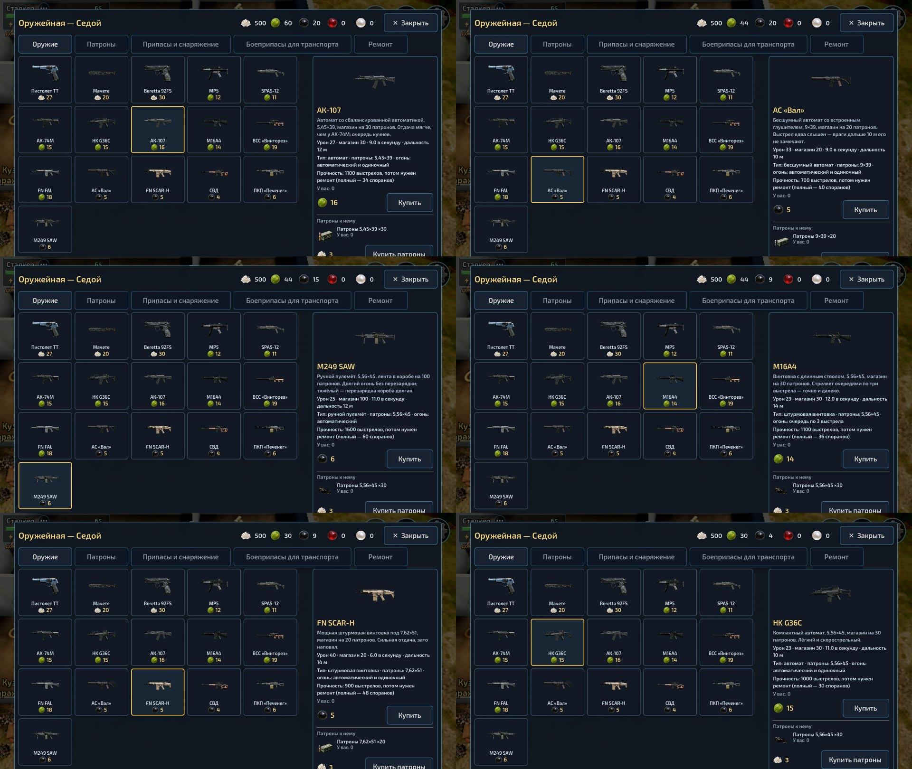
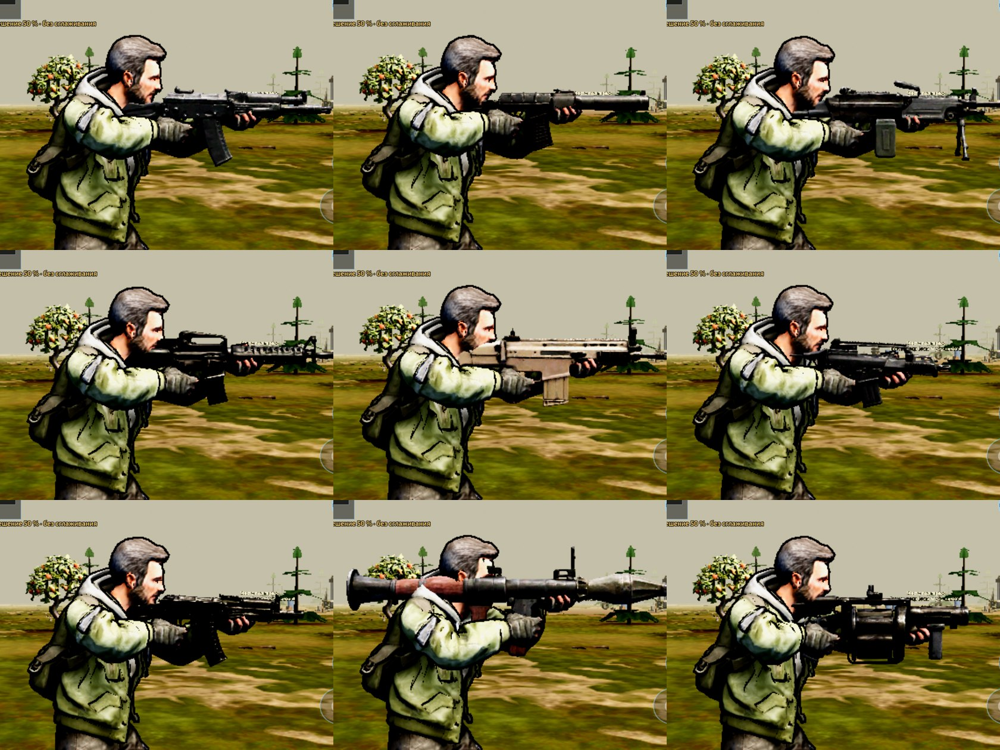

### Модели (`assets/weapons/g_*.glb`, `assets/world/am_*.glb`)

Все девять — модели Tripo **по вырезкам из картинки пользователя** (`tools/tripo/refs/guns26/`, пользователь разрешил
положить вырезки в репозиторий). Первые попытки — по текстовому описанию — пользователь отклонил («это не те оружия,
что на фото, где-то нет магазинов»); в игре их нет. Текстуры ужаты с 4096 до 1024 (`tools/slim_glb.mjs`), по
8,3–9,1 тыс. треугольников, один материал с цветом, нормалями и шероховатостью.

| Предмет | id | Модель | Длина | Патрон | Магазин | Где берётся |
|---|---|---|---|---|---|---|
| АК-107 | `ak107` | `g_ak107.glb` | 0,94 м | 5,45×39 (`a545`) | 30 | оружейник, 16 горошин |
| АС «Вал» | `val` | `g_val.glb` | 0,88 м | 9×39 (`a9x39`) | 20 | оружейник, 5 чёрных жемчужин |
| M249 SAW | `m249` | `g_m249.glb` | 1,04 м | 5,56×45 (`a556`) | 100 (короб) | оружейник, 6 чёрных жемчужин |
| M16A4 | `m16a4` | `g_m16a4.glb` | 1,00 м | 5,56×45 | 30 | оружейник, 14 горошин |
| FN SCAR-H | `scarh` | `g_scarh.glb` | 0,97 м | 7,62×51 (`a762x51`) | 20 | оружейник, 5 чёрных жемчужин |
| HK G36C | `g36c` | `g_g36c.glb` | 0,72 м | 5,56×45 | 30 | оружейник, 15 горошин |
| АК-102 | `ak102` | `g_ak102.glb` | 0,82 м | 5,56×45 | 30 | **резерв Внешников** |
| РПГ-7Д | `rpg7d` | `g_rpg7d.glb` | 1,34 м с гранатой | выстрел ПГ-7В (`pg7v`) | 1 | **резерв Внешников** |
| M32 Bulldog | `m32` | `g_m32.glb` | 0,81 м | гранаты 40×46 (`g40`) | 6 (барабан) | **резерв Внешников** |

Боеприпасы: 5,45×39, 9×39 и 7,62×51 в игре уже были — используются они же, без дублей. Новые: `a556` (5,56×45, в
продаже: 30 штук за 3 спорана), `g40` и `pg7v` (резерв, не продаются); модели — `am_556.glb`, `am_40mm.glb`,
`am_pg7v.glb` (текстуры 512; карта «металличности» Tripo убрана — картонная коробка выходила зеркальной).

Числа (урон, темп, дальность, прочность, цены) — **предложение**, не утверждённый баланс: `core/world/items.gd`,
`data/shop.json`. Цены сверены координатором цен (`--as-test=price`: ошибок 0, цены старых стволов не менялись).

### Как держит и стреляет (`data/weapons.json`, `core/weapon_hold.gd`, `world.gd`)

- Хват — тот же, что у остальных стволов: точки рукояти, цевья, приклада, дула, магазина и затвора сняты с каждой
  модели; руки ставятся обратной кинематикой. Новые поля: `yaw` — модель Tripo вышла боком или наискось (M249 — на
  90°, M16A4 — на 17°): разворот при загрузке; `rot` — наклон ствола; `sound.pitch` — высота звука выстрела;
  `case: false` — гильза не вылетает (гранатомёты).
- Стойки: прицел (огонь), наготове, бег, покой, перезарядка — общие с автоматами; у M32 «наготове» и «покой» ближе
  к груди (короткий и толстый), РПГ-7Д лежит трубой на правом плече, правая рука на рукояти со спуском, левая — под
  трубой.
- Перезарядка: автоматы и винтовки — магазин (вынуть, достать новый, вставить, затвор), M249 — короб с открыванием
  крышки, M32 — по одной гранате в барабан (6 штук), РПГ-7Д — новый вид `rocket`: граната вставляется в ствол
  спереди; после выстрела граната с модели пропадает, пока не перезарядишь.
- M16A4 — очереди по три выстрела с паузой (`burst`, `burst_pause` в описании предмета), удержание — очередь за
  очередью. АС «Вал» — тихий: выстрел слышат только враги ближе 10 м (`quiet`).
- РПГ-7Д и M32 — снаряд летит до первого препятствия и рвётся: урон всем в радиусе (`splash`: 3,5 и 2,5 м), ближе к
  разрыву — больше; у выстрела РПГ — огонёк двигателя и дымный след (те же эффекты, что у ракет турели). Героя
  собственный разрыв не ранит.
- Звуки: записанные выстрелы игры (CC0, `docs/AUDIO.md`) с другой высотой: 5,56 — выше и суше 5,45; SCAR-H — выстрел
  FN FAL; «Вал» — выстрел ВСС; гранатомёты — низкий хлопок, у РПГ поверх — свист. Отдельных записей этих стволов нет.

### Оружейник и резерв

- В продаже шесть: карточка показывает картинку, название, тип, урон, темп, магазин, дальность, патроны, режим огня,
  цену и кнопку «Купить» (`world.gd` — карточка магазина; новая строка «Тип · патроны · огонь» — у предметов с `cls`).
  Список прокручивается. Покупка: проверка валюты, списание один раз, один предмет, сохранение.
- Кооператив: покупка у оружейника подтверждается сервером — операция `buy_item` (`net/server_state.gd`): цена и
  количество берутся из каталога сервера, не от клиента; повтор той же просьбы не списывает второй раз; предмета нет
  в каталоге — отказ. Окна оружейника внутри совместной игры пока нет (кооператив — через экран «МУЛЬТИПЛЕЕР»).
- АК-102, РПГ-7Д, M32 и их боеприпасы есть в базе предметов (пометка `reserve: externals`), но не продаются и не
  выпадают нигде. Для них зарегистрирована таблица `externals_military_chest` (`data/loot_reserve.json`): выключена
  (`enabled: false`), шансы не назначены (`chance: null`), есть поля количества, состояния, боеприпасов рядом,
  категории сундука и уровней опасности. Подключится, когда появится база Внешников.

### Проверка `--as-test=guns` (57 пунктов, без ошибок) и сеть

Модели, материалы и значки всех девяти; ладони на оружии в прицеле, покое и на бегу (отрыв 0,0–3,2 см при пороге 3,5); по каждому
стволу — выстрелы по манекену (расход патронов, износ, урон), разрывы гранат, перезарядка из запаса; очередь M16A4;
тихий «Вал»; смена оружия; покупка всех шести с точным списанием; отказ при нехватке валюты; сохранение и загрузка;
резерв нигде не продаётся и не выпадает (просмотрены все `data/*.json`, оружейник, кейс); таблица Внешников
зарегистрирована и выключена. Быстрая подгонка одного ствола: `--as-guns=m32`.
Сеть (`net/net_test.gd`, настоящий сервер отдельным процессом и клиенты по сети на одной машине): покупка патронов
5,56 через сервер — списано один раз, повтор не списал; резерв сервер не продаёт; при нехватке — отказ.

### Что не проверено

- На телефоне не проверялось: сборки APK с этим оружием ещё не было (делается по команде пользователя).
- Кооператив — на одной машине; на двух телефонах не проверялся.
- Замер кадров/с с новым оружием на телефоне не делался; в игре одновременно загружена одна модель в руках героя.

## 26.11: шаг назад со стрельбой, звуки без синтеза, без мух

Жалоба пользователя: «Звуки мух убрать и звуки нормальные сделать, а не мультяшные, плюс персонаж, когда стреляет и
идёт назад, не ровно идёт, а его бросает из стороны в сторону».

### Шаг назад и боком со стрельбой (`data/anim_clips.json`, `core/animation/anim_set.gd`, `world.gd`)

- Причина: клипы «шаг назад» и «шаг боком» — движения Tripo по описанию, в них вращается корень скелета, а таз едет
  в системе этого вращающегося корня. Обычная обработка «на месте» (`_strip_root`) этого не учитывает — тело уезжало
  вбок от линии хода. Замер до правки: таз на шаге назад ходит вбок на **81 см** (от −45 до +38 см от капсулы).
- Правка: для `walk_back`, `strafe_left`, `strafe_right` включена обработка корня в системе скелета (`bake: inplace`,
  `heading_lock`, `sway`, `sway_k` — она уже была в проекте для таких клипов). После: таз ходит вбок на **4,5 см**,
  вперёд-назад — на 5 см; на шаге боком — 6–8 см.
- Вторая причина рывков: стая идёт на героя — «ближайший» враг меняется каждые полсекунды, прицел прыгал с одного
  на другого. Теперь цель держится (`_keep_target`): пока она жива, в досягаемости и не за стеной, а другой враг не
  ближе её больше чем на 1,2 м (в ближнем бою — на треть досягаемости). Заслонил другой заражённый — цель не меняется.
- Проверка `--as-test=backfire`: назад с одним врагом, назад от стаи из пяти, боком влево и вправо — печатает смены
  цели, суммарный поворот взгляда, резкие качания и ход таза относительно линии героя.

### Звуки (`tools/real_sounds.py`, `docs/AUDIO.md`)

- Жужжание мух убрано совсем (мухи над телами только видны).
- Всё, что раньше считалось программой, заменено настоящими записями CC0 / общественного достояния: голоса
  заражённых (человеческий голос вместо «рыков существ»), чавканье, шаги по бетону, дереву и металлу, дверь, ворота
  гаража, взрыв гранаты и её стук, Desert Eagle главаря, камни Рубера, двигатель УАЗа, дождь, слои «веса» и «хвоста»
  выстрела. Громкость каждого нового файла подогнана под прежний — игру перенастраивать не пришлось.
- Новые стволы: высота тона больше не уводится далеко от записи; РПГ-7Д — настоящая запись выстрела РПГ-7 и гул
  уходящей гранаты.
- На слух не проверялось (в этой среде нет воспроизведения звука): записи подобраны по описаниям наборов и по
  измерениям (длительность, высота тона, огибающая). Проверено, что каждое имя звука в коде находит файл и что в
  проверках `guns` и `backfire` нет ни одного «нет звука».
